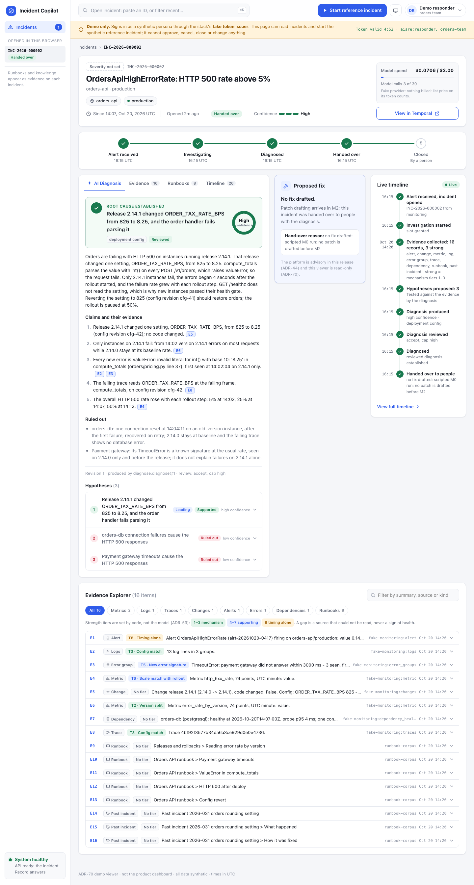

# Demo viewer: UI reference

This is a reference for the read-only demo viewer (ADR-70). It covers what the page shows, where each value comes from, the states each part can be in, and the rules any change has to keep. Running the stack is covered in the root [README](../README.md#demo-viewer).

The viewer is a showcase tool, not the product dashboard. Its job is to let someone who won't use the CLI watch the platform investigate an incident. It shows the incident's status, the evidence the platform collected, the hypotheses it tested, and a diagnosis that cites evidence for every claim.

## Screenshots

These were captured on 2026-11-18 from the reference incident after it reached "Handed over", against the fake model provider, with headless Chrome at 1440 wide. All the data is synthetic.

| | |
| --- | --- |
| Desktop, light | [screenshots/desktop-light-full.png](screenshots/desktop-light-full.png) (1440 wide, full page) |
| Desktop, dark | [screenshots/desktop-dark-full.png](screenshots/desktop-dark-full.png) (1440 wide, full page) |
| Before an incident is opened | [screenshots/idle-light.png](screenshots/idle-light.png) |
| Phone, dark | [screenshots/mobile-dark.jpg](screenshots/mobile-dark.jpg) (375 wide, one screen: top bar, demo banner, incident header and spend; checked with no sideways scroll) |

Headless Chrome won't lay out a page narrower than about 500px, so the 375px layout was checked in a browser emulating a phone: with every tab opened, every row expanded, the navigation drawer open and the search open, `document.documentElement.scrollWidth` stays 375.



## Running it

```bash
cp .env.example .env
```
```bash
docker compose up -d --build --wait && docker compose exec api python -m aisre.api.dev_seed
```

Open http://127.0.0.1:58080 and press **Start reference incident**. In the Claude desktop app, the `demo-viewer` entry in `.claude/launch.json` does the same without creating `.env`.

Once you've started the reference incident, starting it again joins the open one until that incident is closed with the CLI. Against the fake provider the whole investigation takes about 2 seconds, in three bursts: the incident opens, evidence arrives about 1 second later, and the hypotheses, diagnosis and hand-over arrive about 1 second after that.

## Files

| File | What it holds |
| --- | --- |
| `index.html` | The page skeleton: every region below with its element IDs. Icons are `[data-icon]` placeholders |
| `app.js` | Sign-in, API calls, the live stream, the health probe, theme and recent-incident storage, and all rendering. No framework, no build step |
| `icons.js` | The page's icons, static shapes authored in the file and built with `createElementNS`, and the three-segment confidence ring |
| `styles.css` | Colour tokens for light and dark, layout, components, breakpoints |
| `nginx.conf` | Static files (allow-list), the read-only proxy to the API and token issuer, the health probes, and the security headers |
| `reference-alert.json` | The synthetic alert that **Start** posts, a copy of `tests/fixtures/reference-incident/alert.json` |
| `favicon.svg` | Tab icon |

`tests/unit/test_demo_viewer.py` checks the proxy rules (including that `/readyz` and `/livez` are exact GET/HEAD-only locations), the headers, that every `demo/*.js` is on the static allow-list and never writes HTML, and that no page file offers an approve or apply control.

## Page anatomy

```
┌ Sidebar ─────────┐┌ Top bar: [search / open incident ⌘K] [Start reference incident] [theme] [persona chip ▾] ┐
│ logo · name      │├ Demo-only banner (amber) · token validity ─────────────────────────────────────────────┤
│ Incidents (n)    ││ Message line                                                                           │
│  recent list     ││ Breadcrumb: Incidents › INC-…                                                          │
│ "Runbooks and    ││ Header card: severity · ref · title · subtitle · service/env pills · meta row          │
│  knowledge …"    ││              (since · opened … ago · status · confidence)   │ Model spend · Temporal ↗ │
│                  ││ Stepper: Alert received → Investigating → Diagnosed/Inconclusive → Handed over → Closed│
│                  ││ ┌ Main card (tabs) ───────────┐ ┌ Proposed fix ┐ ┌ Live timeline ┐                     │
│                  ││ │ AI Diagnosis | Evidence |   │ │ (soft blue)  │ │ rail of rows  │                     │
│                  ││ │ Runbooks | Timeline         │ │              │ │ View full →   │                     │
│                  ││ └─────────────────────────────┘ └──────────────┘ └───────────────┘                     │
│ ● System healthy ││ Evidence Explorer: count · search · kind chips · tier legend · collapsible rows        │
└──────────────────┘└ Footer: ADR-70 · not the product dashboard · all data synthetic · times in UTC ─────────┘
```

Breakpoints: below 1280px the timeline card moves under the fix card; below 1100px everything is one column (diagnosis, then fix, then timeline); below 1000px the sidebar becomes a drawer behind a menu button; below 720px the search takes its own row, the stepper goes vertical and the persona chip shows only initials; below 420px the Start button shows only its icon.

All times are UTC. A time on a different day from the incident's opening shows its date (the evidence events carry the fixture's replayed source time, `Oct 20 14:20`).

### Sidebar
- **Incidents** (the only real section): a count badge and the incidents opened in this browser, newest first, with display ref and status. Stored in `localStorage` (`icp-demo.recent`, up to 8, wrapped in try/catch; the page works without it). Every incident opened is added and its status kept current. There is no incident-list API, so nothing else is listed.
- A muted note, "Runbooks and knowledge appear as evidence on each incident", stands in for the mockup's Runbooks, Knowledge and Settings items, which don't exist in the demo.
- **System health** (`#health`): polls `GET /readyz` every 15 s through the proxy, with no token.

  | Answer | Shows |
  | --- | --- |
  | 200 `{"status":"ready"}` | green "System healthy · API ready: the Incident Record answers" |
  | 503 problem (`not_ready`) | amber "Not ready" with the problem's detail ("The database is unreachable.") |
  | anything else, or a network failure | red "API unreachable" with the status |

  `/readyz` checks only that the database answers (dependency probes are T4.5's), so the box never claims more than that.

### Top bar
- **Search / open** (`#open-form`): there is no search API. A UUID opens that incident; other text filters the recent list in a dropdown (Enter opens the first match). ⌘K / Ctrl K focuses it, arrows move through results, Escape closes. The URL `#<incident-id>` still opens an incident directly, and opening one writes its ID there.
- **Start reference incident** (`#start`, and `#start-empty` in the empty state): sends `POST /v1/incidents` with `reference-alert.json` and a new idempotency key. If the alert joins an open incident, the page opens that incident and says so.
- **Theme** (`#theme`): cycles system → light → dark. Stored in `localStorage` (`icp-demo.theme`); applied as `data-theme` on `<html>`; system follows `prefers-color-scheme`.
- **Persona chip**: initials, name and team of the demo persona, never a real person. A native `<select id="persona">` covers the chip invisibly, so it is keyboard and screen-reader accessible and its long option labels can't widen the page. Changing it mints a new token and reloads the incident.

  | Persona | Chip | Token groups | What it shows |
  | --- | --- | --- | --- |
  | Demo responder, orders team (default) | DR | `aisre:responder`, `orders-team` | Everything, including runbook text |
  | Demo responder outside the orders team | DO | `aisre:responder` | Runbook and past-incident evidence is restricted: owner and document version, no text |
  | Demo viewer, orders team | DV | `aisre:viewer`, `orders-team` | Can read, but **Start** returns 403 and the page says "This persona may not create incidents (ADR-50). Pick a responder." |

- **Demo-only banner**: always shown, amber, naming the fake token issuer, with the token state (`#token-state`: "Token valid m:ss · groups", green, or a red sign-in error). Tokens last 5 minutes and are renewed 60 seconds before they expire; the live stream restarts quietly when they are.
- **Message line** (`#message`): info, warn or error.

### Empty state (`#empty`)
A centred card explaining the demo, **Start reference incident**, **Open by ID** (focuses the search), and the recent list when there is one.

### Incident header
From `GET /v1/incidents/{id}`.
- **Breadcrumb**: Incidents › display ref.
- **Severity** (`#sev`): `confirmed_severity`, else `proposed_severity` ("Sev 2 · proposed"; sev1–2 red, sev3 amber, sev4 neutral). Neither set: a neutral dashed "Severity not set" (the reference incident has none).
- **Title**: the alert's title. **Subtitle**: `service · environment` (the incident view has no alert summary).
- **Pills**: service (cube icon) and environment (green dot).
- **Meta row**: "Since 14:07, Oct 20, 2026 UTC" (`started_at`, the symptom), "Opened 12m ago" (`created_at`, refreshed every 30 s; full time on hover), the status pill, and confidence.
- **Status pill** (`#inc-status`):

  | Status | Label | Tone |
  | --- | --- | --- |
  | open, investigating | Open, Investigating | accent |
  | diagnosed, handed_over, recovered | Diagnosed, Handed over, Recovered | ok |
  | inconclusive | Inconclusive | warn |
  | not_recovered, cancelled | Not recovered, Cancelled | bad |
  | closed | Closed | none |

  M2 adds testing ("Testing a fix", shown between Diagnosed and Handed over in the stepper's third step); later milestones add awaiting_approval, executing, reconciling and verifying, which already have labels.
- **Confidence**: categorical (ADR-53), never a percentage: a three-step bar, low = 1, medium = 2, high = 3, using `final_confidence` when reviewed (ADR-69). Green when established, amber when inconclusive, "Not yet" before a diagnosis.
- **Model spend** (from `budget`): "$0.0706 / $2.00", a thin bar (width set through CSSOM, which `style-src 'self'` allows), "Model calls 3 of 30" plus any amount reserved, and "Fake provider: nothing billed; list price on its token counts."
- **View in Temporal** (`#temporal`): `http://127.0.0.1:8233/namespaces/default/workflows/incident-<id>` (or `incident-<id>-r<run>` after a re-investigation event), built only from the validated UUID and an integer run; new tab, `rel="noopener noreferrer"`. The Temporal UI resolves it to the latest run. The UI port and namespace are the `.env.example` defaults.

### Stepper (`#stepper`)
Alert received → Investigating → Diagnosed (Inconclusive, amber, on the honesty run) → Handed over → Closed (Cancelled, red). Done steps show a check and the UTC time they were entered, from the `status_changed`, `handed_over`, `closed` and `cancelled` events (Alert received uses `created_at`). The current step has a ring and "In progress" while the stream is live. Unreached steps are grey and numbered; Closed says "By a person".

### Main card: tabs
`role="tablist"`; arrow keys, Home and End move between tabs; the selected tab is kept in memory (the hash stays `#<incident-id>`).

- **AI Diagnosis** (from `GET /v1/incidents/{id}/diagnoses/current`; a 404 means none yet, and the browser console logs it):
  - **Root cause block**: established shows a green check, "Root cause established", the leading hypothesis's statement, category and review tags. Inconclusive shows an amber warning, "Root cause not established" and the `stop_reason`. Before a diagnosis: "No diagnosis yet. It appears once the evidence is in."
  - **Confidence ring**: three arcs filled 1/2/3 for low/medium/high, labelled with the word, never a number.
  - Summary paragraph; **Claims and their evidence** with citation chips (`E5`, `E2 E3`); **Ruled out**; **Missing evidence** (the honesty run's key content); the review line (revision, producer, review note, any cap).
  - **Hypotheses**: one row each with its number, statement, status pill (Supported or Confirmed green, Ruled out red, Open grey), Leading pill, confidence and an expand chevron (`aria-expanded`). Expanded: category, status reason, "Confirmed if", "Refuted if", and evidence chips split into Supports and Contradicts (red). Before the diagnosis, rows come from the hypothesis events and show "Proposed".
- **Evidence (n)**: counts by strength class (mechanism 1–3, supporting 4–7, timing alone, no tier, gaps) with what each means, then one row per record that jumps to it in the explorer.
- **Runbooks (n)**: `runbook` and `past_incident` evidence, collapsible, with heading, label, document and version, and the passage. Restricted ones show a lock, "Restricted runbook", and the owner, no text.
- **Timeline (n)**: every event, oldest first, with UTC date and time, readable name (`EVENT_LABEL`, all 43 types; M2 adds "Fix test started" and "Draft pull request opened"), sequence, detail and actor. Rows that arrive after the incident was opened get a 1.5 s highlight; history replayed on open does not flash.

### Proposed fix card (soft blue)
The platform is advisory in this release (ADR-44) and the viewer is read-only (ADR-70), so there is no approve or apply control, enabled or disabled. From M2 the card reads `GET /v1/incidents/{id}/actions`, every fix the incident has, open or ended: a Release A fix ends `withdrawn` once it is handed over, so it is no longer in `open_action_ids`. The list is read again when the incident's status or version moves or an `aisre.action.*` event arrives. For each fix it shows kind, status, description (the patch summary), target, revisions, expected effect, risk, undo plan, the latest sandbox test (outcome, whether the failure reproduced first, and the isolation label: `development-runc` says it proves the flow, never isolation, ADR-71), the draft pull request's reference as text (never a link), the `+added −removed` counts, and the patch itself as red and green lines, read from `GET /v1/artifacts/{diff_artifact_id}/content` (the canonical diff, `Patch.canonical()`'s hunks, rendered as text). Then the hand-over reason and "The fix is a recommendation, applied by people" with the ADR-44/70 note. On the M3 approval path (an approval-path status, a decision, or a rollback action) the Undo line is instead the fix's rollback action and its status, applied by the dispatcher through the FAKE release process, and the note says the change ran against the synthetic target under ADR-73's stand-ins; the Release A wording stays for Release A fixes only. With no fix (the scripted run, the honesty run, `no_allowed_fix`): "No fix drafted.", the hand-over reason from the timeline, and the same note.

From M3 (the approval path, ADR-73) the card also shows, still read-only: each decision from `GET /v1/actions/{id}/approvals` (decision, who, when in UTC, the signing key ID, and a "development key, not a real signature" tag for a `development-` key; a conditional rollback approval says so); the execution from the timeline (intent with its attempt and key, the outcome, a refusal, an outcome resolution); the verification (verdict over the hold, read from monitoring), each post-change watch flag ("nothing rolled back; a person judges") and the watch's end; and a rollback action as its own card, "Rollback of" its fix. The note then says the change was approved through the API with a development key and applied by the dispatcher to the fake release process. The list is read again on `aisre.approval.*`, `aisre.execution.*` and `aisre.verification.*` events too. There is no approve, reject, apply or rollback control: approving happens through the API or CLI, and the proxy refuses those routes anyway.

### Live timeline card
A condensed rail built from the same events: incident opened, status changes (with reason), consecutive evidence events grouped as "Evidence collected: 16 records, 3 strong" (strong = mechanism tiers 1–3) with the kinds, gaps and flagged evidence as amber rows, hypotheses grouped, diagnosis produced or inconclusive, reviewed, handed over, other alerts joining. Done rows have a green check; while the run is live the newest row has a blue ring and a grey "Not yet" row shows the next step. The **Live** pill (`#live`) has four states: `live` (green, pulsing), `reconnecting` (amber), `error` (red), and idle/ended (grey). **View full timeline →** opens the Timeline tab.

### Evidence Explorer
From `GET /v1/incidents/{id}/evidence`, following every page, reloaded after each evidence event.
- Title with "(16 items)" (and gaps), a text filter (summary, source, tool, kind, label), and kind chips with counts, only for kinds present: All, Metrics, Logs, Traces, Changes, Alerts, Errors, Dependencies, Runbooks (runbook and past incident), Gaps.
- A tier legend.
- **Each row** (`<details>`, collapsed): label (`E1`…, collection order, the same labels the citation chips use), kind tag with icon, tier tag, a one-line headline (the summary's first line), flags, source, collected time, chevron. Expanded: the full summary in monospace, then source and tool, window, collected time, document and version, and flag explanations.
- **Tier tags** (ADR-53, set by code, not the model):

  | Tier | Name | Class |
  | --- | --- | --- |
  | 1 | Reproduction | mechanism (green) |
  | 2 | Version split | mechanism |
  | 3 | Config match | mechanism |
  | 4 | Code match | supporting (accent) |
  | 5 | New error signature | supporting |
  | 6 | Scale match with rollout | supporting |
  | 7 | Rollback clears it | supporting |
  | 8 | Timing alone | weak (amber) |
  | none | No tier | neutral |

- **Special rows**: **Gap** (dashed tag, amber hatching, "Not collected: fake-monitoring changes: HTTP 404"; a gap is never a sign of health), **Partial**, **Instruction-like text flagged**, **Content removed**, **Restricted** (lock, owner and version, no text).
- A citation chip anywhere clears a filter that would hide its target, opens the row, scrolls it to the centre, focuses it and highlights it.

## Data the page reads

| Endpoint | Feeds |
| --- | --- |
| `POST /token` (fake issuer, through the proxy) | Sign-in |
| `POST /v1/incidents` | Start |
| `GET /readyz` (no token) | System health box |
| `GET /v1/incidents/{id}` | Header, severity, status, stepper, spend, open actions |
| `GET /v1/incidents/{id}/timeline/stream` | Timeline tab, live timeline, stepper times, hand-over reason, and when to reload the rest |
| `GET /v1/incidents/{id}/evidence` | Explorer, Evidence and Runbooks tabs, citation labels |
| `GET /v1/incidents/{id}/diagnoses/current` | Diagnosis, confidence, hypotheses after diagnosis |
| `GET /v1/incidents/{id}/actions` | Proposed fix: every action, open or ended (M2) |
| `GET /v1/artifacts/{id}/content` | The fix's patch as red and green lines (M2; `patch_diff` artifacts only, ADR-50's read permission) |
| `GET /v1/actions/{id}/approvals` | M3: each decision with who, when and the signing key ID (development keys labelled, ADR-73) |

The proxy also passes `GET /livez`, unused by the page.

## Scenarios to design for

| Scenario | What changes |
| --- | --- |
| Reference (default) | 16 evidence records, 3 hypotheses (1 supported, 2 ruled out), established high-confidence diagnosis with 5 cited claims, reviewed; from M2, with the Test Runner running on the host, a config revert drafted, its sandbox test passed under `development-runc`, a draft pull request, handed over, the fix `withdrawn`, its diff in red and green. Without the Test Runner the test waits (900 s) and the incident stays `testing` |
| `not_reproduced` (M2) | The fake review system on its `tolerant` branch (root README): the fix is drafted, the sandbox test says the failure did not reproduce, no pull request, the fix `test_failed`, handed over saying so |
| Honesty (change history missing) | The change source is a **gap**, the stepper shows **Inconclusive**, the root cause block is amber "not established" with the stop reason, all hypotheses stay open, a missing-evidence list, not reviewed. It needs a worker restart, described in the root README |
| Before anything is opened | The empty-state card and the recent list (`idle-light.png`) |
| While running | Sections fill in as events arrive; spend grows; the live pill pulses; the stepper and rail show the current step |
| Restricted reader | Runbook and past-incident rows and the Runbooks tab show the restricted notice |
| Viewer persona | **Start** is refused with a 403 message |
| Errors | API down or token failure: an error message, live pill `error` or `reconnecting` with backoff, health box red |

## Rules a change must keep

These come from ADR-70, the threat model (Artifact 5) and `tests/unit/test_demo_viewer.py`:

1. **Read-only.** The only writes are starting the reference incident and minting a token. No approve, apply, cancel, close or retry controls, even disabled ones. The proxy refuses them anyway (405).
2. **Untrusted text stays text.** Evidence, model output and event data are attacker-influenced. Render them with `textContent` or `createElement` only, never `innerHTML`, `outerHTML`, `insertAdjacentHTML`, `eval`, `new Function` or `document.write` (tested in every `demo/*.js`). Never turn a value from the API into a link; the Temporal link is built from the validated UUID only.
3. **Content-Security-Policy is `default-src 'self'`.** Scripts, styles, fonts and images must be served from `demo/` and listed in `nginx.conf`'s allow-list. Inline `<style>`, inline `<script>` and `style=""` attributes are blocked; setting a width through CSSOM (`el.style.setProperty`) is not.
4. **No build step**, unless ADR-70 is amended.
5. **Same sign-in and permissions as any caller.** The page never bypasses the API's checks, and the demo-only banner stays.
6. **Never show invented data.** No percentages for categorical confidence, no default severity, no subtitle text the API didn't return, no actions the platform refuses.
7. **Light and dark**, both deliberate, driven by `prefers-color-scheme` unless the theme button chose one.
8. **Reduced motion.** Highlights, the live pulse, transitions and smooth scrolling turn off under `prefers-reduced-motion`.
9. **No horizontal scroll at 375px.**

## Design tokens

| Token | Light | Dark | Used for |
| --- | --- | --- | --- |
| `--bg` | `#f5f6f9` | `#0c0f15` | Page |
| `--surface` / `--surface-2` / `--surface-3` | `#ffffff` / `#f8f9fb` / `#f1f3f7` | `#141821` / `#181d27` / `#1e2430` | Cards / insets / tracks and code |
| `--border` / `--border-strong` | `#e4e7ee` / `#d3d8e2` | `#262d3b` / `#343d4f` | Card and input borders |
| `--text` / `--muted` / `--faint` | `#161a23` / `#5f6676` / `#8a91a1` | `#e7eaf1` / `#9ca4b6` / `#6f788b` | Body / secondary / tertiary |
| `--accent` / `--accent-soft` / `--accent-tint` | `#2f5bea` / `#eaf0ff` / `#f3f6ff` | `#7c9cff` / `#1d2747` / `#151c31` | Buttons, tabs, citations, current step; fix card background |
| `--ok` / `--ok-soft` | `#18794e` / `#e4f5ec` | `#5fd39a` / `#12301f` | Established, supported, done steps, mechanism tiers |
| `--warn` / `--warn-soft` | `#9a5b00` / `#fff3db` | `#f0b75a` / `#36280e` | Inconclusive, weak tier, banner, gaps |
| `--bad` / `--bad-soft` | `#c0293b` / `#fde8eb` | `#ff8a99` / `#3b1820` | Ruled out, contradicts, errors |
| `--gap` | `#8a6d1d` | `#e3c26b` | Gap rows |
| `--highlight` | `#fff4b3` | `#4a4013` | Citation jump, fresh timeline rows |
| `--radius` / `--radius-sm` | 12px / 8px | | Cards / insets |
| Type | `Inter` if installed, else the system UI stack, 14px/1.5; `ui-monospace` for evidence, IDs and times | | |

Dark tokens are written twice in `styles.css` (under `prefers-color-scheme: dark` for `:root:not([data-theme="light"])`, and for `:root[data-theme="dark"]`); change both.

## Mockup vs what the demo shows

| Mockup element | In the demo |
| --- | --- |
| Sidebar: Incidents with count | Incidents opened in this browser (`localStorage`), with count |
| Sidebar: Runbooks, Knowledge, Settings | Not shown; one muted note says runbooks and knowledge appear as evidence |
| "System Healthy / All systems operational" | Real `GET /readyz`: green "System healthy · API ready: the Incident Record answers", amber or red with the reason |
| Search incidents, services or events ⌘K | Open box: a UUID opens an incident, other text filters the recent list (no search API) |
| User chip with a name | The demo persona (DR / DO / DV) over a native persona picker; never a real name |
| Theme toggle | System / light / dark, stored per browser |
| (no banner) | The amber demo-only banner with the fake issuer and token validity stays |
| "▲ High" severity | `confirmed_severity` or `proposed_severity`; otherwise "Severity not set" |
| Subtitle "Error rate increased to 8.25%" | `service · environment` only; the API has no alert summary for the incident |
| "Since 14:20, Nov 20" · "12m ago" · "Investigating" | `started_at` in UTC · age from `created_at` (30 s refresh) · real status pill |
| Confidence bar / "92%" ring | Categorical three-step bar and ring (low, medium, high; ADR-53, `final_confidence` per ADR-69); "Not yet" before a diagnosis; amber when inconclusive |
| Model Spend $0.0706 / $2.00 | Real budget, plus model calls and the fake-provider note |
| View in Temporal ↗ | Link to the incident's workflow in the local Temporal UI, from the validated UUID |
| 3-step stepper | 5 steps: Alert received → Investigating → Diagnosed/Inconclusive → Handed over → Closed/Cancelled, with real times |
| Tabs: AI Diagnosis, Evidence (7), Runbooks (2), Timeline | Same tabs with real counts; Evidence is a strength overview, Runbooks the retrieved passages, Timeline every event |
| Root cause with green check | Leading hypothesis when established; amber "Root cause not established" with the stop reason otherwise |
| Hypotheses with status pills | Supported / Ruled out / Open (+ Leading), "Proposed" before the diagnosis; expand shows tests and evidence chips |
| Proposed Fix with diff | Read-only actions from `GET /v1/incidents/{id}/actions`, with the patch as a red and green diff from `GET /v1/artifacts/{id}/content`, the sandbox test and its isolation label, and the draft pull request's reference; "No fix drafted" with the hand-over reason when there is none |
| Approve & Apply Fix, View Details | Not shown: advisory release (ADR-44), read-only viewer (ADR-70); approval is in the CLI (ADR-49) |
| "Will be verified automatically" | Not shown (no verification before M3) |
| Live Timeline with ● Live | Condensed rail from the real stream; the pill reflects live / reconnecting / error / ended |
| Evidence Explorer (7 items), search, chips | Real count, text filter, chips only for kinds present, collapsed rows with tier tags; E-labels match citations |
