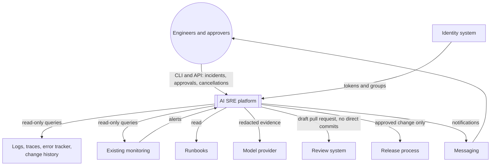
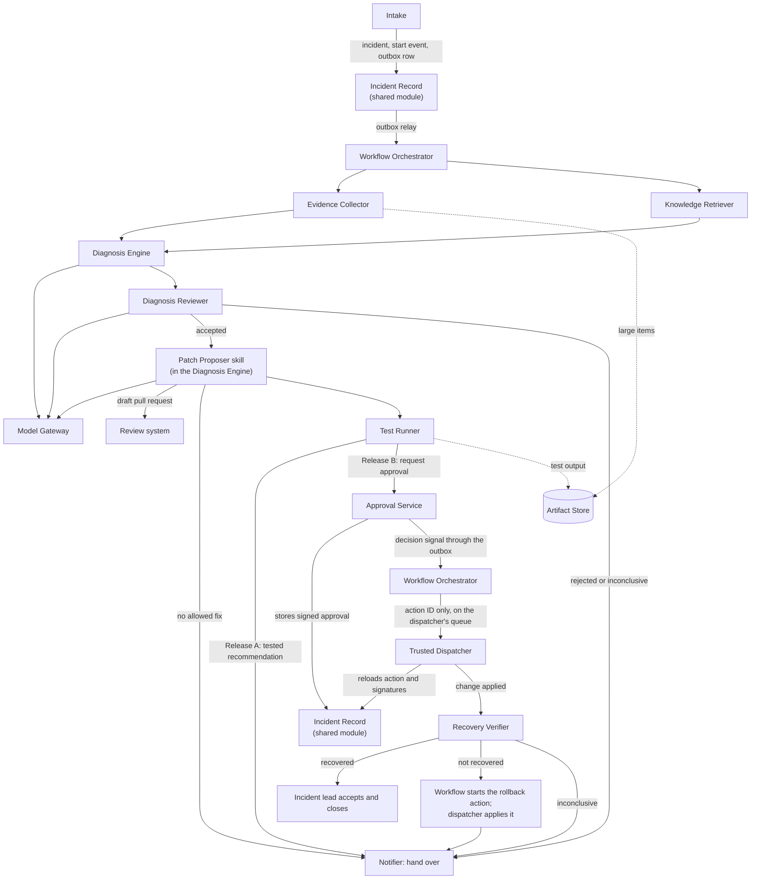
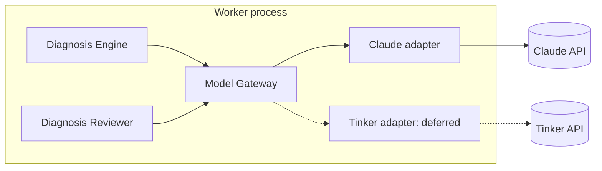
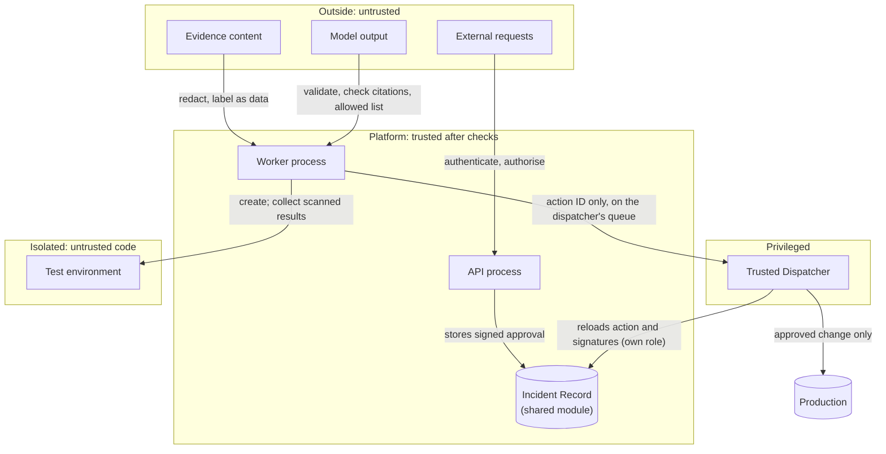
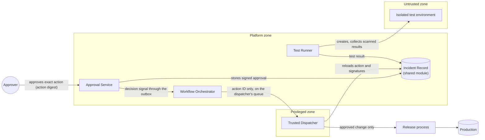

# Artifact 6: System Architecture Document

- **Layer:** 6, System Architecture
- **Built from:** [Artifact 4: Requirements Specification](../layer-04-requirements/artifact-04-requirements-specification.md), [Artifact 5: Threat Model](../layer-05-threat-modeling/artifact-05-threat-model.md)
- **Status:** Proposed: gaps resolved and reference code aligned 2026-11-02 per [decisions.md](../../decisions.md); pending team sign-off
- **Sources:** [decisions.md](../../decisions.md), [conversation.md](conversation.md), the team's written Artifact 6 sections and their screenshots in [assets/](assets/), [system-design.md](../../reference/system-design.md), [technical-specification.md](../../reference/technical-specification.md), and for the conflicts recorded below the conversations of [Layer 7](../layer-07-data-apis-events/conversation.md), [Layer 8](../layer-08-workflows-state-machines/conversation.md), [Layer 9](../layer-09-agent-architecture/conversation.md) and [Layer 11](../layer-11-safe-remediation/conversation.md)

## Required sections

| Required section | Questions this section answers | Done |
| --- | --- | --- |
| 6.1 Context diagram | Q6.34 | Yes |
| 6.2 Container/process diagram | Q6.1–Q6.4, Q6.7, Q6.8, Q6.35, Q6.38 | Yes |
| 6.3 Component diagram | Q6.9–Q6.22, Q6.36 | Yes |
| 6.4 Technology selection | Q6.23–Q6.33 | Yes |
| 6.5 Architecture Decision Records | Q6.5–Q6.8, Q6.23–Q6.33 | Yes |
| 6.6 Component ownership | Q6.9–Q6.22 | Yes |
| 6.7 Trust boundaries | Q6.37, Q6.39 | Yes |
| 6.8 Alternatives and trade-offs | Q6.5–Q6.7, Q6.26, Q6.27, Q6.29, Q6.30, Q6.33 | Yes |

## 6.1 Context diagram

*Answers Q6.34.*

Earlier version: [the team's original screenshot](assets/image4.png).

| Outside the platform | What crosses the boundary |
| --- | --- |
| Engineers and approvers | CLI and API: incidents, approvals, cancellations |
| Logs, traces, error tracker, change history | Read-only queries |
| Existing monitoring | Alerts in; read-only queries out |
| Runbooks | Read |
| Model provider | Redacted evidence |
| Identity system | Tokens and groups (ADR-51) |
| Review system | Draft pull request for the proposed change; no direct commits (ADR-51) |
| Release process | Approved change only, from the dispatcher, in Release B (ADR-44) |
| Messaging | Notifications, which reach engineers and approvers |

This is the first of three levels of diagram, each zooming in on the previous one ([Q6.34](conversation.md)):

1. **Context (6.1):** the platform as one box, with the people and outside systems around it.
2. **Containers and processes (6.2):** the processes and stores, and how they talk.
3. **Components (6.3):** the modules inside the processes.

Two focused views go with them: **trust boundaries (6.7)**, and **the approval path** (Q6.37, also in 6.7).

## 6.2 Container/process diagram

*Answers Q6.1–Q6.4, Q6.7, Q6.8, Q6.35, Q6.38.*

```mermaid
flowchart TB
    subgraph apiProc["API process (FastAPI)"]
        intake["Intake"]
        approval["Approval Service"]
        recordApi["Incident Record<br/>(shared module)"]
    end

    subgraph workerProc["Worker process (Temporal worker)"]
        relay["Outbox relay"]
        orchestrator["Workflow Orchestrator"]
        collector["Evidence Collector"]
        retriever["Knowledge Retriever"]
        engine["Diagnosis Engine"]
        reviewer["Diagnosis Reviewer"]
        proposer["Patch Proposer skill<br/>(in the Diagnosis Engine,<br/>runs after review accepts)"]
        gateway["Model Gateway"]
        testRunner["Test Runner"]
        verifier["Recovery Verifier"]
        notifier["Notifier"]
        recordWorker["Incident Record<br/>(shared module)"]
    end

    subgraph dispatcherProc["Dispatcher process"]
        dispatcher["Trusted Dispatcher"]
        recordDispatcher["Incident Record<br/>(shared module)"]
    end

    temporal["Temporal server<br/>(self-hosted single node)"]

    subgraph pgInstance["PostgreSQL instance"]
        incidentsDb[("Incidents database")]
        temporalDb[("Temporal database")]
    end

    isolated["Isolated test environment:<br/>gVisor, separate host, no network"]
    artifacts[("Artifact store")]
    telemetry["Telemetry: OpenTelemetry,<br/>Prometheus, Grafana"]
    reviewSystem["Review system"]
    release["Release process"]

    intake -->|"incident and start event"| recordApi
    approval -->|"decision, signed approval"| recordApi
    recordApi -->|"writes record and outbox row (one transaction)"| incidentsDb

    relay -->|"claims pending outbox rows"| incidentsDb
    relay -->|"starts and signals workflows (at least once)"| temporal
    temporal -->|"stores its own state"| temporalDb
    temporal -->|"tasks: aisre-investigation queue"| orchestrator
    orchestrator -->|"schedules dispatch: action ID only"| temporal
    temporal -->|"action ID only: aisre-dispatcher queue"| dispatcher

    orchestrator --> collector
    orchestrator --> retriever
    orchestrator --> engine
    orchestrator --> reviewer
    orchestrator --> proposer
    orchestrator --> testRunner
    orchestrator --> verifier
    orchestrator --> notifier
    engine --> gateway
    reviewer --> gateway
    proposer --> gateway
    proposer -->|"draft pull request"| reviewSystem
    recordWorker -->|"reads and writes incidents"| incidentsDb

    testRunner -->|"creates; collects scanned results"| isolated
    testRunner -->|"test output"| artifacts
    collector -->|"large items"| artifacts

    dispatcher -->|"reloads action and signatures; records attempts"| recordDispatcher
    recordDispatcher -->|"own role: reads actions, patches, approvals, verifications;<br/>writes execution_attempts, action status for applying and its outcomes, own timeline events"| incidentsDb
    dispatcher -->|"approved change"| release

    apiProc -.-> telemetry
    workerProc -.-> telemetry
    dispatcherProc -.-> telemetry
```

Earlier version: [the team's original screenshot](assets/image6.png).

One codebase, four processes: API, worker, dispatcher and isolated test environment (ADR-51). The workflow server and the stores are supporting services, not platform processes.

**Process split** ([Q6.3](conversation.md)): by what each part needs to be trusted with, and how it must behave at runtime.

| Responsibility | Where it runs | Why it's separate |
| --- | --- | --- |
| Receive requests, record decisions | **API process** | Must answer fast, stay up, and hold no production or model credentials |
| Collect evidence, call models, plan and review, draft patches, verify, relay the outbox | **Worker process** | Long-running, retried, and scaled separately from the API |
| Run generated code | **Isolated test environment** | Untrusted code; no route to production (Artifact 5) |
| Apply approved changes | **Trusted dispatcher process** | The only holder of production write access, which Release A doesn't provision (Artifact 5, ADR-44) |

**What runs inside the request** ([Q6.1](conversation.md), [Q6.2](conversation.md)): the work splits at the point where the platform has safely recorded the incident. The caller follows progress through status, timeline or notifications, and never waits on the original request.

| Synchronous (inside the request) | Asynchronous (after the request) |
| --- | --- |
| Authenticate and authorise the caller | Notify people |
| Validate mandatory fields | Collect evidence |
| Deduplicate against open incidents | Retrieve runbooks |
| Store the incident, its start event and an outbox row, in one transaction (ADR-19) | Generate and test patches |
| Return the incident ID | Generate and test patches |
| Read requests: status, timeline | Wait for approval; execute; verify recovery |
| Recording an approval or a cancellation, with its outbox row | Act on the approval or cancellation |

**Rule:** anything that calls an outside system or might take more than a fraction of a second runs asynchronously.

**The worker** ([Q6.4](conversation.md)) picks up work in severity order up to the concurrency limit, runs each step, saves progress after each step and resumes after a crash, enforces per-incident limits (time, model calls, tokens and spend), retries within bounds and hands over at limits, honours cancellation, and writes every step to the timeline. It also relays outbox messages to the workflow engine. It doesn't hold production write access, and doesn't run generated code itself. Its only write credential outside the platform is for draft pull requests (ADR-51).

**Deployment** ([Q6.7](conversation.md), [Q6.8](conversation.md)): a modular monolith, deployed as four processes (ADR-51).

- One codebase, one incidents database, one deployment pipeline. The workflow engine has its own database on the same PostgreSQL instance (ADR-51).
- Several entry points (API, worker, dispatcher), each starting only the modules it needs, from one build artifact started with a different command for each role.
- Configuration per role: each process gets only the credentials and settings its role needs. The API gets no production credentials; only the dispatcher gets production write access.
- Shared domain logic and database schema, with one set of schema changes applied before any process starts. Deployed together, so versions always match.
- Reference environment: the reference application and platform run on one Linux host under Docker Compose, and the test environment runs on a separate host. No Kubernetes in the first version (ADR-51).

**Reading the arrows** ([Q6.35](conversation.md)):

- **the API** writes the record and an outbox row to PostgreSQL in one transaction; it never calls Temporal (ADR-19)
- **the outbox relay**, in the worker, claims pending rows and starts or signals workflows in Temporal, at least once
- **Temporal** stores its own state in its own database on the same PostgreSQL instance (ADR-51)
- **the worker** receives tasks from Temporal, and reads and writes incidents in PostgreSQL
- **the dispatcher** receives only an action ID on its own task queue, reloads the action and signatures from trusted storage, and uses its own database role (ADR-51)

**Modules and processes** ([Q6.38](conversation.md)): processes are solid outer boxes, labelled with the process name and how it's deployed. Modules are smaller boxes inside the process that runs them. A module shared by several processes (the Incident Record) is shown in each, marked "shared module". The component summary in 6.3 lists which process runs each module, and what it holds.

**A module boundary is a code boundary; a process boundary is a runtime and trust boundary.**

## 6.3 Component diagram

*Answers Q6.9–Q6.22, Q6.36.*

The investigation as it flows through the components:

Earlier version: [the team's original screenshot](assets/image8.png).

**Component summary** ([Q6.22](conversation.md)):

| # | Component | Process | Holds |
| --- | --- | --- | --- |
| 1 | Intake | API | — |
| 2 | Incident Record (with audit chain) | API, worker and dispatcher (shared module) | Database access; the dispatcher through its own role |
| 3 | Workflow Orchestrator (with the outbox relay) | Worker | — |
| 4 | Evidence Collector | Worker | Read-only tool credentials |
| 5 | Knowledge Retriever | Worker | — |
| 6 | Model Gateway | Worker | Model provider key |
| 7 | Diagnosis Engine (with the Patch Proposer skill) | Worker | Draft-pull-request credential |
| 8 | Diagnosis Reviewer | Worker | — |
| 9 | Test Runner | Worker (controller) + isolated environment | Rights to create test environments only |
| 10 | Approval Service | API | Approval signing key |
| 11 | Trusted Dispatcher | Dispatcher | Production write access (release process); own database role: read actions, patches, approvals and verification results; write `execution_attempts`, action status for `applying` and its outcomes, and its own timeline events |
| 12 | Recovery Verifier | Worker | Read-only monitoring credentials |
| 13 | Artifact Store | Storage | — |
| 14 | Platform Telemetry | Observability stack | — |
| 15 | Notifier | Worker | Messaging credentials |

**What each component is responsible for:**

| Question | Component | Responsibility |
| --- | --- | --- |
| Q6.9 | Intake | Authenticates the source, validates the fields, checks the service exists and the caller may use it, deduplicates, hands the incident to the Incident Record |
| Q6.10 | Incident Record | Owns the incident, its status, the timeline and the audit chain; every other component reads and writes incidents only through it |
| Q6.11 | Workflow Orchestrator | Defines the steps, records each step's result, resumes after crashes, runs timers (approval expiry, investigation limits), handles cancellation, sends the dispatcher only an action ID; its outbox relay turns stored messages into workflow starts and signals |
| Q6.12 | Model Gateway | The only component that calls a model; enforces limits before each call, applies timeouts and the only model retries (ADR-27), records cost and tokens, scans output for secrets, hides provider differences |
| Q6.13 | Knowledge Retriever | Indexes runbooks and past incident reviews, returns the most relevant passages, labels them with their source |
| Q6.14 | Evidence Collector | One read-only adapter per tool; queries in parallel within the incident's scope, redacts, normalises into evidence records, records gaps |
| Q6.15 | Diagnosis Engine | Computes facts in code, asks the model (through the gateway) for ranked hypotheses that cite evidence, produces a diagnosis or an inconclusive result. After review accepts the diagnosis, its Patch Proposer skill drafts the patch for the leading hypothesis as a draft pull request (ADR-51) |
| Q6.16 | Diagnosis Reviewer | Separate from the Engine; calls the model through the gateway; checks citations exist and support the claim, checks the action is on the allowed list and within the incident's service, scores confidence from evidence strength, confirms alternatives were considered. Can reject or downgrade; never approves a production change |
| Q6.17 | Test Runner | Creates the isolated environment, with no network (ADR-60), reproduces the failure, applies the patch, runs the checks, collects the scanned results, destroys the environment; no production credentials |
| Q6.18 | Approval Service | Sends approval requests, checks the approver's rights and recent sign-in, records decisions, signs approvals and stores them, handles escalation and expiry. Has no path to the dispatcher (ADR-51) |
| Q6.19 | Trusted Dispatcher | Takes only an action ID, reloads the action and approvals from trusted storage, verifies the signatures against the action digest, checks expiry, re-checks the service state, applies the change once through the release process, records the attempt; the only component with production write access (ADR-49, ADR-51) |
| Q6.20 | Recovery Verifier | Reads monitoring directly, using criteria recorded before execution; requires recovery to hold for the set period; returns its verdict to the workflow. It writes nothing to production and has no dispatcher path. On a failed verdict the workflow starts the rollback action; on an inconclusive one it hands over (ADR-48, ADR-66) |
| Q6.21 | Artifact Store | Large items: raw evidence snapshots, patch diffs, test output, model inputs and outputs. The record keeps a reference and a fingerprint; items are write-once, encrypted, access-controlled, and deleted when retention ends |
| Q6.22 | Platform Telemetry | Receives metrics, traces and structured logs from every process; exposes health and availability, queue length and wait time, step durations, model cost, tokens and errors, evidence source errors, limit breaches; raises alerts on the platform's own targets. Separate from customers' monitoring, which the platform only reads |

**Model Gateway and providers** ([Q6.36](conversation.md)): the Diagnosis Engine and the Reviewer call the gateway through one internal interface, and the gateway calls one adapter per provider. The active adapter is solid; the deferred one is dashed. The provider boxes sit outside the platform's boundary.

Earlier version: [the team's original screenshot](assets/image3.png).

## 6.4 Technology selection

*Answers Q6.23–Q6.33.*

| **Component** | **Technology** |
| --- | --- |
| Intake, Approval Service | FastAPI, Pydantic |
| Incident Record | PostgreSQL, SQLAlchemy, Alembic |
| Workflow Orchestrator | Temporal (self-hosted single node, own database on the PostgreSQL instance) (ADR-51) |
| Model Gateway | Internal adapters; Claude initially |
| Knowledge Retriever | BM25 in the worker, over a corpus stored in PostgreSQL (ADR-62) |
| Test Runner | Containers under gVisor, on a separate host |
| Artifact Store | Object storage (S3-compatible), with write-once retention; MinIO locally |
| Platform Telemetry | OpenTelemetry, Prometheus, Grafana |
| Development, reference environment | Docker Compose, uv |
| Language | Python |

**Candidate stack decisions** ([Q6.33](conversation.md)):

| Responsibility | Candidate | Team decision | ADR |
| --- | --- | --- | --- |
| Backend API | FastAPI | **Accept** | ADR-01 |
| Validation | Pydantic | **Accept** | ADR-02 |
| Database | PostgreSQL | **Accept** | ADR-03 |
| ORM | SQLAlchemy | **Accept**, explicit queries only | ADR-04 |
| Migrations | Alembic | **Accept** | ADR-05 |
| Workflow engine | Temporal | **Accept**, single node on PostgreSQL | ADR-06 |
| Model providers | Claude and Tinker | **Replace:** Claude only; Tinker deferred | ADR-07 |
| Retrieval | BM25 | **Accept**, using PostgreSQL full-text search | ADR-09 |
| Execution | Restricted sandbox | **Replace:** per-test container under gVisor on a separate host | ADR-10 |
| Metrics | Prometheus | **Accept** | ADR-11 |
| Dashboard | Grafana | **Accept**, for platform health only | ADR-12 |
| Tracing | OpenTelemetry | **Accept** | ADR-13 |
| Development environment | Docker Compose | **Accept** | ADR-14 |
| Dependency management | uv | **Accept** | ADR-15 |

ADRs amended by the [decision register](../../decisions.md): ADR-06 by ADR-51 (self-hosted, in its own database on the same PostgreSQL instance); ADR-09 by ADR-62 (PostgreSQL stores the corpus, the worker ranks it).

The reasoning for each choice is in [Q6.23–Q6.33](conversation.md).

## 6.5 Architecture Decision Records

*Answers Q6.5–Q6.8, Q6.23–Q6.33.*

Each record follows the decision log format from Artifact 2. Status is **Accepted** unless stated. Owners are roles.

| **ID** | **Decision** | **Rationale** | **Alternatives rejected** | **Owner** | **Revisit when** | **Reversal cost** |
| --- | --- | --- | --- | --- | --- | --- |
| ADR-01 | FastAPI for the API | Typed requests, automatic validation and API description, async | Django (too much), Flask (manual validation) | Platform owner | Intake latency target missed | Medium |
| ADR-02 | Pydantic for all validation, including model output | One definition serves the API and output checks | Hand-written checks | Platform owner | — | Medium |
| ADR-03 | PostgreSQL for incidents and workflow state | Transactions, row locks, point-in-time recovery, one database to run | Document database (weaker transactions) | Platform owner | Load exceeds a single instance | High |
| ADR-04 | SQLAlchemy, with explicit queries only | Familiar, testable; avoids hidden lazy loading | Raw SQL everywhere (no typed models) | Platform owner | — | Medium |
| ADR-05 | Alembic migrations, expand-then-contract | Reviewed, repeatable schema changes; safe deployments | Manual changes | Platform owner | — | Low |
| ADR-06 | Temporal, single node on PostgreSQL | Crash recovery, timers, cancellation, retries and history built in | PostgreSQL job queue (fallback), Celery (no durable timers) | Platform owner | Too heavy to run; or the burst test fails | Medium, behind the orchestrator interface |
| ADR-07 | Claude only initially; **Tinker deferred** (Status: **Replaced**) | No custom model in the first version; Tinker is for fine-tuning; its serving is in beta | Two providers from the start | SRE lead | Accuracy, cost or data-residency conditions in Q6.27 | Low, behind the gateway |
| ADR-08 | Thin internal model gateway with provider adapters | Full control of limits, validation, logging and cost | Third-party abstraction library | Platform owner | Many providers needed | Low |
| ADR-09 | BM25 through PostgreSQL full-text search | Exact terms shared by alerts and runbooks; no extra system | Vector database | SRE lead | Retrieval misses measured | Low |
| ADR-10 | Per-test container under gVisor, on a separate host (Status: **Replaced** "restricted sandbox" with this specific choice) | Strong isolation without running virtual machines | Plain containers (weaker); Firecracker (more to run) | Security lead | Escape test fails; stronger guarantee needed | Medium |
| ADR-11 | Prometheus for metrics and alerts | Standard; percentile queries; alerting | Hosted metrics service | Platform owner | Organisation standard differs | Low |
| ADR-12 | Grafana for platform-health dashboards only | Standard; works with Prometheus and traces | Building our own | Platform owner | — | Low |
| ADR-13 | OpenTelemetry for instrumentation | Vendor-neutral; traces carry the incident ID | Vendor-specific agents | Platform owner | — | Low |
| ADR-14 | Docker Compose for local development | One command runs everything; matches the few processes | Kubernetes locally (too heavy) | Platform owner | — | Low |
| ADR-15 | uv for dependencies | Fast, locked, reproducible builds | pip with manual pinning, Poetry | Platform owner | — | Low |
| ADR-16 | Modular monolith with four processes: API, worker, dispatcher, isolated test environment | Small team; trust and runtime needs drive the only splits | A service per module | Engineering manager | Evidence in Q6.33 | Medium |
| ADR-17 | Approvals signed with an asymmetric key; the dispatcher holds only the public key | A compromised dispatcher can't forge approvals | Shared secret | Security lead | — | Low |
| ADR-18 | Large items in a write-once object store; the record keeps references and fingerprints | Keeps the database small; tamper-evident | Large columns in PostgreSQL | Platform owner | — | Low |

ADRs amended by the [decision register](../../decisions.md): ADR-06 by ADR-51 (self-hosted, in its own database on the same PostgreSQL instance); ADR-09 by ADR-62 (PostgreSQL stores the corpus, the worker ranks it).

## 6.6 Component ownership

*Answers Q6.9–Q6.22.*

| **Component** | **Owner (role, provisional)** |
| --- | --- |
| Intake, Incident Record, Workflow Orchestrator, Artifact Store | Platform owner |
| Evidence Collector, Knowledge Retriever | SRE lead |
| Model Gateway, Diagnosis Engine, Diagnosis Reviewer | SRE lead |
| Test Runner, isolated environment | Security lead |
| Approval Service, Trusted Dispatcher | Security lead |
| Recovery Verifier | SRE lead |
| Platform Telemetry, Notifier | Platform owner |

## 6.7 Trust boundaries

*Answers Q6.37, Q6.39.*

Earlier version: [the team's original screenshot](assets/image5.png).

**Which components need their own boundary** ([Q6.39](conversation.md)): ask two questions of every component: what untrusted input does it handle, and what power does it hold? A component needs its own boundary when it handles untrusted input and could otherwise reach power, or when it holds power that others mustn't share.

| Component | Untrusted input | Power held | Boundary |
| --- | --- | --- | --- |
| Isolated test environment | Generated code | None | **Own host and runtime** |
| Trusted Dispatcher | None (action ID only; the action and signed approvals are reloaded from trusted storage) | Production write access | **Own process, identity and database role** |
| Approval Service | People's requests | Signing key | Key in a secrets manager; API process |
| Evidence Collector, Model Gateway | Evidence, model output | Read-only and model keys | Worker process |
| Intake | External requests | None | API process |

**The approval path** ([Q6.37](conversation.md)): sandbox, Approval Service and Trusted Dispatcher sit in **three separate trust zones**. The only path to production goes through a person and the Approval Service. The approval is stored, and the workflow sends the dispatcher only the action ID (ADR-51). The sandbox has **no arrow** to the dispatcher or to production.

Earlier version: [the team's original screenshot](assets/image1.png).

**Boundary rules**, from the [Technical specification, section 3](../../reference/technical-specification.md):

| Boundary | Rule |
| --- | --- |
| Evidence → platform | Redacted, labelled as data, size-limited, instruction-like text flagged |
| Model output → platform | Strict schema; citations must exist; fixes from the allowed list; secrets scanned |
| Platform → isolated environment | No network (ADR-60) |
| Isolated environment → platform | Only scanned test results leave |
| People → API | Authenticated and authorised on every request |
| Approval → dispatcher | Action ID only; action and signatures reloaded from trusted storage; signature, action digest, expiry and service state checked (ADR-49, ADR-51) |
| Dispatcher → production | Only the approved change, only through the release process |

## 6.8 Alternatives and trade-offs

*Answers Q6.5–Q6.7, Q6.26, Q6.27, Q6.29, Q6.30, Q6.33.*

| Choice | Alternative | Why we chose this | What we give up |
| --- | --- | --- | --- |
| Modular monolith | Service per module | Fewer moving parts for a small team | Independent scaling and release of modules |
| Temporal | PostgreSQL job queue | Durable timers, cancellation and replay built in | One more server to run and learn |
| Claude only | Claude and Tinker | No custom model in the first version | Can't tune a model on our own incidents yet |
| Keyword retrieval | Semantic search | Exact shared terms; no extra system | Misses runbooks that use different words |
| gVisor containers | Virtual machines | Strong enough isolation, simpler to run | Somewhat weaker isolation than a virtual machine |
| Separate dispatcher process | Executing from the worker | Production power held in one small place | One more process to deploy |
| Existing observability tools | New platform-specific tools | No extra systems | Depends on the monitoring team |

**What a service per module would cost** ([Q6.5](conversation.md)): network failures between modules; harder consistency; many more deployments; more to run and watch; slower debugging; higher cost and latency; premature boundaries that are expensive to move later.

**How the monolith keeps its boundaries** ([Q6.6](conversation.md)):

- One module per responsibility (intake, incidents, workflow, evidence, knowledge, model gateway, diagnosis, review, testing, approval, dispatch, verification, artifacts, telemetry, notification), each with a public interface and private internals.
- Each module owns its own tables; other modules don't read them directly.
- Shared code is limited to common types, such as the incident ID and the evidence record.
- Dependencies point one way: for example, diagnosis depends on evidence, never the reverse.
- A test fails if a module imports another module's internals.

**Left out for now, and what would change that** ([Q6.33](conversation.md)):

| Avoid initially | Introduce when |
| --- | --- |
| Kubernetes | Several environments or organisations, more processes than simple hosting can manage, more than 20 services, or sustained concurrency above 5 (ADR-51) |
| Separate services per module | A module needs independent scaling or release, shown by measured load or team ownership |
| Message broker (such as Kafka) | Event volume or fan-out exceeds what the database and workflow engine handle |
| Vector database and semantic search | Measured retrieval misses relevant runbooks, and hybrid improves end-to-end results without losing exact-identifier recall (ADR-37) |
| Separate cache | Measured database latency misses the targets |
| Fine-tuning and self-hosted models, GPUs | The conditions in Q6.27 are met, or model spend stays above 80% of the ceiling for 3 straight months (ADR-56, provisional) |
| A product dashboard | The command-line tool and API are shown to be insufficient for engineers |
| Multiple model providers | Provider-caused hand-overs above 5% of incidents in 90 days, or 2 outages over 60 minutes in a quarter (ADR-38, ADR-56, provisional) |

**Rule:** each addition needs a measured problem, a decision record, and an owner.

## Assumptions

| Assumption | Status | Owner | Validated when |
| --- | --- | --- | --- |
| The team is 2–4 engineers ([Q6.7](conversation.md)) | Provisional | Engineering manager | Staffing is confirmed |
| The team is comfortable with asynchronous Python ([Q6.23](conversation.md)) | Provisional | Engineering manager | Confirmed with the team |
| A managed database with point-in-time recovery is available in the deployment environment ([Q6.24](conversation.md)) | Provisional | Platform owner | Confirmed with infrastructure |
| A single-node workflow server, using PostgreSQL for storage, is enough for 5 concurrent investigations ([Q6.26](conversation.md)) | Provisional | Platform owner | The burst test (Artifact 4) passes |
| A hosted frontier model reaches the 80% diagnosis accuracy target without fine-tuning ([Q6.27](conversation.md)) | Provisional | SRE lead | Measured on the synthetic test suite |
| There are fewer than a few thousand runbook passages ([Q6.29](conversation.md)) | Provisional | SRE lead | The runbooks are counted |
| The test hosts can run containers under gVisor ([Q6.30](conversation.md)) | Provisional | Platform owner | A container runs under it on a test host |
| The organisation's existing monitoring can host the platform's telemetry ([Q6.31](conversation.md)) | Provisional | Platform owner | Confirmed with the monitoring team |

## Decisions and conflicts

| Item | Resolution | Decided by |
| --- | --- | --- |
| Observability tools | Prefer the organisation's existing installations rather than running new ones ([Q6.31](conversation.md)). | Team answer (Q6.31) |
| Migrations | Run once, as a separate step, before new processes start. Each is tested in the build pipeline, and a check fails the build if models and migrations disagree ([Q6.25](conversation.md)). | Team answer (Q6.25) |
| Model Gateway interface | One internal interface, per-provider behaviour as configuration, a fake provider adapter for tests ([Q6.28](conversation.md)). | Team answer (Q6.28) |
| Local development | Fakes for outside systems (monitoring source, release process, model adapter), and the synthetic test cases as seed data ([Q6.32](conversation.md)). | Team answer (Q6.32) |
| 1. API to workflow server | Outbox only. The API never calls Temporal; the relay runs in the worker, so the process count is unchanged. 6.2 and 6.3 redrawn. | ADR-19, ADR-51 |
| 2. How the signed approval reaches the dispatcher | Stored by the API. The workflow sends only the action ID on the dispatcher's queue, and the dispatcher reloads the action and signatures from trusted storage. 6.2, 6.3 and 6.7 redrawn. Code still sends more: one line in the code-changes list. | ADR-51 |
| 3. Dispatcher access to the record | Its own database role: reads actions, patches, approvals and verification results; writes `execution_attempts`, action status for `applying` and its outcomes, and its own timeline events. In the component summary and 6.2. | ADR-51 |
| 4. Who drafts the patch, and when | The Patch Proposer, a skill inside the Diagnosis Engine, after review accepts the diagnosis. No new component. The worker holds a draft-pull-request credential only. | ADR-51 |
| 5. Self-hosted or hosted workflow engine | Self-hosted single node, in its own database on the same PostgreSQL instance. | ADR-51 |
| 6. Outside systems missing from the context diagram | Identity and review systems added to 6.1. | ADR-51 |
| 7. Network in the test environment | No network. A package mirror would need a new ADR, a filtering proxy and Security lead sign-off; none is planned. | ADR-60 |
| 8. Diagrams against the team's own conventions | Diagrams are Mermaid text in this artifact, the screenshots stay as the team's originals. Incident Record marked "shared module"; Reviewer to Model Gateway arrow added. | ADR-51 |
| 9. Notifier | Component 15, in the worker. Added to the Q6.6 module list in 6.8. | ADR-51 |
| Technology named outside Part C | Parts A and B ([Q6.1–Q6.22](conversation.md)) name none. The diagrams and Q6.34–Q6.39 do, because they depend on the choices in Q6.23–Q6.33: they are Part C outputs, so the layer's focus holds. | Layer decision (proposed) |
| Outbox relay placement | Part of the Workflow Orchestrator, in the worker, owned by the Platform owner. Not a sixteenth component. | Layer decision (proposed) |
| Recovery Verifier and undo | Q6.20's "asks the dispatcher to undo" is replaced: the Verifier writes nothing and has no dispatcher path. The workflow starts a rollback action on the verdict. Inconclusive hands over. | ADR-48, ADR-66 |
| Where BM25 runs | ADR-09's PostgreSQL full-text search is replaced: PostgreSQL stores the corpus and the worker ranks it. | ADR-62 |
| Kubernetes revisit trigger | Q6.33's trigger gains more than 20 services, or sustained concurrency above 5. | ADR-51 |
| Claude and ChatGPT disagreements | No record exists; [conversation.md](conversation.md) marks it TBD for the team. | Open: see below |

**Needs the team:** Claude vs ChatGPT disagreements and the agent used per conversation, Owner: Team, settled when: conversation logs are filled in (the share link needs sign-in).

## Acceptance checks

- [x] Every required section above is present and complete.
- [x] Every section lists the questions it answers, and every question in this layer is answered by at least one section.
- [x] Every assumption is marked provisional and has a named owner and a condition under which it will be validated.
- [ ] Every disagreement between Claude and ChatGPT that affected a decision is recorded with the team's resolution.
- [ ] The artifact is consistent with every artifact it is built from; any conflict is recorded as an explicit decision.
- [x] The artifact was produced with the team's coding agent and is saved in the team repository.

Reviewed by: TBD
Date: TBD
