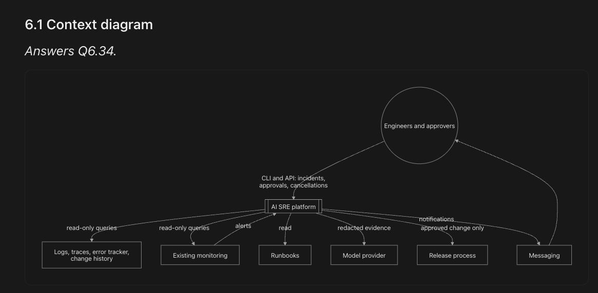
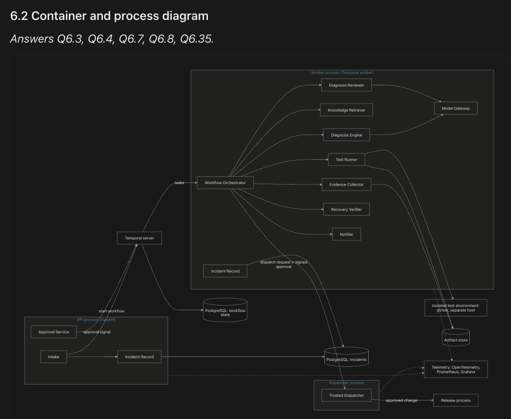
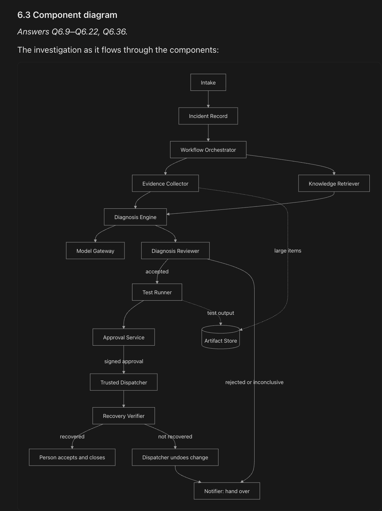
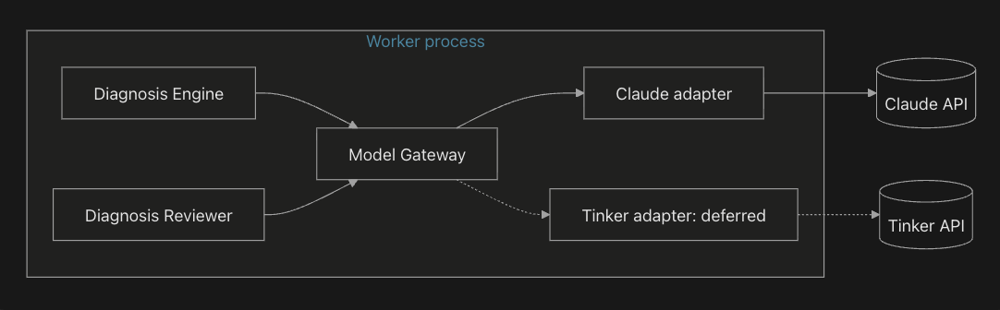
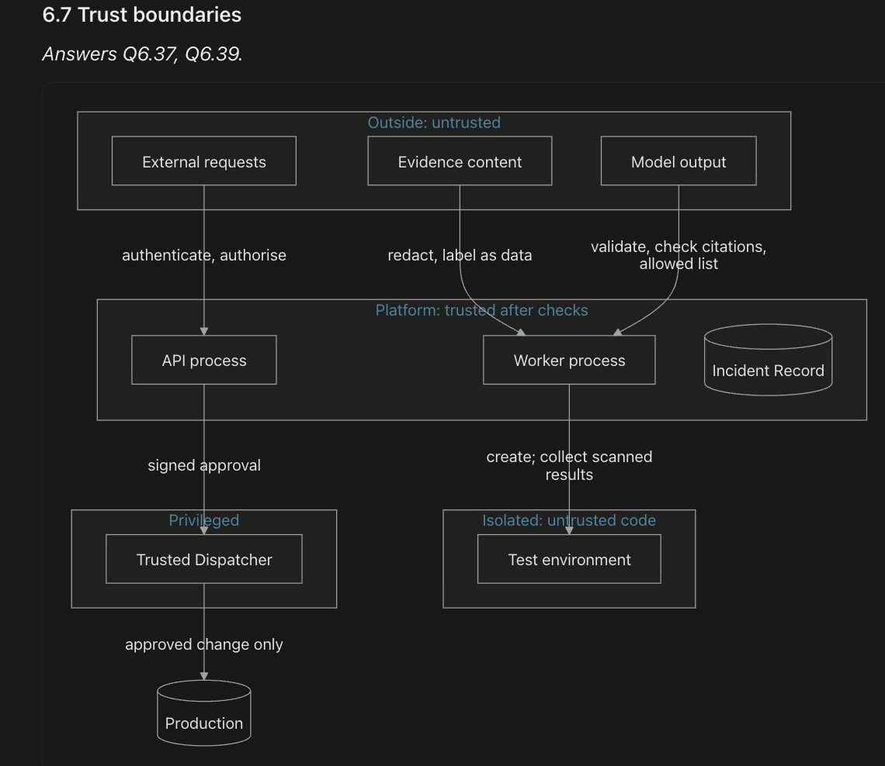
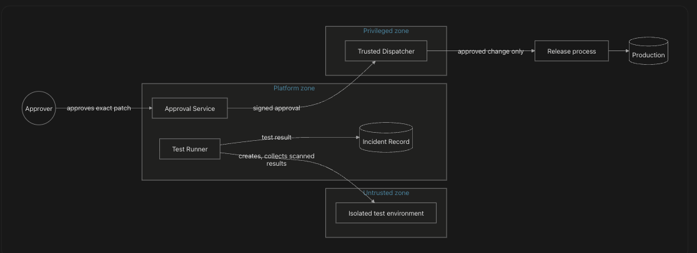

# Artifact 6: System Architecture Document

- **Layer:** 6, System Architecture
- **Built from:** [Artifact 4: Requirements Specification](../layer-04-requirements/artifact-04-requirements-specification.md), [Artifact 5: Threat Model](../layer-05-threat-modeling/artifact-05-threat-model.md)
- **Status:** Draft compiled from the team's answers; pending team review
- **Sources:** [conversation.md](conversation.md), the team's written Artifact 6 sections and their screenshots in [assets/](assets/), [system-design.md](../../reference/system-design.md), [technical-specification.md](../../reference/technical-specification.md), and for the conflicts recorded below the conversations of [Layer 7](../layer-07-data-apis-events/conversation.md), [Layer 8](../layer-08-workflows-state-machines/conversation.md), [Layer 9](../layer-09-agent-architecture/conversation.md) and [Layer 11](../layer-11-safe-remediation/conversation.md)

## Required sections

| Required section | Questions this section answers | Done |
| --- | --- | --- |
| 6.1 Context diagram | Q6.34 | Yes |
| 6.2 Container/process diagram | Q6.1–Q6.4, Q6.7, Q6.8, Q6.35, Q6.38 | Yes |
| 6.3 Component diagram | Q6.9–Q6.22, Q6.36 | Yes |
| 6.4 Technology selection | Q6.23–Q6.33 | Yes |
| 6.5 Architecture Decision Records | Q6.5–Q6.8, Q6.23–Q6.33 | Yes |
| 6.6 Component ownership | Q6.9–Q6.22 | Yes |
| 6.7 Trust boundaries | Q6.37, Q6.39 | Yes |
| 6.8 Alternatives and trade-offs | Q6.5–Q6.7, Q6.26, Q6.27, Q6.29, Q6.30, Q6.33 | Yes |

## 6.1 Context diagram

*Answers Q6.34.*

| Outside the platform | What crosses the boundary |
| --- | --- |
| Engineers and approvers | CLI and API: incidents, approvals, cancellations |
| Logs, traces, error tracker, change history | Read-only queries |
| Existing monitoring | Alerts in; read-only queries out |
| Runbooks | Read |
| Model provider | Redacted evidence |
| Release process | Approved change only |
| Messaging | Notifications, which reach engineers and approvers |

This is the first of three levels of diagram, each zooming in on the previous one ([Q6.34](conversation.md)):

1. **Context (6.1):** the platform as one box, with the people and outside systems around it.
2. **Containers and processes (6.2):** the processes and stores, and how they talk.
3. **Components (6.3):** the modules inside the processes.

Two focused views go with them: **trust boundaries (6.7)**, and **the approval path** (Q6.37, also in 6.7).

## 6.2 Container/process diagram

*Answers Q6.1–Q6.4, Q6.7, Q6.8, Q6.35, Q6.38.*

The diagram shows the API calling the workflow server directly. ADR-19 in Layer 7 refines this; see [Decisions and conflicts](#decisions-and-conflicts).

**Process split** ([Q6.3](conversation.md)): by what each part needs to be trusted with, and how it must behave at runtime.

| Responsibility | Where it runs | Why it's separate |
| --- | --- | --- |
| Receive requests, record decisions | **API process** | Must answer fast, stay up, and hold no production or model credentials |
| Collect evidence, call models, plan and review, verify | **Worker process** | Long-running, retried, and scaled separately from the API |
| Run generated code | **Isolated test environment** | Untrusted code; no route to production (Artifact 5) |
| Apply approved changes | **Trusted dispatcher process** | The only holder of production write access (Artifact 5) |

**What runs inside the request** ([Q6.1](conversation.md), [Q6.2](conversation.md)): the work splits at the point where the platform has safely recorded the incident. The caller follows progress through status, timeline or notifications, and never waits on the original request.

| Synchronous (inside the request) | Asynchronous (after the request) |
| --- | --- |
| Authenticate and authorise the caller | Notify people |
| Validate mandatory fields | Collect evidence |
| Deduplicate against open incidents | Retrieve runbooks |
| Store the incident and its start event, in one transaction | Call the model; build and review hypotheses |
| Return the incident ID | Generate and test patches |
| Read requests: status, timeline | Wait for approval; execute; verify recovery |
| Recording an approval or a cancellation | Act on the approval or cancellation |

**Rule:** anything that calls an outside system or might take more than a fraction of a second runs asynchronously.

**The worker** ([Q6.4](conversation.md)) picks up work in severity order up to the concurrency limit, runs each step, saves progress after each step and resumes after a crash, enforces per-incident limits (time, model calls, tokens and spend), retries within bounds and hands over at limits, honours cancellation, and writes every step to the timeline. It doesn't hold production write access, and doesn't run generated code itself.

**Deployment** ([Q6.7](conversation.md), [Q6.8](conversation.md)): a modular monolith, deployed as a small number of processes.

- One codebase, one database, one deployment pipeline.
- Several entry points (API, worker, dispatcher), each starting only the modules it needs, from one build artifact started with a different command for each role.
- Configuration per role: each process gets only the credentials and settings its role needs. The API gets no production credentials; only the dispatcher gets production write access.
- Shared domain logic and database schema, with one set of schema changes applied before any process starts. Deployed together, so versions always match.

**Reading the arrows** ([Q6.35](conversation.md)):

- **the API** writes to PostgreSQL, and starts workflows in Temporal
- **Temporal** stores its own state in PostgreSQL, in a separate database
- **the worker** receives tasks from Temporal, and reads and writes incidents in PostgreSQL

**Modules and processes** ([Q6.38](conversation.md)): processes are solid outer boxes, labelled with the process name and how it's deployed. Modules are smaller boxes inside the process that runs them. A module shared by several processes (the Incident Record) is shown in each, marked "shared module". The component summary in 6.3 lists which process runs each module, and what it holds.

**A module boundary is a code boundary; a process boundary is a runtime and trust boundary.**

## 6.3 Component diagram

*Answers Q6.9–Q6.22, Q6.36.*

The investigation as it flows through the components:

**Component summary** ([Q6.22](conversation.md)):

| # | Component | Process | Holds |
| --- | --- | --- | --- |
| 1 | Intake | API | — |
| 2 | Incident Record (with audit chain) | API and worker (shared module) | Database access |
| 3 | Workflow Orchestrator | Worker | — |
| 4 | Evidence Collector | Worker | Read-only tool credentials |
| 5 | Knowledge Retriever | Worker | — |
| 6 | Model Gateway | Worker | Model provider key |
| 7 | Diagnosis Engine | Worker | — |
| 8 | Diagnosis Reviewer | Worker | — |
| 9 | Test Runner | Worker (controller) + isolated environment | Rights to create test environments only |
| 10 | Approval Service | API | Approval signing key |
| 11 | Trusted Dispatcher | Dispatcher | Production write access (release process) |
| 12 | Recovery Verifier | Worker | Read-only monitoring credentials |
| 13 | Artifact Store | Storage | — |
| 14 | Platform Telemetry | Observability stack | — |
| 15 | Notifier | Worker | Messaging credentials |

**What each component is responsible for:**

| Question | Component | Responsibility |
| --- | --- | --- |
| Q6.9 | Intake | Authenticates the source, validates the fields, checks the service exists and the caller may use it, deduplicates, hands the incident to the Incident Record |
| Q6.10 | Incident Record | Owns the incident, its status, the timeline and the audit chain; every other component reads and writes incidents only through it |
| Q6.11 | Workflow Orchestrator | Defines the steps, records each step's result, resumes after crashes, runs timers (approval expiry, investigation limits), handles cancellation |
| Q6.12 | Model Gateway | The only component that calls a model; enforces limits before each call, applies timeouts and retries, records cost and tokens, scans output for secrets, hides provider differences |
| Q6.13 | Knowledge Retriever | Indexes runbooks and past incident reviews, returns the most relevant passages, labels them with their source |
| Q6.14 | Evidence Collector | One read-only adapter per tool; queries in parallel within the incident's scope, redacts, normalises into evidence records, records gaps |
| Q6.15 | Diagnosis Engine | Computes facts in code, asks the model (through the gateway) for ranked hypotheses that cite evidence, produces a diagnosis or an inconclusive result, drafts the proposed patch for the leading hypothesis |
| Q6.16 | Diagnosis Reviewer | Separate from the Engine; checks citations exist and support the claim, checks the action is on the allowed list and within the incident's service, scores confidence from evidence strength, confirms alternatives were considered. Can reject or downgrade; never approves a production change |
| Q6.17 | Test Runner | Creates the isolated environment, reproduces the failure, applies the patch, runs the checks, collects the scanned results, destroys the environment; no production credentials |
| Q6.18 | Approval Service | Sends approval requests, checks the approver's rights and recent sign-in, records decisions, signs approvals, handles escalation and expiry |
| Q6.19 | Trusted Dispatcher | Verifies the approval's signature, fingerprint and expiry, re-checks the service state, applies the change once through the release process, records the result; the only component with production write access |
| Q6.20 | Recovery Verifier | Reads monitoring directly, using criteria recorded before execution; requires recovery to hold for the set period; if recovery fails, asks the dispatcher to undo the change (pre-approved undo plan) and escalates |
| Q6.21 | Artifact Store | Large items: raw evidence snapshots, patch diffs, test output, model inputs and outputs. The record keeps a reference and a fingerprint; items are write-once, encrypted, access-controlled, and deleted when retention ends |
| Q6.22 | Platform Telemetry | Receives metrics, traces and structured logs from every process; exposes health and availability, queue length and wait time, step durations, model cost, tokens and errors, evidence source errors, limit breaches; raises alerts on the platform's own targets. Separate from customers' monitoring, which the platform only reads |

**Model Gateway and providers** ([Q6.36](conversation.md)): the Diagnosis Engine and the Reviewer call the gateway through one internal interface, and the gateway calls one adapter per provider. The active adapter is solid; the deferred one is dashed. The provider boxes sit outside the platform's boundary.

## 6.4 Technology selection

*Answers Q6.23–Q6.33.*

| **Component** | **Technology** |
| --- | --- |
| Intake, Approval Service | FastAPI, Pydantic |
| Incident Record | PostgreSQL, SQLAlchemy, Alembic |
| Workflow Orchestrator | Temporal (single node, PostgreSQL store) |
| Model Gateway | Internal adapters; Claude initially |
| Knowledge Retriever | BM25 through PostgreSQL full-text search |
| Test Runner | Containers under gVisor, on a separate host |
| Artifact Store | Object storage (S3-compatible), with write-once retention; MinIO locally |
| Platform Telemetry | OpenTelemetry, Prometheus, Grafana |
| Development | Docker Compose, uv |
| Language | Python |

**Candidate stack decisions** ([Q6.33](conversation.md)):

| Responsibility | Candidate | Team decision | ADR |
| --- | --- | --- | --- |
| Backend API | FastAPI | **Accept** | ADR-01 |
| Validation | Pydantic | **Accept** | ADR-02 |
| Database | PostgreSQL | **Accept** | ADR-03 |
| ORM | SQLAlchemy | **Accept**, explicit queries only | ADR-04 |
| Migrations | Alembic | **Accept** | ADR-05 |
| Workflow engine | Temporal | **Accept**, single node on PostgreSQL | ADR-06 |
| Model providers | Claude and Tinker | **Replace:** Claude only; Tinker deferred | ADR-07 |
| Retrieval | BM25 | **Accept**, using PostgreSQL full-text search | ADR-09 |
| Execution | Restricted sandbox | **Replace:** per-test container under gVisor on a separate host | ADR-10 |
| Metrics | Prometheus | **Accept** | ADR-11 |
| Dashboard | Grafana | **Accept**, for platform health only | ADR-12 |
| Tracing | OpenTelemetry | **Accept** | ADR-13 |
| Development environment | Docker Compose | **Accept** | ADR-14 |
| Dependency management | uv | **Accept** | ADR-15 |

The reasoning for each choice is in [Q6.23–Q6.33](conversation.md).

## 6.5 Architecture Decision Records

*Answers Q6.5–Q6.8, Q6.23–Q6.33.*

Each record follows the decision log format from Artifact 2. Status is **Accepted** unless stated. Owners are roles.

| **ID** | **Decision** | **Rationale** | **Alternatives rejected** | **Owner** | **Revisit when** | **Reversal cost** |
| --- | --- | --- | --- | --- | --- | --- |
| ADR-01 | FastAPI for the API | Typed requests, automatic validation and API description, async | Django (too much), Flask (manual validation) | Platform owner | Intake latency target missed | Medium |
| ADR-02 | Pydantic for all validation, including model output | One definition serves the API and output checks | Hand-written checks | Platform owner | — | Medium |
| ADR-03 | PostgreSQL for incidents and workflow state | Transactions, row locks, point-in-time recovery, one database to run | Document database (weaker transactions) | Platform owner | Load exceeds a single instance | High |
| ADR-04 | SQLAlchemy, with explicit queries only | Familiar, testable; avoids hidden lazy loading | Raw SQL everywhere (no typed models) | Platform owner | — | Medium |
| ADR-05 | Alembic migrations, expand-then-contract | Reviewed, repeatable schema changes; safe deployments | Manual changes | Platform owner | — | Low |
| ADR-06 | Temporal, single node on PostgreSQL | Crash recovery, timers, cancellation, retries and history built in | PostgreSQL job queue (fallback), Celery (no durable timers) | Platform owner | Too heavy to run; or the burst test fails | Medium, behind the orchestrator interface |
| ADR-07 | Claude only initially; **Tinker deferred** (Status: **Replaced**) | No custom model in the first version; Tinker is for fine-tuning; its serving is in beta | Two providers from the start | SRE lead | Accuracy, cost or data-residency conditions in Q6.27 | Low, behind the gateway |
| ADR-08 | Thin internal model gateway with provider adapters | Full control of limits, validation, logging and cost | Third-party abstraction library | Platform owner | Many providers needed | Low |
| ADR-09 | BM25 through PostgreSQL full-text search | Exact terms shared by alerts and runbooks; no extra system | Vector database | SRE lead | Retrieval misses measured | Low |
| ADR-10 | Per-test container under gVisor, on a separate host (Status: **Replaced** "restricted sandbox" with this specific choice) | Strong isolation without running virtual machines | Plain containers (weaker); Firecracker (more to run) | Security lead | Escape test fails; stronger guarantee needed | Medium |
| ADR-11 | Prometheus for metrics and alerts | Standard; percentile queries; alerting | Hosted metrics service | Platform owner | Organisation standard differs | Low |
| ADR-12 | Grafana for platform-health dashboards only | Standard; works with Prometheus and traces | Building our own | Platform owner | — | Low |
| ADR-13 | OpenTelemetry for instrumentation | Vendor-neutral; traces carry the incident ID | Vendor-specific agents | Platform owner | — | Low |
| ADR-14 | Docker Compose for local development | One command runs everything; matches the few processes | Kubernetes locally (too heavy) | Platform owner | — | Low |
| ADR-15 | uv for dependencies | Fast, locked, reproducible builds | pip with manual pinning, Poetry | Platform owner | — | Low |
| ADR-16 | Modular monolith with four processes: API, worker, dispatcher, isolated test environment | Small team; trust and runtime needs drive the only splits | A service per module | Engineering manager | Evidence in Q6.33 | Medium |
| ADR-17 | Approvals signed with an asymmetric key; the dispatcher holds only the public key | A compromised dispatcher can't forge approvals | Shared secret | Security lead | — | Low |
| ADR-18 | Large items in a write-once object store; the record keeps references and fingerprints | Keeps the database small; tamper-evident | Large columns in PostgreSQL | Platform owner | — | Low |

## 6.6 Component ownership

*Answers Q6.9–Q6.22.*

| **Component** | **Owner (role, provisional)** |
| --- | --- |
| Intake, Incident Record, Workflow Orchestrator, Artifact Store | Platform owner |
| Evidence Collector, Knowledge Retriever | SRE lead |
| Model Gateway, Diagnosis Engine, Diagnosis Reviewer | SRE lead |
| Test Runner, isolated environment | Security lead |
| Approval Service, Trusted Dispatcher | Security lead |
| Recovery Verifier | SRE lead |
| Platform Telemetry, Notifier | Platform owner |

## 6.7 Trust boundaries

*Answers Q6.37, Q6.39.*

**Which components need their own boundary** ([Q6.39](conversation.md)): ask two questions of every component: what untrusted input does it handle, and what power does it hold? A component needs its own boundary when it handles untrusted input and could otherwise reach power, or when it holds power that others mustn't share.

| Component | Untrusted input | Power held | Boundary |
| --- | --- | --- | --- |
| Isolated test environment | Generated code | None | **Own host and runtime** |
| Trusted Dispatcher | None (signed approvals only) | Production write access | **Own process and identity** |
| Approval Service | People's requests | Signing key | Key in a secrets manager; API process |
| Evidence Collector, Model Gateway | Evidence, model output | Read-only and model keys | Worker process |
| Intake | External requests | None | API process |

**The approval path** ([Q6.37](conversation.md)): sandbox, Approval Service and Trusted Dispatcher sit in **three separate trust zones**. The only path to production goes through a person and the Approval Service. The sandbox has **no arrow** to the dispatcher or to production.

**Boundary rules**, from the [Technical specification, section 3](../../reference/technical-specification.md):

| Boundary | Rule |
| --- | --- |
| Evidence → platform | Redacted, labelled as data, size-limited, instruction-like text flagged |
| Model output → platform | Strict schema; citations must exist; fixes from the allowed list; secrets scanned |
| Isolated environment → platform | Only scanned test results leave |
| People → API | Authenticated and authorised on every request |
| Approval → dispatcher | Signature, fingerprint, expiry and service state checked |
| Dispatcher → production | Only the approved change, only through the release process |

## 6.8 Alternatives and trade-offs

*Answers Q6.5–Q6.7, Q6.26, Q6.27, Q6.29, Q6.30, Q6.33.*

| Choice | Alternative | Why we chose this | What we give up |
| --- | --- | --- | --- |
| Modular monolith | Service per module | Fewer moving parts for a small team | Independent scaling and release of modules |
| Temporal | PostgreSQL job queue | Durable timers, cancellation and replay built in | One more server to run and learn |
| Claude only | Claude and Tinker | No custom model in the first version | Can't tune a model on our own incidents yet |
| Keyword retrieval | Semantic search | Exact shared terms; no extra system | Misses runbooks that use different words |
| gVisor containers | Virtual machines | Strong enough isolation, simpler to run | Somewhat weaker isolation than a virtual machine |
| Separate dispatcher process | Executing from the worker | Production power held in one small place | One more process to deploy |
| Existing observability tools | New platform-specific tools | No extra systems | Depends on the monitoring team |

**What a service per module would cost** ([Q6.5](conversation.md)): network failures between modules; harder consistency; many more deployments; more to run and watch; slower debugging; higher cost and latency; premature boundaries that are expensive to move later.

**How the monolith keeps its boundaries** ([Q6.6](conversation.md)):

- One module per responsibility, each with a public interface and private internals.
- Each module owns its own tables; other modules don't read them directly.
- Shared code is limited to common types, such as the incident ID and the evidence record.
- Dependencies point one way: for example, diagnosis depends on evidence, never the reverse.
- A test fails if a module imports another module's internals.

**Left out for now, and what would change that** ([Q6.33](conversation.md)):

| Avoid initially | Introduce when |
| --- | --- |
| Kubernetes | Several environments or organisations, or more processes than simple hosting can manage |
| Separate services per module | A module needs independent scaling or release, shown by measured load or team ownership |
| Message broker (such as Kafka) | Event volume or fan-out exceeds what the database and workflow engine handle |
| Vector database and semantic search | Measured retrieval misses relevant runbooks |
| Separate cache | Measured database latency misses the targets |
| Fine-tuning and self-hosted models, GPUs | The conditions in Q6.27 are met |
| A product dashboard | The command-line tool and API are shown to be insufficient for engineers |
| Multiple model providers | Provider outages are frequent enough to hurt |

**Rule:** each addition needs a measured problem, a decision record, and an owner.

## Assumptions

| Assumption | Status | Owner | Validated when |
| --- | --- | --- | --- |
| The team is 2–4 engineers ([Q6.7](conversation.md)) | Provisional | Engineering manager | Staffing is confirmed |
| The team is comfortable with asynchronous Python ([Q6.23](conversation.md)) | Provisional | Engineering manager | Confirmed with the team |
| A managed database with point-in-time recovery is available in the deployment environment ([Q6.24](conversation.md)) | Provisional | Platform owner | Confirmed with infrastructure |
| A single-node workflow server, using PostgreSQL for storage, is enough for 5 concurrent investigations ([Q6.26](conversation.md)) | Provisional | Platform owner | The burst test (Artifact 4) passes |
| A hosted frontier model reaches the 80% diagnosis accuracy target without fine-tuning ([Q6.27](conversation.md)) | Provisional | SRE lead | Measured on the synthetic test suite |
| There are fewer than a few thousand runbook passages ([Q6.29](conversation.md)) | Provisional | SRE lead | The runbooks are counted |
| The test hosts can run containers under gVisor ([Q6.30](conversation.md)) | Provisional | Platform owner | A container runs under it on a test host |
| The organisation's existing monitoring can host the platform's telemetry ([Q6.31](conversation.md)) | Provisional | Platform owner | Confirmed with the monitoring team |

## Decisions and conflicts

**Decisions not recorded in a section above:**

- Prefer the organisation's existing installations of the observability tools, rather than running new ones ([Q6.31](conversation.md)).
- Migrations run once, as a separate step, before new processes start; every migration is tested in the build pipeline, and a check fails the build if the models and migrations disagree ([Q6.25](conversation.md)).
- The Model Gateway exposes one internal interface, per-provider behaviour is configuration, and tests use a fake provider adapter ([Q6.28](conversation.md)).
- Local development uses fakes for outside systems (monitoring source, release process, model adapter) and the synthetic test cases as seed data ([Q6.32](conversation.md)).

**Conflicts found while compiling:**

| # | Conflict | Sources | Status |
| --- | --- | --- | --- |
| 1 | **API to workflow server.** The 6.2 diagram and Q6.35 show the API calling the workflow server directly ("start workflow", "approval signal"). ADR-19 says the API reaches Temporal only through the outbox, and states that it refines Artifact 6. | [Q6.35](conversation.md); ADR-19 in [Layer 7](../layer-07-data-apis-events/conversation.md) (Q7.57); [Technical specification, section 8](../../reference/technical-specification.md) | ADR-19 is later and explicit, so it governs. The relay runs inside the worker process, so the process count is unchanged. The 6.2 diagram is kept as the team drew it and needs redrawing. |
| 2 | **How the signed approval reaches the dispatcher.** The diagrams differ: 6.2 shows the Workflow Orchestrator sending "dispatch request + signed approval"; 6.3 shows the Approval Service, and 6.7 the API process, passing it directly. Later layers say the workflow triggers the dispatcher with an action ID only, on the dispatcher's own task queue, and the dispatcher reloads the action and signatures from trusted storage. | 6.2, 6.3 and 6.7 diagrams; [Q8.14](../layer-08-workflows-state-machines/conversation.md); [Q11.68](../layer-11-safe-remediation/conversation.md) | Not resolved by a decision record. Team to confirm the Layer 8 and Layer 11 path and align the diagrams. |
| 3 | **Dispatcher access to the record.** The component summary places the Incident Record in the API and worker only, and the 6.2 diagram shows no dispatcher link to the incidents database. Q6.8 and Q6.25 share the schema with the dispatcher, Q6.19 has it record the result, and Layers 8 and 11 have it record intent and load the action from storage. | [Q6.8, Q6.19, Q6.22, Q6.25](conversation.md); [Q8.32](../layer-08-workflows-state-machines/conversation.md); [Q11.68](../layer-11-safe-remediation/conversation.md) | Open. Team to confirm and update the component summary and diagram. |
| 4 | **Who drafts the patch, and when.** Q6.15 has the Diagnosis Engine draft the patch, before review. The System Design drafts the fix after review, the Technical specification drafts no patch below the threshold, and Layer 9 has a Patch Proposer skill act after the critic accepts the diagnosis. | [Q6.15](conversation.md); [System Design, section 6](../../reference/system-design.md); [Technical specification, sections 5.3–5.4](../../reference/technical-specification.md); [Q9.18](../layer-09-agent-architecture/conversation.md) | The later sources agree on order: patch after review. 6.3 keeps Q6.15's wording; the team should update it. |
| 5 | **Self-hosted or hosted workflow engine.** ADR-06 is Accepted as a single node, and Q6.26 says self-hosted. Q6.26 also lists the choice as an unknown, and the System Design lists it as an open decision (Platform owner, before M1 build). | ADR-06; [Q6.26](conversation.md); [System Design, section 12](../../reference/system-design.md) | Open until the Platform owner decides. ADR-06 stands as written. |
| 6 | **Outside systems missing from the context diagram.** The Technical specification also integrates with an identity system (tokens and groups) and a review system (proposed change as a pull request). Neither is in the 6.1 diagram. | 6.1 diagram; [Technical specification, section 8](../../reference/technical-specification.md) | Later specification is more complete. The 6.1 diagram needs both added. |
| 7 | **Network in the test environment.** Q6.30 allows an approved package mirror. The System Design threat table says "no network". Layer 11 makes no network the default, and a mirror only "if ever needed", behind a filtering proxy. | [Q6.30](conversation.md); [System Design, section 11](../../reference/system-design.md); [Layer 11](../layer-11-safe-remediation/conversation.md) | Later Layer 11 wording reconciles the two: no network by default. |
| 8 | **Diagrams against the team's own conventions.** Q6.34 says to keep diagrams as text in the repository, but this artifact has only screenshots. Q6.38 says to mark the Incident Record "shared module", which the 6.2 diagram doesn't. Q6.36 has the Reviewer call the Model Gateway, which the 6.3 flow omits (6.2 and the Q6.36 diagram show it). | [Q6.34, Q6.36, Q6.38](conversation.md); 6.2 and 6.3 diagrams | Open. Diagram sources are needed to follow Q6.34. |
| 9 | **Notifier.** It is component 15 and has an owner in 6.6, but no Part B question covers it, and Q6.6's module list omits it. | [Q6.6, Q6.22](conversation.md) | Component summary and 6.6 used. Q6.6's list needs the module added. |

No record of disagreements between Claude and ChatGPT exists yet; [conversation.md](conversation.md) marks it TBD for the team.

## Acceptance checks

- [x] Every required section above is present and complete.
- [x] Every section lists the questions it answers, and every question in this layer is answered by at least one section.
- [x] Every assumption is marked provisional and has a named owner and a condition under which it will be validated.
- [ ] Every disagreement between Claude and ChatGPT that affected a decision is recorded with the team's resolution.
- [ ] The artifact is consistent with every artifact it is built from; any conflict is recorded as an explicit decision.
- [x] The artifact was produced with the team's coding agent and is saved in the team repository.

Reviewed by: TBD
Date: TBD
