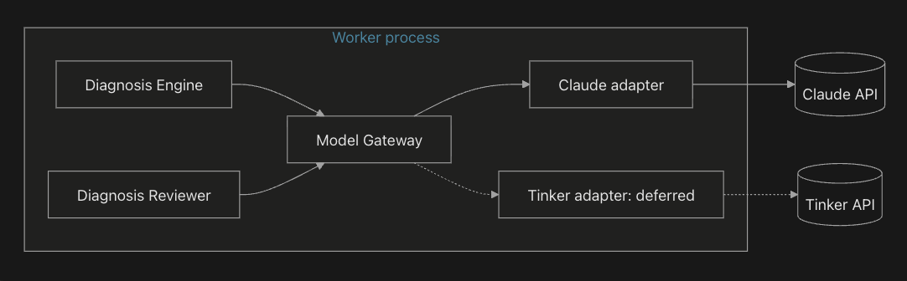
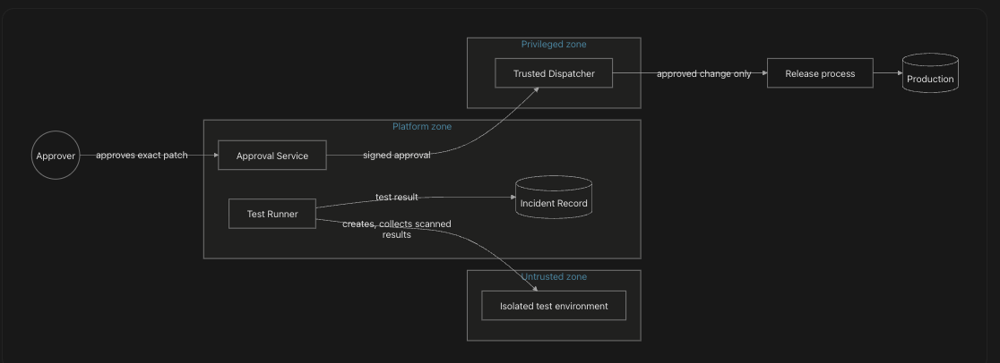

# Layer 6: System Architecture — Conversation

- **Central question:** What components do we need?
- **Built from:** Artifacts 4 and 5
- **Focus for this layer:** Derive the architecture from responsibilities. Parts A and B must be complete before any technology is named in Part C.
- **Deliverable:** [Artifact 6: System Architecture Document](artifact-06-system-architecture-document.md)
- **Questions:** 39

## Conversation log

| Questions | Agent | Conversation link | Decision reached | Open unknowns and owner | Artifact section |
| --- | --- | --- | --- | --- | --- |
| Q6.1–Q6.39 | TBD | [Shared conversation](https://claude.ai/share/c6a48a50-d511-4886-b4f5-0a3000f6a725) (needs sign-in; not read for these docs) | Recorded per question below | Listed under each question's Unknowns and Assumptions | [Artifact 6: System Architecture Document](artifact-06-system-architecture-document.md) |

## Where Claude and ChatGPT disagreed

TBD: the source documents do not record any disagreements. The team fills this in.

## Questions and answers

### Q6.1 The team implements the entire incident lifecycle inside one Python function. An investigation takes 10 minutes, and the HTTP request times out. How should responsibilities be separated to avoid keeping the request open?

**Frame.** How do we stop a long investigation from holding an HTTP request open?

**Knowns.**

- Artifact 4: intake must answer within 300 ms (p95); the investigation may take up to 15 minutes; waiting for approval may take up to 60 minutes.
- In the reference scenario, monitoring sends the alert. If the request times out, monitoring retries and creates duplicates.

**Unknowns.** None that change the answer.

**Assumptions (provisional).** None needed.

**Answer.** Split the work at the point where the platform has safely recorded the incident:

- **The request handler** validates, deduplicates, stores the incident and a "start investigation" event in one transaction, and returns the incident ID. Then it is done.
- **Background workers** pick up the event and run the investigation, step by step, saving progress after each one.
- **The caller follows progress** by reading the incident's status and timeline, or by receiving notifications. It never waits on the original request.

The request takes milliseconds. The investigation takes as long as it needs, within its own limits.

### Q6.2 The API needs to acknowledge an incident immediately, but investigation requires several minutes. Which operations should happen synchronously and which should happen asynchronously?

**Frame.** What runs inside the request, and what runs afterwards?

**Knowns.** Artifact 4: intake p95 ≤ 300 ms; event available to workers p95 ≤ 1 s; no accepted incident is ever lost.

**Unknowns.** None.

**Assumptions (provisional).** None needed.

**Answer.**

| **Synchronous (inside the request)** | **Asynchronous (after the request)** |
| --- | --- |
| Authenticate and authorise the caller | Notify people |
| Validate mandatory fields | Collect evidence |
| Deduplicate against open incidents | Retrieve runbooks |
| Store the incident and its start event, in one transaction | Call the model; build and review hypotheses |
| Return the incident ID | Generate and test patches |
| Read requests: status, timeline | Wait for approval; execute; verify recovery |
| Recording an approval or a cancellation | Act on the approval or cancellation |

**Rule:** anything that calls an outside system or might take more than a fraction of a second runs asynchronously.

### Q6.3 The API process currently receives requests, collects logs, calls models and executes patches. How would you separate its responsibilities?

**Frame.** How do we split a process that does everything?

**Knowns.**

- Artifact 5: only the executor may write to production; generated code runs only in an isolated environment; the model holds no credentials.
- Artifact 4: intake must stay available when investigation is slow.

**Unknowns.** None.

**Assumptions (provisional).** None needed.

**Answer.** Split by what each part needs to be trusted with, and how it must behave at runtime:

| **Responsibility** | **Where it runs** | **Why it's separate** |
| --- | --- | --- |
| Receive requests, record decisions | **API process** | Must answer fast, stay up, and hold no production or model credentials |
| Collect evidence, call models, plan and review, verify | **Worker process** | Long-running, retried, and scaled separately from the API |
| Run generated code | **Isolated test environment** | Untrusted code; no route to production (Artifact 5) |
| Apply approved changes | **Trusted dispatcher process** | The only holder of production write access (Artifact 5) |

### Q6.4 Several investigations need to run independently while the API continues accepting new requests. What should a background processing component be responsible for?

**Frame.** What does the background worker own?

**Knowns.** Artifact 4: 5 concurrent investigations; queue by severity; checkpoint after each step; cancellation within 30 seconds.

**Unknowns.** None.

**Assumptions (provisional).** None needed.

**Answer.** The worker is responsible for:

- **Picking up work** from the queue, in severity order, up to the concurrency limit.
- **Running each step** of the investigation: evidence, retrieval, diagnosis, review, patch, test, approval wait, dispatch request, verification.
- **Saving progress** after each step, and resuming after a crash.
- **Enforcing limits:** time, model calls, tokens and spend, per incident.
- **Retrying** failed steps within bounds, and handing over when limits are reached.
- **Honouring cancellation.**
- **Writing every step** to the incident's timeline.

The worker **doesn't** hold production write access, and doesn't run generated code itself.

### Q6.5 The team proposes creating a separate deployable service for every module. What operational problems could this introduce?

**Frame.** What goes wrong if every module becomes its own service?

**Knowns.** Artifact 2: a small team; no microservices in the first version.

**Unknowns.** None.

**Assumptions (provisional).** None needed.

**Answer.**

- **Network failures between modules:** every call can now time out or fail, so each one needs retries and error handling.
- **Harder consistency:** one action spans several databases, so transactions turn into coordination problems.
- **Many more deployments:** versions must stay compatible across services.
- **More to run and watch:** each service needs monitoring, alerts, logs, secrets and an on-call owner.
- **Slower debugging:** one incident's path crosses many services.
- **Higher cost and latency.**
- **Premature boundaries:** module edges chosen too early are expensive to move later.

For a platform whose purpose is reliability, extra moving parts are extra ways to fail.

### Q6.6 A growing application contains many unrelated responsibilities inside a single codebase. How could the code be organized without introducing distributed service complexity?

**Frame.** How do we keep one codebase organised without splitting it into services?

**Knowns.** Artifact 2: a modular monolith.

**Unknowns.** None.

**Assumptions (provisional).** None needed.

**Answer.** Organise it as a **modular monolith**:

- **One module per responsibility:** intake, incidents, workflow, evidence, knowledge, model gateway, diagnosis, review, testing, approval, dispatch, verification, artifacts, telemetry.
- **Each module has a public interface** that other modules call, and keeps its internals private.
- **Each module owns its own tables.** Other modules don't read them directly.
- **Shared code is limited** to common types, such as the incident ID and the evidence record.
- **Dependencies point one way:** for example, diagnosis depends on evidence, never the reverse.
- **Rules are checked automatically:** a test fails if a module imports another module's internals.

This keeps the boundaries clear, so a module can be split out later if evidence shows the need.

### Q6.7 A small engineering team wants to deploy its initial platform quickly while retaining clear module boundaries. Which architectural approach would support this?

**Frame.** What approach lets a small team ship fast, with clean boundaries?

**Knowns.** Q6.5 and Q6.6.

**Unknowns.** None.

**Assumptions (provisional).**

- The team is 2–4 engineers. *Owner: Engineering manager. Validated when: staffing is confirmed.*

**Answer.** **A modular monolith, deployed as a small number of processes.**

- One codebase, one database, one deployment pipeline.
- Separate processes only where trust or runtime behaviour requires it: the API, the worker, the trusted dispatcher, and the isolated test environment (Q6.3).
- Any later split must be justified by evidence (Q6.33).

### Q6.8 The API and background processing systems need different runtime behavior, but share domain logic and database contracts. How could they run as separate processes while sharing one codebase?

**Frame.** How do we run the API and workers separately from one codebase?

**Knowns.** Q6.6 and Q6.7.

**Unknowns.** None.

**Assumptions (provisional).** None needed.

**Answer.**

- **One codebase, several entry points:** an API entry point, a worker entry point and a dispatcher entry point, each starting only the modules it needs.
- **One build artifact**, started with a different command for each role.
- **Configuration per role:** each process gets only the credentials and settings its role needs. The API gets no production credentials; only the dispatcher gets production write access.
- **Shared domain logic and database schema**, with one set of schema changes applied before any process starts.
- **Deployed together**, so versions always match.

### Q6.9 An external monitoring system detects an incident. Which component should receive and validate the incoming incident?

**Frame.** Which component takes in new incidents?

**Knowns.** Artifact 4: mandatory fields; deduplication; idempotent submission; authentication of the source.

**Answer.** **The Intake component** (in the API process). It authenticates the source, validates the fields, checks the service exists and the caller may use it, deduplicates, and hands the incident to the incident record component.

### Q6.10 The platform needs to preserve incident information across restarts. Which component should manage persistent incident records?

**Frame.** Which component owns the stored incident?

**Knowns.** Artifact 4: one record per incident; an append-only timeline; nothing lost after acknowledgement.

**Answer.** **The Incident Record component.** It owns the incident, its status, the timeline and the audit chain. Every other component reads and writes incidents only through it.

### Q6.11 An investigation needs to resume after a worker crashes. Which component should manage durable workflow progress?

**Frame.** Which component remembers where each investigation is?

**Knowns.** Artifact 4: checkpoints after each step; resume within 2 minutes; no duplicate side effects.

**Answer.** **The Workflow Orchestrator.** It defines the investigation's steps, records each step's result, resumes after crashes, runs timers (approval expiry, investigation limits), and handles cancellation.

### Q6.12 The agent needs to communicate with multiple AI providers. Which component should own model inference requests?

**Frame.** Which component talks to model providers?

**Knowns.**

- Artifact 4: model-call timeout of 60 s; 3 attempts; token and spend limits enforced before each call.
- Artifact 2: if the provider is down, the platform degrades to evidence and a timeline, with no fix proposals.

**Answer.** **The Model Gateway.** It is the only component that calls a model. It enforces limits before each call, applies timeouts and retries, records cost and tokens, scans output for secrets, and hides the differences between providers.

### Q6.13 Engineers have internal runbooks that the AI needs during investigations. Which component should retrieve relevant knowledge?

**Frame.** Which component finds the right runbook?

**Knowns.** Artifact 5: runbook content is treated as data, never as instructions.

**Answer.** **The Knowledge Retriever.** It indexes runbooks and past incident reviews, returns the most relevant passages for an incident, and labels them with their source.

### Q6.14 The platform needs to collect logs and metrics from customer applications. Which component should coordinate evidence collection?

**Frame.** Which component gathers evidence?

**Knowns.** Artifact 4 and Artifact 5: read-only adapters, scoped to the incident's service and window; redaction; gaps recorded.

**Answer.** **The Evidence Collector.** It holds one read-only adapter per tool, runs the queries in parallel within the incident's scope, redacts sensitive data, normalises results into evidence records, and records gaps.

### Q6.15 The agent has collected evidence and needs to identify possible causes. Which component should generate diagnoses?

**Frame.** Which component produces the hypotheses and diagnosis?

**Knowns.** Artifact 4: at least two hypotheses; citations; an inconclusive status.

**Answer.** **The Diagnosis Engine.** It computes facts in code, asks the model (through the gateway) for ranked hypotheses that cite evidence, and produces a diagnosis, or an inconclusive result. It also drafts the proposed patch for the leading hypothesis.

### Q6.16 A diagnosis needs independent review before becoming an actionable recommendation. Which component should evaluate it?

**Frame.** Which component checks a diagnosis before it's acted on?

**Knowns.** Artifact 5: model output is untrusted until validated.

**Answer.** **The Diagnosis Reviewer**, separate from the Diagnosis Engine. It:

- checks that every citation exists, and supports the claim
- checks that the proposed action is on the allowed list, and stays within the incident's service
- scores confidence from the strength of evidence
- confirms alternatives were considered

It can reject or downgrade a diagnosis. It never approves a production change; that is a person's decision.

### Q6.17 AI-generated code needs to be executed against a test suite. Which component should own this operation?

**Frame.** Which component runs generated code?

**Knowns.** Artifact 4 and Artifact 5: a fresh, isolated, disposable environment with no production access; reproduce the failure first.

**Answer.** **The Test Runner.** It creates the isolated environment, reproduces the failure, applies the patch, runs the checks, collects the scanned results, and destroys the environment. It has no production credentials.

### Q6.18 A production repair requires human authorization. Which component should manage approval?

**Frame.** Which component handles approvals?

**Knowns.** Artifact 4 and Artifact 5: authorised approvers; signed approvals with the patch fingerprint; expiry and escalation.

**Answer.** **The Approval Service.** It sends approval requests, checks the approver's rights and recent sign-in, records decisions, signs approvals, and handles escalation and expiry.

### Q6.19 An approved action needs to modify an external system. Which component should execute that operation?

**Frame.** Which component makes the production change?

**Knowns.** Artifact 5: only the executor writes to production.

**Answer.** **The Trusted Dispatcher.** It verifies the approval's signature, fingerprint and expiry, re-checks the service state, applies the change once through the release process, and records the result. It is the only component with production write access.

### Q6.20 A repair has been applied, but its effectiveness is unknown. Which component should independently verify recovery?

**Frame.** Which component checks whether the repair worked?

**Knowns.** Artifact 1 and Artifact 4: recovery criteria are set before execution; verification is independent of the executor.

**Answer.** **The Recovery Verifier.** It reads monitoring directly, using the criteria recorded before execution, and requires recovery to hold for the set period. If recovery fails, it asks the dispatcher to undo the change (using the pre-approved undo plan), and escalates.

### Q6.21 Large logs, diffs and test outputs exceed the practical size of database records. Where should these artifacts be stored?

**Frame.** Where do large items go?

**Knowns.** Artifact 4: raw evidence is kept for 30 days; encrypted at rest.

**Answer.** **An Artifact Store** for large items: raw evidence snapshots, patch diffs, test output and model inputs and outputs.

- The incident record keeps only a **reference and a fingerprint** for each item.
- Items are **write-once:** never changed after storing.
- **Encrypted**, access-controlled, and deleted when their retention ends.

### Q6.22 Engineers need to understand whether the AI SRE platform itself is healthy. Which component should collect and expose platform telemetry?

**Frame.** Which component shows the platform's own health?

**Knowns.** Artifact 4: every step, source and model call is timed and traced with the incident ID.

**Answer.** **The Platform Telemetry component.** Every process sends metrics, traces and structured logs to it. It exposes:

- health and availability
- queue length and wait time
- step durations
- model cost, tokens and errors
- evidence source errors
- limit breaches

It also raises alerts when the platform's own targets are missed. It is kept separate from the customers' monitoring, which the platform only reads.

#### Component summary

| **#** | **Component** | **Process** | **Holds** |
| --- | --- | --- | --- |
| 1 | Intake | API | — |
| 2 | Incident Record (with audit chain) | API and worker (shared module) | Database access |
| 3 | Workflow Orchestrator | Worker | — |
| 4 | Evidence Collector | Worker | Read-only tool credentials |
| 5 | Knowledge Retriever | Worker | — |
| 6 | Model Gateway | Worker | Model provider key |
| 7 | Diagnosis Engine | Worker | — |
| 8 | Diagnosis Reviewer | Worker | — |
| 9 | Test Runner | Worker (controller) + isolated environment | Rights to create test environments only |
| 10 | Approval Service | API | Approval signing key |
| 11 | Trusted Dispatcher | Dispatcher | Production write access (release process) |
| 12 | Recovery Verifier | Worker | Read-only monitoring credentials |
| 13 | Artifact Store | Storage | — |
| 14 | Platform Telemetry | Observability stack | — |
| 15 | Notifier | Worker | Messaging credentials |

### Q6.23 The platform needs to expose HTTP endpoints and validate incoming requests. Which Python framework would satisfy these requirements?

**Frame.** Which framework serves the Intake and Approval endpoints?

**Knowns.** Python only (Artifact 2); intake p95 ≤ 300 ms; strict validation of mandatory fields.

**Unknowns.** The team's prior experience.

**Assumptions (provisional).**

- The team is comfortable with asynchronous Python. *Owner: Engineering manager. Validated when: confirmed with the team.*

**Answer.** **FastAPI, with Pydantic for validation.**

- Requests and responses are defined as typed models, so validation and error messages come for free.
- It generates an API description automatically, which the command-line tool can use.
- Its asynchronous support suits an API that mostly does quick database work.
- The same Pydantic models validate model output in the worker, so one definition serves both.

**Rejected:** Django (more than this API needs), Flask (validation would be added by hand). See ADR-01 and ADR-02.

### Q6.24 The system stores structured incident records and transactional state. Which database technology should be evaluated?

**Frame.** Which database holds incidents?

**Knowns.** Artifact 4: transactional writes (incident and event together), an append-only timeline, point-in-time recovery, restore within 1 hour.

**Unknowns.** Whether the organisation already runs a managed database service.

**Assumptions (provisional).**

- A managed database with point-in-time recovery is available in the deployment environment. *Owner: Platform owner. Validated when: confirmed with infrastructure.*

**Answer.** **PostgreSQL**, managed where possible.

- Strong transactions: the incident and its start event are written together, or not at all.
- Row locks for safe deduplication and one-time execution.
- Flexible columns (JSON) for evidence metadata, alongside strict columns.
- Point-in-time recovery meets the recovery targets.
- It can also serve as the workflow engine's store (ADR-06), so there is one database to run.

**Data access:** **SQLAlchemy** for queries, using plain, explicit queries rather than hidden behaviour. See ADR-03 and ADR-04.

### Q6.25 Multiple engineers modify database schemas over time. How should schema changes be tracked and applied safely?

**Frame.** How do we manage schema changes?

**Knowns.** Shared schema across API, worker and dispatcher (Q6.8).

**Unknowns.** None.

**Assumptions (provisional).** None needed.

**Answer.** **Alembic migrations**, kept in the repository.

- Every change is a numbered, reviewed migration file. Nobody edits the database by hand.
- Migrations run once, as a separate step, before new processes start.
- **Expand, then contract:** add new columns first, switch the code, then remove the old columns in a later release. This keeps old and new versions working during a deployment.
- Every migration is tested on a copy of the schema in the build pipeline, including the upgrade from the previous version.
- A check fails the build if the models and migrations disagree.

See ADR-05.

### Q6.26 Investigations can take several minutes or hours, and must survive process crashes. Which workflow technology supports this requirement?

**Frame.** What runs long, crash-safe workflows?

**Knowns.**

- Artifact 4 needs: resume from the last step after a crash; timers for approval expiry and escalation; cancellation within 30 seconds; steps run once even under retries; workflows lasting up to 24 hours.
- Artifact 2 wants low operational overhead.

**Unknowns.** Whether the organisation will accept running a workflow server, or a hosted service.

**Assumptions (provisional).**

- A single-node workflow server, using PostgreSQL for storage, is enough for 5 concurrent investigations. *Owner: Platform owner. Validated when: the burst test (Artifact 4) passes.*

**Answer.** **Temporal**, self-hosted on a single node, storing its state in PostgreSQL.

- It provides crash recovery, durable timers, cancellation, retries with limits, and a full history of every step — all of which we would otherwise build by hand.
- Workflows are written in Python.

**Alternative considered:** a job queue built on PostgreSQL with our own checkpoints. It's simpler to run, but we would have to build durable timers, cancellation and replay ourselves, and the approval wait (up to 60 minutes) and 24-hour limit make that real work. **Fallback:** if Temporal proves too heavy to run, move to this alternative, behind the same Workflow Orchestrator interface. See ADR-06.

### Q6.27 The platform needs to communicate with multiple model providers. Which providers should be supported initially?

**Frame.** Which model providers do we start with?

**Knowns.**

- Artifact 2: no custom model and no GPUs in the first version; a provider outage degrades to evidence only.
- Tinker is Thinking Machines' service for fine-tuning open-weight models. Its inference API for trained models is in beta as of October 2026.

**Unknowns.** Diagnosis accuracy on the test suite; the organisation's data agreement with each provider.

**Assumptions (provisional).**

- A hosted frontier model reaches the 80% diagnosis accuracy target without fine-tuning. *Owner: SRE lead. Validated when: measured on the synthetic test suite.*

**Answer.**

- **Initially: Claude only**, through the Model Gateway.
- **Tinker: deferred.** It is for fine-tuning our own model, which Artifact 2 excluded from the first version, and its serving API is still in beta.
- **Revisit when:**
    - accuracy stalls below target with a hosted model
    - there are enough labelled incidents to train on
    - cost per incident is too high
    - the organisation requires that data stays on a self-managed model

**Provider outage:** degrade to evidence and a timeline, as Artifact 2 decided. Add a second hosted provider only if outages are frequent. See ADR-07.

### Q6.28 Different providers expose different request and response formats. How should the platform hide these differences?

**Frame.** How do we keep provider differences out of the rest of the code?

**Knowns.** The Model Gateway owns all model calls (Q6.12).

**Unknowns.** None.

**Assumptions (provisional).** None needed.

**Answer.** The Model Gateway exposes **one internal interface**: a task name, the instructions, the labelled evidence, the expected output structure, and limits. It returns validated output and usage.

- **One adapter per provider** translates to and from that provider's format.
- **Output is validated** against the same Pydantic model, whatever the provider.
- **Usage and cost** are recorded in one common format.
- **Per-provider behaviour** (limits, retries, timeouts) is configuration, not code in other modules.
- **Tests use a fake provider adapter,** so the rest of the platform can be tested without a real model.

A thin internal adapter is preferred over a third-party abstraction library, to keep control of limits, validation and logging. See ADR-08.

### Q6.29 The agent needs access to internal runbooks. Which retrieval strategy would be appropriate for the first implementation?

**Frame.** How do we find relevant runbooks at first?

**Knowns.** Runbooks use the same terms as alerts and errors: service names, error types, alert names.

**Unknowns.** How many runbooks exist.

**Assumptions (provisional).**

- There are fewer than a few thousand runbook passages. *Owner: SRE lead. Validated when: the runbooks are counted.*

**Answer.** **Keyword search (BM25)**, using PostgreSQL's built-in full-text search.

- Filter first by the incident's service.
- Then rank passages by keyword match against the alert name, error type and changed components.
- Return the top passages, labelled with their source.

**Why:** alerts and runbooks share exact terms, keyword search is easy to explain and debug, and it needs no extra system. **Add semantic search** only if measured retrieval misses relevant runbooks (Q6.33). See ADR-09.

### Q6.30 AI-generated code needs to be executed in an isolated environment. Which execution isolation approach should be used?

**Frame.** How do we isolate generated code?

**Knowns.** Artifact 5: fresh per test, no production network, no real credentials, non-root, resource limits, only scanned results leave.

**Unknowns.** The deployment environment's support for stronger isolation runtimes.

**Assumptions (provisional).**

- The test hosts can run containers under gVisor. *Owner: Platform owner. Validated when: a container runs under it on a test host.*

**Answer.** **A fresh container per test, run under a stronger isolation runtime (gVisor), on a separate host from production and from the platform's own processes.**

- No network, except an approved package mirror.
- Read-only base image; non-root user; no access to the host.
- CPU, memory, disk and time limits.
- Only test results are copied out, after a secret scan.
- Destroyed after use.

**Move to lightweight virtual machines** (Firecracker) if escape tests fail, or if a stronger guarantee is required. See ADR-10.

### Q6.31 The platform needs to expose metrics and dashboards. Which observability technologies should be considered?

**Frame.** What do we use to watch the platform itself?

**Knowns.** Artifact 4: per-step timing, tracing with the incident ID, percentile measurements.

**Unknowns.** Whether the organisation already runs these tools.

**Assumptions (provisional).**

- The organisation's existing monitoring can host the platform's telemetry. *Owner: Platform owner. Validated when: confirmed with the monitoring team.*

**Answer.**

- **OpenTelemetry** to instrument every process: traces, metrics and logs, all tagged with the incident ID.
- **Prometheus** to store metrics and run alerts on the platform's own targets.
- **Grafana** for engineers' dashboards of platform health.

**Prefer the organisation's existing installations** of these tools, rather than running new ones. This is the platform's own health view, not a product dashboard (Artifact 2 has no product dashboard in the first version). See ADR-11 to ADR-13.

### Q6.32 Engineers need to run the entire system locally without deploying every component independently. How should the development environment be assembled?

**Frame.** How does an engineer run everything on one machine?

**Knowns.** Synthetic test cases come first (Artifact 2).

**Unknowns.** None.

**Assumptions (provisional).** None needed.

**Answer.** **Docker Compose**, with **uv** for Python dependencies.

- One command starts: the database, the workflow server, the artifact store, the API, the worker, the dispatcher, and the observability tools.
- **Fakes for outside systems:** a fake monitoring source with the reference scenario's data, a fake release process, and the fake model adapter. The real model can be switched on with a key.
- **Seed data:** the synthetic test cases, including the reference scenario.
- uv locks exact dependency versions, so local, test and production builds match.

See ADR-14 and ADR-15.

### Q6.33 The team is considering additional technologies that introduce operational overhead. Which technologies should be avoided initially, and what evidence would justify introducing them later?

**Frame.** What do we leave out, and what would change our mind?

**Knowns.** Artifact 2: no Kubernetes, no microservices, no custom model, no GPUs.

**Unknowns.** Future load and team size.

**Assumptions (provisional).** None needed.

**Answer.**

| **Avoid initially** | **Introduce when** |
| --- | --- |
| Kubernetes | Several environments or organisations, or more processes than simple hosting can manage |
| Separate services per module | A module needs independent scaling or release, shown by measured load or team ownership |
| Message broker (such as Kafka) | Event volume or fan-out exceeds what the database and workflow engine handle |
| Vector database and semantic search | Measured retrieval misses relevant runbooks |
| Separate cache | Measured database latency misses the targets |
| Fine-tuning and self-hosted models, GPUs | The conditions in Q6.27 are met |
| A product dashboard | The command-line tool and API are shown to be insufficient for engineers |
| Multiple model providers | Provider outages are frequent enough to hurt |

**Rule:** each addition needs a measured problem, a decision record, and an owner.

#### Candidate stack decisions

| **Responsibility** | **Candidate** | **Team decision** | **ADR** |
| --- | --- | --- | --- |
| Backend API | FastAPI | **Accept** | ADR-01 |
| Validation | Pydantic | **Accept** | ADR-02 |
| Database | PostgreSQL | **Accept** | ADR-03 |
| ORM | SQLAlchemy | **Accept**, explicit queries only | ADR-04 |
| Migrations | Alembic | **Accept** | ADR-05 |
| Workflow engine | Temporal | **Accept**, single node on PostgreSQL | ADR-06 |
| Model providers | Claude and Tinker | **Replace:** Claude only; Tinker deferred | ADR-07 |
| Retrieval | BM25 | **Accept**, using PostgreSQL full-text search | ADR-09 |
| Execution | Restricted sandbox | **Replace:** per-test container under gVisor on a separate host | ADR-10 |
| Metrics | Prometheus | **Accept** | ADR-11 |
| Dashboard | Grafana | **Accept**, for platform health only | ADR-12 |
| Tracing | OpenTelemetry | **Accept** | ADR-13 |
| Development environment | Docker Compose | **Accept** | ADR-14 |
| Dependency management | uv | **Accept** | ADR-15 |

### Q6.34 A new engineer joins the project and cannot understand how the platform's major components communicate. How would you represent the complete architecture visually?

**Frame.** How do we show the whole architecture so a newcomer gets it?

**Answer.** Use **three levels of diagram**, each zooming in on the previous one:

1. **Context (6.1):** the platform as one box, with the people and outside systems around it.
2. **Containers and processes (6.2):** the processes and stores, and how they talk.
3. **Components (6.3):** the modules inside the processes.

Add two focused views: **trust boundaries (6.7)**, and **the approval path** (Q6.37). Keep all diagrams as text in the repository, next to the code, so they're reviewed and updated with it.

### Q6.35 The API, PostgreSQL and Temporal each have different responsibilities. How would you represent their communication and dependencies in an architecture diagram?

**Answer.** In the container diagram (6.2), draw each as a separate box. Label every arrow with what flows and how, for example "writes incident and start event (transaction)". Show that:

- **the API** writes to PostgreSQL, and starts workflows in Temporal
- **Temporal** stores its own state in PostgreSQL, in a separate database
- **the worker** receives tasks from Temporal, and reads and writes incidents in PostgreSQL

### Q6.36 The agent needs to communicate with a model gateway, which communicates with multiple model providers. How would you represent this relationship?

**Answer.** Inside the worker, show the Diagnosis Engine and the Reviewer calling the **Model Gateway** through one internal interface. Show the Gateway calling **one adapter per provider**. Mark Claude as active, and Tinker as deferred (dashed). The provider boxes sit outside the platform's boundary.

Worker processDiagnosis EngineModel GatewayDiagnosis ReviewerClaude adapterTinker adapter: deferredClaude APITinker API

### Q6.37 The sandbox must never directly authorize production actions. How would you represent the relationship between sandbox, approval service and trusted dispatcher?

**Answer.** Draw them in **three separate trust zones**. The only path to production goes through a person and the Approval Service. The sandbox has **no arrow** to the dispatcher or to production.

Privileged zonePlatform zoneUntrusted zonecreates, collects scannedresultstest resultapproves exact patchsigned approvalapproved change onlyIsolated test environmentTest RunnerIncident RecordApproval ServiceApproverTrusted DispatcherRelease processProduction

### Q6.38 The architecture contains logical modules and independently deployed processes. How would you distinguish them visually and explain their deployment boundaries?

**Answer.**

- **Processes** are drawn as solid outer boxes, labelled with the process name and how it's deployed.
- **Modules** are drawn as smaller boxes inside the process that runs them.
- **A module shared by several processes** (the Incident Record) is shown in each, marked "shared module."
- **A table** (component summary, Part B) lists which process runs each module, and what it holds.

The rule to explain: **a module boundary is a code boundary; a process boundary is a runtime and trust boundary.**

### Q6.39 Some components process untrusted code or hold production credentials. How would you identify which components need separate security boundaries?

**Answer.** Ask two questions of every component: **what untrusted input does it handle?** and **what power does it hold?** A component needs its own boundary when it handles untrusted input and could otherwise reach power, or when it holds power that others mustn't share.

| **Component** | **Untrusted input** | **Power held** | **Boundary** |
| --- | --- | --- | --- |
| Isolated test environment | Generated code | None | **Own host and runtime** |
| Trusted Dispatcher | None (signed approvals only) | Production write access | **Own process and identity** |
| Approval Service | People's requests | Signing key | Key in a secrets manager; API process |
| Evidence Collector, Model Gateway | Evidence, model output | Read-only and model keys | Worker process |
| Intake | External requests | None | API process |
