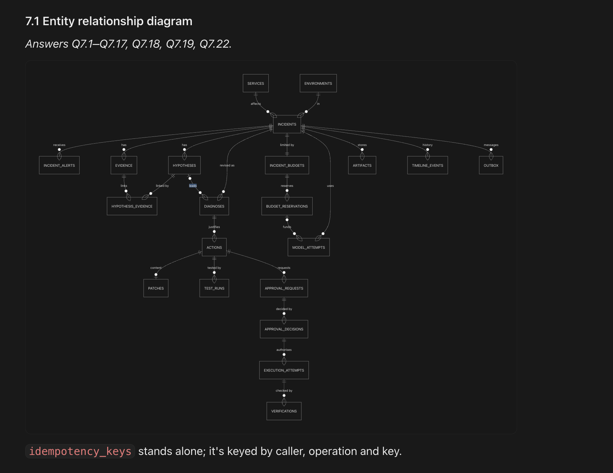
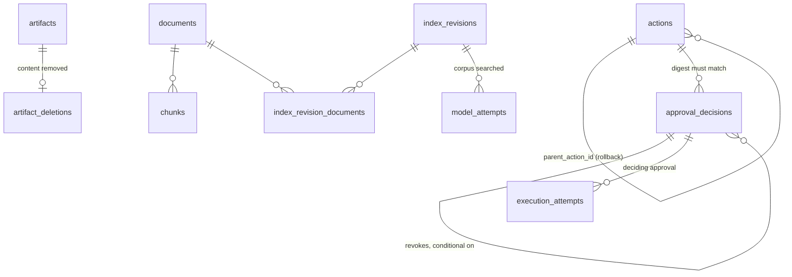
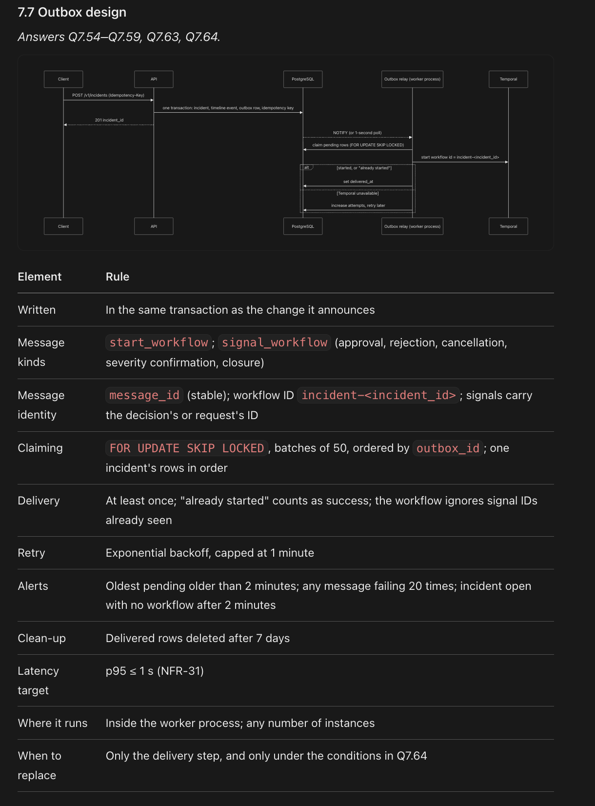

# Artifact 7: Data and Interface Specification

- **Layer:** 7, Data Architecture, APIs and Event Design
- **Built from:** Artifacts 4 and 6
- **Status:** Proposed: gaps resolved 2026-11-02 per [decisions.md](../../decisions.md); pending team sign-off
- **Sources:** [conversation.md](conversation.md), [files/schema.mmd](files/schema.mmd), [files/schema-tables.sql](files/schema-tables.sql), [files/contracts.py](files/contracts.py), [files/schema.sql](files/schema.sql) (proposed), [files/schema-tests.sql](files/schema-tests.sql) (proposed), [technical-specification.md](../../reference/technical-specification.md), [Layer 6 conversation](../layer-06-system-architecture/conversation.md), [decisions.md](../../decisions.md)

## Required sections

| Required section | Questions this section answers | Done |
| --- | --- | --- |
| 7.1 Entity relationship diagram | Q7.1–Q7.17, Q7.18, Q7.19, Q7.22 | Yes |
| 7.2 PostgreSQL schema | Q7.18–Q7.27 | Yes |
| 7.3 Pydantic contracts | Q7.3–Q7.6, Q7.8–Q7.10, Q7.26, Q7.28, Q7.29, Q7.31–Q7.34, Q7.38, Q7.45 | Yes |
| 7.4 API specification | Q7.28–Q7.41 | Yes |
| 7.5 Event schemas | Q7.16, Q7.42, Q7.44–Q7.46 | Yes |
| 7.6 Event sequencing rules | Q7.43, Q7.47–Q7.50 | Yes |
| 7.7 Outbox design | Q7.54–Q7.59, Q7.63, Q7.64 | Yes |
| 7.8 Idempotency rules | Q7.20, Q7.49, Q7.60–Q7.63 | Yes |
| 7.9 SSE timeline design | Q7.51, Q7.52, Q7.53 | Yes |

## 7.1 Entity relationship diagram

*Answers Q7.1–Q7.17, Q7.18, Q7.19, Q7.22.*



`idempotency_keys` stands alone; it's keyed by caller, operation and key.

The image and [files/schema.mmd](files/schema.mmd) are the team's originals. They show the 22 tables as first drawn. The canonical definition, with every column, is [files/schema.sql](files/schema.sql) (ADR-64), and the rows below follow it.

| Object | Stored as | Key points | Question |
| --- | --- | --- | --- |
| Incident identity | `incident_id` (UUIDv7, generated by the application); `display_ref` such as `INC-2026-000123` | Never relies on monitoring's reference, kept as `source_alert_id`. Workflow ID is `incident-<incident_id>` | [Q7.1](conversation.md) |
| Service and environment | `services`, `environments` | Required foreign keys on every incident; unique by `(org_id, slug)`; requests use slugs | [Q7.2](conversation.md) |
| Evidence | One `evidence` record type for every kind | Common columns, `attributes` for what varies, snapshot by `artifact_id`. Also `tool`, `source_as_of`, `gap_reason` and a code-assigned `strength_tier` (ADR-53, ADR-64). A gap is `kind = gap`. Append-only | [Q7.3, Q7.4](conversation.md) |
| Hypothesis | `hypotheses`, linked through `hypothesis_evidence` | Distinguished by ID and ordinal, never wording. Links are marked supports or contradicts. Carries `category` and `claims` (ADR-64) | [Q7.5](conversation.md) |
| Diagnosis | `diagnoses` | New row per `revision`; established or inconclusive; leading hypothesis must belong to the same incident. Carries `category`, `claims` and `ruled_out` (ADR-64) | [Q7.6](conversation.md) |
| Diagnosis vs action | Two tables, two lifecycles | A diagnosis is a belief and never changes production; an action is a proposed change and needs approval. Each action points to its `diagnosis_id` | [Q7.7](conversation.md) |
| Patch | `patches`, plus the diff as a write-once artifact | `patch_sha256` is the patch fingerprint (ADR-64), covered by the action digest that approvals name (ADR-49). A revised patch is a new action with a new patch | [Q7.8](conversation.md) |
| Proposed change | One `actions` row per change | Own target, risk, undo plan, recovery criteria, `hold_seconds`, `action_digest`, status and version. Immutable apart from status and version (ADR-47). Approving one approves only that one. A rollback is its own action, kind `rollback`, with `parent_action_id` (ADR-48) | [Q7.9](conversation.md) |
| Approval | `approval_requests`, `approval_decisions` | One row per person per kind of decision (approved, rejected, revoked), with role, last sign-in, two-factor, action digest, patch fingerprint, target, 15-minute expiry and signature. A revocation points at the approval it withdraws (ADR-49). A conditional rollback approval is its own row, on the rollback action (ADR-48) | [Q7.10](conversation.md) |
| Execution | `execution_attempts` | `execution_key` equals the `action_id`, unchanged on every attempt; increasing `attempt_no`; one "applied" per key; each row records the deciding `approval_id` (ADR-47). A rollback is a separate action with its own key (ADR-48) | [Q7.11](conversation.md) |
| Execution outcome | Raw response as a write-once artifact; interpreted outcome on the attempt | applied, not applied, failed or unknown, plus `external_ref`. Unknown is never success | [Q7.12](conversation.md) |
| Verification | `verifications` | Copy of the criteria, hold period, window, measured values, result (`verified`, `failed`, `inconclusive`), verifier and acceptor. Append-only; the acceptor is written once | [Q7.13](conversation.md) |
| Model call | `model_attempts` | Task, attempt number, provider, model, checkpoint, adapter version, instructions' version and fingerprint, output schema fingerprint, input fingerprint, provider request ID, status, stop reason, tokens including cache, usage reported or estimated, cost, latency, reservation, trace ID (ADR-64). Lets a diagnosis be replayed | [Q7.14](conversation.md) |
| Budget | `incident_budgets`, `budget_reservations` | Lock, calculate maximum cost, reserve or refuse; settle afterwards; expire if the call never returns. Money in whole millionths | [Q7.15](conversation.md) |
| State change | `timeline_events` | One event per change, in the same transaction; CloudEvents envelope; per-incident sequence; past-tense names | [Q7.16](conversation.md) |
| Large items | `artifacts`, content in the object store | Other records use `artifact_id`, never the storage key. Write-once; a separate job deletes expired items | [Q7.17](conversation.md) |

**Tables ([Q7.18](conversation.md)):** all of these objects are independent tables, because each has its own identity and is referenced by others.

**Relationships ([Q7.19](conversation.md), [Q7.22](conversation.md)):**

- `diagnoses.incident_id` is a required foreign key, and `UNIQUE (incident_id, revision)` numbers revisions within an incident.
- Composite foreign keys keep a diagnosis's leading hypothesis and an action's diagnosis in the same incident.
- The current diagnosis is the highest revision, so no "current" flag can fall out of step.
- One-to-many through foreign keys: incident → evidence, hypotheses, diagnoses, actions; action → patch, test runs, approvals, attempts, verifications; fix action → its rollback action (same-incident foreign key).
- Many-to-many through `hypothesis_evidence`.
- Indexes on `(incident_id, kind)` and on time, and paged reads in the API.

## 7.2 PostgreSQL schema

*Answers Q7.18–Q7.27.*

**The canonical schema is [files/schema.sql](files/schema.sql) (proposed, ADR-64).** It has 33 tables, 19 enumerated types, all the constraints, indexes and triggers, and a separate role block. The team's original tab is [files/schema-tables.sql](files/schema-tables.sql) (22 tables, 16 types, no indexes or triggers), and it stays unchanged as the record. The first Alembic migration is `schema.sql`.

**Tested on PostgreSQL 17.11**, not on the PostgreSQL 16 the Technical specification names, because 17 is what was installed. It uses no feature newer than version 15. Test on 16 before M1 if production runs 16.

[files/schema-tests.sql](files/schema-tests.sql) (proposed) re-runs every check below: load `schema.sql` as `aisre_owner`, then run the tests as a superuser.

| Proved on a real cluster (122 checks, all passing) | Result |
| --- | --- |
| Illegal transition | Rejected, including `open` → `executing`, and `diagnosed` → `awaiting_approval` (removed by ADR-46) |
| Legal transition | A full flow from `open` to `closed` passes, using the application and dispatcher roles |
| `UPDATE`, `DELETE`, `TRUNCATE` on append-only tables | Rejected for every role, the superuser included. The one exception is the retention role deleting an expired record |
| Second applied attempt, second open attempt for a key | Rejected by the guard trigger and, with triggers bypassed, by the partial unique index alone |
| Dispatcher's update right on `actions` | `status` and `version` only, and only `approved` → `applying` and its outcomes. Other columns and statuses are refused |
| Attempt after the action is `not_applied` | Refused: `not_applied` is final, so a further try is a new action (ADR-47) |
| Second open incident for a dedup key | Rejected. In a race of 8 sessions, 1 incident was created |
| Budget overrun | Rejected on cost, tokens and calls; exact fit passes; release gives it back |
| Sequence and hash chain | 8 sessions, 800 inserts, 80 rolled back: 720 events, sequence gapless, chain intact. A forged row is detected |
| Transition tables against `states.py` | 47 rows plus 3 ADR-46 additions: 30 incident and 20 action transitions, no differences. Enums match too |
| The tests themselves | With 5 rules deliberately removed, 8 checks failed as they should |

| Group | Table | Holds | Key rules in the file |
| --- | --- | --- | --- |
| Catalogue | `services` | Services, with display name and owner group, `critical` flag (ADR-49) and hold period (ADR-66) | Unique `(org_id, slug)`; hold at least 600 seconds |
| Catalogue | `environments` | Environments | Unique `(org_id, slug)` |
| Incident | `incidents` | Status, severity, `version`, `last_event_seq`, `investigation_run` | Required `service_id`, `environment_id`; unique `display_ref`; one open incident per `(org_id, dedup_key)`, open meaning not closed or cancelled |
| Incident | `incident_alerts` | Every alert, duplicates included | Raw `payload` as JSONB; unique `(incident_id, source_alert_id, received_at)`; `fingerprint` never null: it falls back to service plus alert name (ADR-58) |
| Incident | `dead_letters` | Rejected alerts, stored raw with the reason (ADR-58) | No incident; append-only; `retain_until` |
| Evidence and reasoning | `evidence` | One record per item, any kind | `attributes` JSONB; `content_sha256`; window check; `gap_reason` set exactly when `kind = gap`; `strength_tier` 1–8 |
| Evidence and reasoning | `hypotheses` | Causes for an incident | Unique `(incident_id, ordinal)`; `version` |
| Evidence and reasoning | `hypothesis_evidence` | Links between hypotheses and evidence | Primary key `(hypothesis_id, evidence_id, relation)` |
| Evidence and reasoning | `diagnoses` | A new row per revision | Unique `(incident_id, revision)`; same-incident foreign key; leading hypothesis required if established |
| Change | `actions` | Proposed changes, with recovery criteria, target deployment, base revision and digests | Same-incident foreign key to `diagnoses`; `version`; `parent_action_id` set exactly when kind is `rollback`; `action_digest` required from `awaiting_approval` on |
| Change | `patches` | Diff reference and `patch_sha256` | One per action |
| Change | `test_runs` | Reproduction and test result | Foreign key to `actions`; `patch_sha256`; six outcomes (ADR-64) |
| Approval | `approval_requests` | Requester, escalation, expiry, approvers needed, close reason | `approvers_needed` is 1 or 2, and 2 for a high-impact action; at most one open request per action |
| Approval | `approval_decisions` | One row per decision | Unique `(approval_request_id, decided_by, decision)`; `action_digest` must match the action; signature, `valid_until`, two-factor and a sign-in within 15 minutes for approvals; reason for rejections and revocations; no self-approval; the platform never approves |
| Execution and verification | `execution_attempts` | Each attempt, with `execution_key` and `action_digest` | Unique `(execution_key, attempt_no)`; key equals `action_id`; one applied and one open attempt per key; `reconciliation` marks a looked-up result, where nothing was sent |
| Execution and verification | `verifications` | Criteria, measurements, result | `hold_seconds` at least 60 |
| Model use | `model_attempts` | Every model call | `step_attempt_no` between 1 and 3; task is `hypothesise`, `diagnose`, `critique` or `draft_patch`; indexed by `input_sha256` for result reuse (ADR-61) |
| Model use | `incident_budgets` | Limits, used, reserved and spent | One row per incident; checks reject any overrun; only reservation triggers write to it |
| Model use | `budget_reservations` | Held cost and tokens per call | Status reserved, settled or released, once; `expires_at`; a trigger moves the amounts in the budget row |
| Support | `artifacts` | References to large items | Unique `storage_key`; `retain_until` |
| Support | `artifact_deletions` | Which object-store content the retention job has removed | One per artifact; append-only |
| Support | `timeline_events` | The public history | Unique `(incident_id, seq)`; `traceparent`, `dataschema`; `seq`, `prev_hash` and `hash` are assigned by a trigger |
| Support | `outbox` | Messages to the workflow engine | Unique `message_id`; `outbox_id` gives the order |
| Support | `idempotency_keys` | API write keys | Primary key `(caller_id, operation, idem_key)`; state in progress or completed |
| Retrieval | `documents`, `chunks`, `index_revisions`, `index_revision_documents` | The corpus and immutable index revisions (ADR-62) | Append-only; the worker ranks; `model_attempts` records the revision searched |
| Rules | `incident_transitions`, `action_transitions` | The allowed transitions, as data | 30 and 20 rows (ADR-46) |

`org_id` is on top-level records only (`services`, `environments`, `incidents`, `artifacts`, `dead_letters`, `documents`, `index_revisions`) and reached by join elsewhere. Entity tables use UUIDv7 keys; `outbox`, `idempotency_keys` and the join tables keep their natural keys (ADR-64).

**Added to the team's diagram:**



`dead_letters` and the two transition tables stand alone.

**Immutability ([Q7.21](conversation.md)):**

| Immutable (no update, no delete) | Change once, then frozen | Mutable (versioned) |
| --- | --- | --- |
| `timeline_events`, `approval_decisions`, `evidence`, `patches`, `test_runs`, `verifications`, `model_attempts`, `artifacts` | `execution_attempts` (started → final outcome) | `incidents`, `hypotheses`, `actions`: status and version only, with every change also written as an event |

Enforced by database triggers (ADR-24), by the application's role having no delete rights on these tables, and by the hash chain on `timeline_events`. `schema.sql` applies this as follows:

- **Also append-only:** `incident_alerts`, `dead_letters`, `artifact_deletions` and the retrieval tables. `TRUNCATE` is blocked too.
- **An unknown attempt stays unknown.** Reconciliation adds a new row with `reconciliation = true` for what it found. A person who settles the state moves the action; the attempt row stays.
- **Write-once, not a mutable column:** `verifications.accepted_by` and `accepted_at`; a request's `closed_at` and `close_reason`; `actions.action_digest` and `test_bundle_digest`, because the digest covers the passing test bundle and can only be set when testing ends.
- **Diagnoses:** only `reviewed` and `review_notes` may change. A new conclusion is a new revision.
- **Hash chain:** per incident. Hashed by the database, over the previous hash and every event field. `verify_timeline_chain(incident_id)` walks it and lists any fault.

**Other rules in the database:**

| Rule | How |
| --- | --- |
| Illegal transitions | Triggers check `incident_transitions` and `action_transitions` on every status change. `proposed` → `awaiting_approval` passes for rollback actions only |
| Version | Rises by exactly 1 on each change. Appending an event doesn't count as a change to the incident |
| Gapless sequence | A counter on the incident row, updated under its row lock when an event is inserted. A rolled-back transaction uses no number |
| Retry (ADR-47) | A new attempt needs the action in `applying`, the latest attempt for the key confirmed `not_applied`, the approvals still standing, and the same digest |
| Unknown outcome (ADR-47) | Blocks every new attempt on that deployment, by any action, until the action's status is settled. Intent per deployment is serialised by an advisory lock |
| Revocation, rejection (ADR-49) | Accepted until an attempt exists. A revocation withdraws only the person's own approval |
| Rollback (ADR-48) | Copies the parent's test and predicate digests; starts from the revision the parent produced. A conditional approval's `valid_until` must be the parent approval's + hold + 15 minutes |
| Budget | Inserting a reservation updates the budget row, so its row lock and checks refuse any overrun; the application can't write the budget directly |

**Roles (section 15 of `schema.sql`):**

| Role | May | May not |
| --- | --- | --- |
| `aisre_owner` | Run migrations | Serve traffic |
| `aisre_app` (API, worker) | Read all; insert; update versioned tables, requests, reservations, outbox and keys | Delete anything; write `execution_attempts` or `incident_budgets` |
| `aisre_dispatcher` (ADR-51) | Read actions, patches, approvals, verification results; write `execution_attempts`; set action `status` for `applying` and its outcomes, by a trigger-limited grant on `status` and `version`; add `aisre.execution.*` events; store the release process's response as an artifact | Change any other action column or status, read anything else, write other event types |
| `aisre_retention` (Technical specification section 10) | Read all; delete expired rows; record object-store deletions | Update anything; delete a record before it is due |

**Retention (ADR-57):** `artifacts_due_for_deletion` lists object-store content past `retain_until`, holding back snapshots cited by a hypothesis for a year. The job deletes the content and writes `artifact_deletions`; the row stays, because append-only records point at it. `purge_incident` removes an incident's whole record once it has been closed or cancelled for a year and every artifact has expired. Dead letters go when `retain_until` passes, and delivered outbox rows after 7 days.

**Approval history ([Q7.23](conversation.md)):** every decision is a new row, and nothing is overwritten. Requests keep their closing reason: decided, expired, withdrawn or voided.

**Concurrency ([Q7.24](conversation.md), [Q7.25](conversation.md)):**

- Only the workflow changes an incident's status, so there is normally one writer.
- Every update is optimistic: `UPDATE ... SET ..., version = version + 1 WHERE incident_id = $1 AND version = $2`. If no row changes, reload and decide again.
- `SELECT ... FOR UPDATE` covers short critical sections: adding an event, and reserving budget.
- Unique constraints are the final guard.
- Allowed transitions are checked in code before writing (defined in Layer 8), and the database refuses any other (ADR-46, ADR-64).

**Columns or JSONB ([Q7.26](conversation.md)):** if the database must enforce it, or a query filters on it often, it's a column. JSONB holds evidence `attributes`, recovery criteria and measured values, event payloads and raw alert payloads. It is always validated by a Pydantic contract before being written, and indexed with GIN where it's searched.

**Migrations ([Q7.27](conversation.md)):**

- Every change is a reviewed Alembic migration. The first migration is `schema.sql`.
- Expand, then contract.
- Never rewrite immutable tables: add columns with defaults instead.
- Event payloads carry a `schema_version`.
- Test every migration against a copy of production data, and back up (point-in-time recovery) first.

## 7.3 Pydantic contracts

*Answers Q7.3–Q7.6, Q7.8–Q7.10, Q7.26, Q7.28, Q7.29, Q7.31–Q7.34, Q7.38, Q7.45.*

Full definitions: [files/contracts.py](files/contracts.py), kept as the team's original. The changes ADR-46, ADR-49, ADR-52 and ADR-64 need are recorded as code changes (`code-changes-required.md`); this section states the contract after them. These models are the single definition of every object that crosses a boundary: API requests and responses, model output, and events. Every contract extends `Strict`: unknown fields are rejected and values are frozen.

| Group | Models | Used for |
| --- | --- | --- |
| Enumerations | `IncidentStatus`, `ActionStatus`, `Severity`, `EvidenceKind`, `Confidence`, `HypothesisStatus`, `ActionKind`, `ArtifactKind`, and the other types that cross a boundary | Mirror the PostgreSQL types in `schema.sql` exactly |
| Incident intake | `IncidentCreate`, `IncidentAccepted` | `POST /v1/incidents` |
| Incident state | `IncidentView`, `BudgetView` | `GET /v1/incidents/{incident_id}` |
| Domain records | `EvidenceRecord`, `EvidenceLink`, `Hypothesis`, `Diagnosis` (with `reviewed`, `review_notes`, `produced_by`, `category`, `claims`, `ruled_out`) | Stored, returned by the API, and used by the worker |
| Actions | `ActionView`, `RecoveryCriterion`, `PatchView`, `TestRunView` | One action, with its patch and latest test |
| Model output | `DiagnosisDraft` in Layer 9's `agent_contracts.py`, replacing `ModelDiagnosisOutput` and `ModelHypothesis` (ADR-52) | What the model must return for the `diagnose` task; validated by the Model Gateway |
| Approval and cancellation | `ApprovalCreate`, `RejectionCreate`, `RevocationCreate`, `ApprovalDecisionView`, `CancellationCreate` | Approve, reject, revoke and cancel calls |
| Other writes | `SeverityConfirmationCreate`, `ClosureCreate`, `ReinvestigationCreate`, `NoteCreate`, `OutcomeResolutionCreate` | Named bodies for the remaining `POST` calls |
| Pages | `Page[T]` | Every paged list, and the approval history |
| Artifacts | `ArtifactView` | Metadata only; never exposes storage paths |
| Errors | `Problem` | RFC 9457 problem details |
| Events | `CloudEvent`, and one `...Data` model per event type | The envelope, and every event payload |

Rules carried by the models:

- `Diagnosis`: an established diagnosis needs a leading hypothesis, an inconclusive one has none, and the leading hypothesis must be one of those listed.
- `ApprovalCreate`: the approver names the exact action through `action_digest` (ADR-49). The version travels in `If-Match`; there is no body field (ADR-64).
- `RejectionCreate`: a reason is mandatory, and it sends `If-Match` too.
- `CloudEvent`: lower-case envelope names on the wire, snake_case in storage. The mapping is the `timeline_cloudevents` view, which also derives `orgid` and `subject` (ADR-64).
- API responses use slugs; storage uses IDs. The API joins to `services` and `environments` ([Q7.2](conversation.md)).

## 7.4 API specification

*Answers Q7.28–Q7.41.*

| **Method and path** | **Purpose** | **Permission** | **Request** | **Success** | **Main errors** |
| --- | --- | --- | --- | --- | --- |
| `POST /v1/incidents` | Submit an incident | `incident:create` | `IncidentCreate` + `Idempotency-Key` | `201`/`200` `IncidentAccepted` | 403, 404, 409, 422 |
| `GET /v1/incidents` | List incidents | `incident:read` | `service`, `status`, `cursor` | `200` page | 403 |
| `GET /v1/incidents/{id}` | Current state | `incident:read` | — | `200` `IncidentView` + `ETag` | 404 |
| `GET /v1/incidents/{id}/evidence` | Evidence, paged | `incident:read` | `kind`, `cursor` | `200` page of `EvidenceRecord` | 404 |
| `GET /v1/incidents/{id}/diagnoses/current` | Latest diagnosis | `incident:read` | — | `200` `Diagnosis` | 404 |
| `GET /v1/incidents/{id}/actions` | Proposed actions | `incident:read` | — | `200` list of `ActionView` | 404 |
| `GET /v1/incidents/{id}/timeline` | History, paged | `incident:read` | `after_seq`, `limit`, `types` | `200` CloudEvents page | 404 |
| `GET /v1/incidents/{id}/timeline/stream` | Live history (SSE) | `incident:read` | `Last-Event-ID` or `after_seq` | `200` `text/event-stream` | 404 |
| `GET /v1/incidents/{id}/timeline/export` | Signed export | `incident:read` | — | `200` file | 404 |
| `GET /v1/incidents/{id}/audit/export` | Full audit export, including read logs and failed sign-ins (ADR-50) | `audit:export` | — | `200` file | 403, 404 |
| `POST /v1/incidents/{id}/severity-confirmation` | Confirm severity | `incident:confirm_severity` | `SeverityConfirmationCreate` + `If-Match` + key | `200` | 403, 409, 412, 428 |
| `POST /v1/incidents/{id}/cancellation` | Cancel | `incident:cancel` | `CancellationCreate` + key | `202` | 403, 409 |
| `POST /v1/incidents/{id}/closure` | Accept and close | `incident:close` | `ClosureCreate` + `If-Match` + key | `200` | 403, 409, 412, 428 |
| `POST /v1/incidents/{id}/reinvestigations` | Request re-investigation of a handed-over incident (ADR-46) | `incident:reinvestigate` | `ReinvestigationCreate` + `If-Match` + key | `202` | 403, 404, 409, 412, 428 |
| `POST /v1/incidents/{id}/notes` | Add a note (ADR-50) | `incident:note` | `NoteCreate` + key | `201` | 403, 404 |
| `GET /v1/actions/{id}` | One action and its patch | `incident:read` | — | `200` `ActionView` | 404 |
| `POST /v1/actions/{id}/approvals` | Approve | `action:approve` | `ApprovalCreate` + `If-Match` + key | `201` `ApprovalDecisionView` | 401, 403, 409, 412, 428 |
| `POST /v1/actions/{id}/rejections` | Reject | `action:reject` | `RejectionCreate` + `If-Match` + key | `201` `ApprovalDecisionView` | 403, 409, 412, 428 |
| `POST /v1/actions/{id}/revocations` | Withdraw your own approval, until the dispatcher records intent (ADR-49) | `approval:revoke_own` | `RevocationCreate` + `If-Match` + key | `201` `ApprovalDecisionView` | 403, 409, 412, 428 |
| `POST /v1/actions/{id}/outcome-resolutions` | Clear an unknown outcome: record `applied` or `not_applied`, the observed revision and a reason (ADR-49) | `action:resolve_outcome`, Incident lead only | `OutcomeResolutionCreate` + `If-Match` + key | `200` `ActionView` | 401, 403, 404, 409, 412, 428 |
| `GET /v1/actions/{id}/approvals` | Approval history | `incident:read` | — | `200` list | 404 |
| `GET /v1/artifacts/{id}` | Artifact metadata | `incident:read` | — | `200` `ArtifactView` | 404 |
| `GET /v1/artifacts/{id}/content` | Artifact content | `incident:read` | — | `200` stream (attachment, nosniff) | 404 |
| `GET /livez` | Process alive | none | — | `200` | — |
| `GET /readyz` | Ready for traffic | none | — | `200` | `503` |
| `GET /metrics` | Prometheus metrics, internal port | network-restricted | — | `200` | — |

**Common rules:**

- OIDC bearer token on every `/v1` call.
- Errors are RFC 9457 `Problem`.
- `X-Request-ID` is accepted, or generated, and returned.
- Cursor pagination.
- Changes to versioned objects need `If-Match`, and no body field carries the version (ADR-64). Cancellation and notes don't send it: neither changes a versioned object, and a cancel mustn't lose a race with the workflow.
- Every write needs `Idempotency-Key`.
- The OpenAPI document is generated from the contracts and checked in the build.

**Intake (ADR-58):**

| Case | Result |
| --- | --- |
| Missing fingerprint | Falls back to service plus alert name |
| Unknown service, authorised monitoring caller | `422`, dead-lettered, and the incident lead is notified |
| Unknown or forbidden service, person | The same `404` for both, so existence isn't revealed. Details go to the dead-letter record |
| Out-of-scope failure type | Recorded, recognised and handed over, never fixed |

**Approvals (ADR-49):**

- `401`: sign-in older than 15 minutes, or no two-factor. Rejection needs authentication only.
- `403`: no permission, or self-approval.
- `409`: digest changed, or the request is closed.
- `412`: `If-Match` is stale. `428`: `If-Match` is missing (ADR-64).
- A failed approval attempt writes no approval row. It writes an `aisre.approval.refused.v1` event and raises a security alert.
- A high-impact action needs two different approvers. Each approval arrives as its own signal.
- A fix's rollback is shown alongside it, and its conditional approval is signed in the same call (ADR-48).

**Re-investigation (ADR-46):** only from `handed_over`, otherwise `409`. It starts workflow `incident-<id>-r2`; no automatic path exists.

## 7.5 Event schemas

*Answers Q7.16, Q7.42, Q7.44–Q7.46.*

**Envelope:** CloudEvents 1.0, structured JSON (`CloudEvent` contract), with extensions `incidentid`, `sequence`, `orgid`, `actor`, `correlationid`, `causationid` and `traceparent`.

**Example:**

```json
{
  "specversion": "1.0",
  "id": "019a3f2e-7c41-7d2b-9a11-4b6f0c2d8e10",
  "source": "/aisre/api/approval-service",
  "type": "aisre.approval.granted.v1",
  "subject": "incidents/019a3f2a-1b00-7c3e-8f20-6a7b8c9d0e1f",
  "time": "2026-11-01T09:42:13.512Z",
  "datacontenttype": "application/json",
  "incidentid": "019a3f2a-1b00-7c3e-8f20-6a7b8c9d0e1f",
  "sequence": 27,
  "orgid": "019a0000-0000-7000-8000-000000000001",
  "actor": "user:priya@org",
  "correlationid": "019a3f2a-1b00-7c3e-8f20-6a7b8c9d0e1f",
  "causationid": "019a3f2d-0000-7000-8000-00000000abcd",
  "traceparent": "00-4bf92f3577b34da6a3ce929d0e0e4736-00f067aa0ba902b7-01",
  "data": {
    "approval_id": "019a3f2e-7c40-7000-8000-000000000042",
    "action_id": "019a3f2c-5500-7000-8000-000000000007",
    "action_digest": "4d1b...07c2",
    "patch_sha256": "9f2c...e81a",
    "decided_by": "user:priya@org",
    "valid_until": "2026-11-01T09:57:13Z"
  }
}
```

**Event types (all `.v1`):**

| **Group** | **Types** |
| --- | --- |
| Incident | `aisre.incident.created`, `alert_attached`, `severity_proposed`, `severity_confirmed`, `status_changed`, `handed_over`, `cancellation_requested`, `cancelled`, `closed`, `reinvestigation_requested`, `note_added` |
| Evidence | `aisre.evidence.collected`, `gap_recorded`, `injection_flagged` |
| Reasoning | `aisre.hypothesis.created`, `status_changed`; `aisre.diagnosis.produced`, `inconclusive`, `reviewed` |
| Action | `aisre.action.proposed`, `tested`, `withdrawn`, `undone` |
| Approval | `aisre.approval.requested`, `granted`, `rejected`, `revoked`, `refused`, `escalated`, `expired`, `voided` |
| Execution | `aisre.execution.started`, `completed`, `refused` |
| Verification | `aisre.verification.completed`, `accepted` |
| Limits and model | `aisre.limit.reached`; `aisre.model.attempt_failed` |
| Notification | `aisre.notification.failed` |

Each type's `data` is a Pydantic model in `contracts.py`.

`aisre.approval.refused.v1` records a failed approval attempt, which writes no approval row (ADR-49). `aisre.execution.refused.v1` records a dispatcher pre-check that stopped a change before anything was sent; no attempt row is written, because nothing was attempted.

## 7.6 Event sequencing rules

*Answers Q7.43, Q7.47–Q7.50.*

1. **Order comes from `sequence`, per incident.** It is gapless, starts at 1, and is assigned under a lock on the incident row in the same transaction as the change.
2. **`time` is information only.** It never decides order.
3. **No global order.** Cross-incident views sort by `recorded_at`, without dependency between incidents.
4. **Consumers keep a cursor:** the last sequence processed per incident, stored with their own effect.
5. **Duplicates:** `sequence <= cursor`; skip.
6. **Gaps:** `sequence > cursor + 1`; hold, fetch the missing events from `timeline_events`, then process in order.
7. **The table is the source of truth.** Notifications and streams are only ways to learn that new rows exist.
8. **Events are never changed.** Corrections are new events that refer to the earlier one through `causationid`.

## 7.7 Outbox design

*Answers Q7.54–Q7.59, Q7.63, Q7.64.*



| Element | Rule |
| --- | --- |
| Written | In the same transaction as the change it announces |
| Message kinds | `start_workflow` (a re-investigation uses `incident-<incident_id>-r2`, ADR-46); `signal_workflow` (approval, rejection, revocation, cancellation, severity confirmation, closure) |
| Message identity | `message_id` (stable); workflow ID `incident-<incident_id>`; signals carry the decision's or request's ID |
| Claiming | `FOR UPDATE SKIP LOCKED`, batches of 50, ordered by `outbox_id`; one incident's rows in order |
| Delivery | At least once; "already started" counts as success; the workflow ignores signal IDs already seen |
| Retry | Exponential backoff, capped at 1 minute |
| Alerts | Oldest pending older than 2 minutes; any message failing 20 times; incident open with no workflow after 2 minutes |
| Clean-up | Delivered rows deleted after 7 days, by the retention role |
| Latency target | p95 ≤ 1 s (NFR-31) |
| Where it runs | Inside the worker process; any number of instances |
| When to replace | Only the delivery step, and only under the conditions in Q7.64 |

## 7.8 Idempotency rules

*Answers Q7.20, Q7.49, Q7.60–Q7.63.*

| **Layer** | **Mechanism** | **Duplicate result** |
| --- | --- | --- |
| API writes | `Idempotency-Key` per caller and operation; request fingerprint; 24-hour expiry | Same key and body: the stored response. Different body: `409 idempotency_key_reused`. Still in progress: `409` with retry advice |
| Incident creation | One open incident per `(org_id, dedup_key)` | Alert attached to the existing incident; `200`, `deduplicated: true` |
| Approvals | One decision of each kind per approver per request; action digest and version must match | `409` for a duplicate or digest mismatch. `428` if `If-Match` is missing, `412` if stale (ADR-64) |
| Workflow start | Workflow ID `incident-<incident_id>`; duplicates rejected | "Already started" treated as success |
| Workflow signals | Each carries its decision's or request's ID | Ignored if already seen |
| Model calls | Budget reservation per attempt; attempt number within the step (≤ 3); same `input_sha256` within an incident reuses the recorded result (ADR-61) | A retry is a new attempt, counted against the budget. A reused result costs nothing |
| Production execution | One `execution_key` per action, equal to the `action_id` (ADR-47); only one attempt may end "applied", and only one may be open | Second apply refused; lookup used after a crash |
| Event consumers | Per-incident cursor, stored with the consumer's effect | Skipped |
| Notifications | Carry the event ID | Dropped by the receiver, or the Notifier's own record |

## 7.9 SSE timeline design

*Answers Q7.51, Q7.52, Q7.53.*

- **Endpoint:** `GET /v1/incidents/{id}/timeline/stream`, with `Accept: text/event-stream`. The same permission as reading the incident.
- **Each message:**

    ```text
    id: 27
    event: aisre.approval.granted.v1
    data: {...the CloudEvent JSON...}
    ```

- **Starting point:** the `Last-Event-ID` header, else `?after_seq=`, else 0.
- **Flow:**
    - Replay events after the starting point from `timeline_events`, in sequence order.
    - Then wait for a database notification for this incident, and read the new rows.
- **Heartbeat:** a comment line every 15 seconds, so proxies don't close the connection.
- **`retry: 3000`** on connect.
- **The stream ends** when the incident is closed, after the final event.
- **Limits:**
    - a maximum number of open streams per user (provisional: 10)
    - streams re-check permission every 5 minutes, and close if access was removed
- **Source:** only the platform's own events. Temporal's history is never streamed (Q7.53).

## Assumptions

| Assumption | Status | Owner | Validated when |
| --- | --- | --- | --- |
| The service catalogue can be synchronised into the platform daily, and on change ([Q7.2](conversation.md)) | Provisional | Platform owner | A sync job runs against the catalogue |
| The maximum cost of a call can be calculated from its input size and its output limit ([Q7.15](conversation.md)) | Provisional | SRE lead | Reserved and actual costs are compared on the test suite |
| Monitoring can send an authorisation header and an idempotency key ([Q7.28](conversation.md)) | Provisional | Platform owner | A test alert is sent with both |
| Polling every second, plus a database notification, meets the 1-second delivery target ([Q7.58](conversation.md)) | Provisional | Platform owner | The load test measures event publication latency (NFR-31) |
| The first version produces fewer than 50,000 events a day ([Q7.64](conversation.md)) | Provisional | Platform owner | Measured during the pilot |
| Signed download links last 5 minutes ([Q7.41](conversation.md)) | Provisional | Security lead | A link is refused after 5 minutes in the M1 security tests |
| Clients wait 3 seconds before reconnecting ([Q7.51](conversation.md)) | Provisional | Platform owner | A client reconnects and resumes with no missed event in the load test |
| The safety check alerts when an incident stays "open" with no workflow after 2 minutes ([Q7.54](conversation.md)) | Provisional | Platform owner | The alert fires in a drill with the relay stopped |
| A user may hold at most 10 open streams (7.9) | Provisional | Platform owner | Pilot use stays under the limit without refused streams |
| Recovery must hold for 600 seconds by default, longer per service (`hold_seconds`, ADR-66) | Provisional | SRE lead | Hold periods are reviewed against pilot recoveries |
| An incident's record is purged 1 year after it closes or is cancelled, once its artifacts have expired ([schema.sql](files/schema.sql), from ADR-57) | Provisional | Security lead | Legal review, or the provider terms, confirm the period |
| A dead letter is kept 1 year, as audit data (ADR-57 names no period) | Provisional | Security lead | The first retention review confirms the period |
| Evidence rows keep their redacted summaries for 1 year; only the raw snapshot goes at 30 days (ADR-57) | Provisional | Security lead | Personal data in logs is inspected (System Design section 10) |
| PostgreSQL 16 behaves as 17.11 did for this schema | Provisional | Platform owner | `schema-tests.sql` passes on the production version |

## Decisions and conflicts

### Decisions recorded in this layer

| **ID** | **Decision** | **Rationale** | **Owner** | **Revisit when** | **Reversal cost** |
| --- | --- | --- | --- | --- | --- |
| ADR-19 | The API reaches Temporal only through the outbox (refines Artifact 6, which showed a direct call) | Removes the dual-write problem in Q7.54–Q7.56 | Platform owner | — | Low |
| ADR-20 | UUIDv7 IDs, generated by the application | Unique everywhere; time-ordered for indexes | Platform owner | — | High |
| ADR-21 | CloudEvents 1.0 envelope; per-incident gapless sequence | Standard metadata; exact replay per incident | Platform owner | — | Medium |
| ADR-22 | SSE for live timelines | One-way updates; resumable with `Last-Event-ID` | Platform owner | Two-way live interaction needed | Low |
| ADR-23 | RFC 9457 problem details for all errors | One consistent error format | Platform owner | — | Low |
| ADR-24 | Immutable tables enforced by database triggers and role permissions | Audit integrity, independent of application code | Security lead | — | Medium |

### Conflicts found while compiling

The 22 table names and all column names and types match between [files/schema.mmd](files/schema.mmd) and [files/schema-tables.sql](files/schema-tables.sql), and so do their 34 foreign-key relationships. The six contract enumerations match their PostgreSQL types. [files/schema.sql](files/schema.sql) now supersedes both, and each difference is resolved below.

| Item | Resolution | Decided by |
| --- | --- | --- |
| Diagram shows fewer relationships (`image10.png` draws 23 of `schema.mmd`'s 34) | The image stays as the team's original; `schema.sql` is the authority | ADR-64 |
| Cardinality differs between `image10.png` and `schema.mmd` (incident to budget, hypotheses → diagnoses, reservations → model attempts) | `schema.sql` decides: `leading_hypothesis_id` is nullable, required if established; `reservation_id` is nullable, for calls refused before reserving; the budget is one per incident | ADR-64 |
| `hold_seconds` has no column on `actions`; `ge=60` vs `> 0` | Column added to `actions`. At least 60 on actions and verifications; catalogue default 600 | ADR-64, ADR-66 |
| Fingerprint optional in `IncidentCreate`, `NOT NULL` in `incident_alerts` | Column stays required; a missing fingerprint falls back to service plus alert name | ADR-58 |
| `orgid`, `traceparent`, `dataschema` have no event columns | `traceparent` and `dataschema` are columns; `orgid` is derived by join in `timeline_cloudevents` | ADR-64 |
| Same field, different name, in `CloudEvent` and `timeline_events` | Lower-case on the wire, snake_case in storage, mapped by `timeline_cloudevents` | ADR-64 |
| Slugs in `contracts.py`, IDs in SQL | Slugs in the API, IDs in storage, joined by the API | Layer decision (proposed), per [Q7.2](conversation.md) |
| One fingerprint, two names (`diff_sha256`, `patch_sha256`) | `patch_sha256` everywhere, including `patches` | ADR-64 |
| Contract fields looser than the SQL (`ActionView.status`, `ArtifactView.kind`; 6 of 16 enums mirrored) | Typed enums; every type that crosses a boundary is mirrored. Code change | ADR-64 |
| `reviewed`, `review_notes`, `produced_by` missing from `Diagnosis` | Added to the contract. Code change | ADR-64 |
| Version passed in different ways (`If-Match`, `expected_action_version`, none) | `If-Match` everywhere; the body field is removed; rejections send it too | ADR-64 |
| Bodies with no contract (`{severity}`, `{note}`, pages, approval history) | Named contracts added. Code change | Layer decision (proposed) |
| Only four event payload models exist | One model per event type. Code change | Layer decision (proposed) |
| Action lifecycle: Q7.7 ends at "verified or undone", SQL has no `verified` | `action_status` has the 14 states of `states.py`, including `verified` | ADR-46 |
| `org_id` on all 22 tables (Technical specification section 4) vs top-level only ([Q7.2](conversation.md)) | Top-level records only; the specification is amended | ADR-64 |
| API to Temporal: Layer 6 vs ADR-19 | Outbox only | ADR-19, ADR-51 |
| Enums vs states (`testing`, `reconciling`, `applying` and others missing; `tested` extra) | Match `states.py` exactly; adds kind `rollback`, decision `revoked` | ADR-46, ADR-64 |
| Test outcomes (`error` vs Layer 11's six) | The six from Layer 11 | ADR-64 |
| Verification results (`recovered`, `not_recovered`) | `verified`, `failed`, `inconclusive`. Incident states keep their own names | ADR-64 |
| `is_undo`, `exec:<approval_id>` | Retired. Rollback is its own action with its own key, which equals its `action_id` | ADR-47, ADR-48 |
| One decision per person per request vs revocation | Unique per person, request and decision, so a person who approved can still revoke or reject | ADR-49 |
| `execution_outcome` vs dispatcher `refused` | Not an attempt: nothing was sent. `aisre.execution.refused.v1` event instead | Layer decision (proposed) |
| An attempt freezes once, but `unknown` must later resolve | `unknown` is final for that row. Reconciliation adds a row marked `reconciliation` | Layer decision (proposed) |
| ADR-47 retries with the same key, but `not_applied` is terminal in `states.py` and the dispatcher | Attempts retry only while the action is `applying`. Once the action itself is `not_applied`, any further try is a new action needing a new approval | ADR-47 |
| Action is immutable, but its digest covers a test result that doesn't exist at creation | `action_digest` and `test_bundle_digest` are write-once, at `testing` → `awaiting_approval` | Layer decision (proposed) |
| `verifications` is immutable, but acceptance comes later | `accepted_by`, `accepted_at` are write-once | Layer decision (proposed) |
| `diagnoses` is in no Q7.21 column | Frozen, except `reviewed` and `review_notes` | Layer decision (proposed) |
| How a conditional approval is stored | A separate decision row on the rollback action, pointing at the fix's approval. Same API call, same person | Layer decision (proposed), implements ADR-48 |
| Open incident, undefined for the dedup index | Not `closed` or `cancelled`, the terminal set in `states.py`. A handed-over incident still collects alerts | Layer decision (proposed) |
| `model_attempt_status` (5 values) vs gateway `ResultStatus` (13) | The gateway's 13, the later and more detailed source | Layer decision (proposed) |
| Spec says PostgreSQL 16; 17 is what was installed | Tested on 17.11 and stated as such in 7.2; re-run on the production version | Layer decision (proposed) |
| Retention role vs append-only triggers and foreign keys | Retention deletes content and writes a tombstone; rows go only as a whole-incident purge. Adds `artifact_deletions` | Layer decision (proposed) |
| Cancellation under "`If-Match` everywhere" | Not sent: it creates a request and changes no versioned object, and stopping must stay cheap ([Q7.34](conversation.md)) | Layer decision (proposed) |
| Rejection permission `action:approve` vs ADR-50 (Responders may reject) | `action:reject` | ADR-50 |
| Dispatcher also writes artifacts, beyond ADR-51's list | Allowed: Q7.12 stores its raw response as a write-once artifact | Layer decision (proposed) |
| Gap in 7.2: `schema.sql` existed in no source | Written and tested | ADR-64 |

### Compiling notes

- Q7.43 fitted no supplied Answers line, so it was added to 7.6, whose rule 7 carries its point. The closest alternative was 7.7.
- The Answers lines for 7.2 and 7.3 were not supplied; they are mapped from the questions' content.
- In 7.4 to 7.6, 7.8 and 7.9 the wording is the team's. Only the layout changed: the two code blocks follow the original document, and split bold markers were joined.
- The first five rows of Assumptions are the answers' stated assumptions. The rest are values the sources mark provisional without naming an owner.

## Acceptance checks

- [x] Every required section above is present and complete.
- [x] Every section lists the questions it answers, and every question in this layer is answered by at least one section.
- [x] Every assumption is marked provisional and has a named owner and a condition under which it will be validated.
- [ ] Every disagreement between Claude and ChatGPT that affected a decision is recorded with the team's resolution.
- [ ] The artifact is consistent with every artifact it is built from; any conflict is recorded as an explicit decision.
- [x] The artifact was produced with the team's coding agent and is saved in the team repository.

Reviewed by: TBD
Date: TBD
