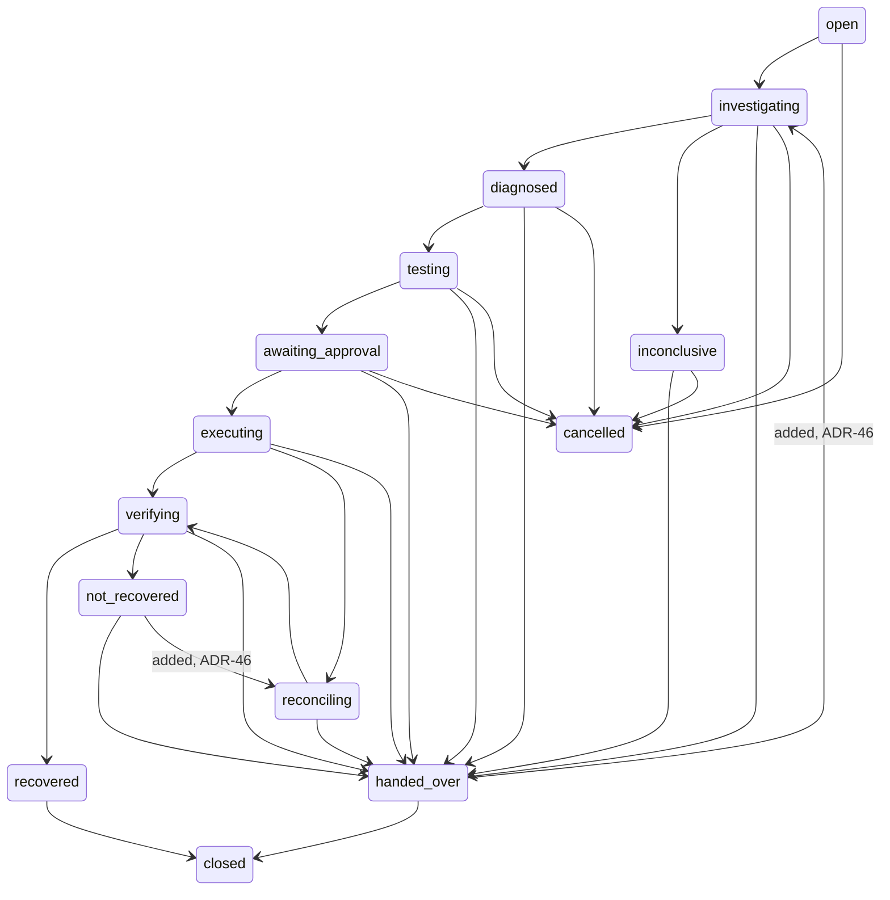
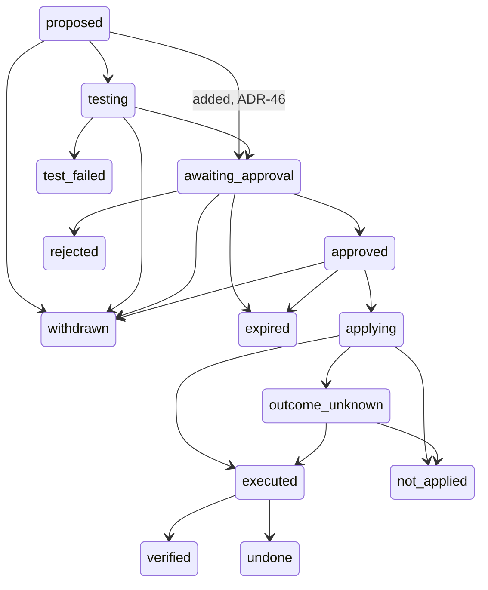

# Artifact 8: Workflow Specification

- **Layer:** 8, Distributed Workflows and State Machines
- **Built from:** Artifacts 6 and 7
- **Status:** Proposed: gaps resolved and reference code aligned 2026-11-02 per [decisions.md](../../decisions.md); pending team sign-off
- **Sources:** [decisions.md](../../decisions.md), [conversation.md](conversation.md), [files/workflow.py](files/workflow.py), [files/activities.py](files/activities.py), [files/states.py](files/states.py), [files/test_workflow.py](files/test_workflow.py), [System Design](../../reference/system-design.md), [Technical specification](../../reference/technical-specification.md), [Layer 7 schema](../layer-07-data-apis-events/files/schema-tables.sql), [Layer 7 contracts](../layer-07-data-apis-events/files/contracts.py)

## Required sections

| Required section | Questions this section answers | Done |
| --- | --- | --- |
| 8.1 Temporal workflow definition | Q8.1–Q8.3, Q8.10, Q8.12–Q8.16 | Yes |
| 8.2 Activity inventory | Q8.10, Q8.16 | Yes |
| 8.3 State machine diagram | Q8.25, Q8.26 | Yes |
| 8.4 State transition table | Q8.25–Q8.31, Q8.35, Q8.36, Q8.38, Q8.39 | Yes |
| 8.5 Retry and timeout policies | Q8.17, Q8.18, Q8.40–Q8.44 | Yes |
| 8.6 Approval wait design | Q8.19–Q8.21, Q8.29–Q8.31 | Yes |
| 8.7 Cancellation behavior | Q8.22, Q8.36, Q8.37 | Yes |
| 8.8 Replay strategy | Q8.4–Q8.9, Q8.23, Q8.24 | Yes |
| 8.9 Reconciliation strategy | Q8.11, Q8.32–Q8.35, Q8.39, Q8.45, Q8.48 | Yes |
| 8.10 Failure scenarios | Q8.4, Q8.11, Q8.32, Q8.33, Q8.45–Q8.47 | Yes |

## 8.1 Temporal workflow definition

*Answers Q8.1–Q8.3, Q8.10, Q8.12–Q8.16.*

Code: [files/workflow.py](files/workflow.py), `IncidentWorkflow`; the order is visible in one place, `IncidentWorkflow._lifecycle`. This artifact states the amended design, and the reference code in `files/` implements it. What the code can't yet prove is listed under Decisions and conflicts, in Reference code status.

**Why a workflow.** One workflow per incident, written as ordinary sequential code that calls activities for each step ([Q8.1](conversation.md)). Progress must live outside the process ([Q8.2](conversation.md)). An HTTP request can't carry this work because of timeouts, duplicates, no survival across restarts, no waiting, and wasted capacity, so intake returns in milliseconds and the workflow runs separately ([Q8.3](conversation.md)). Temporal replaces background threads and database flags; the fallback, a PostgreSQL job queue behind the same Workflow Orchestrator interface, stays recorded in ADR-06 ([Q8.12](conversation.md)). Temporal is self-hosted on a single node, in its own database on the same PostgreSQL instance (ADR-51).

| Item | Value |
| --- | --- |
| Workflow type | `IncidentWorkflow`. `ReconciliationWorkflow` is a separate short workflow, started by the `aisre-reconciliation` schedule (8.9) |
| Workflow ID | `incident-<incident_id>`; a re-investigation runs as `incident-<incident_id>-r2`, then `-r3` and so on (ADR-46) |
| Input | `IncidentWorkflowInput(incident_id, run)` |
| Signals | `approval_decided` (one per decision, ADR-49), `cancellation_requested`, `lead_decision` (`confirm_severity`, `close`, `reinvestigate`); each carries a dedupe ID |
| Query | `current_state`: incident state, action state, version |
| Result | Final incident state as a string, or `incident_missing` if there is no record |

**Lifecycle, in code order**

| Step | Activities | Incident state after |
| --- | --- | --- |
| Load | `load_incident` | `open` |
| Queue | `acquire_investigation_slot` | `open` until a slot is granted (8.1, Workers and routing) |
| Investigate | `read_spend_state`, then the coordinator loop, below | `investigating`, then `diagnosed`, `inconclusive` or `handed_over` |
| Patch and test | `draft_patch`, `run_sandbox_test` | `testing`, or `handed_over` |
| Approval wait (Release B) | `request_approval`, `escalate_approval`, `close_approval_request` | `awaiting_approval`, then `executing` or `handed_over` |
| Execute (Release B) | `dispatch_change`, `reconcile_execution` if unknown | `executing`, `reconciling` |
| Verify (Release B) | `verify_recovery` | `verifying`, then `recovered`, `not_recovered` or `handed_over` |
| Rollback (Release B) | `dispatch_change` on the rollback action, `reconcile_execution` if unknown, `verify_recovery` if applied | `not_recovered`, `reconciling` if unknown, then `handed_over` |
| Close | The API records closure; a `lead_decision` signal ends the run | `closed` |

Every business step also goes through `record_transition`; `notify` and `hand_over` run where needed.

**The investigating phase is the coordinator's loop** (ADR-52). The workflow owns durability, and the Layer 9 coordinator owns the investigation's decisions:

1. The workflow calls pure `coordinator.next_step(state, now)` from [coordinator.py](../layer-09-agent-architecture/files/coordinator.py).
2. It runs the returned step as one activity.
3. It feeds the result back into the coordinator's state. Temporal checkpoints each result.
4. It repeats until the coordinator returns a stop verdict.

| Step | Activity | Calls a model |
| --- | --- | --- |
| `COLLECT_BASELINE` | `collect_evidence`, fixed plan | No |
| `RETRIEVE_KNOWLEDGE` | `retrieve_knowledge` | No |
| `HYPOTHESISE` | `hypothesise` | Yes |
| `COLLECT_TARGETED` | `collect_evidence`, requested tools | No |
| `DIAGNOSE` | `diagnose` | Yes |
| `CRITIQUE` | `review_diagnosis`: code checks, then the independent critic (the Diagnosis Reviewer) | Yes |
| Stop verdict | None; the workflow takes the transition below | No |

| Stop verdict | Transition |
| --- | --- |
| Established: the critic accepted | `investigating` → `diagnosed` |
| Inconclusive: below the Medium bar (ADR-53), a required source missing (ADR-54), the critic escalated or failed twice, a skill failure, a provider outage, or a time, budget or invalid-output limit | `investigating` → `inconclusive` → `handed_over` (ADR-46) |
| Security or data-risk stop | `investigating` → `handed_over` (ADR-46) |

- A skill failure returns a typed failure to the coordinator, which stops as inconclusive (ADR-52).
- Limits read from one configuration object, including tokens and spend (ADR-52).
- `read_spend_state` runs once at the start and sets `AgentState.evidence_only` when the daily limit is reached. If spend can't be read, the investigation runs evidence-only (ADR-55).
- Model calls happen in hypothesise, diagnose, critique and patch proposal, always through the gateway (ADR-52). The Patch Proposer is a skill inside the Diagnosis Engine and runs after the critic accepts (ADR-51).

**How Release A ends** (ADR-44). "First version" means everything built through M4, shipped in two releases. In Release A the workflow stops at the end of Patch and test: `testing` → `handed_over`, carrying the tested recommendation, and people change production by hand. The production write credential isn't provisioned at all. A draft pull request is allowed in both releases; a direct commit never is. `IncidentSnapshot.remediation_enabled` selects the path: it is false until the recorded decision that opens Release B, and a running workflow keeps the value it read. If the sandbox is unavailable in Release A, `PatchOut.sandbox_available` is false and the incident goes `diagnosed` → `handed_over` with the untested draft. The Approval Service, dispatcher and Verifier are built and tested at M3 on synthetic targets, and run against production only in Release B.

| Release | After `testing` with outcome `passed` | Incident | Action |
| --- | --- | --- | --- |
| A | Hand over the tested recommendation | `handed_over` | `withdrawn`, reason `release_a_recommendation` |
| B | Request approval | `awaiting_approval` | `awaiting_approval` |

**Limits (provisional)**

| Constant | Value | Source |
| --- | --- | --- |
| `INVESTIGATION_LIMIT` | 15 min, from the slot grant | `Limits.investigation` (ADR-52) |
| `APPROVAL_ESCALATE_AFTER` | 15 min | ADR-49 |
| `APPROVAL_EXPIRES_AFTER` | 60 min | ADR-49 |
| `APPROVAL_VALID_FOR` | 15 min | ADR-49 |
| `WORKFLOW_LIMIT` | 24 h per run | ADR-46 |
| Hold period | `hold_seconds` on the action: 600 by default, longer per service in the catalogue | ADR-64, ADR-66 |

**The 24-hour limit** (ADR-46). A workflow-level timer runs for the whole run, not only during the close wait. When it fires, every non-terminal, non-waiting state hands over, after any write in flight reaches its outcome. `open` has no direct transition, so it passes through `investigating` to get there: `open` → `investigating` → `inconclusive` → `handed_over`, with the same reason. `recovered` stays `recovered` until the incident lead closes it: the limit stops work, and no work remains. The run then ends, and closure still works because the API records it.

**Workflow and activity split** ([Q8.10](conversation.md))

| Workflow (deterministic) | Activities (do I/O) |
| --- | --- |
| Step order and branching, including the pure coordinator call | Database reads and writes |
| Waiting for signals and timers | Evidence tool queries |
| Choosing which activity to call next | Model calls through the gateway |
| Tracking incident and action state in memory | Sandbox tests |
| Checking a transition is allowed before requesting it | Approval requests, notifications |
| Cancellation safe points | Production changes (dispatcher queue) |
| Limits that depend on time | Recovery verification |

**Workers and routing** ([Q8.14](conversation.md), [Q8.15](conversation.md)). The platform is one codebase and four processes: API, worker, dispatcher and isolated test environment (ADR-51). Temporal workers long-poll a task queue. If no worker is running, tasks wait in the queue and nothing is lost. An alert fires if a queue's oldest task waits longer than 60 seconds. Progress is kept in Temporal's history, one history per workflow ID, and any worker can replay any workflow ([Q8.13](conversation.md)).

| Task queue | Polled by | Carries | Why |
| --- | --- | --- | --- |
| `aisre-investigation` | Worker process (any number) | Workflow tasks; evidence, knowledge, diagnosis, review, patch, sandbox control, approval, verification, notification activities | No production credentials here. The worker holds a draft-pull-request credential only (ADR-51) |
| `aisre-dispatcher` | Dispatcher process only | `dispatch_change`, `reconcile_execution` | Only this process holds production write access (Artifact 5) |

**Concurrency.** 5 investigations run at once across all workers, queued up to 50 by severity, and the rest are never dropped (System Design section 9). A per-worker setting can't enforce a global limit, and Temporal task priority orders work without capping it, so the limiter is a PostgreSQL queue table:

1. `acquire_investigation_slot` inserts the incident into `investigation_queue` ([schema.sql](../layer-07-data-apis-events/files/schema.sql): incident, severity, queued time, granted time) and notifies on-call that it is queued.
2. In one locked transaction it grants a slot only if fewer than 5 are granted and this incident is first in order: severity (confirmed, else proposed), then oldest. A service already holding 4 slots waits, and the next eligible incident takes the slot (NFR-44, provisional). Otherwise it raises the retryable `NoSlot`, and Temporal asks again every 15 s (provisional).
3. The incident stays `open` while queued. The 15-minute limit starts at the grant.
4. `record_transition` deletes the row in the same transaction that takes the incident out of `investigating`, so a crash can't leak a slot.
5. Beyond 50 queued, the incident lead is alerted and the incident is still recorded and queued (NFR-39).

Each worker still caps concurrent activities and model activities to protect itself; that setting is capacity, not the investigation limit.

## 8.2 Activity inventory

*Answers Q8.10, Q8.16.*

Contracts: [files/activities.py](files/activities.py). Each activity has one job, takes a small input including its idempotency key, returns a small output (large items travel as artifact IDs), and reports heartbeats if it runs long ([Q8.16](conversation.md)). Implementations live in the platform's modules; the file defines interfaces only. Timeouts and retries are in 8.5.

Skill activities take `SkillIn` and return `SkillResult[...]`, which carries a typed failure as a value. Evidence travels by ID and the activity loads it. Hypotheses, the diagnosis and the critic's verdict travel in `SkillIn`, so they sit in history. `review_diagnosis` gets the diagnosis only, never the diagnoser's reasoning. All activities and workers use `DATA_CONVERTER`, Temporal's Pydantic converter.

| Activity | Queue | Input → output | Idempotency key | Job |
| --- | --- | --- | --- | --- |
| `load_incident` | Investigation | `IncidentIn` → `IncidentSnapshot`, or none if there is no record | `idempotency_key` | Read the incident |
| `acquire_investigation_slot` | Investigation | `IncidentIn` → none | `idempotency_key` | Queue by severity; grant one of 5 slots |
| `read_spend_state` | Investigation | `IncidentIn` → `SpendOut` | `idempotency_key` | Read whether the daily limit puts this investigation in evidence-only mode (ADR-55) |
| `record_transition` | Investigation | `TransitionIn` → `TransitionOut` | `transition_id` | Check the table and expected version; write status, timeline event and queue-row removal in one transaction |
| `notify` | Investigation | `NotifyIn` → none | `notification_id` | Send a notification |
| `record_notification_failed` | Investigation | `NotifyIn` → none | `notification_id` | Write `aisre.notification.failed.v1` and raise an alert, where no further transition exists (8.10) |
| `collect_evidence` | Investigation | `EvidenceIn` → `SkillResult[EvidenceOut]` | `idempotency_key` | Fixed plan or requested tools, each through the ToolGate: parallel read-only queries, redaction, gaps |
| `retrieve_knowledge` | Investigation | `SkillIn` → `SkillResult[KnowledgeOut]` | `idempotency_key` | Relevant knowledge passages |
| `hypothesise` | Investigation | `SkillIn` → `SkillResult[HypothesesOut]` | `idempotency_key` | Model Gateway: 2–5 hypotheses and evidence requests |
| `diagnose` | Investigation | `SkillIn` → `SkillResult[DiagnosisResult]` | `idempotency_key` | Model Gateway: reserve budget, call, validate, settle |
| `review_diagnosis` | Investigation | `SkillIn` → `SkillResult[ReviewResult]` | `idempotency_key` | Code checks, then the independent critic |
| `draft_patch` | Investigation | `SkillIn` → `SkillResult[PatchOut]` | `idempotency_key` | Draft the patch through the Patch Proposer, or report that no allowed fix exists |
| `run_sandbox_test` | Investigation | `TestIn` → `TestOut` | `test_key` | Fresh isolated environment: reproduce first, apply, check, destroy. Beyond 3 copies at once it queues (ADR-56) |
| `request_approval` | Investigation | `ApprovalRequestIn` → `ApprovalRequestOut` | `request_key` | Open the approval request, set `approvers_needed` (ADR-49), create the rollback action |
| `escalate_approval` | Investigation | `ApprovalRequestIn` → none | `request_key` | Notify the next approver |
| `close_approval_request` | Investigation | `ApprovalRequestIn` → none | `request_key` | Close as expired, withdrawn or voided |
| `dispatch_change` | Dispatcher | `DispatchIn` → `DispatchOut` | `action_id`, which is the execution key (ADR-47) | Reload the action and signatures; verify; record intent and `applying`; apply once; record the outcome |
| `reconcile_execution` | Dispatcher | `DispatchIn` → `DispatchOut` | `action_id`, which is the execution key | Look up the key, compare the live service with the target; read-only |
| `verify_recovery` | Investigation | `VerifyIn` → `VerifyOut` | `verification_key` | Read monitoring directly for the hold period |
| `hand_over` | Investigation | `HandOverIn` → none | `handover_key` | Hand over to a person, with findings |
| `reconcile_workflows` | Investigation | `ReconciliationIn` → `ReconciliationOut` | `idempotency_key` | The 8.9 job: compare open incidents, running workflows and the queue; remove orphaned queue rows |

Key formats are derived from history, so a replay rebuilds the same key. `<run>` is the incident ID, plus `-r2` and so on for a re-investigation, so a later run can't collide with the first.

| Key | Format |
| --- | --- |
| Transition, notification, hand-over | `<run>:t<step>`, `<run>:n<step>`, `<run>:h<step>` |
| Load, slot, spend, coordinator step | `<run>:load`, `<run>:slot`, `<run>:spend`, `<run>:s<step>` |
| Reconciliation job | The Temporal run ID |
| Test, approval request, verification | `<action_id>:test:1`, `<action_id>:approval:1`, `<action_id>:verify:1` |
| Execution key | The `action_id`, unchanged on every attempt (ADR-47) |

Every activity is idempotent on the key named in its input, and every input carries one. `IncidentIn`, `EvidenceIn` and `SkillIn` carry `idempotency_key`, and `VerifyIn` carries `verification_key`. Model results are also reused by `input_sha256` within an incident (ADR-61).

`DispatchIn` carries only the action ID (ADR-51). The API stores the signed approval, and the dispatcher reloads the action and signatures from trusted storage. `approval_id` is not an input: each attempt records the deciding `approval_id` for audit (ADR-47).

## 8.3 State machine diagram

*Answers Q8.25, Q8.26.*

Rendered from the ADR-46 tables: `INCIDENT_TRANSITIONS` and `ACTION_TRANSITIONS` in [files/states.py](files/states.py). The three transitions ADR-46 added are labelled `added, ADR-46`. One diagram per table. The table holds no triggers, start markers or end markers, so none are drawn. The initial incident state is `open` ([Q8.26](conversation.md)). `closed` and `cancelled` have no outgoing transitions.

**Incident (30 transitions: the team's 28, 2 added)**

**Action (20 transitions: the team's 19, 1 added)**

## 8.4 State transition table

*Answers Q8.25–Q8.31, Q8.35, Q8.36, Q8.38, Q8.39.*

Code: [files/states.py](files/states.py). `states.py` is authoritative and holds the three additions from ADR-46. Everything else (schema enums, contracts, Technical specification section 2, tests) must match it (ADR-46, ADR-64), and `test_transition_tables_match_schema_exactly` compares it with `schema.sql` both ways. One table of allowed transitions, shared by the workflow and the Incident Record. Every entry has a path.

**Incident states** ([Q8.25](conversation.md))

| State | Meaning |
| --- | --- |
| `open` | Accepted; workflow not yet running, or queued for an investigation slot |
| `investigating` | Coordinator loop: evidence, retrieval, hypotheses, diagnosis, review |
| `diagnosed` | Reviewed diagnosis, established |
| `inconclusive` | Root cause not established |
| `testing` | Patch being tested in the isolated environment |
| `awaiting_approval` | Waiting for a person |
| `executing` | Dispatcher applying the change |
| `reconciling` | Outcome unknown; establishing the real state |
| `verifying` | Recovery being checked over the hold period |
| `recovered` | Recovery held; waiting for the lead to accept |
| `not_recovered` | Fix didn't hold; rollback in progress |
| `handed_over` | A person owns the next step |
| `cancelled` | Stopped before any production change. Final for the platform; the incident itself stays with people outside the platform (ADR-46) |
| `closed` | Accepted and closed by the incident lead |

"Repaired" is deliberately not a state: a change being applied doesn't mean the service has recovered. Q3.15's nine stages describe how a team tracks an incident and are not workflow states (ADR-46).

**Incident transitions**

| From | To | Trigger | Source |
| --- | --- | --- | --- |
| `open` | `investigating` | Workflow started and slot granted | Q8.26 |
| `open` | `cancelled` | Cancellation | Q8.36 |
| `investigating` | `diagnosed` | All conditions hold, including critic accepted | Q8.27 |
| `investigating` | `inconclusive` | Coordinator stops as inconclusive: a condition fails, review did not accept, skill failure, provider outage, or a time, budget or invalid-output limit | Q8.27, ADR-46, ADR-52 |
| `investigating` | `handed_over` | Security or data-risk stop only | ADR-46 |
| `investigating` | `cancelled` | Cancellation at a safe point | Q8.36 |
| `diagnosed` | `testing` | Patch drafted | `workflow.py` |
| `diagnosed` | `handed_over` | No allowed fix can be drafted, including `draft_patch` failing, or Release A with sandbox unavailable | ADR-46, 8.10 |
| `diagnosed` | `cancelled` | Cancellation at a safe point | Q8.36 |
| `inconclusive` | `handed_over` | Root cause not established; diagnosis rejected by review. No automatic resume when a provider returns | Q8.27, ADR-46 |
| `inconclusive` | `cancelled` | Cancellation in the moment before hand-over | Q8.36, ADR-46 |
| `testing` | `awaiting_approval` | Release B: reproduced, symptom gone, all prior tests pass, no new error types | Q8.28, ADR-44 |
| `testing` | `handed_over` | Release A: `passed`, with the tested recommendation. Either release: any other test outcome, or `run_sandbox_test` failed | Q8.28, ADR-44 |
| `testing` | `cancelled` | Cancellation at a safe point | Q8.36 |
| `awaiting_approval` | `executing` | `approvers_needed` valid decisions exist, and the conditions in 8.6 hold | Q8.29, ADR-49 |
| `awaiting_approval` | `handed_over` | Any valid rejection, expired at 60 min, or an approval activity failed (8.10) | Q8.30, Q8.31, ADR-49 |
| `awaiting_approval` | `cancelled` | Cancellation while waiting | Q8.22, Q8.36 |
| `executing` | `verifying` | Dispatcher returns `applied` | `workflow.py` |
| `executing` | `reconciling` | Dispatch outcome unknown, or `dispatch_change` failed with no answer | Q8.33 |
| `executing` | `handed_over` | Dispatcher returns `not_applied` or `refused` | Layer 11 |
| `reconciling` | `verifying` | Reconciliation says applied, and the change is the fix | Q8.34 |
| `reconciling` | `handed_over` | Not applied, still unknown, or no intent found. Always after a rollback's reconciliation, and after its check if it applied | Q8.34, ADR-48 |
| `verifying` | `recovered` | Verdict `verified` | ADR-66 |
| `verifying` | `not_recovered` | Verdict `failed` | Q8.35, ADR-66 |
| `verifying` | `handed_over` | Verdict `inconclusive`, or `verify_recovery` failed: no rollback, and a person decides | ADR-46, ADR-66 |
| `recovered` | `closed` | Closed by incident lead, in all cases | ADR-66 |
| `not_recovered` | `handed_over` | Rollback applied and checked, or not applied, refused, rejected or expired | Q8.35, ADR-48 |
| `not_recovered` | `reconciling` | **Added.** A rollback's outcome is unknown | ADR-46 |
| `handed_over` | `closed` | Closed by incident lead | `workflow.py` |
| `handed_over` | `investigating` | **Added.** A person requests re-investigation. New run `incident-<id>-r2`. No automatic path exists | ADR-46, Q8.30 |

The 24-hour limit also takes every `→ handed_over` transition open to a non-terminal, non-waiting state, and from `investigating` it goes through `inconclusive` (ADR-46, 8.1). `cancelled` and `closed` have no outgoing transitions. `→ cancelled` applies from exactly the 6 states above: `executing`, `reconciling`, `verifying`, `not_recovered` and `recovered` never go to `cancelled` (ADR-46). `PROTECTED_INCIDENT` is `executing`, `reconciling`, `not_recovered`. `diagnosed` → `awaiting_approval` doesn't exist: testing always comes first (ADR-46).

A run that reaches `reconciling` from `not_recovered` never takes `reconciling` → `verifying`. The table allows that pair for the fix, and the workflow doesn't take it for a rollback (ADR-48).

**Action transitions**

A rollback is its own immutable action of kind `rollback`, with `parent_action_id` and its own execution key (ADR-48). The same table covers both kinds.

| From | To | Trigger | Source |
| --- | --- | --- | --- |
| `proposed` | `testing` | Patch drafted | `workflow.py` |
| `proposed` | `withdrawn` | Cancellation; Release A with sandbox unavailable; for a rollback action, the fix ended with no `failed` verdict | Q8.36, ADR-48 |
| `proposed` | `awaiting_approval` | **Added.** Rollback actions only, which skip `testing`, on a `failed` verdict | ADR-46, ADR-48 |
| `testing` | `awaiting_approval` | Release B: test passed after reproduction | Q8.28, ADR-44 |
| `testing` | `test_failed` | Anything else, including a partial pass or `run_sandbox_test` failing | Q8.28 |
| `testing` | `withdrawn` | Cancellation; Release A hand-over of a passed test | Q8.36, ADR-44 |
| `awaiting_approval` | `approved` | `approvers_needed` valid decisions exist; for a rollback, its conditional approval starts on the `failed` verdict | Q8.29, ADR-48, ADR-49 |
| `awaiting_approval` | `rejected` | Any valid rejection; final | Q8.30, ADR-49 |
| `awaiting_approval` | `expired` | 60 min with no decision; final | Q8.31 |
| `awaiting_approval` | `withdrawn` | Cancellation; `request_approval`, `escalate_approval` or `notify` failed | Q8.36, 8.10 |
| `approved` | `applying` | Dispatcher records intent | Q8.29, Q8.32 |
| `approved` | `expired` | Dispatcher refused: the granted approval passed `valid_until` before intent was recorded | ADR-49 |
| `approved` | `withdrawn` | Before intent: a late rejection, or the dispatcher refused because of a revocation, a cancellation or a changed service (approval voided). `approved` → `rejected` isn't a transition | Q8.36, ADR-49 |
| `applying` | `executed` | Applied, by the dispatcher's answer or by reconciliation | `workflow.py`, Q8.34 |
| `applying` | `not_applied` | `not_applied`, by the dispatcher's answer or by reconciliation | `workflow.py`, Q8.34 |
| `applying` | `outcome_unknown` | Timeout with no answer, or `reconcile_execution` failed | Q8.33 |
| `outcome_unknown` | `executed` | Reconciliation, or the incident lead's outcome resolution | Q8.33, Q8.34, ADR-49 |
| `outcome_unknown` | `not_applied` | Reconciliation, or the incident lead's outcome resolution | Q8.33, Q8.34, ADR-49 |
| `executed` | `verified` | Verdict `verified`, for a fix or a rollback | ADR-48, ADR-66 |
| `executed` | `undone` | The rollback applied; the parent action takes this transition | Q8.35, ADR-48 |

A rollback action ends at `executed`, `verified`, `not_applied`, `outcome_unknown`, `rejected`, `expired` or `withdrawn`. Once applied it is checked while the incident stays `not_recovered`, or `reconciling` if its outcome was unknown, with no `verifying` state. The result is reported to the person taking over and triggers nothing (ADR-48).

**Preventing invalid transitions** ([Q8.38](conversation.md))

1. **One writer:** while a run is live, only the incident's workflow changes its state, and Temporal runs one workflow per ID. There are three named exceptions: the API records `closed`; the dispatcher records action `applying` and its outcomes (ADR-51, C18); and a person's outcome resolution on an `outcome_unknown` action, which the API accepts and the dispatcher writes, because only its role can write attempts (ADR-49, ADR-51). All go through the same table and version checks.
2. **The transition table:** `check_incident` and `check_action` refuse any transition not listed, in the workflow before it asks and in `record_transition` before it writes. `check_action` requires the action's kind, because only a rollback may go `proposed` → `awaiting_approval`.
3. **Optimistic concurrency:** `record_transition` writes only if `version = expected_version`.
4. **Idempotent transition IDs:** `<run>:t<step>` is derived from history, so a retried transition is recognised, not applied twice.

**Re-investigation** (ADR-46). A person with the permission (ADR-50) requests it through the API, which writes an outbox row. The relay signals the old run with `lead_decision` kind `reinvestigate`, which ends that run without a write, and then starts `incident-<id>-r2`. The new run loads the incident as `handed_over`, takes a slot, and records `handed_over` → `investigating`. Any fix it proposes is a new action with a new `action_id` (ADR-47).

**Closure.** `POST /v1/incidents/{id}/closure` answers `200` (Artifact 7), so the API records `recovered` or `handed_over` → `closed` in one transaction, and writes an outbox row. The relay signals `lead_decision` kind `close`, and a live run ends without a second write. Closure still works after the run has ended at 24 hours.

**Canonical state** ([Q8.39](conversation.md)). The PostgreSQL incident record owns business state. Temporal owns execution state. The workflow changes business state only through `record_transition`.

## 8.5 Retry and timeout policies

*Answers Q8.17, Q8.18, Q8.40–Q8.44.*

**Rule:** one layer owns retries for each operation ([Q8.44](conversation.md)). Retries at different layers multiply: 3 × 3 × 3 = 27 calls for one logical request ([Q8.43](conversation.md)).

**Retry policies**

| Policy | Initial interval | Backoff | Maximum interval | Maximum attempts | Other |
| --- | --- | --- | --- | --- | --- |
| `DB_RETRY` | 1 s | 2.0 | 30 s | 0 (unlimited; stops at schedule-to-close where one is set) | Non-retryable: `InvalidTransition`. A record that refuses the write (SQLSTATE 23514, 23001) fails the workflow, so it doesn't spin |
| `TOOL_RETRY` | 2 s | 2.0 | 20 s | 3 | |
| `NO_RETRY` | Not set | Not set | Not set | 1 | The sandbox and production writes |
| `MODEL_RETRY` | Not set | Not set | Not set | 2 | Model activities. Every model failure returns as a value, so the only failure Temporal sees is a lost worker (ADR-27, ADR-52) |
| `READ_RETRY` | 5 s | 2.0 | 1 min | 10 | Non-retryable: `PermissionDenied` |
| `SLOT_RETRY` (provisional) | 15 s | 1.0 | 15 s | 0 (unlimited) | `NoSlot` is the normal answer while queued |

**Per activity (provisional).** Schedule-to-close is 4× start-to-close, capped by the remaining investigation time for investigation steps (Q8.18). The only exceptions are the five activities marked "None", which run within the 24-hour workflow limit.

| Activity | Start-to-close | Schedule-to-close | Heartbeat timeout | Policy | Retry owner |
| --- | --- | --- | --- | --- | --- |
| `load_incident` | 10 s | None | None | `DB_RETRY` | Temporal |
| `acquire_investigation_slot` | 10 s | None | None | `SLOT_RETRY` | Temporal |
| `read_spend_state` | 10 s | 40 s | None | `DB_RETRY` | Temporal |
| `record_transition` | 10 s | None | None | `DB_RETRY` | Temporal |
| `notify` | 15 s | 60 s | None | `TOOL_RETRY` | Temporal |
| `record_notification_failed` | 10 s | None | None | `DB_RETRY` | Temporal |
| `collect_evidence` | 180 s, or remaining time if less | 720 s, or remaining time if less | 20 s | `TOOL_RETRY` | Temporal |
| `retrieve_knowledge` | 30 s, or remaining time if less | 120 s, or remaining time if less | None | `TOOL_RETRY` | Temporal |
| `hypothesise` | 300 s, or remaining time if less | 1,200 s, or remaining time if less | 20 s | `MODEL_RETRY` | Model Gateway; Temporal for a lost worker only |
| `diagnose` | 300 s, or remaining time if less | 1,200 s, or remaining time if less | 20 s | `MODEL_RETRY` | Model Gateway; Temporal for a lost worker only |
| `review_diagnosis` | 300 s, or remaining time if less | 1,200 s, or remaining time if less | 20 s | `MODEL_RETRY` | Model Gateway; Temporal for a lost worker only |
| `draft_patch` | 300 s | 1,200 s | 20 s | `MODEL_RETRY` | Model Gateway; Temporal for a lost worker only |
| `run_sandbox_test` | 900 s | 3,600 s, which covers a wait for a free copy | 20 s | `NO_RETRY` | None: failure hands over (8.10) |
| `request_approval` | 30 s | 120 s | None | `DB_RETRY` | Temporal |
| `escalate_approval` | 30 s | 120 s | None | `DB_RETRY` | Temporal |
| `close_approval_request` | 30 s | 120 s | None | `DB_RETRY` | Temporal |
| `dispatch_change` | 300 s | 1,200 s | None | `NO_RETRY` | Forbidden: an unanswered write becomes `unknown` |
| `reconcile_execution` | 150 s | 600 s, the 10-minute limit from Q8.34 | None | `READ_RETRY` | Temporal |
| `verify_recovery` | Hold period + 300 s (900 s at the default) | 4× (3,600 s at the default) | 60 s | `READ_RETRY` | Temporal |
| `hand_over` | 15 s | None | None | `DB_RETRY` | Temporal |
| `reconcile_workflows` | 60 s | 240 s | None | `TOOL_RETRY` | Temporal |

`reconcile_execution` keeps 4× and the 10-minute limit together: while the release process says "in progress", an attempt raises a retryable error, and `READ_RETRY`'s backoff is the wait between checks.

**Time limits, smallest to largest** ([Q8.18](conversation.md), provisional)

| Limit | Applies to | Value |
| --- | --- | --- |
| Per call | One model request, inside the gateway | 60 s |
| Start-to-close | One activity attempt | Per activity, above; `diagnose` 300 s |
| Schedule-to-close | All attempts of one activity | 4× start-to-close, capped by the investigation's remaining time |
| Investigation | Evidence to diagnosis | 15 min, from `workflow.now()` at the slot grant |
| Workflow | One run | 24 h (ADR-46) |

Long activities also send heartbeats; a missing heartbeat ends the attempt early instead of waiting for the full timeout. A heartbeat is also how an activity receives cancellation, so every long activity that can be cancelled has a 20 s heartbeat timeout (8.7). `verify_recovery` isn't cancelled, and keeps 60 s, the crash-detection value in the Technical specification.

**`record_transition` in a database outage** (layer decision). It retries with no schedule-to-close limit while within the 24-hour workflow limit, so a run pauses and continues when the database returns ([Q8.46](conversation.md)). `load_incident`, `hand_over` and `record_notification_failed` do the same: nothing can be handed over from `open` without a readable record, and a hand-over is the last step that must not be lost.

**Model calls** ([Q8.17](conversation.md), [Q8.44](conversation.md), ADR-27)

| Layer | Behaviour |
| --- | --- |
| Provider SDK | Built-in retries off (`max_retries = 0`) |
| Model Gateway | Up to 3 attempts per step, backoff 2 s → 4 s, each call limited to 60 s, budget check before each attempt, circuit breaker |
| Temporal | `hypothesise`, `diagnose`, `review_diagnosis` and `draft_patch` use `MODEL_RETRY`: one re-run, when the worker is lost (ADR-27) |
| API clients | Never retry model work; they only submit incidents, which are idempotent |

After 3 failures the activity returns a typed failure, the coordinator stops as inconclusive, and the workflow hands over with the evidence and timeline (ADR-52). A critic failing twice ends the investigation as inconclusive, so a critic can't exceed 6 attempts total (ADR-52).

**Crash recovery for model steps** (ADR-27, ADR-52). When a step's worker is lost, Temporal re-runs the activity once on another worker. A completed model result is reused by `input_sha256` (ADR-61), so nothing is re-billed. Typed failures come back as values, so they are not re-run.

**Delivery guarantees**

| Guarantee | Where | Source |
| --- | --- | --- |
| At-least-once | Temporal activities and the outbox; made safe by idempotency keys | Q8.40 |
| At-most-once | Not used for incidents, approvals or changes; suits things like a metric sample | Q8.41 |
| At most one effect | Production writes: at-least-once delivery, an execution key, and reconciliation when the outcome is unknown | Q8.41, ADR-47 |
| Effectively once | An idempotency key, a lookup by key, a check of the real state, and a person when all of those fail. Exactly-once needs the receiver's cooperation | Q8.42 |

## 8.6 Approval wait design

*Answers Q8.19–Q8.21, Q8.29–Q8.31.*

This section applies in Release B (ADR-44). The rules are in ADR-49.

**How a decision reaches the workflow** ([Q8.19](conversation.md))

1. The API records the decision and writes an outbox row in one transaction.
2. The outbox relay sends `approval_decided`, with the decision ID, action ID, decision and action digest. Each decision arrives as its own signal.
3. The signal handler ignores duplicates, stale actions and a different action digest. Otherwise it stores the decision, keyed by the deciding person.
4. The `wait_condition` sees the decisions, and the workflow continues once one of these is true: `approvers_needed` valid decisions exist, or any valid rejection exists.

**How many approvers** (ADR-49). `request_approval` sets `approvers_needed` and returns it to the workflow.

| Case | `approvers_needed` |
| --- | --- |
| Ordinary change | 1 |
| High-impact: confirmed severity `sev1`; kind `release_rollback`; a service marked `critical` in the catalogue; or a change to more than one deployment (provisional) | 2 |
| Severity not yet confirmed | 2: treated as high-impact |

- Two different people with approve rights are needed for 2. The incident lead may be one, but isn't required to be.
- Two approvers authorise one action, and so one execution key (ADR-47).
- A decision counts only while it is valid. An approval older than 15 minutes stops counting, and the workflow keeps waiting for the request's 60 minutes. The signal carries no decision time, so the workflow measures age from receipt; the dispatcher's check stays final.
- Any valid rejection wins, regardless of order. A rejection needs authentication, not a recent sign-in.
- Nobody approves their own request, nobody may be the sole approver of a revert of their own change, and the platform can never approve.
- A failed approval attempt sends no signal. It writes no approval row, but it writes a `aisre.approval.refused.v1` timeline event and raises a security alert.

**How it waits** ([Q8.20](conversation.md)). `workflow.wait_condition(..., timeout=...)` records a timer in Temporal's history. The worker drops the workflow from memory and holds nothing. When the timer fires or a signal arrives, any worker replays to the waiting point and continues. The wait is never 24 hours; the same mechanism holds the whole workflow open for up to 24 hours while waiting for the incident lead to close it.

**Two clocks.** The two timers are separate, and they match in code, answers and both specs (ADR-49). The request deadline is how long a person has to answer (escalates at 15 min, expires at 60 min). The approval's validity is how long a granted approval can be used (15 min, `APPROVAL_VALID_FOR`). An approver's sign-in must be within 15 minutes, with two-factor.

| Time or event | What happens | Incident | Action |
| --- | --- | --- | --- |
| 0 | `request_approval`, then `notify` approvers | `awaiting_approval` | `awaiting_approval` |
| 15 min | `escalate_approval`; the next approver is notified; the workflow keeps waiting | No change | No change |
| 60 min | `close_approval_request` (expired), so a late approval is refused by the API; hand over "approval expired; no action taken"; wait for the lead | `handed_over` | `expired` |
| Rejected | Reason kept as a permanent record; hand over; wait for the lead | `handed_over` | `rejected` |
| Approved by `approvers_needed` people | Conditions below | `executing` | `approved`, then `applying` by the dispatcher |
| Cancelled | See 8.7 | `cancelled` | `withdrawn` |

**Nothing is executed by default** ([Q8.21](conversation.md)). The platform never proposes another fix on its own after a rejection. If the approver asked for more evidence, a person starts a recorded re-investigation (`incident-<id>-r2`) ([Q8.30](conversation.md), 8.4).

**Before applying** ([Q8.29](conversation.md)). The workflow checks what its signals carry, so it doesn't dispatch a change that can't pass. The dispatcher checks all of them again from trusted storage, and its answer is final (ADR-51).

| # | Condition | Workflow | Dispatcher |
| --- | --- | --- | --- |
| 1 | A recorded `approved` decision from an authorised person, for this action | Yes | Yes |
| 2 | A second approver, if the change is high-impact | Yes | Yes |
| 3 | The approval's action digest matches the action. The digest covers the patch fingerprint, target, base revision and predicates; `patch_sha256` stays on the record for reading | Yes | Yes |
| 4 | The approval's signature is valid | No | Yes |
| 5 | The approval is unexpired (within 15 minutes) | Yes | Yes |
| 6 | The service's version and configuration are unchanged since approval | No | Yes |
| 7 | No cancellation or revocation was requested | Cancellation | Yes, as a revocation (8.7) |
| 8 | Recovery criteria and baseline are recorded (ADR-66) | No | Yes |

**If the service changed after approval.** The dispatcher refuses, the approval is voided, and an alert is raised. The action is immutable and names its base revision, so it can't be asked for again: action `approved` → `withdrawn`, incident `executing` → `handed_over`. A new attempt is a re-investigation with a new action (ADR-47, ADR-49).

**Revocation.** `POST /v1/actions/{id}/revocations` works until the dispatcher records intent (ADR-49). A `revoked` decision while waiting removes that person's approval from the count. After the incident enters `executing`, the dispatcher sees it and refuses.

**Rollback approval** (ADR-48). A conditional approval is signed with the fix, in the same decision, and for a high-impact fix both approvers sign it. It starts on a `failed` verdict, with `valid_until` = parent's `valid_until` + hold period + 15 minutes. Without one, the rollback needs a fresh approval, and escalation and expiry follow the same 15 and 60 minutes while the incident stays `not_recovered`.

Tests: `test_happy_path_reaches_closed` (duplicate approval), `test_unanswered_approval_escalates_then_expires`, `test_rejection_hands_over`.

## 8.7 Cancellation behavior

*Answers Q8.22, Q8.36, Q8.37.*

**How it arrives** ([Q8.22](conversation.md)). As the signal `cancellation_requested`, through the outbox, carrying its own ID for deduplication. Temporal-level cancellation (an administrator's emergency stop) is handled the same way.

**All work stops within 30 s p95** (FR-33, provisional).

1. The signal handler cancels the running activity, unless the state is protected.
2. The activity receives the cancellation on its next heartbeat. A 20 s heartbeat timeout puts that within about 16 s.
3. The activity stops. For `run_sandbox_test`, the Test Runner kills the sandbox and destroys it before the activity ends, and the workflow waits for that.
4. The workflow takes the safe point below.

`record_transition`, `hand_over` and `verify_recovery` are not cancelled.

| Moment | Behaviour | Result |
| --- | --- | --- |
| Before any change: `open`, `investigating`, `diagnosed`, `inconclusive`, `testing`, `awaiting_approval` | Cancel the running activity, then stop at the safe point: between steps, or while waiting for approval. Close any open approval request, withdraw the action, destroy the sandbox, record who asked and why | `cancelled`, final for the platform (ADR-46). A later problem is a new incident |
| During a production write: `executing`, `reconciling`, `not_recovered` | The write runs to its outcome: the dispatcher activity is shielded and the workflow waits. The API records the request as an event, with who and when; the workflow writes nothing for it | Depends on the outcome, below |
| `verifying` | No `cancelled` transition; `verify_recovery` runs in `_protected` | `recovered`, `handed_over` or `not_recovered` |
| `recovered`, `handed_over` | A person owns it; cancellation changes nothing | Unchanged |

**After a write completes with a cancel pending** ([Q8.37](conversation.md))

| Outcome | Next |
| --- | --- |
| Applied | Verification still runs, because the service must be checked either way; the incident ends `recovered` or `handed_over` |
| Not applied or unknown | Hand over |

`cancelled` is not an allowed transition from a state where a change may have happened: the record can't say "cancelled" then. Rollback is a separate, explicit, approved action, never a side effect of "cancel".

**Cancelling after `executing` starts but before intent.** The API records a cancellation against an `approved` action as a revocation, in the same transaction. The dispatcher refuses it (ADR-49), so nothing is sent: action `approved` → `withdrawn`, incident `executing` → `handed_over`.

Action on cancellation: `withdrawn`, from proposed, testing or awaiting approval at a safe point, or from approved through that revocation ([Q8.36](conversation.md)).

**Writes are shielded.** A Temporal-level cancel can't interrupt `record_transition`: the write is shielded in every state, so the outcome is always recorded before `run` handles the cancel (C20). `_act` shields every non-cancellable activity, so `notify` and `hand_over` survive a Temporal cancel too. Test: `test_temporal_cancel_during_transition_write_records_outcome`.

Tests: `test_cancel_while_awaiting_approval_withdraws_action`, `test_cancel_during_write_lets_write_finish_and_does_not_pretend_reversal`, `test_temporal_cancel_during_write_waits_for_outcome`.

## 8.8 Replay strategy

*Answers Q8.4–Q8.9, Q8.23, Q8.24.*

**What a crash loses** ([Q8.4](conversation.md)). Everything in memory: local variables, the call stack, open connections, unreported activity results. What survives is what Temporal recorded: input, each completed activity's result, each signal, each timer.

**Replay** ([Q8.8](conversation.md))

1. A worker picks up the workflow and receives its history.
2. It runs the workflow code from the start. When the code asks for an activity that already completed, the recorded result is returned without running the activity again.
3. Signals and timers are delivered at the same points they occurred.
4. At the end of the history the code is in exactly the state it was in before the crash, and continues live.

**Guarantees this needs** ([Q8.6](conversation.md)): durable history, deterministic replay, at-least-once activities, exactly-once workflow decisions, one live run per workflow ID, durable timers and signals.

**Restrictions on workflow code** ([Q8.9](conversation.md))

- No I/O: no database, network, files or model calls.
- No system clock: use `workflow.now()`.
- No randomness and no new UUIDs: IDs come from activities or are derived from history.
- No threads or blocking sleeps: use `workflow.sleep` and `wait_condition`.
- No reading environment or global mutable state.
- No iteration over unordered collections that affects decisions.
- No changing the order or type of activity calls for running workflows without versioning.

Temporal's Python sandbox enforces most of these. The rest are checked in code review and by replay tests.

**What must survive a restart** ([Q8.5](conversation.md))

| Information | Where it survives |
| --- | --- |
| Each workflow's history: input, completed steps, signals, timers | Temporal's own database, on the same PostgreSQL instance (ADR-51) |
| Incident and action state, version, timeline | PostgreSQL incident record |
| Evidence, diagnoses, patches, approvals, attempts, verifications | PostgreSQL + artifact store |
| Pending outbox messages (starts, signals) | PostgreSQL outbox |
| Budget used and reserved | PostgreSQL |
| Approval deadlines, escalation times | Temporal timers, plus the approval request row |
| Execution intent and execution key, before any production write | PostgreSQL execution attempt |
| Investigation queue position | PostgreSQL `investigation_queue` |

**Deploying new code** ([Q8.23](conversation.md))

| Change | Handling |
| --- | --- |
| Activity implementation, or a timeout value read at call time | Safe; nothing needed |
| Adding, removing or reordering activity calls or waits | `workflow.patched("<change-id>")`; once no old workflow runs, `workflow.deprecate_patch` and remove the old branch |
| Large redesign | New workflow type (`IncidentWorkflowV2`); old workflows finish on the old type |
| Every deploy | CI replays a sample of recent production histories against the new code with Temporal's `Replayer`; any nondeterminism fails the build |

Each run lasts at most 24 hours, so old branches are removed within a day of a change.

**Two records** ([Q8.7](conversation.md), [Q8.24](conversation.md))

| | Temporal history | Business timeline |
| --- | --- | --- |
| Written by | Temporal, automatically | The `record_transition` activity and the API |
| Contains | Activity attempts, retries, timers, signals, serialised inputs | Business events: status changes, approvals, executions, verifications |
| Format | Temporal's own | Our CloudEvents contracts (Artifact 7) |
| Retention | Short (provisional: 7 days after close) | 1 year, hash-chained |
| Readers | Platform engineers, for debugging | Engineers, reviewers, auditors, through the API |
| Permissions | Temporal's own | Per-service roles |

The workflow never exposes its history as the timeline. After a crash, the timeline shows the last completed business step, and Temporal's history shows the interrupted attempt.

Test: `test_completed_history_replays_deterministically`.

## 8.9 Reconciliation strategy

*Answers Q8.11, Q8.32–Q8.35, Q8.39, Q8.45, Q8.48.*

**Recording an uncertain write**

| Situation | Attempt | Action | Incident | Source |
| --- | --- | --- | --- | --- |
| Before calling the release process, the dispatcher records | `started`, with the execution key | `applying` | `executing` | Q8.32, C18 |
| Dispatcher crashes | Stays `started` | Stays `applying` | Stays `executing`, then `reconciling` when the activity fails | Q8.32 |
| Timeout with no answer | `unknown` | `outcome_unknown` | `reconciling` | Q8.33 |

A reconcile that finds no intent row means nothing was sent: the action is still `approved`, so it goes to `withdrawn` and the incident hands over.

When the activity is retried or the workflow resumes, the dispatcher sees the `started` attempt and reconciles first; it never applies the change again blindly. The event is `aisre.execution.completed.v1` with outcome `unknown`. Only reconciliation, or the incident lead's outcome resolution (ADR-49, event `aisre.execution.outcome_resolved.v1`), can leave `outcome_unknown`.

**An unknown outcome blocks the deployment** (ADR-47). The block follows from the action's status, so it needs no separate write: a new attempt on a deployment is refused while another action there is `outcome_unknown`, or `applying` with an unresolved attempt (Layer 7 schema). It blocks every further change on that deployment, not just that key. A definite reconciliation result clears it. If the outcome stays unknown, it holds until a person records the actual state.

**`reconcile_execution`** ([Q8.34](conversation.md), [Q8.48](conversation.md)), on the dispatcher queue, read-only:

1. Ask the release process for the change with this execution key: not found, in progress, succeeded, or failed.
2. If it's in progress, wait and ask again, with backoff, for up to 10 minutes.
3. Check the service itself: compare the running version and configuration value with the target.
4. Decide, below.
5. Record the result as a new attempt row with the same key and the next `attempt_no`, and an event.

| Release process and service | Result | Next |
| --- | --- | --- |
| Both say applied | `executed` | Verify. A rollback is checked with no `verifying` state, then hands over (ADR-48) |
| Both say not applied | `not_applied` | Hand over. A later try is a person's decision, through a new action and a fresh approval |
| They disagree, or still unclear | Stays unknown | Hand over with "production state uncertain; do not retry until a person checks"; the deployment stays blocked until a person records the actual state |

The platform never decides to apply again on its own while the outcome is unknown. While an operation may still be running, it records it as unknown and doesn't start a competing operation on the same target ([Q8.45](conversation.md)). For read-only operations the rule is simpler: discard the late result, and retry or record a gap.

A retry exists only while the action is still `applying`: same key, next `attempt_no`, after a lookup shows the change wasn't applied, with the approval still valid and the target still at the base revision. Once reconciliation sets `not_applied`, which is final, any further try is a new action needing a new approval (ADR-47).

**Failed fix** ([Q8.35](conversation.md), ADR-48). The workflow triggers the rollback on the Verifier's verdict. The Verifier writes nothing to production and has no dispatcher path.

1. Verdict `failed`: incident `verifying` → `not_recovered`.
2. Rollback action `proposed` → `awaiting_approval`. Its conditional approval starts, and it goes to `approved`. Without one, the workflow requests a fresh approval (8.6).
3. The dispatcher applies the rollback action, with its own execution key. It isn't re-tested in the sandbox, because it restores the known prior revision; `test_bundle_digest` and `recovery_predicates_digest` copy the parent's values. It is refused if the deployment is no longer at the parent's produced revision.
4. Applied: the dispatcher writes rollback action `executed`. The workflow then writes parent action `executed` → `undone` right after, as its own transition. These aren't one transaction, because the dispatcher's role can't write `undone` (ADR-51). `record_transition` is retried and a run resumes from history, so a crash between the two doesn't lose the second. `verify_recovery` then checks the rollback over the hold period while the incident stays `not_recovered`, with no `verifying` state. The result is reported to the person taking over and triggers nothing.
5. Unknown: incident `not_recovered` → `reconciling`, rollback action `outcome_unknown`, and the deployment is blocked. Reconciliation runs the same way. If it finds the rollback applied, the check in step 4 runs while the incident stays `reconciling`. Then incident `reconciling` → `handed_over`.
6. Otherwise, or once the check ends, incident `not_recovered` → `handed_over`: "fix did not hold; person decides next step".
7. The approver and on-call are notified. If the rollback couldn't run, or its outcome stays unknown, the incident lead is told at once (Artifact 11).

The incident stays `not_recovered` throughout, apart from the `reconciling` step for an unknown rollback outcome.

A verdict of `inconclusive` means too little data: hand over, no rollback, and a person decides (ADR-66). Accepting recovery is the incident lead's decision in all cases.

**Model calls** ([Q8.11](conversation.md)). The model call has no external side effect, so a repeat is safe. Budget: the first reservation either settled or expires and is released, the second call takes its own, and both are recorded in `model_attempts`. To avoid paying twice, the gateway checks for a recorded successful attempt with the same `input_sha256` for this incident and step, and reuses it (ADR-52, ADR-61). A reservation sent with unknown usage is charged at the reserved maximum; one never sent is released on expiry (ADR-61).

**Incident record and workflows** ([Q8.39](conversation.md)). If they disagree, the incident record wins. A reconciliation job compares open incidents with workflow state and alerts on any mismatch.

| Item | Value |
| --- | --- |
| Schedule | Every 5 minutes (provisional) |
| Implementation | A Temporal schedule, `aisre-reconciliation`, starting `ReconciliationWorkflow`, which runs one activity, `reconcile_workflows`, on `aisre-investigation` |
| Owner | Platform owner |
| Runbook | RB-04 (Release A onward). An unknown production outcome stays with RB-07 |
| Authority | Read-only, and alerts only: mismatches count in `aisre_workflows_stalled`, which raises `AisreWorkflowStalled`. The one write is removing an orphaned queue row |

| Finding | Response |
| --- | --- |
| Incident in a working state, with no running workflow | Alert |
| Incident `open`, with no running workflow, no queue row and no pending outbox row | Alert |
| Running workflow whose incident is `closed` or `cancelled` | Alert |
| Workflow's `current_state` differs from the incident record | Alert; the record wins |
| `investigation_queue` row whose incident has left `investigating` or `open` | Remove the row, freeing the slot |
| `handed_over` or `recovered`, with no running workflow | Normal: the run ended and a person owns it |

If Temporal is down the schedule doesn't run, and the outbox alert in 8.10 covers that period.

The findings logic is `reconciliation_findings`, a pure function that is tested. The schedule definition is written, but `create_schedule` hasn't been run, because the test server has no schedules. The `reconcile_workflows` body and the gauge write remain to be built.

Tests: `test_unknown_outcome_is_reconciled_not_retried`, `test_still_unknown_after_reconciliation_hands_over`, `test_failed_verification_rolls_back_as_its_own_action_and_hands_over`.

## 8.10 Failure scenarios

*Answers Q8.4, Q8.11, Q8.32, Q8.33, Q8.45–Q8.47.*

| Failure | Behaviour | Test or source |
| --- | --- | --- |
| Worker crash | Memory lost; another worker replays history; a running activity is retried after a lost heartbeat or its timeout, and a model step re-runs once with its result reused (8.5) | Q8.4, ADR-52 |
| Restart after deployment | All state survives outside the workers (8.8) | Q8.5 |
| No worker running | Tasks wait in the queue; alert after 60 s | Q8.14 |
| Model answered, result not recorded | Repeat is safe; recorded result reused (8.9) | Q8.11, ADR-61 |
| Provider unavailable | Gateway retries, then the step fails and the coordinator stops as inconclusive; `inconclusive` → `handed_over` with evidence and timeline. No automatic cross-provider fallback, and no automatic resume | Q8.17, ADR-38, ADR-46 |
| Investigation limit reached | Time stop: `investigating` → `inconclusive` → `handed_over` | ADR-46 |
| Budget limit reached, or daily spend at 100% | Running investigations finish their current step, then stop: `investigating` → `inconclusive` → `handed_over`. New ones are evidence-only | ADR-46, ADR-55 |
| Security or data risk found | Stops at once: `investigating` → `handed_over` | ADR-46, ADR-54 |
| Test not reproduced or partial | `handed_over`, no approval requested | `test_not_reproduced_never_requests_approval` |
| Approval unanswered | Escalate at 15 min, expire at 60 min, hand over | `test_unanswered_approval_escalates_then_expires` |
| Dispatcher crash mid-write | Intent stays recorded; reconcile first | Q8.32 |
| Dispatch timeout | `unknown`, reconciled, never retried | `test_unknown_outcome_is_reconciled_not_retried` |
| Still unknown after reconciliation | Hand over, no verification, deployment blocked | `test_still_unknown_after_reconciliation_hands_over`, ADR-47 |
| Fix doesn't hold | Rollback once, hand over | `test_failed_verification_rolls_back_as_its_own_action_and_hands_over`, ADR-48 |
| Verification inconclusive | Hand over, no rollback | ADR-66 |
| 24-hour limit reached | Hands over; `recovered` stays `recovered` (8.1) | ADR-46 |
| Stale or duplicate signal | Ignored | Q8.19 |
| Conflicting writers | Refused by the table, version check and transition ID | Q8.38 |
| Incident stuck in `open` over 2 min and not queued | Alert (outbox not delivered) | Q8.26 |
| More than 50 incidents queued | Incident lead alerted; incidents still recorded and queued | System Design section 9, NFR-39 |

**When an activity exhausts its attempts** (layer decision). Any non-production activity failing after its attempts hands the incident over with findings: the evidence, diagnosis and test results so far. `record_transition` failing pauses the workflow. Dispatch and reconcile failures go to reconciling or handed over, with the deployment blocked.

| Activity | On exhaustion | Incident | Action |
| --- | --- | --- | --- |
| `record_transition` | Pauses: retries until the database returns, within the 24-hour limit | Unchanged | Unchanged |
| `load_incident` | Pauses, as above | `open` | None |
| `acquire_investigation_slot` | Doesn't exhaust; it waits, within the 24-hour limit | `open`, then 8.1's limit path | None |
| `hand_over` | Pauses, as above | Already `handed_over` | Unchanged |
| `notify` | Hands over, through `inconclusive` from `investigating`. A failed notification in `recovered`, or within a hand-over, runs `record_notification_failed` instead, which writes an `aisre.notification.failed.v1` timeline event and raises an alert, because no further transition exists | `→ handed_over`, or unchanged | `awaiting_approval` → `withdrawn` if waiting; otherwise unchanged |
| `collect_evidence`, `retrieve_knowledge`, `hypothesise`, `diagnose`, `review_diagnosis` | Typed failure; the coordinator stops as inconclusive (ADR-52) | `investigating` → `inconclusive` → `handed_over` | None |
| `draft_patch` | Hands over | `diagnosed` → `handed_over` | None |
| `run_sandbox_test` | Hands over; the Test Runner destroys the sandbox | `testing` → `handed_over` | `testing` → `test_failed` |
| `request_approval`, `escalate_approval` | Closes the request if one exists, then hands over | `awaiting_approval` → `handed_over` | `awaiting_approval` → `withdrawn` |
| `close_approval_request` | Hands over on the path already chosen. The API refuses late approvals because the action has left `awaiting_approval` | `→ handed_over` or `cancelled` | `expired`, `withdrawn`, as chosen |
| `dispatch_change` | Treated as `unknown`, never assumed. Reconcile | `executing` or `not_recovered` → `reconciling` | Unchanged until reconciliation reports |
| `reconcile_execution` | Treated as still unknown. Deployment blocked until a person clears it (ADR-47) | `reconciling` → `handed_over` | `applying` → `outcome_unknown`, or stays `outcome_unknown`. That is the dispatcher's write: if the dispatcher is unreachable the action stays `applying`, which still blocks the deployment |
| `verify_recovery` | Hands over, as an inconclusive verdict: no rollback (ADR-66). On a rollback's check, the person taking over is told it gave no result | `verifying`, `not_recovered` or `reconciling` → `handed_over` | Stays `executed` |

**PostgreSQL unavailable** ([Q8.46](conversation.md))

| Continues | Stops |
| --- | --- |
| Read-only evidence queries already running (results held in the activity, and retried for storage) | Recording any transition (`record_transition` retries with backoff, with no schedule-to-close limit) |
| Model calls already reserved | New model calls (budget reservation needs the database) |
| Temporal timers and waits, if Temporal's own database is reachable | Approvals (they must be recorded first) |
| Workflow state in Temporal (its own database) | Any production write (no intent record, no write) |
| Health checks | Intake (`/readyz` fails, returns `503`, so monitoring retries) |

Rule (Artifact 4): nothing that changes production, or can't be recorded, runs while the record can't be written. When the database returns, activities complete and the workflow continues from history.

Temporal's database is on the same PostgreSQL instance (ADR-51). If the instance itself is lost, Temporal stops too: timers fire late, nothing runs, and running workflows resume from their history when the instance returns.

**Temporal unavailable** ([Q8.47](conversation.md))

- Intake doesn't depend on Temporal. It writes the incident, its event and an outbox row to PostgreSQL, and returns `201` as normal.
- The relay can't deliver, so it retries with backoff. Rows wait in the outbox.
- The alert fires when the oldest pending row is older than 2 minutes, and on-call is told to handle new incidents manually for now.
- When Temporal returns, the relay starts the waiting workflows, oldest first. Stable workflow IDs prevent duplicates.
- Running workflows simply pause, and resume from their history.

## Assumptions

The answers that state an assumptions line, Q8.1 and Q8.2, say "None needed". The rows below are the values this layer marks provisional, with the owner and validation from an earlier layer or the register where one exists.

| Assumption | Status | Owner | Validated when |
| --- | --- | --- | --- |
| Temporal history retention of 7 days after close is enough (Q8.24) | Provisional | Platform owner | Pilot debugging needs no history older than 7 days after close |
| Per-call model limit of 60 s (Q8.18) | Provisional | SRE lead | Pilot model-call latency shows calls finish within it |
| Per-activity start-to-close values (Q8.18, 8.5), including `hypothesise`, `review_diagnosis` and `draft_patch` at 300 s and `reconcile_execution` at 150 s | Provisional | Platform owner | `aisre_step_seconds` in the pilot shows steps finish within them |
| Schedule-to-close of 4× start-to-close (Q8.18) | Provisional | Platform owner | Crash and outage drills complete without a false exhaustion |
| 15 minutes is enough for change-caused failures (Q8.18, Layer 4) | Provisional | SRE lead | Test-suite investigations finish within it |
| Approval escalation at 15 min and expiry at 60 min; approvers respond within 15 minutes during an incident (`workflow.py`, Layer 4, ADR-49) | Provisional | Engineering manager | Measured during the pilot |
| A granted approval is usable for 15 min (`workflow.py`, ADR-49) | Provisional | Engineering manager | Pilot shows approvals are used within it, including high-impact changes needing two people |
| "More than one deployment" counts as high-impact (ADR-49) | Provisional | Engineering manager | Reviewed with the approval rules before Release B |
| Whole-workflow limit of 24 h (`workflow.py`, Layer 4) | Provisional | Platform owner | No pilot run reaches it with work remaining |
| A hold period of 10 minutes is enough for the reference service (`workflow.py`, Layer 4, ADR-66) | Provisional | SRE lead | Past recoveries show no relapse after 10 minutes |
| 5 concurrent investigations, 50 queued (System Design section 9, ADR-55) | Provisional | Platform owner | The M4 burst test passes, and peak concurrency is measured |
| Slot check every 15 s | Provisional | Platform owner | M4 burst test shows no slot idle for longer than one check, and acceptable Temporal load |
| Heartbeat timeout of 20 s gives cancellation ≤ 30 s p95 (FR-33) | Provisional | Platform owner | The cancellation test measures ≤ 30 s p95, including sandbox destruction |
| Reconciliation job every 5 minutes | Provisional | Platform owner | A drill with an injected mismatch alerts within two runs |
| The release process supports apply, rollback and lookup by key (System Design section 12, ADR-47) | Provisional | Platform owner | Scenario revert done through it |
| The amended behaviour works in code | Provisional | Platform owner | The reference code passes on Temporal's test server; the items in Reference code status run against real PostgreSQL and a real Temporal schedule |

## Decisions and conflicts

| Item | Resolution | Decided by |
| --- | --- | --- |
| Workflow engine | Temporal, with the PostgreSQL job queue as recorded fallback (Q8.12) | ADR-06 |
| Retry ownership | One owner per operation; model retries belong to the Model Gateway only (Q8.44) | ADR-27 |
| Specification vs `states.py`: `testing`, `reconciling` | Both states exist | ADR-46 |
| `diagnosed` → `awaiting_approval` | Removed: testing always comes first | ADR-46 |
| `diagnosed` → `testing` | Kept | ADR-46 |
| `testing` → `awaiting_approval` | Kept | ADR-46 |
| `testing` → `handed_over` | Kept | ADR-46 |
| `executing` → `reconciling` | Kept | ADR-46 |
| `reconciling` → `verifying` | Kept | ADR-46 |
| `reconciling` → `handed_over` | Kept | ADR-46 |
| `investigating` → `handed_over` | Kept: security or data-risk stop only. Time, budget and invalid-output limits go through `inconclusive` | ADR-46 |
| `verifying` → `handed_over` | Kept: verification inconclusive | ADR-46, ADR-66 |
| `diagnosed` → `handed_over` trigger | No allowed fix, or Release A with sandbox unavailable. Test failures leave from `testing` | ADR-46 |
| `executing` → `handed_over` trigger | Unknown leaves through `reconciling` | ADR-46 |
| → `cancelled` scope | Exactly the 6 states in `states.py`, not "any active state" | ADR-46 |
| C1 Authoritative lifecycle | `states.py` with three additions: 30 incident and 20 action transitions | ADR-46 |
| C2 Artifact 7 enums | Schema and contracts match ADR-46 exactly | ADR-46, ADR-64 |
| C3 "No path" entries | All five have paths (8.4). `approved` → `expired` and `→ withdrawn` are dispatcher refusals before intent. ADR-46 names triggers for three of the five | ADR-46; Layer decision (proposed) for the two action rows |
| C4 Crash retry of `diagnose`; heartbeats | Temporal re-runs a model activity once, only when its worker is lost, reusing the result (`MODEL_RETRY`). Long steps heartbeat | ADR-27, ADR-52; Layer decision (proposed) for the mechanism |
| C5 Database outage vs 40 s limit | `record_transition` retries with no schedule-to-close limit, within the 24-hour limit. `load_incident` and `hand_over` likewise | Layer decision (proposed) |
| C6 Schedule-to-close | Q8.18 values stand: 4× start-to-close, capped by remaining time, in all helpers. `reconcile_execution` becomes 150 s × 4 = 600 s, so Q8.34's limit also holds | Layer decision (proposed) |
| C7 Cancellation stops running work | Activities heartbeat and receive cancellation; the Test Runner kills the sandbox; ≤ 30 s p95 | Layer decision (proposed) |
| C8 Re-entry after hand-over | `handed_over` → `investigating`, by a person, on a new run | ADR-46 |
| C9 Who checks what before applying | The workflow checks what its signals carry; the dispatcher checks all eight (8.6) | ADR-49, ADR-51 |
| C10 Unknown rollback outcome | `not_recovered` → `reconciling`, then `handed_over` | ADR-46, ADR-48 |
| C11 Service changed after approval | Dispatcher refuses, voids, alerts; hand over. No new request, because the action names its base revision | ADR-47, ADR-49 |
| C12 24-hour limit | Every non-terminal, non-waiting state hands over; `recovered` stays. A whole-run timer, `_limit_timer` | ADR-46 |
| C13 Concurrency scope | 5 investigations globally, enforced by a PostgreSQL queue table, ordered by severity | Layer decision (proposed) |
| C14 Temporal hosting | Self-hosted single node, own database, same PostgreSQL instance | ADR-51 |
| C15 Execution key | Equals the `action_id`. `exec:<approval_id>` and `undo:<approval_id>` are retired | ADR-47 |
| C16 Idempotency keys | Every activity input carries one (8.2) | Layer decision (proposed) |
| C17 `inconclusive` verification | Hand over, no rollback. `workflow.py` is corrected | ADR-66 |
| C18 Who records `applying` | The dispatcher, with the intent record, and the outcomes that follow. `_record_action(A.APPLYING)` is removed. The Layer 7 grants give it `actions.status` and `version` only, limited by trigger to `applying` and its outcomes | ADR-51 |
| C19 `cancelled` is final | Final for the platform; the incident stays with people outside it | ADR-46 |
| C20 Temporal cancel during `record_transition` | Shield the write in every state. Done in `_act` and tested | Layer decision (proposed) |
| 8.6 gap: second approver | Its own signal with the decision ID; the workflow waits for `approvers_needed` valid decisions | ADR-49 |
| 8.9 gap: reconciliation job | Every 5 minutes (provisional), Temporal schedule, Platform owner, RB-04 | Layer decision (proposed) |
| 8.10 gap: activity exhaustion | One table in 8.10 | Layer decision (proposed) |
| New: stop verdict mapping | Only the coordinator's security or data-risk stops go `investigating` → `handed_over`; the rest, time, budget and invalid-output limits included, go through `inconclusive`. `FINISH_INCONCLUSIVE` carries a stop kind on `state.stop_kind`, because an enum member can't carry one per stop | ADR-46, ADR-52 |
| New: Release A's passed action | `testing` → `withdrawn`, reason `release_a_recommendation`. The table has no other exit, and `test_failed` would be false | Layer decision (proposed) |
| New: dispatcher outcomes | `applied`, `not_applied`, `refused`, `unknown`, from Layer 11. `failed` is dropped | Layer decision (proposed) |
| New: dispatch failed with no intent | Reconcile finds no intent row: action `approved` → `withdrawn`, incident hands over | Layer decision (proposed) |
| New: cancel before intent | Recorded by the API as a revocation, so the dispatcher needs no incident read | Layer decision (proposed) |
| New: deployment block | Follows from the action's status in the Layer 7 schema; cleared by a definite reconciliation result or a person | ADR-47, ADR-64 |
| New: rollback action timing | Created by `request_approval`, so the conditional approval can sign it; withdrawn if never needed | ADR-48; Layer decision (proposed) for the timing |
| New: checking the rollback | Verified while the incident stays `not_recovered`, or `reconciling` if its outcome was unknown, with no `verifying` state. The result triggers nothing | ADR-48 |
| New: closure | The API records `closed` (Artifact 7 returns `200`), and works after the run ends | Layer decision (proposed) |
| New: old run on re-investigation | Ends on `lead_decision` kind `reinvestigate`. Keys carry `<run>`, so a new run can't reuse `t1`. Later runs are `-r3` and on | Layer decision (proposed) |
| New: step and activity names | Follow Artifact 9 and ADR-52: `HYPOTHESISE`, `hypothesise`, `collect_evidence`, `review_diagnosis` | ADR-52 |
| New: failed notification | Hands over like any activity, except in `recovered` or within a hand-over | Layer decision (proposed) |
| New: `draft_patch` timeout | 300 s, not 120 s: three gateway attempts need up to 186 s | Layer decision (proposed) |
| New: PostgreSQL outage table | Temporal continues only if its own database is reachable, because ADR-51 shares the instance | ADR-51 |
| New: parent `undone` and rollback `executed` | Two writes, not one transaction: the dispatcher's role can't write `undone`, so the workflow writes it right after (8.9) | ADR-51; Layer decision (proposed) |
| New: who writes an outcome resolution | The API accepts it and the dispatcher writes it, because the API's role can't write `execution_attempts` | ADR-51 |
| New: approval age in the workflow | Measured from the signal's receipt, because the signal carries no decision time. The dispatcher's check stays final | Layer decision (proposed) |
| New: failure codes in the loop | A secret in model output is `security_risk`; links and commands are `invalid_output`. An `ActivityError` in the loop is `deadline_passed` on a timeout, otherwise `store_failed` | Layer decision (proposed) |
| New: cancel during a fresh rollback wait | Withdraws the rollback and hands over | Layer decision (proposed) |
| New: Release B with no sandbox | It runs the test, which hands over | Layer decision (proposed) |

`Where Claude and ChatGPT disagreed` in [conversation.md](conversation.md) is TBD, so no disagreements are recorded here.

**Reference code status.** [files/test_workflow.py](files/test_workflow.py) has 104 passing tests on Temporal's time-skipping test server, including sandboxed runs and a replay of a revision round and a fresh rollback approval. Nineteen deliberate mutants of `workflow.py` and `states.py` were all caught. What remains:

| Item | What remains |
| --- | --- |
| Activities in `activities.py` | Interfaces only: their bodies are the platform's. So `record_transition`'s queue-row removal and SQL error mapping, and the real Test Runner's kill and destroy, are contract-level and tested with fakes |
| Tool and output checks | `precheck_requests` and `checked_result` are tested with the real ToolGate and validation. Real activities must call them |
| Reconciliation job | The real schedule, the `reconcile_workflows` body and the gauge write (8.9) |
| Dispatcher activities | Layer 11's behaviour is mapped by `dispatch_out`. An unreachable dispatcher leaves the action `applying` (8.10) |
| Telemetry | The relay's `aisre_event_available_seconds` isn't observed, because no relay exists in these files. `aisre_verification_outcomes_total` has no caller, because `verify_recovery` is an interface |

## Acceptance checks

- [x] Every required section above is present and complete.
- [x] Every section lists the questions it answers, and every question in this layer is answered by at least one section.
- [x] Every assumption is marked provisional and has a named owner and a condition under which it will be validated.
- [ ] Every disagreement between Claude and ChatGPT that affected a decision is recorded with the team's resolution.
- [ ] The artifact is consistent with every artifact it is built from; any conflict is recorded as an explicit decision.
- [x] The artifact was produced with the team's coding agent and is saved in the team repository.

Reviewed by: TBD
Date: TBD
