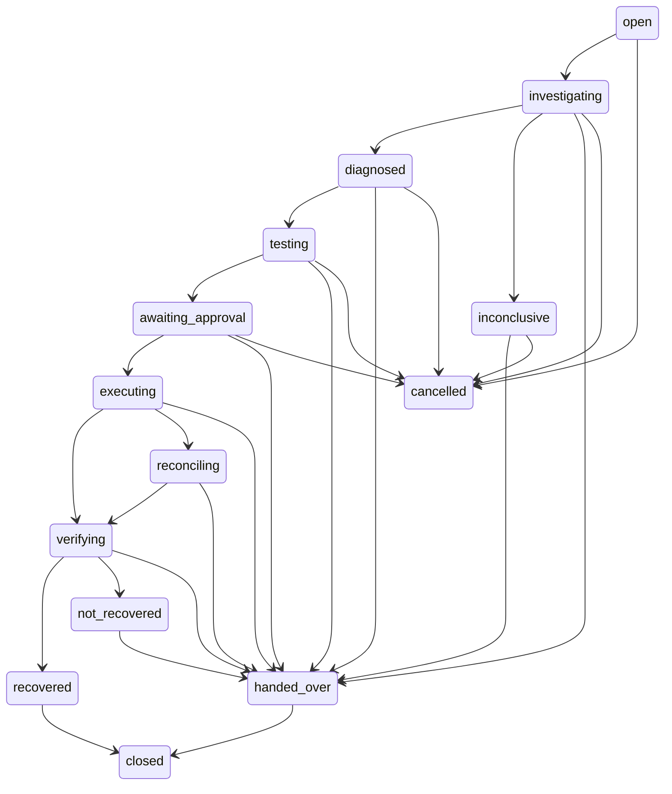
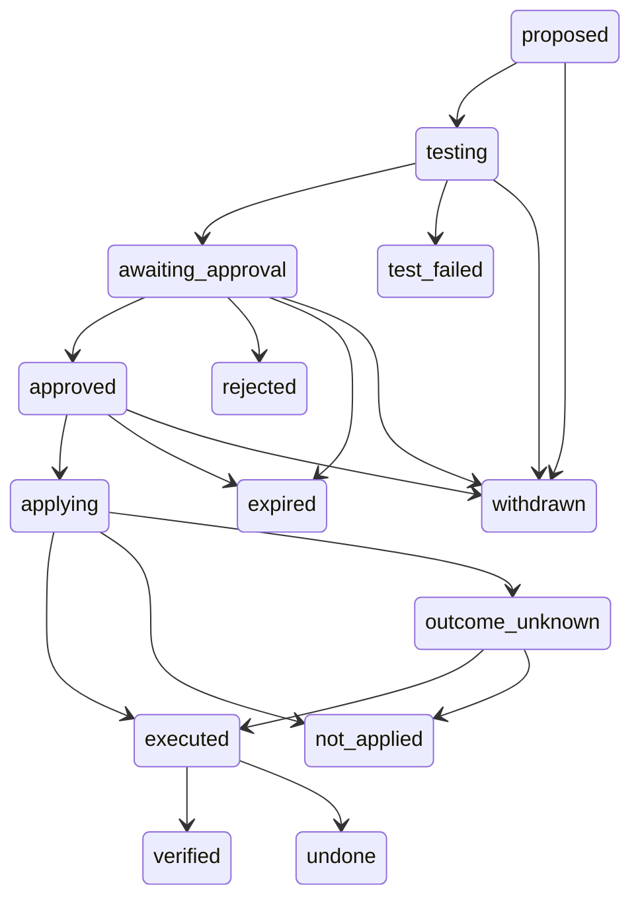

# Artifact 8: Workflow Specification

- **Layer:** 8, Distributed Workflows and State Machines
- **Built from:** Artifacts 6 and 7
- **Status:** Draft compiled from the team's answers; pending team review
- **Sources:** [conversation.md](conversation.md), [files/workflow.py](files/workflow.py), [files/activities.py](files/activities.py), [files/states.py](files/states.py), [files/test_workflow.py](files/test_workflow.py), [System Design](../../reference/system-design.md), [Technical specification](../../reference/technical-specification.md), [Layer 7 schema](../layer-07-data-apis-events/files/schema-tables.sql), [Layer 7 contracts](../layer-07-data-apis-events/files/contracts.py)

## Required sections

| Required section | Questions this section answers | Done |
| --- | --- | --- |
| 8.1 Temporal workflow definition | Q8.1–Q8.3, Q8.10, Q8.12–Q8.16 | Yes |
| 8.2 Activity inventory | Q8.10, Q8.16 | Yes |
| 8.3 State machine diagram | Q8.25, Q8.26 | Yes |
| 8.4 State transition table | Q8.25–Q8.31, Q8.35, Q8.36, Q8.38, Q8.39 | Yes |
| 8.5 Retry and timeout policies | Q8.17, Q8.18, Q8.40–Q8.44 | Yes |
| 8.6 Approval wait design | Q8.19–Q8.21, Q8.29–Q8.31 | Partial |
| 8.7 Cancellation behavior | Q8.22, Q8.36, Q8.37 | Yes |
| 8.8 Replay strategy | Q8.4–Q8.9, Q8.23, Q8.24 | Yes |
| 8.9 Reconciliation strategy | Q8.11, Q8.32–Q8.35, Q8.39, Q8.45, Q8.48 | Partial |
| 8.10 Failure scenarios | Q8.4, Q8.11, Q8.32, Q8.33, Q8.45–Q8.47 | Partial |

## 8.1 Temporal workflow definition

*Answers Q8.1–Q8.3, Q8.10, Q8.12–Q8.16.*

Code: [files/workflow.py](files/workflow.py), `IncidentWorkflow`; the order is visible in one place, `IncidentWorkflow._lifecycle`.

**Why a workflow.** One workflow per incident, written as ordinary sequential code that calls activities for each step ([Q8.1](conversation.md)). Progress must live outside the process ([Q8.2](conversation.md)). An HTTP request can't carry this work because of timeouts, duplicates, no survival across restarts, no waiting, and wasted capacity, so intake returns in milliseconds and the workflow runs separately ([Q8.3](conversation.md)). Temporal replaces background threads and database flags; the fallback, a PostgreSQL job queue behind the same Workflow Orchestrator interface, stays recorded in ADR-06 ([Q8.12](conversation.md)).

| Item | Value |
| --- | --- |
| Workflow type | `IncidentWorkflow` |
| Workflow ID | `incident-<incident_id>` |
| Input | `IncidentWorkflowInput(incident_id)` |
| Signals | `approval_decided`, `cancellation_requested`, `lead_decision`; each carries a dedupe ID |
| Query | `current_state`: incident state, action state, version |
| Result | Final incident state as a string, or `incident_missing` if there is no record |

**Lifecycle, in code order**

| Step | Activities | Incident state after |
| --- | --- | --- |
| Load | `load_incident` | `open` |
| Investigate | `collect_evidence`, `retrieve_knowledge`, `diagnose`, `review_diagnosis` | `investigating`, then `diagnosed` or `inconclusive` |
| Patch and test | `draft_patch`, `run_sandbox_test` | `testing`, or `handed_over` |
| Approval wait | `request_approval`, `escalate_approval`, `close_approval_request` | `awaiting_approval`, then `executing` or `handed_over` |
| Execute | `dispatch_change`, `reconcile_execution` if unknown | `executing`, `reconciling` |
| Verify | `verify_recovery` | `verifying`, then `recovered` or `not_recovered` |
| Undo | `dispatch_change` with `is_undo=True`, `reconcile_execution` if unknown | `handed_over` |
| Close | `lead_decision` signal | `closed` |

Every business step also goes through `record_transition`; `notify` and `hand_over` run where needed.

**Limits in `workflow.py` (provisional)**

| Constant | Value |
| --- | --- |
| `INVESTIGATION_LIMIT` | 15 min |
| `APPROVAL_ESCALATE_AFTER` | 15 min |
| `APPROVAL_EXPIRES_AFTER` | 60 min |
| `APPROVAL_VALID_FOR` | 15 min |
| `WORKFLOW_LIMIT` | 24 h |
| `RECOVERY_HOLD_SECONDS` | 600 |

**Workflow and activity split** ([Q8.10](conversation.md))

| Workflow (deterministic) | Activities (do I/O) |
| --- | --- |
| Step order and branching | Database reads and writes |
| Waiting for signals and timers | Evidence tool queries |
| Choosing which activity to call next | Model calls through the gateway |
| Tracking incident and action state in memory | Sandbox tests |
| Checking a transition is allowed before requesting it | Approval requests, notifications |
| Cancellation safe points | Production changes (dispatcher queue) |
| Limits that depend on time | Recovery verification |

**Workers and routing** ([Q8.14](conversation.md), [Q8.15](conversation.md)). Temporal workers long-poll a task queue. If no worker is running, tasks wait in the queue and nothing is lost. An alert fires if a queue's oldest task waits longer than 60 seconds. Progress is kept in Temporal's history, one history per workflow ID, and any worker can replay any workflow ([Q8.13](conversation.md)).

| Task queue | Polled by | Carries | Why |
| --- | --- | --- | --- |
| `aisre-investigation` | Worker process (any number) | Workflow tasks; evidence, knowledge, diagnosis, review, patch, sandbox control, approval, verification, notification activities | No production credentials here |
| `aisre-dispatcher` | Dispatcher process only | `dispatch_change`, `reconcile_execution` | Only this process holds production write access (Artifact 5) |

Concurrency is set per worker: at most 5 workflows at once, plus a limit on concurrent model activities ([Q8.15](conversation.md)); see C13.

## 8.2 Activity inventory

*Answers Q8.10, Q8.16.*

Contracts: [files/activities.py](files/activities.py). Each activity has one job, takes a small input including its idempotency key, returns a small output (large items travel as artifact IDs), and reports heartbeats if it runs long ([Q8.16](conversation.md)). Implementations live in the platform's modules; the file defines interfaces only. Timeouts and retries are in 8.5.

| Activity | Queue | Input → output | Idempotency key | Job |
| --- | --- | --- | --- | --- |
| `load_incident` | Investigation | `IncidentIn` → `IncidentSnapshot` | `incident_id` | Read the incident |
| `record_transition` | Investigation | `TransitionIn` → `TransitionOut` | `transition_id` | Check the table and expected version; write status and timeline event in one transaction |
| `notify` | Investigation | `NotifyIn` → none | `notification_id` | Send a notification |
| `collect_evidence` | Investigation | `IncidentIn` → `EvidenceOut` | `incident_id` | Parallel read-only queries, redaction, gaps |
| `retrieve_knowledge` | Investigation | `IncidentIn` → `list[str]` | `incident_id` | Relevant knowledge passages |
| `diagnose` | Investigation | `IncidentIn` → `DiagnosisOut` | `incident_id` | Model Gateway: reserve budget, call, validate, settle |
| `review_diagnosis` | Investigation | `IncidentIn` → `ReviewOut` | `incident_id` | Review the diagnosis |
| `draft_patch` | Investigation | `IncidentIn` → `PatchOut` | `incident_id` | Draft the patch |
| `run_sandbox_test` | Investigation | `TestIn` → `TestOut` | `test_key` | Fresh isolated environment: reproduce first, apply, check, destroy |
| `request_approval` | Investigation | `ApprovalRequestIn` → `ApprovalRequestOut` | `request_key` | Open the approval request |
| `escalate_approval` | Investigation | `ApprovalRequestIn` → none | `request_key` | Notify the next approver |
| `close_approval_request` | Investigation | `ApprovalRequestIn` → none | `request_key` | Close as expired, withdrawn or voided |
| `dispatch_change` | Dispatcher | `DispatchIn` → `DispatchOut` | `execution_key` | Verify signature, fingerprint, expiry and service state; record intent; apply once |
| `reconcile_execution` | Dispatcher | `DispatchIn` → `DispatchOut` | `execution_key` | Look up the key, compare the live service with the target; read-only |
| `verify_recovery` | Investigation | `VerifyIn` → `VerifyOut` | Not named in `VerifyIn` | Read monitoring directly for the hold period |
| `hand_over` | Investigation | `HandOverIn` → none | `handover_key` | Hand over to a person |

Key formats in `workflow.py`: `<incident_id>:t<step>`, `<incident_id>:n<step>`, `<incident_id>:h<step>`, `<action_id>:test:1`, `<action_id>:approval:1`, `exec:<approval_id>`, `undo:<approval_id>`.

`activities.py` says every activity is idempotent on the key named in its input. Inputs of type `IncidentIn` carry only `incident_id`, and `VerifyIn` names no key (C16).

## 8.3 State machine diagram

*Answers Q8.25, Q8.26.*

Rendered from `INCIDENT_TRANSITIONS` and `ACTION_TRANSITIONS` in [files/states.py](files/states.py), one diagram per table, with no edges added or removed. The table holds no triggers, start markers or end markers, so none are drawn. The initial incident state is `open` ([Q8.26](conversation.md)). `closed` and `cancelled` have no outgoing transitions.

**Incident (28 transitions)**

**Action (19 transitions)**

## 8.4 State transition table

*Answers Q8.25–Q8.31, Q8.35, Q8.36, Q8.38, Q8.39.*

Code: [files/states.py](files/states.py). One table of allowed transitions, shared by the workflow and the Incident Record. The Allowed pairs below are exactly the `states.py` tables. Triggers come from `workflow.py` and the answers. "No path" means `workflow.py` never takes the transition (C3).

**Incident states** ([Q8.25](conversation.md))

| State | Meaning |
| --- | --- |
| `open` | Accepted; workflow not yet running |
| `investigating` | Evidence, retrieval, diagnosis, review |
| `diagnosed` | Reviewed diagnosis, established |
| `inconclusive` | Root cause not established |
| `testing` | Patch being tested in the isolated environment |
| `awaiting_approval` | Waiting for a person |
| `executing` | Dispatcher applying the change |
| `reconciling` | Outcome unknown; establishing the real state |
| `verifying` | Recovery being checked over the hold period |
| `recovered` | Recovery held; waiting for the lead to accept |
| `not_recovered` | Fix didn't hold; undo in progress |
| `handed_over` | A person owns the next step |
| `cancelled` | Stopped before any production change |
| `closed` | Accepted and closed by the incident lead |

"Repaired" is deliberately not a state: a change being applied doesn't mean the service has recovered.

**Incident transitions**

| From | To | Trigger | Source |
| --- | --- | --- | --- |
| `open` | `investigating` | Workflow started | Q8.26 |
| `open` | `cancelled` | Cancellation | Q8.36 |
| `investigating` | `diagnosed` | All six conditions hold, including Diagnosis Reviewer accepted | Q8.27 |
| `investigating` | `inconclusive` | Any condition fails; limit reached; review did not accept | Q8.27 |
| `investigating` | `handed_over` | No path | C3 |
| `investigating` | `cancelled` | Cancellation at a safe point | Q8.36 |
| `diagnosed` | `testing` | Patch drafted | `workflow.py` |
| `diagnosed` | `handed_over` | No path | C3 |
| `diagnosed` | `cancelled` | Cancellation at a safe point | Q8.36 |
| `inconclusive` | `handed_over` | Root cause not established; diagnosis rejected by review | Q8.27 |
| `inconclusive` | `cancelled` | Temporal-level cancellation only; no safe point in this state | Q8.36, `workflow.py` |
| `testing` | `awaiting_approval` | Reproduced, symptom gone, all prior tests pass, no new error types | Q8.28 |
| `testing` | `handed_over` | Partial pass, failed, not reproduced or error | Q8.28 |
| `testing` | `cancelled` | Cancellation at a safe point | Q8.36 |
| `awaiting_approval` | `executing` | Approved, and the conditions in 8.6 hold | Q8.29 |
| `awaiting_approval` | `handed_over` | Rejected, or expired at 60 min | Q8.30, Q8.31 |
| `awaiting_approval` | `cancelled` | Cancellation while waiting | Q8.22, Q8.36 |
| `executing` | `verifying` | Dispatcher returns `applied` | `workflow.py` |
| `executing` | `reconciling` | Dispatch outcome unknown | Q8.33 |
| `executing` | `handed_over` | Dispatcher returns `not_applied` or `failed` | `workflow.py` |
| `reconciling` | `verifying` | Reconciliation says applied | Q8.34 |
| `reconciling` | `handed_over` | Not applied, or still unknown | Q8.34 |
| `verifying` | `recovered` | Recovery held | `workflow.py` |
| `verifying` | `not_recovered` | Result `not_recovered`; `workflow.py` also sends `inconclusive` here | Q8.35, C17 |
| `verifying` | `handed_over` | No path | C3 |
| `recovered` | `closed` | Closed by incident lead | `workflow.py` |
| `not_recovered` | `handed_over` | Fix did not hold; undo applied or not | Q8.35 |
| `handed_over` | `closed` | Closed by incident lead | `workflow.py` |

`cancelled` and `closed` have no outgoing transitions. `PROTECTED_INCIDENT` is `executing`, `reconciling`, `not_recovered`.

**Action transitions**

| From | To | Trigger | Source |
| --- | --- | --- | --- |
| `proposed` | `testing` | Patch drafted | `workflow.py` |
| `proposed` | `withdrawn` | Cancellation | Q8.36 |
| `testing` | `awaiting_approval` | Test passed after reproduction | Q8.28 |
| `testing` | `test_failed` | Anything else, including a partial pass | Q8.28 |
| `testing` | `withdrawn` | Cancellation | Q8.36 |
| `awaiting_approval` | `approved` | Approved | Q8.29 |
| `awaiting_approval` | `rejected` | Rejected; final | Q8.30 |
| `awaiting_approval` | `expired` | 60 min with no decision; final | Q8.31 |
| `awaiting_approval` | `withdrawn` | Cancellation | Q8.36 |
| `approved` | `applying` | Before dispatch | Q8.29, Q8.32 |
| `approved` | `expired` | No path | C3 |
| `approved` | `withdrawn` | No path | Q8.36, C3 |
| `applying` | `executed` | Applied | `workflow.py` |
| `applying` | `not_applied` | `not_applied` or `failed` | `workflow.py` |
| `applying` | `outcome_unknown` | Timeout with no answer | Q8.33 |
| `outcome_unknown` | `executed` | Reconciliation only | Q8.33, Q8.34 |
| `outcome_unknown` | `not_applied` | Reconciliation only | Q8.33, Q8.34 |
| `executed` | `verified` | Recovery held | `workflow.py` |
| `executed` | `undone` | Undo applied | Q8.35 |

**Preventing invalid transitions** ([Q8.38](conversation.md))

1. **One writer:** only the incident's workflow changes its state, and Temporal runs one workflow per ID.
2. **The transition table:** `check_incident` and `check_action` refuse any transition not listed, in the workflow before it asks and in `record_transition` before it writes.
3. **Optimistic concurrency:** `record_transition` writes only if `version = expected_version`.
4. **Idempotent transition IDs:** `<incident_id>:t<step>` is derived from history, so a retried transition is recognised, not applied twice.

**Canonical state** ([Q8.39](conversation.md)). The PostgreSQL incident record owns business state. Temporal owns execution state. The workflow changes business state only through `record_transition`.

## 8.5 Retry and timeout policies

*Answers Q8.17, Q8.18, Q8.40–Q8.44.*

**Rule:** one layer owns retries for each operation ([Q8.44](conversation.md)). Retries at different layers multiply: 3 × 3 × 3 = 27 calls for one logical request ([Q8.43](conversation.md)).

**Retry policies in `workflow.py`**

| Policy | Initial interval | Backoff | Maximum interval | Maximum attempts | Other |
| --- | --- | --- | --- | --- | --- |
| `DB_RETRY` | 1 s | 2.0 | 30 s | 0 (until schedule-to-close) | |
| `TOOL_RETRY` | 2 s | 2.0 | 20 s | 3 | Default in `_act` and `_investigation_act` |
| `NO_RETRY` | Not set | Not set | Not set | 1 | Default in `_protected` |
| `READ_RETRY` | 5 s | 2.0 | 1 min | 10 | Non-retryable: `PermissionDenied` |

**Per activity.** Start-to-close and heartbeat come from the call sites. `activities.py` holds the queues and contracts, and sets no timeout or retry values. Schedule-to-close is 4× start-to-close in `_act`, the remaining investigation time in `_investigation_act`, and unset in `_protected`.

| Activity | Start-to-close | Schedule-to-close | Heartbeat | Policy | Retry owner |
| --- | --- | --- | --- | --- | --- |
| `load_incident` | 10 s | 40 s | None | `DB_RETRY` | Temporal |
| `record_transition` | 10 s | 40 s | None | `DB_RETRY` | Temporal |
| `notify` | 15 s | 60 s | None | `TOOL_RETRY` | Temporal |
| `collect_evidence` | 180 s, or remaining time if less | Remaining investigation time | None set | `TOOL_RETRY` | Temporal |
| `retrieve_knowledge` | 30 s, or remaining time if less | Remaining investigation time | None | `TOOL_RETRY` | Temporal |
| `diagnose` | 300 s, or remaining time if less | Remaining investigation time | None | `NO_RETRY` | Model Gateway |
| `review_diagnosis` | 60 s, or remaining time if less | Remaining investigation time | None | `TOOL_RETRY` | Temporal |
| `draft_patch` | 120 s | 480 s | None | `NO_RETRY` | None stated |
| `run_sandbox_test` | 900 s | 3,600 s | 60 s | `NO_RETRY` | None stated |
| `request_approval` | 30 s | 120 s | None | `DB_RETRY` | Temporal |
| `escalate_approval` | 30 s | 120 s | None | `DB_RETRY` | Temporal |
| `close_approval_request` | 30 s | 120 s | None | `DB_RETRY` | Temporal |
| `dispatch_change` | 300 s | Unset | None | `NO_RETRY` | Forbidden: an unanswered write becomes `unknown` |
| `reconcile_execution` | 600 s | Unset | None | `READ_RETRY` | Temporal |
| `verify_recovery` | 900 s (600 + 300) | Unset | 60 s | `READ_RETRY` | Temporal |
| `hand_over` | 15 s | 60 s | None | `DB_RETRY` | Temporal |

**Time limits, smallest to largest** ([Q8.18](conversation.md), provisional)

| Limit | Applies to | Value |
| --- | --- | --- |
| Per call | One model request, inside the gateway | 60 s |
| Start-to-close | One activity attempt | Per activity, above; `diagnose` 300 s |
| Schedule-to-close | All attempts of one activity | 4× start-to-close, capped by the investigation's remaining time |
| Investigation | Evidence to diagnosis | 15 min, from `workflow.now()` |

Long activities also send heartbeats; a missing heartbeat ends the attempt early instead of waiting for the full timeout.

**Model calls** ([Q8.17](conversation.md), [Q8.44](conversation.md))

| Layer | Behaviour |
| --- | --- |
| Provider SDK | Built-in retries off (`max_retries = 0`) |
| Model Gateway | Up to 3 attempts per step, backoff 2 s → 4 s, each call limited to 60 s, budget check before each attempt, circuit breaker |
| Temporal | `diagnose` has `maximum_attempts = 1` |
| API clients | Never retry model work; they only submit incidents, which are idempotent |

After 3 failures the activity returns, and the workflow treats the step as inconclusive and hands over with the evidence and timeline.

**Delivery guarantees**

| Guarantee | Where | Source |
| --- | --- | --- |
| At-least-once | Temporal activities and the outbox; made safe by idempotency keys | Q8.40 |
| At-most-once | Not used for incidents, approvals or changes; suits things like a metric sample | Q8.41 |
| At most one effect | Production writes: at-least-once delivery, an execution key, and reconciliation when the outcome is unknown | Q8.41 |
| Effectively once | An idempotency key, a lookup by key, a check of the real state, and a person when all of those fail. Exactly-once needs the receiver's cooperation | Q8.42 |

## 8.6 Approval wait design

*Answers Q8.19–Q8.21, Q8.29–Q8.31.*

**How a decision reaches the workflow** ([Q8.19](conversation.md))

1. The API records the decision and writes an outbox row in one transaction.
2. The outbox relay sends `approval_decided`, with the approval's ID, action ID and patch fingerprint.
3. The signal handler ignores duplicates, stale actions and a different fingerprint. Otherwise it stores the decision.
4. The `wait_condition` sees the decision, and the workflow continues.

**How it waits** ([Q8.20](conversation.md)). `workflow.wait_condition(..., timeout=...)` records a timer in Temporal's history. The worker drops the workflow from memory and holds nothing. When the timer fires or a signal arrives, any worker replays to the waiting point and continues. The wait is never 24 hours; the same mechanism holds the whole workflow open for up to 24 hours while waiting for the incident lead to close it.

**Two clocks.** The request deadline is how long a person has to answer (60 min). The approval's validity is how long a granted approval can be used (15 min, `APPROVAL_VALID_FOR`).

| Time or event | What happens | Incident | Action |
| --- | --- | --- | --- |
| 0 | `request_approval`, then `notify` approvers | `awaiting_approval` | `awaiting_approval` |
| 15 min | `escalate_approval`; the next approver is notified; the workflow keeps waiting | No change | No change |
| 60 min | `close_approval_request` (expired), so a late approval is refused by the API; hand over "approval expired; no action taken"; wait for the lead | `handed_over` | `expired` |
| Rejected | Reason kept as a permanent record; hand over; wait for the lead | `handed_over` | `rejected` |
| Approved | Conditions below | `executing` | `approved`, then `applying` |
| Cancelled | See 8.7 | `cancelled` | `withdrawn` |

**Nothing is executed by default** ([Q8.21](conversation.md)). The platform never proposes another fix on its own after a rejection. If the approver asked for more evidence, a person starts a recorded re-investigation (`incident-<id>-r2`) ([Q8.30](conversation.md)); see C8.

**Before applying** ([Q8.29](conversation.md)). All of these are checked by the workflow, and again by the dispatcher (C9 shows what `workflow.py` checks itself):

1. A recorded `approved` decision from an authorised person, for this action.
2. A second approver, if the change is high-impact.
3. The approval's patch fingerprint matches the action's patch.
4. The approval's signature is valid.
5. The approval is unexpired (within 15 minutes).
6. The service's version and configuration are unchanged since approval.
7. No cancellation was requested.
8. Recovery criteria are recorded.

**Gap:** the sources don't say how a second approver's decision reaches the workflow. `workflow.py` proceeds on the first accepted `approved` signal and always calls `request_approval` with the default `approvers_needed = 1`.

Tests: `test_happy_path_reaches_closed` (duplicate approval), `test_unanswered_approval_escalates_then_expires`, `test_rejection_hands_over`.

## 8.7 Cancellation behavior

*Answers Q8.22, Q8.36, Q8.37.*

**How it arrives** ([Q8.22](conversation.md)). As the signal `cancellation_requested`, through the outbox, carrying its own ID for deduplication. Temporal-level cancellation (an administrator's emergency stop) is handled the same way.

| Moment | Behaviour | Result |
| --- | --- | --- |
| Before any change: `open`, `investigating`, `diagnosed`, `inconclusive`, `testing`, `awaiting_approval` | Stop at the next safe point: between steps, or while waiting for approval. Close any open approval request, withdraw the action, destroy the sandbox, record who asked and why | `cancelled`, final. A later problem is a new incident |
| During a production write: `executing`, `reconciling`, `not_recovered` | The write runs to its outcome: the dispatcher activity is shielded and the workflow waits. The request is recorded as an event, with who and when | Depends on the outcome, below |
| `verifying` | No `cancelled` transition; `verify_recovery` runs in `_protected` | `recovered` or `handed_over` |
| `recovered`, `handed_over` | A person owns it; cancellation changes nothing | Unchanged |

**After a write completes with a cancel pending** ([Q8.37](conversation.md))

| Outcome | Next |
| --- | --- |
| Applied | Verification still runs, because the service must be checked either way; the incident ends `recovered` or `handed_over` |
| Not applied or unknown | Hand over |

`cancelled` is not an allowed transition from a state where a change may have happened: the record can't say "cancelled" then. Undoing a change is a separate, explicit, approved action, never a side effect of "cancel".

Action on cancellation: `withdrawn`, from proposed, testing, awaiting approval or approved ([Q8.36](conversation.md)). Running read-only activities are cancelled, and the sandbox activity destroys its environment ([Q8.22](conversation.md)); see C7.

Tests: `test_cancel_while_awaiting_approval_withdraws_action`, `test_cancel_during_write_lets_write_finish_and_does_not_pretend_reversal`, `test_temporal_cancel_during_write_waits_for_outcome`.

## 8.8 Replay strategy

*Answers Q8.4–Q8.9, Q8.23, Q8.24.*

**What a crash loses** ([Q8.4](conversation.md)). Everything in memory: local variables, the call stack, open connections, unreported activity results. What survives is what Temporal recorded: input, each completed activity's result, each signal, each timer.

**Replay** ([Q8.8](conversation.md))

1. A worker picks up the workflow and receives its history.
2. It runs the workflow code from the start. When the code asks for an activity that already completed, the recorded result is returned without running the activity again.
3. Signals and timers are delivered at the same points they occurred.
4. At the end of the history the code is in exactly the state it was in before the crash, and continues live.

**Guarantees this needs** ([Q8.6](conversation.md)): durable history, deterministic replay, at-least-once activities, exactly-once workflow decisions, one live run per workflow ID, durable timers and signals.

**Restrictions on workflow code** ([Q8.9](conversation.md))

- No I/O: no database, network, files or model calls.
- No system clock: use `workflow.now()`.
- No randomness and no new UUIDs: IDs come from activities or are derived from history.
- No threads or blocking sleeps: use `workflow.sleep` and `wait_condition`.
- No reading environment or global mutable state.
- No iteration over unordered collections that affects decisions.
- No changing the order or type of activity calls for running workflows without versioning.

Temporal's Python sandbox enforces most of these. The rest are checked in code review and by replay tests.

**What must survive a restart** ([Q8.5](conversation.md))

| Information | Where it survives |
| --- | --- |
| Each workflow's history: input, completed steps, signals, timers | Temporal (PostgreSQL store) |
| Incident and action state, version, timeline | PostgreSQL incident record |
| Evidence, diagnoses, patches, approvals, attempts, verifications | PostgreSQL + artifact store |
| Pending outbox messages (starts, signals) | PostgreSQL outbox |
| Budget used and reserved | PostgreSQL |
| Approval deadlines, escalation times | Temporal timers, plus the approval request row |
| Execution intent and key, before any production write | PostgreSQL execution attempt |

**Deploying new code** ([Q8.23](conversation.md))

| Change | Handling |
| --- | --- |
| Activity implementation, or a timeout value read at call time | Safe; nothing needed |
| Adding, removing or reordering activity calls or waits | `workflow.patched("<change-id>")`; once no old workflow runs, `workflow.deprecate_patch` and remove the old branch |
| Large redesign | New workflow type (`IncidentWorkflowV2`); old workflows finish on the old type |
| Every deploy | CI replays a sample of recent production histories against the new code with Temporal's `Replayer`; any nondeterminism fails the build |

Workflows last at most 24 hours, so old branches are removed within a day of a change.

**Two records** ([Q8.7](conversation.md), [Q8.24](conversation.md))

| | Temporal history | Business timeline |
| --- | --- | --- |
| Written by | Temporal, automatically | The `record_transition` activity and the API |
| Contains | Activity attempts, retries, timers, signals, serialised inputs | Business events: status changes, approvals, executions, verifications |
| Format | Temporal's own | Our CloudEvents contracts (Artifact 7) |
| Retention | Short (provisional: 7 days after close) | 1 year, hash-chained |
| Readers | Platform engineers, for debugging | Engineers, reviewers, auditors, through the API |
| Permissions | Temporal's own | Per-service roles |

The workflow never exposes its history as the timeline. After a crash, the timeline shows the last completed business step, and Temporal's history shows the interrupted attempt.

Test: `test_completed_history_replays_deterministically`.

## 8.9 Reconciliation strategy

*Answers Q8.11, Q8.32–Q8.35, Q8.39, Q8.45, Q8.48.*

**Recording an uncertain write**

| Situation | Attempt | Action | Incident | Source |
| --- | --- | --- | --- | --- |
| Before calling the release process | `started`, with `execution_key` | `applying` | `executing` | Q8.32 |
| Dispatcher crashes | Stays `started` | Stays `applying` | Stays `executing` | Q8.32 |
| Timeout with no answer | `unknown` | `outcome_unknown` | `reconciling` | Q8.33 |

When the activity is retried or the workflow resumes, the dispatcher sees the `started` attempt and reconciles first; it never applies the change again blindly. The event is `aisre.execution.completed.v1` with outcome `unknown`. Only reconciliation can leave `outcome_unknown`.

**`reconcile_execution`** ([Q8.34](conversation.md), [Q8.48](conversation.md)), on the dispatcher queue, read-only:

1. Ask the release process for the change with this `execution_key`: not found, in progress, succeeded, or failed.
2. If it's in progress, wait and ask again, with backoff, for up to 10 minutes.
3. Check the service itself: compare the running version and configuration value with the target.
4. Decide, below.
5. Record the result as a new attempt row, and an event.

| Release process and service | Result | Next |
| --- | --- | --- |
| Both say applied | `executed` | Verify |
| Both say not applied | `not_applied` | Hand over; trying again is a person's decision with a fresh approval |
| They disagree, or still unclear | Stays unknown | Hand over with "production state uncertain; do not retry until a person checks"; no further production operation on that service until a person records the actual state |

The platform never decides to apply again on its own while the outcome is unknown. While an operation may still be running, it records it as unknown and doesn't start a competing operation on the same target ([Q8.45](conversation.md)). For read-only operations the rule is simpler: discard the late result, and retry or record a gap.

**Failed fix** ([Q8.35](conversation.md))

1. Verification `not_recovered`: incident `verifying` → `not_recovered`.
2. The dispatcher applies the pre-approved undo, with its own key (`undo:<approval_id>`). An unknown undo outcome is reconciled the same way (C10).
3. Action `executed` → `undone`, if the undo applied.
4. Incident `not_recovered` → `handed_over`: "fix did not hold; person decides next step".
5. The approver and on-call are notified.

**Model calls** ([Q8.11](conversation.md)). The model call has no external side effect, so a repeat is safe. Budget: the first reservation either settled or expires and is released, the second call takes its own, and both are recorded in `model_attempts`. To avoid paying twice, the gateway checks for a recorded successful attempt with the same `input_sha256` for this incident and step, and reuses it (see C4).

**Incident record and workflows** ([Q8.39](conversation.md)). If they disagree, the incident record wins. A reconciliation job compares open incidents with running workflows: it alerts on an incident with no workflow, or a workflow whose incident is closed.

**Gap:** the sources give no schedule, owner, runbook or implementation for this reconciliation job.

Tests: `test_unknown_outcome_is_reconciled_not_retried`, `test_still_unknown_after_reconciliation_hands_over`, `test_failed_verification_undoes_and_hands_over`.

## 8.10 Failure scenarios

*Answers Q8.4, Q8.11, Q8.32, Q8.33, Q8.45–Q8.47.*

| Failure | Behaviour | Test or source |
| --- | --- | --- |
| Worker crash | Memory lost; another worker replays history; an activity that was running is retried after its timeout (C4) | Q8.4 |
| Restart after deployment | All state survives outside the workers (8.8) | Q8.5 |
| No worker running | Tasks wait in the queue; alert after 60 s | Q8.14 |
| Model answered, result not recorded | Repeat is safe; recorded result reused (8.9) | Q8.11 |
| Provider unavailable | Gateway retries, then the step is inconclusive and hands over with evidence and timeline | Q8.17 |
| Investigation limit reached | `_investigation_act` returns None; `inconclusive`, then `handed_over` | `workflow.py` |
| Test not reproduced or partial | `handed_over`, no approval requested | `test_not_reproduced_never_requests_approval` |
| Approval unanswered | Escalate at 15 min, expire at 60 min, hand over | `test_unanswered_approval_escalates_then_expires` |
| Dispatcher crash mid-write | Intent stays recorded; reconcile first | Q8.32 |
| Dispatch timeout | `unknown`, reconciled, never retried | `test_unknown_outcome_is_reconciled_not_retried` |
| Still unknown after reconciliation | Hand over, no verification | `test_still_unknown_after_reconciliation_hands_over` |
| Fix doesn't hold | Undo once, hand over | `test_failed_verification_undoes_and_hands_over` |
| Stale or duplicate signal | Ignored | Q8.19 |
| Conflicting writers | Refused by the table, version check and transition ID | Q8.38 |
| Incident stuck in `open` over 2 min | Alert (outbox not delivered) | Q8.26 |

**PostgreSQL unavailable** ([Q8.46](conversation.md))

| Continues | Stops |
| --- | --- |
| Read-only evidence queries already running (results held in the activity, and retried for storage) | Recording any transition (`record_transition` retries with backoff) |
| Model calls already reserved | New model calls (budget reservation needs the database) |
| Temporal timers and waits | Approvals (they must be recorded first) |
| Workflow state in Temporal (separate database) | Any production write (no intent record, no write) |
| Health checks | Intake (`/readyz` fails, returns `503`, so monitoring retries) |

Rule (Artifact 4): nothing that changes production, or can't be recorded, runs while the record can't be written. When the database returns, activities complete and the workflow continues from history (see C5).

**Temporal unavailable** ([Q8.47](conversation.md))

- Intake doesn't depend on Temporal. It writes the incident, its event and an outbox row to PostgreSQL, and returns `201` as normal.
- The relay can't deliver, so it retries with backoff. Rows wait in the outbox.
- The alert fires when the oldest pending row is older than 2 minutes, and on-call is told to handle new incidents manually for now.
- When Temporal returns, the relay starts the waiting workflows, oldest first. Stable workflow IDs prevent duplicates.
- Running workflows simply pause, and resume from their history.

**Gap:** the sources don't say what happens to the incident when an activity outside `_investigation_act` exhausts its attempts. `workflow.py` catches `ActivityError` only in `_investigation_act` and, for `dispatch_change`, in `_protected`. For `draft_patch`, `run_sandbox_test`, `record_transition`, `notify`, `reconcile_execution`, `verify_recovery` and others, the error isn't handled, and no answer defines the resulting incident state.

## Assumptions

The answers that state an assumptions line, Q8.1 and Q8.2, say "None needed". The rows below are the values this layer marks provisional, with the owner and validation from an earlier layer where one exists.

| Assumption | Status | Owner | Validated when |
| --- | --- | --- | --- |
| Temporal history retention of 7 days after close is enough (Q8.24) | Provisional | TBD | TBD |
| Per-call model limit of 60 s (Q8.18) | Provisional | TBD | TBD |
| Per-activity start-to-close values (Q8.18, 8.5) | Provisional | TBD | TBD |
| Schedule-to-close of 4× start-to-close (Q8.18) | Provisional | TBD | TBD |
| 15 minutes is enough for change-caused failures (Q8.18, Layer 4) | Provisional | SRE lead | Test-suite investigations finish within it |
| Approval escalation at 15 min and expiry at 60 min; approvers respond within 15 minutes during an incident (`workflow.py`, Layer 4) | Provisional | Engineering manager | Measured during the pilot |
| A granted approval is usable for 15 min (`workflow.py`) | Provisional | TBD | TBD |
| Whole-workflow limit of 24 h (`workflow.py`, Layer 4) | Provisional | TBD | TBD |
| A hold period of 10 minutes is enough for the reference service (`workflow.py`, Layer 4) | Provisional | SRE lead | Past recoveries show no relapse after 10 minutes |

## Decisions and conflicts

**Decisions in this layer not stated above**

- Temporal is the workflow engine, with the PostgreSQL job queue as recorded fallback (Q8.12, ADR-06).
- Retry ownership is centralised per operation, and model retries belong to the Model Gateway only (Q8.44).

**`states.py` against Technical specification section 2.** The specification has 12 states and 15 explicit transitions plus "any active state → cancelled". `states.py` has 14 states and 28 transitions. Fourteen of the 15 explicit pairs match. The differences:

| Difference | Technical specification | `states.py` |
| --- | --- | --- |
| States | No `testing`, no `reconciling` | Both present |
| `diagnosed` → `awaiting_approval` | Present: patch tested and passed | Absent; goes through `testing` |
| `diagnosed` → `testing` | Absent | Present |
| `testing` → `awaiting_approval` | Absent | Present |
| `testing` → `handed_over` | Absent | Present |
| `executing` → `reconciling` | Absent | Present |
| `reconciling` → `verifying` | Absent | Present |
| `reconciling` → `handed_over` | Absent | Present |
| `investigating` → `handed_over` | Absent | Present, no path in `workflow.py` |
| `verifying` → `handed_over` | Absent | Present, no path in `workflow.py` |
| `diagnosed` → `handed_over` trigger | "Not reproduced, or test failed" | Pair present, but those triggers leave from `testing`; no path in `workflow.py` |
| `executing` → `handed_over` trigger | Includes "unknown after lookup" | Unknown leaves through `reconciling` |
| → `cancelled` | "any active state" | Only `open`, `investigating`, `diagnosed`, `inconclusive`, `testing`, `awaiting_approval` (6 pairs), as in Q8.36 |

**Conflicts.** None of these is resolved here; each needs a team decision.

| # | Conflict | Sources | Treatment here |
| --- | --- | --- | --- |
| C1 | The specification's lifecycle differs from `states.py`, as tabled above. Nothing states which is authoritative. The answers and tests depend on `testing` and `reconciling` | Spec section 2; `states.py`; Q8.25, Q8.33 | 8.3 and 8.4 follow `states.py`, as instructed |
| C2 | Artifact 7's enums lack states this layer writes. `incident_status` has no `testing` or `reconciling`. `action_status` has `tested`, and has no `testing`, `applying`, `outcome_unknown`, `not_applied` or `verified`. `IncidentStatus` in `contracts.py` also lacks the two incident states | `schema-tables.sql`; `contracts.py`; `states.py` | Recorded |
| C3 | Five table entries have no path in `workflow.py`: `investigating` → `handed_over`, `diagnosed` → `handed_over`, `verifying` → `handed_over`, and action `approved` → `expired`, `approved` → `withdrawn`. `_finish_cancelled` handles `approved`, but the action becomes `approved` only as the incident enters `executing`, where `cancelled` is refused. Q8.36 lists withdrawal from approved | `states.py`; `workflow.py`; Q8.36 | Marked "No path" in 8.4 |
| C4 | Q8.4, Q8.11 and Q8.44 say an interrupted activity, including `diagnose`, is retried after a crash. `diagnose` has `maximum_attempts = 1`, so `workflow.py` gives no second attempt, and the failure returns None, which leads to `inconclusive`. Also, `_investigation_act` sets no heartbeat, while the specification says a heartbeat is lost after 60 s, and `activities.py` and Q8.18 say evidence collection heartbeats | Q8.4, Q8.11, Q8.18, Q8.44; `workflow.py`; `activities.py`; Spec section 9 | 8.5 lists actual values |
| C5 | Q8.46 and the specification say workers pause and continue when the database returns. `DB_RETRY` retries only until schedule-to-close, which is 40 s for `record_transition` | Q8.46; Spec section 9; `workflow.py` | 8.5 lists actual values; see the 8.10 Gap |
| C6 | Q8.18 caps schedule-to-close at 4× start-to-close and the remaining time. `_investigation_act` uses the remaining time alone, and `_protected` sets none. `reconcile_execution` has a 10-minute limit in Q8.34, but its 600 s is per attempt with up to 10 attempts | Q8.18, Q8.34; `workflow.py` | 8.5 lists actual values |
| C7 | Q8.22 says running read-only activities are cancelled. A `cancellation_requested` signal only sets a flag checked at safe points, so a running activity continues; `run_sandbox_test` can run 900 s. The specification and FR-33 require all work stopped in ≤ 30 s p95 | Q8.22; `workflow.py`; Spec section 9; Layer 4 | Recorded |
| C8 | Re-investigation runs on a new workflow ID (`incident-<id>-r2`), but `handed_over` can only go to `closed`, so no table entry lets the incident re-enter investigation | Q8.30; Q7.63; `states.py` | Recorded |
| C9 | Q8.29 says all conditions are checked by the workflow and again by the dispatcher. `workflow.py` itself checks the fingerprint and cancellation, and its comment leaves age, fingerprint and service state to the dispatcher. `APPROVAL_VALID_FOR` is defined but unused | Q8.29; `workflow.py` | Q8.29 listed as written in 8.6 |
| C10 | Q8.35 says an unknown undo is reconciled "the same way", but the undo path doesn't enter `reconciling` or `outcome_unknown`; `not_recovered` has no such transition | Q8.35; `states.py`; `workflow.py` | Recorded |
| C11 | The System Design says a service change after approval voids the approval and asks again; the specification says stop, void, alert. In `workflow.py` the dispatcher returns `not_applied` and the incident hands over, with no new request and no void call | System Design section 7; Spec section 6; `workflow.py` | Recorded |
| C12 | The System Design says the 24 h limit means stop and hand over. `workflow.py` just ends the workflow, and its comment says the incident stays handed over. A `recovered` incident stays `recovered`, because `recovered` can only go to `closed` | System Design section 9; `workflow.py`; `states.py` | Recorded |
| C13 | Q8.15 sets 5 workflows per worker, with any number of workers. The System Design sets 5 concurrent investigations, queued up to 50 by severity. `workflow.py` has no severity queueing | Q8.15; System Design section 9 | Recorded |
| C14 | Where Temporal stores its state, and who hosts it. Q8.13 and Q8.46: its own, separate database. Q6: PostgreSQL can serve as its store, "so there is one database to run". Q8.12: single node. The System Design still lists self-hosted or hosted as an open decision | Q8.12, Q8.13, Q8.46; Layer 6; System Design section 12 | Recorded |
| C15 | Layer 11 makes the execution key the action ID. This layer and the specification use one key per approval (`exec:<approval_id>`, `undo:<approval_id>`) | Layer 11; `workflow.py`; Spec section 7 | 8.2 follows this layer |
| C16 | `activities.py` says every activity is idempotent on a key in its input, but `VerifyIn` names none and `IncidentIn` carries only `incident_id` | `activities.py` | Noted in 8.2 |
| C17 | A verification result of `inconclusive` takes the undo path in `workflow.py`. Q8.35 covers only `not_recovered` | `workflow.py`; `activities.py`; Q8.35 | Noted in 8.4 |
| C18 | Q8.32 says the dispatcher records action state `applying`. `workflow.py` records it through `_record_action` before dispatching | Q8.32; `workflow.py` | 8.9 keeps Q8.32's wording |
| C19 | Layer 4 says a cancelled incident "stays open for the person to handle". This layer makes `cancelled` final | Q4.14; Q8.36 | 8.7 follows this layer |
| C20 | A Temporal-level cancel arriving during an unshielded `record_transition` in `executing` or `reconciling` reaches `run`, which can't move to `cancelled` and returns. By code reading, the workflow then ends without an outcome being recorded. Tests cover a cancel during the write only. Q8.22 says this is handled the same way as a signal | `workflow.py`; `test_workflow.py`; Q8.22 | Recorded; not confirmed by running |

`Where Claude and ChatGPT disagreed` in [conversation.md](conversation.md) is TBD, so no disagreements are recorded here. The tests in [files/test_workflow.py](files/test_workflow.py) are cited as the answers cite them; they were not run for this compilation.

## Acceptance checks

- [ ] Every required section above is present and complete.
- [x] Every section lists the questions it answers, and every question in this layer is answered by at least one section.
- [ ] Every assumption is marked provisional and has a named owner and a condition under which it will be validated.
- [ ] Every disagreement between Claude and ChatGPT that affected a decision is recorded with the team's resolution.
- [ ] The artifact is consistent with every artifact it is built from; any conflict is recorded as an explicit decision.
- [x] The artifact was produced with the team's coding agent and is saved in the team repository.

Reviewed by: TBD
Date: TBD
