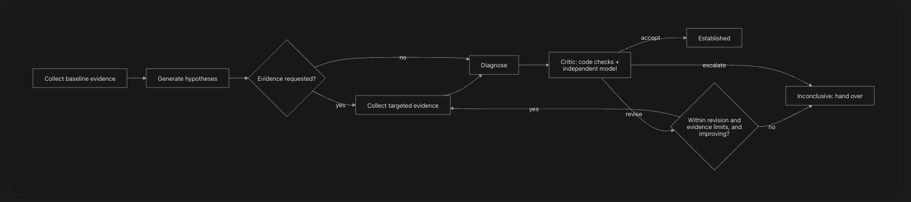

# Artifact 9: Agent Design Specification

- **Layer:** 9, Agent Architecture and Engineering Reasoning
- **Built from:** Artifact 3 (Incident and Evidence Catalog), Artifact 7 (Data and Interface Specification), Artifact 8 (Workflow Specification)
- **Status:** Draft compiled from the team's answers; pending team review
- **Sources:** [conversation.md](conversation.md), [files/coordinator.py](files/coordinator.py), [files/agent_contracts.py](files/agent_contracts.py), [files/tool_registry.py](files/tool_registry.py), [files/validation.py](files/validation.py), [files/test_agent.py](files/test_agent.py), [assets/image2.png](assets/image2.png), [technical-specification.md](../../reference/technical-specification.md), [system-design.md](../../reference/system-design.md), [Layer 3](../layer-03-sre-fundamentals/conversation.md), [Layer 4](../layer-04-requirements/conversation.md), [Layer 7 schema](../layer-07-data-apis-events/files/schema-tables.sql), [Layer 7 contracts](../layer-07-data-apis-events/files/contracts.py), [Layer 8 workflow.py](../layer-08-workflows-state-machines/files/workflow.py), [Layer 10](../layer-10-inference-retrieval/conversation.md), [Layer 12 eval_harness.py](../layer-12-reliability-evaluation/files/eval_harness.py)

## Required sections

| Required section | Questions this section answers | Done |
| --- | --- | --- |
| 9.1 Coordinator | Q9.1–Q9.4, Q9.7–Q9.9 | Yes |
| 9.2 Skill definitions | Q9.11–Q9.13, Q9.15–Q9.19 | Partial |
| 9.3 Typed contracts | Q9.13, Q9.14 | Partial |
| 9.4 Tool registry | Q9.5, Q9.6, Q9.10, Q9.39–Q9.47 | Yes |
| 9.5 Evidence schema | Q9.20–Q9.22, Q9.27–Q9.29 | Yes |
| 9.6 Hypothesis schema | Q9.16, Q9.23–Q9.26 | Yes |
| 9.7 Diagnosis schema | Q9.17, Q9.25–Q9.29 | Partial |
| 9.8 Critic schema | Q9.30–Q9.34, Q9.36, Q9.37 | Yes |
| 9.9 Revision policy | Q9.33, Q9.35 | Yes |
| 9.10 Loop termination policy | Q9.34, Q9.37, Q9.38 | Yes |
| 9.11 Agent evaluation metrics | Q9.28, Q9.47–Q9.53 | Partial |

## 9.1 Coordinator

*Answers Q9.1–Q9.4, Q9.7–Q9.9.*

A large language model only maps text to text: no memory between calls, no access to systems, no way to check its own claims ([Q9.1](conversation.md)). The application wraps it with tools, state, typed skills, a control loop owned by code, and checks. The model proposes; the application runs the tools, validates the output, and decides ([Q9.2](conversation.md)).

The design is a **workflow with an agent loop inside it**. The Temporal workflow (Artifact 8) holds the whole incident for up to 24 hours. Its investigation phase is a coordinator loop that runs skills in turn. Each step is an activity, so it survives crashes, and state is explicit and saved between steps ([Q9.3](conversation.md)).

**The investigation loop: observe → hypothesise → test → decide** ([Q9.4](conversation.md))

**Who decides.** The coordinator is deterministic code (`coordinator.next_step`), not the model. Pure Python, no I/O, no clock of its own; the workflow passes it `workflow.now()` ([coordinator.py](files/coordinator.py)). It decides from recorded facts: whether the critic accepted, whether evidence requests are pending, how many revisions have run, whether the last revision changed anything, and time, model-call and tool-call budgets. The model contributes suggestions only. Every decision is logged with its reason in `agent.decisions`, and exposed through the workflow query ([Q9.7](conversation.md)).

| Step (`Step`) | What it does |
| --- | --- |
| `COLLECT_BASELINE` | Fixed evidence plan, no model |
| `HYPOTHESISE` | Model: 2–5 hypotheses with claims |
| `COLLECT_TARGETED` | Tools chosen from hypotheses or critic requests |
| `DIAGNOSE` | Model plus code scoring |
| `CRITIQUE` | Code checks, then the independent critic |
| `FINISH_ESTABLISHED` | Ends the loop: critic accepted |
| `FINISH_INCONCLUSIVE` | Ends the loop: every other stop (9.10) |

**State kept between steps** ([Q9.8](conversation.md)). The model itself keeps nothing between calls: each call is given what it needs, by ID and extract.

| State | Where it lives |
| --- | --- |
| Evidence IDs collected, and gaps | Coordinator state (workflow history); evidence records in PostgreSQL |
| Hypotheses, and each diagnosis revision | PostgreSQL; fingerprints and support ratios in coordinator state |
| Pending evidence requests | Coordinator state |
| Critic verdicts and issues | PostgreSQL; the last verdict in coordinator state |
| Counters: model calls, tool calls, revisions, rounds, critic failures | Coordinator state |
| Repeated-call hashes | ToolGate log in PostgreSQL |
| Start time and limits | Coordinator state |
| Decision log | Coordinator state, copied to the timeline |

**Model reasoning versus application policy** ([Q9.9](conversation.md)):

- The model's output is a proposal record: a diagnosis with a `proposed_action` from the allowed list. It is data, not a command.
- Policy lives in code the model can't reach: the transition table (Artifact 8), the approval service, the dispatcher's checks, and the tool registry, which has no write tools for the agent.
- A proposal becomes a change only by the path in Artifact 8: a sandbox test, a person's signed approval, and the trusted dispatcher.
- Nothing the model writes, including injected text, can skip a step: there is no tool or field for it.

## 9.2 Skill definitions

*Answers Q9.11–Q9.13, Q9.15–Q9.19.*

One do-everything agent marks its own homework, gives weaker results on each job, blurs contracts, concentrates power, is hard to measure, and can't have retries tuned per job ([Q9.11](conversation.md)). So jobs are split, each with its own contract and rules ([Q9.12](conversation.md)):

| Skill | Model? | Produces | Validated by |
| --- | --- | --- | --- |
| Evidence Collector | No | Evidence records | Tool schemas, ToolGate, redaction |
| Knowledge Retriever | No | Runbook passages, as evidence | Service filter |
| Hypothesis Generator | Yes | 2–5 hypotheses, with cited claims | Schema; citations; at least one non-deployment cause |
| Diagnoser | Yes, plus code scoring | Diagnosis draft | Schema; citations; confidence scored by code |
| Critic | Code checks, then a separate model | Verdict: accept, revise or escalate | Schema; code issues can't be overruled |
| Patch Proposer | Yes | Patch draft from the allowed list | Allowed list; scope; secret rules |
| *Approval, Dispatcher, Verifier* | **No: application only** | Decisions, changes, verification | Artifact 5 controls |

**What a skill is** ([Q9.13](conversation.md)): one activity with one typed input and one typed output; one versioned instruction set per model-backed skill (`prompt_template_version` in `model_attempts`); a fixed list of tools it may suggest; its own limits (timeout, attempts); its own evaluation set. Skills don't call each other. The coordinator passes results between them by ID.

**Evidence Collector boundaries** ([Q9.15](conversation.md)). It has no model call, so it is predictable and testable.

| Does | Doesn't |
| --- | --- |
| Run the fixed baseline plan: alert, changes, 5xx rate, error rate by version, error logs, failing traces, dependency health | Interpret evidence or rank causes |
| Run requested tools, each through the ToolGate | Choose tools on its own beyond the plan |
| Redact, fingerprint, snapshot, and store each result | Write anywhere except evidence records |
| Record a gap for each failed or timed-out source | Treat a missing source as "healthy" |
| Flag text that looks like instructions | Pass raw logs to the model |
| Stay within the incident's service, window and size limits | Hold or reveal credentials |

**The remaining skills:**

- **Hypothesis Generator:** returns `HypothesesOut` (9.6) ([Q9.16](conversation.md)).
- **Diagnoser:** weighs hypotheses against all evidence, chooses a leading hypothesis or returns inconclusive, explains why each alternative was set aside, lists missing evidence, and proposes an action from the allowed list. It does not own confidence ([Q9.17](conversation.md)).
- **Patch Proposer:** runs after the critic accepts, through the PROPOSE tool `draft_patch`, which creates a draft in the review system and changes nothing. Limited to configuration revert, commit revert and release rollback. The draft is then tested in the sandbox and approved by a person ([Q9.18](conversation.md)).

**Outside the agent** ([Q9.19](conversation.md)): approval, permissions, the transition table, the dispatcher and verification are application code, because the agent reads untrusted text, its output is probabilistic, authorisation needs a named person, policy must be identical every time, and external writes can't be taken back. The agent has no tool, field or path to any of them.

**Gap:** the per-skill details [Q9.13](conversation.md) requires are only partly recorded. Attempts are 3 per model step (9.10). [Layer 8 workflow.py](../layer-08-workflows-state-machines/files/workflow.py) gives timeouts for evidence collection (180 s), knowledge (30 s), diagnosis (300 s), review (60 s) and patch drafting (120 s). No source gives a separate timeout for the Hypothesis Generator or Critic, each skill's fixed tool list, or each skill's evaluation set.

## 9.3 Typed contracts

*Answers Q9.13, Q9.14.*

All contracts are in [agent_contracts.py](files/agent_contracts.py). Every skill takes one Pydantic input and returns one Pydantic output; anything else is rejected whole. The base class `Strict` forbids unknown fields, is frozen, and strips whitespace.

| Skill | Input | Output |
| --- | --- | --- |
| Hypothesis Generator | `HypothesisIn` | `HypothesesOut` |
| Diagnoser | `DiagnoseIn` | `DiagnosisDraft` |
| Critic | `CritiqueIn` | `CriticVerdict` |

| Input contract | Fields |
| --- | --- |
| `SkillContext` | `incident_id`, `service`, `environment`, `started_at` |
| `HypothesisIn` | `context`, `evidence`, `previous` (optional), `critic` (optional) |
| `DiagnoseIn` | `context`, `evidence`, `hypotheses`, `critic` (optional) |
| `CritiqueIn` | `context`, `evidence`, `diagnosis`. The critic sees evidence and the diagnosis only, never the diagnoser's reasoning |

**What typed contracts fix** ([Q9.14](conversation.md)):

- **Bad input is refused before running:** a reversed time range, an unknown metric, a limit of 100,000, or an unexpected field. Each fails with a clear code.
- **Defaults are explicit:** with no window given, the tool uses 60 minutes before the incident start, up to now.
- **Output always has the same shape** (`Evidence`), so downstream code can rely on every field.
- **Schemas are shown to the model,** so its requests are well-formed far more often.
- **Contract changes are versioned** and caught in tests.

**Gap:** [agent_contracts.py](files/agent_contracts.py) has no input or output contract for the Evidence Collector, Knowledge Retriever or Patch Proposer, although [Q9.13](conversation.md) says every skill has one. The nearest sources are `PatchDraftParams` (tool input only) and `EvidenceOut` and `PatchOut` in Layer 8's activities.

## 9.4 Tool registry

*Answers Q9.5, Q9.6, Q9.10, Q9.39–Q9.47.*

Direct access would risk destructive commands, injection becoming code execution, secret theft, lateral movement, no review, broken audit trails, and unbounded load ([Q9.10](conversation.md)). Hence no shell, no direct credentials, read-only tools, and writes only through the dispatcher.

**How a capability is exposed** ([Q9.5](conversation.md), [Q9.6](conversation.md)):

1. The model sees only a name, a one-line purpose and a strict input schema.
2. It returns a structured request naming a tool and parameters as JSON, never free text the application interprets.
3. The ToolGate checks it.
4. If it passes, the adapter (which holds the credential) runs it read-only, redacts the result, and stores it as evidence.
5. The model gets the evidence ID and a short extract, or the refusal code. Refusals are recorded.

In the first version, tool requests come mainly from the hypothesis skill's `evidence_needed` and the critic's `evidence_requests`, and the coordinator decides whether to run them.

**Tool kinds** ([Q9.40](conversation.md)):

| Kind | Meaning | Agent may call | Examples |
| --- | --- | --- | --- |
| READ | Reads operational data | Yes | `get_logs`, `get_metric`, `get_changes`, `get_traces`, `get_dependency_health` |
| PROPOSE | Creates a draft record; changes no live system | Yes | `draft_patch` |
| WRITE | Changes an external system | **No; application only** | `apply_change` (dispatcher) |

**Registry** (`REGISTRY` in [tool_registry.py](files/tool_registry.py); [Q9.43](conversation.md)). Default window: 60 minutes before the incident start, up to now.

| Tool | Kind | Parameters | Credential scope | Max window | Max rows | Max output | Calls per incident |
| --- | --- | --- | --- | --- | --- | --- | --- |
| `get_logs` | READ | `LogQuery` | `logs:read:{service}` | 6 h | 500 | 256 KB | 8 |
| `get_metric` | READ | `MetricQuery` | `metrics:read:{service}` | 24 h | 500 | 64 KB | 10 |
| `get_changes` | READ | `ChangeQuery` | `changes:read:{service}` | 24 h | 500 | 64 KB | 4 |
| `get_traces` | READ | `TraceQuery` | `traces:read:{service}` | 2 h | 500 | 128 KB | 6 |
| `get_dependency_health` | READ | `DependencyQuery` | `catalog:read` | Point in time | — | 32 KB | 4 |
| `draft_patch` | PROPOSE | `PatchDraftParams` | `review:propose:{service}` | — | — | 64 KB | 2 |
| `apply_change` | WRITE | `PatchDraftParams` | `release:write:{service}` | — | — | 16 KB | 1 |

Results over the size limit are truncated, marked partial, and stored as a snapshot; only a short extract goes to the model.

**Parameter schemas** ([Q9.41](conversation.md)): unknown fields refused; `end` after `start`; `limit` 1–500 (default 200); `level` one of error, warning, info; text filter up to 200 characters; `metric` one of `http_5xx_rate`, `http_latency_p95`, `http_request_rate`, `error_rate_by_version`; `action_kind` from the allowed list.

**`ToolGate.check`, in order.** The model sees the refusal code, so it can correct the request.

| Check | Refusal code | Source |
| --- | --- | --- |
| Tool is registered; no reflection or dynamic dispatch | `unknown_tool` | [Q9.39](conversation.md) |
| Tool isn't WRITE | `write_forbidden` | [Q9.40](conversation.md) |
| Parameters match the schema | `invalid_params` | [Q9.41](conversation.md) |
| `service` equals the incident's | `out_of_scope` | [Q9.42](conversation.md) |
| Window within the tool's maximum | `window_too_large` | [Q9.43](conversation.md) |
| Window not in the future | `window_in_future` | [Q9.41](conversation.md) |
| Window not more than 24 h before the incident | `window_too_old` | [Q9.41](conversation.md) |
| Total calls under 20 | `call_budget` | [Q9.47](conversation.md) |
| Calls of this tool under its budget | `tool_budget` | [Q9.47](conversation.md) |
| Identical call made fewer than 2 times | `repeated_call` | [Q9.47](conversation.md) |

**Restricting the model** ([Q9.39](conversation.md)): only named tools exist; the model is shown only `agent_tools()`, READ and PROPOSE tools, never WRITE; adding a tool requires a code change and review.

**Service scope** ([Q9.42](conversation.md)): credentials are scoped per service, so even a gate bug can't read another service's logs. Dependencies are an exception, as in Artifact 5: `get_dependency_health` reads health only.

**Credentials** ([Q9.44](conversation.md)): per tool and per service; short-lived, issued per investigation; never in the model's context, evidence or the sandbox. PROPOSE credentials can create drafts only. WRITE credentials exist only in the dispatcher process.

**No path to production** ([Q9.45](conversation.md)): no shell tool in the registry; the worker has no production host credentials or network route; writes go only through the dispatcher's `apply_change`, which acts only on a signed approval for a specific patch; generated code runs only in the isolated sandbox.

**Prompt injection** ([Q9.46](conversation.md)): evidence enters only as labelled data, as short extracts; instruction-like text is flagged (`flagged_injection`) and shown to the critic and approvers; outputs are typed, with no field for "run this"; tool requests are gated; the coordinator decides the next step; writes need a person and the dispatcher. The injection test set runs against the agent, and zero unsafe actions is the pass mark.

**Repeated calls** ([Q9.47](conversation.md)): the canonical hash covers the tool name and validated, normalised parameters. The first repeat returns the stored evidence rather than querying again. A third identical call is refused.

## 9.5 Evidence schema

*Answers Q9.20–Q9.22, Q9.27–Q9.29.*

`Evidence` in [agent_contracts.py](files/agent_contracts.py). One collected fact, produced only by code (tools), never by the model.

| Field | Type | Meaning |
| --- | --- | --- |
| `evidence_id` | UUID | Identifier |
| `incident_id` | UUID | Owning incident |
| `kind` | `EvidenceKind` | See below |
| `source_system` | str | Source system |
| `tool` | str | Registry name of the tool that produced it |
| `query` | Optional str | Exact, rerunnable |
| `window_start` | Optional datetime | When the data happened (from) |
| `window_end` | Optional datetime | When the data happened (to) |
| `collected_at` | datetime | When we read it |
| `source_as_of` | Optional datetime | The source's own version or last-modified time |
| `source_link` | Optional str | Link to the source |
| `summary` | str, max 4000 | Redacted extract given to the model |
| `content_sha256` | 64 hex characters | Fingerprint of the snapshot |
| `is_partial` | bool, default false | Result was truncated or partial |
| `flagged_injection` | bool, default false | Text looks like instructions |
| `gap_reason` | Optional str | Set only when `kind` is `gap`; the validator requires it for gaps and forbids it otherwise |

**`EvidenceKind`:** `alert`, `metric`, `log`, `trace`, `error_group`, `change`, `dependency`, `past_incident`, `runbook`, `test_result`, `gap`.

**Provenance** ([Q9.20](conversation.md)): facts enter only as evidence records made by tools. Every claim cites at least one evidence ID, and code checks every citation (`check_citations`): it exists, belongs to this incident, and isn't a gap. A claim with no valid evidence is an unsupported claim.

**Three clocks** ([Q9.21](conversation.md)): `window_start` and `window_end` (when the data happened), `collected_at` (when we read it), `source_as_of` (the source's own version). Two engineers' records of the same log both stay; neither overwrites the other.

**Changed sources** ([Q9.22](conversation.md)): before the critic's review and again before approval, `recheck_fingerprints` re-reads the source's fingerprint for every cited item. A change, or a source that can't be read, creates a blocking `stale_evidence` issue, and the diagnosis must be revised. The snapshot is kept for comparison.

**Missing evidence** ([Q9.27](conversation.md)): missing sources are recorded as `gap` evidence with a reason. A gap supports nothing, lowers confidence from high to medium, and appears in what the model and critic see. If the missing evidence is decisive, the result is inconclusive, with the gap named.

**Invalid references** ([Q9.28](conversation.md), [Q9.29](conversation.md)):

| Layer | Control |
| --- | --- |
| Code | `check_citations` looks up every cited ID before the draft is stored. An unknown ID, or one whose `incident_id` differs, raises `UnsupportedReference`, and the whole draft is rejected |
| Database | Composite foreign keys tie hypotheses, diagnoses and actions to the same incident (Artifact 7) |
| Prevention | The model is only ever shown this incident's evidence IDs |

## 9.6 Hypothesis schema

*Answers Q9.16, Q9.23–Q9.26.*

From [agent_contracts.py](files/agent_contracts.py).

**`Claim`:** one factual statement, with the evidence that supports it.

| Field | Type | Rule |
| --- | --- | --- |
| `text` | `Short` | 1–500 characters |
| `evidence_ids` | list of UUID | At least 1 |

**`HypothesisDraft`:**

| Field | Type | Rule |
| --- | --- | --- |
| `statement` | `Short` | 1–500 characters |
| `category` | Literal | `deployment_code`, `deployment_config`, `dependency`, `capacity`, `data`, `infrastructure`, `unknown` |
| `claims` | list of `Claim` | 1–8 |
| `contradicting_evidence_ids` | list of UUID | Default empty |
| `confirm_test` | `Short` | What would confirm it |
| `refute_test` | `Short` | What would rule it out |
| `evidence_needed` | list of `Short` | Up to 5; become requests the coordinator may run |

**`HypothesesOut`:** `hypotheses`, 2 to 5 `HypothesisDraft`. The validator refuses a set where every category starts with `deployment` ([Q9.16](conversation.md)).

**Why alternatives are required** ([Q9.23](conversation.md)): they stop early lock-in, point to the deciding evidence, make "ruled out" explicit, and make inconclusive honest.

**Supporting evidence** ([Q9.24](conversation.md)): tied at claim level, stored as `hypothesis_evidence` rows marked supports or contradicts (Artifact 7). The explanation shown to people is built from these claims, and strength is judged by code from the kinds of evidence cited.

**Contradicting evidence** ([Q9.25](conversation.md)): represented as `contradicting_evidence_ids` and `contradicts` links. One strong contradiction outweighs many weak supports. `code_checks` raises a blocking `contradicted` issue, and confidence drops to low. The diagnosis must then explain the contradiction with new evidence, change the leading hypothesis, or become inconclusive.

**Correlation versus causation** ([Q9.26](conversation.md)): timing and change records alone can't establish a cause. If the leading deployment hypothesis cites only change and alert evidence, `code_checks` raises a blocking `correlation_only` issue and `score_confidence` returns low. Causation needs mechanism evidence: the failure reproduces with the change and not without it; only the new version fails; the changed value sits on the failing path; the stack trace points to the changed code. The baseline plan always includes dependency health, and a non-deployment hypothesis is required.

## 9.7 Diagnosis schema

*Answers Q9.17, Q9.25–Q9.29.*

`DiagnosisDraft` in [agent_contracts.py](files/agent_contracts.py):

| Field | Type | Rule |
| --- | --- | --- |
| `outcome` | Literal | `established` or `inconclusive` |
| `leading_index` | Optional int, 0–4 | Required if established, absent if inconclusive; must be in range |
| `hypotheses` | list of `HypothesisDraft` | 2 to 5 |
| `summary` | str | 1–4000 characters |
| `ruled_out` | list of `Short` | Why each alternative was set aside |
| `missing_evidence` | list of `Short` | Default empty |
| `proposed_action` | Optional Literal | `config_revert`, `commit_revert`, `release_rollback`; never from an inconclusive diagnosis |

**Confidence** isn't a field the model fills. Code scores it (`score_confidence` in [validation.py](files/validation.py)), and the critic can only lower it ([Q9.17](conversation.md)). The levels are `low`, `medium`, `high`.

| Evidence kind | Strength |
| --- | --- |
| `test_result` | 5 |
| `trace`, `error_group` | 4 |
| `metric`, `log`, `dependency` | 3 |
| `change`, `alert`, `past_incident` | 1 |
| `runbook`, `gap` | 0 |

| Result | Rule |
| --- | --- |
| Low | Contradicted by evidence of strength 3 or more, or best cited strength is 1 or less |
| High | Best strength 4 or more, and at least 3 kinds cited |
| Medium | Otherwise; also high lowered to medium when any gap exists |

**Code checks on a draft** ([validation.py](files/validation.py)):

- `check_citations` returns a `CitationReport`: `claims`, `supported`, `unknown_ids`, `foreign_ids`, and `supported_ratio`.
- `fingerprint` hashes the outcome, leading statement, cited evidence and action, so rewording isn't a revision.
- A claim citing only gaps is unsupported ([Q9.27](conversation.md)). If the skill's output has an invented reference, it retries with the error explained, up to its attempt limit; after that the step fails and the investigation is inconclusive. Nothing with an invented reference is ever stored or shown ([Q9.28](conversation.md)).

**Gap:** no source sets the confidence threshold below which a diagnosis becomes inconclusive. Layer 4 lists it as an unknown, to be set from test results, and the Technical specification (5.3) relies on it. No value is invented here.

## 9.8 Critic schema

*Answers Q9.30–Q9.34, Q9.36, Q9.37.*

The Critic has two layers ([Q9.30](conversation.md)):

1. **Code checks** (`code_checks`), which can't be overruled: unsupported claims, correlation only, strong contradiction, alternatives not ruled out, stale evidence.
2. **An independent model critic:** a separate instruction set and call. It sees only the evidence and the diagnosis, never the diagnoser's reasoning, and may use a different model where available.

`combine()` merges the two. A blocking code issue turns the model's "accept" into "revise".

**`CriticVerdict`** in [agent_contracts.py](files/agent_contracts.py):

| Field | Type | Rule |
| --- | --- | --- |
| `verdict` | Literal | `accept`, `revise`, `escalate` |
| `issues` | list of `CriticIssue` | Up to 20; default empty |
| `evidence_requests` | list of `EvidenceRequest` | Up to 3; default empty |
| `confidence_cap` | `Confidence` | The highest confidence the critic will allow |

The validator refuses `accept` with a blocking issue, and `revise` with no issues and no evidence requests ([Q9.32](conversation.md)).

| Verdict | Meaning |
| --- | --- |
| accept | No blocking issues |
| revise | Fixable, with listed issues or evidence requests |
| escalate | Can't be resolved by the platform (conflicting strong evidence, out of scope) |

**`CriticIssue`:**

| Field | Type | Rule |
| --- | --- | --- |
| `kind` | `IssueKind` | See the next table |
| `detail` | `Short` | 1–500 characters |
| `claim_index` | Optional int | Which claim |
| `evidence_ids` | list of UUID | Default empty |
| `blocking` | bool | Required |

**`EvidenceRequest`:** a bounded, typed request. The coordinator decides whether to run it.

| Field | Type |
| --- | --- |
| `tool` | str |
| `reason` | `Short` |
| `params` | `dict[str, str \| int]` |

**Review criteria** ([Q9.31](conversation.md)). With two of five claims supported (a support ratio of 0.4), the verdict can't be accept.

| Criterion | Issue kind | Blocking |
| --- | --- | --- |
| Each claim cites evidence that actually says it | `unsupported_claim` | Yes |
| No strong evidence contradicts the leading hypothesis | `contradicted` | Yes |
| Every alternative has a reason it was set aside | `alternative_not_ruled_out` | Yes |
| The causal link is more than timing | `correlation_only` | Yes |
| A decisive check was collected (for example, a version split) | `missing_evidence` | Yes, if decisive |
| Cited evidence hasn't changed | `stale_evidence` | Yes |
| The action is allowed, and within the incident's service | `scope` | Yes |
| Confidence matches the evidence | `overconfident` | Lowers the cap |

**After a contradiction** ([Q9.33](conversation.md)): see 9.9.

**Critic evidence requests** ([Q9.34](conversation.md)): yes, as a request, not a command. Up to 3 typed requests per verdict, naming registered READ tools only. The coordinator decides whether to run them, and each runs through the ToolGate. The critic can't call tools itself, so a compromised or confused critic can't widen access.

**Why agreement isn't proof** ([Q9.36](conversation.md)): models given the same evidence make the same errors, and correlated models share blind spots. Agreement measures consistency, not correctness. The critic's value comes from checking claims against evidence, demanding mechanism evidence, and re-checking that evidence is current. Ground truth comes from tests and verification.

**Invalid critic output** ([Q9.37](conversation.md)):

1. Reject it whole: nothing partial is used.
2. Retry inside the gateway with the validation error, within the 3-attempt limit.
3. Still invalid: the activity returns `verdict = None`, the coordinator records `invalid`, and the critique runs once more.
4. Invalid twice: fail closed. The result is inconclusive ("critic output invalid twice; failing closed").

An unreviewed diagnosis is never treated as accepted.

## 9.9 Revision policy

*Answers Q9.33, Q9.35.*

The policy lives in `coordinator.next_step` ([coordinator.py](files/coordinator.py)) and applies when the last verdict was `revise`.

| Rule | Stop reason in code | Tested |
| --- | --- | --- |
| At most 2 revisions: the diagnosis runs at most 3 times | `revision limit (2) reached` | Yes |
| A revision repeats the same diagnosis (same fingerprint) | `revision repeated the same diagnosis` | Yes |
| Support ratio didn't improve, and no new evidence arrived | `revision did not improve support and no new evidence` | No |
| Requested evidence added nothing new | `requested evidence added nothing new` | Yes |

If none applies, the coordinator runs the next `DIAGNOSE`. The time and model-call budgets apply throughout ([Q9.35](conversation.md)).

**Worked path: the critic rejects because a metric contradicts the diagnosis** ([Q9.33](conversation.md)):

1. The verdict is revise, with a blocking `contradicted` issue citing the metric.
2. The coordinator checks the revision policy: revisions left, and whether the last one improved.
3. If allowed, it runs the critic's evidence requests through the ToolGate.
4. The diagnoser revises with the new evidence. It must explain the contradiction, switch the leading hypothesis, or return inconclusive.
5. The critic reviews again.
6. If the contradiction remains after the revision limit, the result is inconclusive, and is handed over with both sides shown.

The code runs steps 2 and 3 in the opposite order. See "Decisions and conflicts", C7.

## 9.10 Loop termination policy

*Answers Q9.34, Q9.37, Q9.38.*

The loop stops at the first of these conditions, and every stop records its reason in `stop_reason` ([Q9.38](conversation.md)):

| Condition | Outcome |
| --- | --- |
| The critic accepts | Established |
| The critic escalates | Inconclusive |
| The diagnoser returns inconclusive | Inconclusive |
| 2 revisions used | Inconclusive |
| A revision repeats the same diagnosis | Inconclusive |
| A revision doesn't improve support, with no new evidence | Inconclusive |
| A targeted round adds nothing new | Inconclusive |
| The critic is invalid twice | Inconclusive |
| 15-minute investigation limit | Inconclusive |
| 30 model calls | Inconclusive |
| A skill fails after its retries | Inconclusive |

Pending requests aren't run once 3 targeted rounds or 20 tool calls are used ([Q9.34](conversation.md), [Q9.38](conversation.md)).

**`Limits` in [coordinator.py](files/coordinator.py).** The code marks these provisional.

| Limit | Value |
| --- | --- |
| `investigation` | 15 minutes |
| `max_model_calls` | 30 |
| `max_tool_calls` | 20 |
| `max_revisions` | 2 |
| `max_targeted_rounds` | 3 |
| `max_requests_per_round` | 3 |

Critic failures stop the loop at 2, a fixed value in `_decide`. An accepted verdict is checked first, then time, model calls, escalation and critic failures, before every step. These values are compared with the answers and the Technical specification under "Decisions and conflicts".

## 9.11 Agent evaluation metrics

*Answers Q9.28, Q9.47–Q9.53.*

| Area | Metric | Definition | Target |
| --- | --- | --- | --- |
| Accuracy ([Q9.48](conversation.md)) | Top-1 accuracy | Leading cause matches the label | ≥ 80% |
| | Top-3 | True cause is among the hypotheses | Not set |
| | Correct inconclusive | Cases with evidence withheld are marked inconclusive | 100% |
| | False established | An established diagnosis that is wrong; the most costly, tracked separately | Not set here |
| Coverage ([Q9.49](conversation.md)) | Evidence coverage | Required kinds collected ÷ required kinds; gaps count as not collected | Provisional: 100%, or a recorded gap, before any established diagnosis |
| | Decisive-evidence coverage | Whether the evidence separating the leading hypothesis from the runner-up was collected | Not set |
| Claims ([Q9.50](conversation.md), [Q9.28](conversation.md)) | Unsupported-claim rate | Claims without valid supporting evidence ÷ all claims, from `CitationReport` | Provisional: 0 in accepted diagnoses |
| | Invented-reference rate | Drafts rejected for unknown or foreign IDs ÷ all drafts | Provisional: below 2% of drafts |
| | Semantic support | Evidence actually says what the claim says; checked by the critic, sampled by people | 10% of diagnoses sampled in the pilot |
| Escalation ([Q9.51](conversation.md)) | Over-escalation rate | Handed over, but evidence was sufficient and the label clear | Reduce, after under-escalation |
| | Under-escalation rate | Established, but wrong or unsupported; weighted far more heavily | Provisional: below 2% |
| | Escalation precision and recall | Hand-over treated as a classification | Not set |
| Critic ([Q9.52](conversation.md)) | Catch rate | Seeded faults flagged ÷ seeded faults, per issue kind | Provisional: ≥ 95% code-checked kinds, ≥ 80% semantic kinds |
| | False-rejection rate | Correct diagnoses the critic sends back | Not set |
| | Value added | Accuracy of accepted diagnoses compared with all drafts | Not set |
| | Agreement with human reviewers | On a sample | Not set |
| Efficiency ([Q9.53](conversation.md)) | Per-incident usage | Model calls, tool calls, tokens, cost, time to first summary and to diagnosis, revisions, targeted rounds | Provisional, reference case: ≤ 6 model calls, ≤ 12 tool calls, first summary ≤ 5 minutes |
| | Redundant-call rate ([Q9.47](conversation.md)) | Repeated calls ÷ all calls | Not set |
| | Cost per correct diagnosis | Total cost ÷ correct diagnoses | Not set |

**How they are measured:**

- **Accuracy** runs against labelled incidents: synthetic cases with a known cause, then sanitised replays, labelled by the engineers who resolved them. In the pilot, compare against the cause in the incident review, and check whether the verified fix removed the symptom. Break results down by incident category.
- **Required evidence** comes per incident category from Artifact 3. For change-caused failures: alert, impact metric, change history, error rate by version, error logs or traces, dependency health. Established diagnoses with coverage below 100% are flagged for review.
- **Hand-over reasons** are recorded in `stop_reason`, so over-escalation can be traced to a specific rule.
- **Critic effectiveness** uses seeded errors: an unsupported claim, a foreign citation, a correlation-only cause, a hidden contradiction, stale evidence. A critic that rarely objects may simply be accepting everything; seeded errors show the difference.
- **100 model calls** is impossible by design: the cap is 30, and the reference case is expected to use 3–6.

**Gap:** the answers set no target where the table says "Not set", except that [Layer 12 eval_harness.py](../layer-12-reliability-evaluation/files/eval_harness.py) has a promotion gate of `max_false_established = 0.02`. The required-evidence list is given only for change-caused failures, and the per-skill evaluation sets required by [Q9.13](conversation.md) aren't defined.

## Assumptions

Layer 9's answers have no Assumptions blocks, although the conversation log refers to them. This table lists the values the sources mark provisional. Owner and validation come from the source named in the row, or are `TBD`.

| Assumption | Status | Owner | Validated when |
| --- | --- | --- | --- |
| 15 minutes is enough for an investigation of a change-caused failure | Provisional | SRE lead | Test-suite investigations finish within it (Layer 4) |
| Change-caused investigations need fewer than 30 model calls | Provisional | SRE lead | Measured on the test suite (Layer 4) |
| 20 tool calls per incident | Provisional | TBD | TBD |
| 2 revisions per diagnosis | Provisional | TBD | TBD |
| 3 targeted rounds, 3 requests per round | Provisional | TBD | TBD |
| Default evidence window: 60 minutes before the start, up to now | Provisional | TBD | TBD |
| Top-1 accuracy ≥ 80% | Provisional | SRE lead | Measured on replays before the pilot (Technical specification, section 13) |
| Withheld-evidence cases marked inconclusive: 100% | Provisional | TBD | TBD |
| Evidence coverage: 100%, or a recorded gap, before any established diagnosis ([Q9.49](conversation.md)) | Provisional | TBD | TBD |
| 0 unsupported claims in accepted diagnoses; invented references below 2% of drafts ([Q9.50](conversation.md)) | Provisional | TBD | TBD |
| Under-escalation below 2% ([Q9.51](conversation.md)) | Provisional | TBD | TBD |
| Critic catch rate ≥ 95% for code-checked kinds, ≥ 80% for semantic kinds ([Q9.52](conversation.md)) | Provisional | TBD | TBD |
| Reference case: ≤ 6 model calls, ≤ 12 tool calls, first summary ≤ 5 minutes ([Q9.53](conversation.md)) | Provisional | TBD | TBD |

## Decisions and conflicts

**Decisions:** none beyond the sections above. No record of Claude and ChatGPT disagreements exists for this layer.

All conflicts below are open for the team. The sections above report Layer 9's answers and code unchanged, because no source says which side supersedes the other.

[test_agent.py](files/test_agent.py) was run on a scratch copy outside the repo: 25 passed. C7 and C8 were confirmed by driving `next_step` with scripted results.

### Limits check

| Limit | Code | Layer 9 answers | Technical specification and System Design | Result |
| --- | --- | --- | --- | --- |
| Investigation time | 15 min (`Limits`); also `INVESTIGATION_LIMIT` in Layer 8 | 15 min (Q9.34, Q9.38) | 15 min | Match; defined in two places |
| Model calls | 30 (`Limits`); also `max_calls` in Layer 10's `gateway.py` | 30 (Q9.38, Q9.53) | 30 (System Design 9) | Match; defined in two places |
| Tool calls | 20 (`Limits.max_tool_calls` and `ToolGate.max_total_calls`) | 20 (Q9.34, Q9.38) | Not stated | Specification silent; defined in two places in Layer 9 |
| Revisions | 2; `diagnoses` reaches at most 3 | 2 revisions, 3 runs (Q9.35, Q9.38) | Not stated | Specification silent |
| Targeted rounds | 3 | 3 (Q9.34, Q9.38) | Not stated | Specification silent |
| Requests per round | 3, applied to hypothesis and critic requests | 3 per critic verdict (Q9.32, Q9.34); up to 5 per hypothesis (Q9.16) | Not stated | **Difference:** `after_hypotheses` keeps only the first 3 requests, so most of `evidence_needed` can be dropped |
| Attempts per step | None in Layer 9's code; 3 in Layer 10's `gateway.py` | 3 (Q9.37) | 3, original plus 2 retries | Match; enforced outside this layer |
| Invalid critic output | 2 invalid results (`critic_failures >= 2`) | Invalid twice (Q9.37, Q9.38) | "Invalid output 3 times" → inconclusive (Technical specification 2 and 6; System Design 7) | **Conflict:** with 3 gateway attempts per critique, the critic can reach 6 invalid attempts before failing closed. The specification's 3 is reached only at the gateway level |
| Tokens and spend | Not in the coordinator; in the gateway | Not in the Q9.7 inputs or the Q9.38 table | 200,000 input, 20,000 output, spend limits; stop and hand over | **Difference:** the termination policy omits a stop the System Design requires |
| `Limits` source | Docstring: "Artifact 4 sets the totals" | — | — | **Difference:** Artifact 4 sets time and model calls, but no source outside Layer 9 sets tool calls, revisions or rounds |
| Model-call counting | Tests count 1 per step | Reference case 3–6 calls (Q9.53) | Layer 10 (Q10.34): the coordinator's count and the ledger both count attempts | **Check:** `after_*` takes a `model_calls` argument, so this depends on the caller |

### Design and contract conflicts

| # | Conflict | Sources |
| --- | --- | --- |
| C1 | **Pipeline shape.** Layer 9 has a loop with separate hypothesise, targeted-collect, diagnose and critique steps. The specification and Layer 8's workflow run a fixed collect, retrieve, diagnose, review sequence with no coordinator call, one `diagnose` activity and no revision path. The coordinator's `Step` also has no knowledge-retrieval step | Q9.3, `coordinator.py`; Technical specification 5; System Design 6; Layer 8 `workflow.py` |
| C2 | **Where the model is called.** The specification says only 5.2 and 5.3, and 5.3 lists only code checks. Layer 9 has a separate model critic and a model-backed Patch Proposer (specification 5.4) | Q9.12, Q9.30; Technical specification 5 |
| C3 | **Model output shape.** `ModelDiagnosisOutput` has `supporting_evidence_ids` and `proposed_action` per hypothesis. `DiagnosisDraft` has claims with `evidence_ids`, `outcome`, `category`, `ruled_out`, and one `proposed_action` | Technical specification 5.2; `agent_contracts.py` |
| C4 | **Fields versus Artifact 7.** The docstring says field names match, but `Evidence` has `tool`, `source_as_of` and `gap_reason` where Layer 7 has `collected_by`, `attributes` and `artifact_id`. Layer 7's hypotheses and diagnoses have no `category`, claims or `ruled_out`. Specification 6 requires a link, while `source_link` is optional | `agent_contracts.py`; Layer 7 `schema-tables.sql`, `contracts.py`; Technical specification 6 |
| C5 | **Missing tools.** The registry has no tool for the error tracker, runbooks, past incidents or the alert, though `EvidenceKind` covers them and `Evidence.tool` is "registry name of the tool". The specification has an adapter for the error tracker | `tool_registry.py`; Technical specification 8; Q9.12, Q9.15 |
| C6 | **Evidence strength.** Code ranks by evidence kind. Layer 3 and the System Design rank by mechanism (reproduction, version split, config match). A deployment hypothesis citing one log passes `correlation_only`, although Q9.26 says causation needs mechanism evidence. Q9.25 also omits `error_group` and `dependency`, which code counts as strong | `validation.py`; Q3.34; System Design 6; Q9.25, Q9.26 |
| C7 | **Order of revision checks.** Q9.33 and the diagram check the revision policy before collecting. `_decide` runs pending requests first, so after the third revise the code runs a third targeted round, then stops at the revision limit and never uses it. The diagram also sends every allowed revision through targeted collection, while code goes straight to `DIAGNOSE` when nothing is pending | Q9.33, `image2.png`; `coordinator.py` lines 93 and 103 |
| C8 | **"A targeted round adds nothing new".** Q9.34 and Q9.38 state this without conditions. The code stops only after a critic `revise`, and only while the support ratio is under 1.0. A round before the first diagnosis that adds nothing continues to `DIAGNOSE` | Q9.34, Q9.38; `coordinator.py` line 110 |
| C9 | **`evidence_needed` is free text.** Q9.6 and Q9.16 say it becomes tool requests, but the field is a list of strings and `after_hypotheses` takes dicts. No source says how one becomes the other | Q9.6, Q9.16; `agent_contracts.py`, `coordinator.py` |
| C10 | **READ tools only.** Q9.34 limits critic requests to READ tools, but `EvidenceRequest.tool` is a plain string and `ToolGate.check` admits PROPOSE tools, including `draft_patch` | Q9.34; `agent_contracts.py`, `tool_registry.py` |
| C11 | **Skill failure stop.** Q9.28, Q9.38 and Q10 say a failed step leads to inconclusive, but `_decide` has no input or path for it. The workflow would have to handle it, and Layer 8's does not run the coordinator | Q9.28, Q9.38; `coordinator.py` |
| C12 | **Gap citations.** Q9.27 counts a claim citing only gaps as unsupported, as does `code_checks`. `check_citations` marks a claim unsupported if any citation is a gap | Q9.27; `validation.py` lines 50 and 98 |
| C13 | **Support ratio isn't a gate.** Q9.20 and Q9.31 say unsupported claims block acceptance. `supported_ratio` feeds only the revision policy. `code_checks` looks at the leading hypothesis and only for gap-only claims, so the rest relies on the model critic | Q9.20, Q9.31; `validation.py` |
| C14 | **Scope check.** Specification 5.3 makes the action's target service a code check, and Q9.31 lists `scope` as blocking. `code_checks` takes `service` but never uses it, so `scope` comes only from the model critic | Technical specification 5.3; Q9.31; `validation.py` |
| C15 | **Confidence cap and threshold.** Nothing applies `confidence_cap` to the scored confidence: `combine()` only copies it. `next_step` doesn't read confidence, so the "below the threshold" rule isn't in the loop | Q9.17, Q9.31; Technical specification 5.3; `validation.py`, `coordinator.py` |
| C16 | **Credential scope.** Q9.44 says per tool and per service, but `get_dependency_health` uses `catalog:read` | Q9.44; `tool_registry.py` |
| C17 | **Gate details.** Q9.41 lists the output cap under the gate, but `check` doesn't enforce `max_output_bytes`, and no adapter is in `files/`. "Not in the future" has a 1-minute allowance in code | Q9.41, Q9.43; `tool_registry.py` |
| C18 | **"Tested" claims without a test.** `call_budget` (Q9.47) and refusal of `revise` with nothing to fix (Q9.32) have no test. Q9.22's test covers `recheck_fingerprints`, not the blocking `stale_evidence` issue | `test_agent.py` |

## Acceptance checks

- [ ] Every required section above is present and complete.
- [x] Every section lists the questions it answers, and every question in this layer is answered by at least one section.
- [ ] Every assumption is marked provisional and has a named owner and a condition under which it will be validated.
- [ ] Every disagreement between Claude and ChatGPT that affected a decision is recorded with the team's resolution.
- [ ] The artifact is consistent with every artifact it is built from; any conflict is recorded as an explicit decision.
- [x] The artifact was produced with the team's coding agent and is saved in the team repository.

Reviewed by: TBD
Date: TBD
