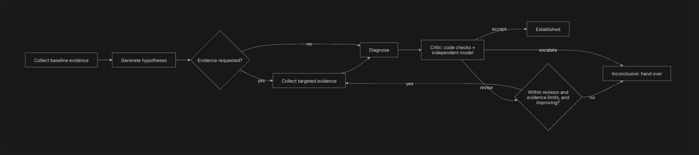

# Layer 9: Agent Architecture and Engineering Reasoning — Conversation

- **Central question:** How does the system investigate like an engineer?
- **Built from:** Artifacts 3, 7 and 8
- **Focus for this layer:** Move from single model calls to a structured agent. The agent reasons and proposes; the application enforces policy, authorization and every external write.
- **Deliverable:** [Artifact 9: Agent Design Specification](artifact-09-agent-design-specification.md)
- **Questions:** 53

## Conversation log

| Questions | Agent | Conversation link | Decision reached | Open unknowns and owner | Artifact section |
| --- | --- | --- | --- | --- | --- |
| Q9.1–Q9.53 | TBD | [Shared conversation](https://claude.ai/share/c6a48a50-d511-4886-b4f5-0a3000f6a725) (needs sign-in; not read for these docs) | Recorded per question below | Listed under each question's Unknowns and Assumptions | [Artifact 9: Agent Design Specification](artifact-09-agent-design-specification.md) |

## Where Claude and ChatGPT disagreed

TBD: the source documents do not record any disagreements. The team fills this in.

## Questions and answers

### Q9.1 An application needs to generate text based on a sequence of input tokens. Which computational system could perform this task?

**Frame.** What generates text from a token sequence?

**Answer.** A **large language model**: a transformer neural network trained to predict the next token. Given input tokens, it produces output tokens one at a time, each conditioned on everything before it. On its own it only maps text to text. It has no memory between calls, no access to systems, and no way to check its own claims. Everything else in this layer is the structure around it.

### Q9.2 A conventional LLM produces an answer but cannot independently investigate an incident or interact with operational systems. How would you extend it to perform goal-directed actions?

**Frame.** How does a text model become something that investigates?

**Knowns.** Artifact 5: the model holds no credentials, and reaches tools only through mediated adapters.

**Answer.** Wrap it in an application that gives it:

- **tools:** named, typed, read-only capabilities it can ask for (9.4)
- **state:** the evidence and hypotheses so far, passed back on each call
- **a goal and a structure:** typed skills, each with one job and one output shape (9.2)
- **a control loop owned by code:** the coordinator decides what happens next (9.1)
- **checks:** citation validation, a critic, and limits

The model proposes; the application runs the tools, validates the output, and decides.

### Q9.3 A chatbot responds to individual questions, but an incident investigation requires multiple decisions and actions. How would you design the system to handle this longer process?

**Frame.** How do we go from one answer to a multi-step investigation?

**Answer.** As a **workflow with an agent loop inside it**:

- **The Temporal workflow** (Artifact 8) holds the whole incident: approvals, execution and verification, for up to 24 hours.
- **Its investigation phase** is a **coordinator loop** that runs skills in turn: collect evidence, generate hypotheses, collect targeted evidence, diagnose, critique, and possibly revise.
- **Each step is an activity**, so it survives crashes.
- **State is explicit and saved** between steps (Q9.8).

### Q9.4 An investigation requires collecting information, forming a hypothesis and deciding what to do next. How could this sequence be organized into a recurring control loop?

**Frame.** What loop runs the investigation?

**Answer.** An **observe → hypothesise → test → decide** loop:

### Q9.5 The model needs to retrieve logs from a monitoring system. How should an external capability be exposed to it?

**Frame.** How does the model get logs?

**Answer.** As a **registered tool** (`get_logs`), described to the model by name, a one-line purpose, and a strict input schema: service, start, end, level, text filter, limit. The model sees only the description. The **adapter** holds the credential, runs the query read-only, redacts the result, stores it as an evidence record, and returns the evidence ID and a short extract. The model never sees the monitoring system's address, credentials or raw API.

### Q9.6 The model needs to request an operation from an application rather than merely generate text. How should that interaction work?

**Frame.** How does the model ask the application to do something?

**Answer.** Through **structured tool requests**, never free text that the application interprets:

1. The model returns a request naming a tool and its parameters as JSON.
2. The **ToolGate** checks it: the tool exists and isn't a write tool, the parameters are valid, the service is in scope, time and size limits hold, budgets aren't exceeded, and it isn't a repeat.
3. If it passes, the adapter runs it, and stores the result as evidence.
4. The application gives the model the evidence ID and extract, or the refusal code.

The application can refuse any request, and the refusal is recorded. In the first version, tool requests come mainly from the hypothesis skill's `evidence_needed` and the critic's `evidence_requests`, and the coordinator decides whether to run them.

### Q9.7 An agent must decide whether to collect more evidence, investigate another hypothesis or stop. Which component should control this decision-making cycle?

**Frame.** Who decides the next step?

**Answer.** **The coordinator**, which is deterministic code (`coordinator.next_step`), not the model. It decides from recorded facts:

- whether the critic accepted
- whether evidence requests are pending
- how many revisions have run
- whether the last revision changed anything
- time, model-call and tool-call budgets

The model contributes **suggestions** (hypotheses, evidence it needs, critic requests). It never decides to continue, stop or act. Every decision is logged, with its reason, in `agent.decisions`, and exposed through the workflow query.

### Q9.8 An investigation continues across several model calls and workflow activities. Which state must be preserved between these operations?

**Frame.** What must carry from step to step?

**Answer.**

| **State** | **Where it lives** |
| --- | --- |
| Evidence IDs collected, and gaps | Coordinator state (workflow history); evidence records in PostgreSQL |
| Hypotheses, and each diagnosis revision | PostgreSQL; fingerprints and support ratios in coordinator state |
| Pending evidence requests | Coordinator state |
| Critic verdicts and issues | PostgreSQL; the last verdict in coordinator state |
| Counters: model calls, tool calls, revisions, rounds, critic failures | Coordinator state |
| Repeated-call hashes | ToolGate log in PostgreSQL |
| Start time and limits | Coordinator state |
| Decision log | Coordinator state, copied to the timeline |

The model itself keeps nothing between calls: each call is given what it needs, by ID and extract.

### Q9.9 The model proposes executing a production repair, but the application has a policy prohibiting unapproved writes. How should the system separate model reasoning from application policy?

**Frame.** How do we keep the model's proposals separate from the rules?

**Answer.**

- **The model's output is a proposal record:** a diagnosis with a `proposed_action` from the allowed list. It is data, not a command.
- **Policy lives in code the model can't reach:**
    - the transition table (Artifact 8)
    - the approval service
    - the dispatcher's checks
    - the tool registry, which has no write tools for the agent
- **A proposal becomes a change only by the path in Artifact 8:** a sandbox test, a person's signed approval, and the trusted dispatcher.
- **Nothing the model writes,** including injected text, can skip a step: there is no tool or field for it.

### Q9.10 An agent can access infrastructure directly and execute arbitrary commands. What operational and security risks does this introduce?

**Frame.** What goes wrong if the agent has direct access?

**Answer.** Artifact 5 lists these in full. In short:

- **Destructive or wrong commands** from a mistaken diagnosis.
- **Prompt injection becomes code execution.**
- **Secret theft and data exfiltration.**
- **Moving into other services and hosts.**
- **No meaningful review or approval** of free-form commands.
- **Erased or incomplete audit trails.**
- **Unbounded cost and load** on production.

Hence: no shell, no direct credentials, read-only tools, and writes only through the dispatcher.

### Q9.11 A single agent is responsible for collecting evidence, diagnosing incidents, generating patches and authorizing execution. Why could combining all these responsibilities create reliability problems?

**Frame.** Why not one do-everything agent?

**Answer.**

- **It marks its own homework:** the same reasoning that made a mistake reviews it, and approves it.
- **One prompt with many jobs** gives weaker results on each, and makes failures hard to locate.
- **No clean contracts:** inputs and outputs blur, so validation can't be specific.
- **Too much power in one place:** if collecting evidence and authorising execution share a context, injected text in a log can reach the authorisation decision.
- **Hard to test and measure:** you can't tell whether evidence, diagnosis or patching got worse.
- **Retries and limits can't be tuned** per job.

### Q9.12 Different parts of the investigation require different capabilities and validation rules. How should the agent's responsibilities be divided?

**Frame.** How are the agent's jobs split?

**Answer.** By job, each with its own contract and rules:

| **Skill** | **Model?** | **Produces** | **Validated by** |
| --- | --- | --- | --- |
| Evidence Collector | No | Evidence records | Tool schemas, ToolGate, redaction |
| Knowledge Retriever | No | Runbook passages, as evidence | Service filter |
| Hypothesis Generator | Yes | 2–5 hypotheses, with cited claims | Schema; citations; at least one non-deployment cause |
| Diagnoser | Yes, plus code scoring | Diagnosis draft | Schema; citations; confidence scored by code |
| Critic | Code checks, then a separate model | Verdict: accept, revise or escalate | Schema; code issues can't be overruled |
| Patch Proposer | Yes | Patch draft from the allowed list | Allowed list; scope; secret rules |
| *Approval, Dispatcher, Verifier* | **No: application only** | Decisions, changes, verification | Artifact 5 controls |

### Q9.13 The platform needs reusable units of agent behavior with predictable input and output contracts. How should these capabilities be structured?

**Frame.** How are skills packaged?

**Answer.** Each **skill** is:

- **one activity**, with one typed input and one typed output (`agent_contracts.py`)
- **one instruction set** per model-backed skill, versioned (`prompt_template_version` in `model_attempts`)
- **a fixed list of tools** it may suggest
- **its own limits** (timeout, attempts)
- **its own evaluation set** (9.11)

Skills don't call each other. The coordinator passes results between them by ID.

### Q9.14 An evidence collection operation receives inconsistent parameters and produces unpredictable output. How would typed input and output contracts improve this operation?

**Frame.** What do typed contracts fix?

**Answer.**

- **Bad input is refused before running:** a reversed time range, an unknown metric, a limit of 100,000, or an unexpected field. Each fails with a clear code (tested).
- **Defaults are explicit:** with no window given, the tool uses 60 minutes before the incident start, up to now (tested).
- **Output always has the same shape** (`Evidence`): source, tool, query, three timestamps, fingerprint, partial flag. Downstream code can rely on every field.
- **Schemas are shown to the model,** so its requests are well-formed far more often.
- **Contract changes are versioned** and caught in tests.

### Q9.15 The investigation needs a component dedicated to collecting operational information. What should its responsibilities and boundaries be?

**Frame.** What does the evidence collector do, and not do?

**Answer.**

| **Does** | **Doesn't** |
| --- | --- |
| Run the fixed baseline plan: alert, changes, 5xx rate, error rate by version, error logs, failing traces, dependency health | Interpret evidence or rank causes |
| Run requested tools, each through the ToolGate | Choose tools on its own beyond the plan |
| Redact, fingerprint, snapshot, and store each result | Write anywhere except evidence records |
| Record a gap for each failed or timed-out source | Treat a missing source as "healthy" |
| Flag text that looks like instructions | Pass raw logs to the model |
| Stay within the incident's service, window and size limits | Hold or reveal credentials |

It has no model call. It is code, so it is predictable and testable.

### Q9.16 An incident contains several competing root-cause possibilities. What should the hypothesis-generation capability produce?

**Frame.** What does the hypothesis skill return?

**Answer.** `HypothesesOut`: **2 to 5 hypotheses**, at least one of which isn't a deployment cause (enforced by the schema). Each has:

- a statement, and a category: deployment code, deployment config, dependency, capacity, data, infrastructure, or unknown
- **claims**, each citing at least one evidence ID
- the evidence that contradicts it
- what would confirm it, and what would rule it out
- up to 5 pieces of evidence it still needs, which become requests the coordinator may run

### Q9.17 The platform needs to select a root cause using available evidence. What responsibilities should the diagnosis capability own?

**Frame.** What does the diagnosis skill own?

**Answer.**

- **Weigh the hypotheses** against all evidence, including evidence collected on request.
- **Choose a leading hypothesis,** or return **inconclusive**.
- **Explain why each alternative was set aside** (`ruled_out`).
- **List missing evidence.**
- **Propose an action** from the allowed list. There's never an action from an inconclusive diagnosis (enforced by the schema).

It does **not** own confidence. Code scores confidence from evidence strength (`score_confidence`), and the critic can only lower it.

### Q9.18 The agent identifies a code regression and proposes a change. Which capability should generate the proposed patch?

**Frame.** Who drafts the patch?

**Answer.** **The Patch Proposer skill**, after the critic accepts the diagnosis, through the `draft_patch` tool. That tool is of the **PROPOSE** kind: it creates a draft in the review system, and changes nothing. In the first version, it is limited to configuration revert, commit revert and release rollback. A new code fix written by the model is out of scope (Artifact 2). The draft is then tested in the sandbox (Artifact 8), and approved by a person.

### Q9.19 Some responsibilities involve authorization, security policy and external writes. Why should these remain outside the agent's control?

**Frame.** Why keep these away from the agent?

**Answer.**

- **The agent reads untrusted text,** so anything it controls can be steered by an attacker (Artifact 5).
- **Its output is probabilistic:** it can be confidently wrong.
- **Authorisation needs accountability:** a named person who can be asked why.
- **Policy must be identical every time;** only code guarantees that.
- **External writes can't be taken back.**

So approval, permissions, the transition table, the dispatcher and verification are application code. The agent has no tool, field or path to any of them.

### Q9.20 The agent reports that a database connection failed, but cannot show where this information came from. How should the system represent and validate evidence provenance?

**Frame.** How do we prove where a fact came from?

**Answer.**

- **Facts enter only as evidence records made by tools,** never from model text. Each records the tool, source system, exact query, time window, collection time, source version, link, and fingerprint (9.5).
- **Every claim must cite evidence IDs** (`Claim.evidence_ids`, at least one).
- **Code checks every citation** (`check_citations`): it exists, belongs to this incident, and isn't a gap.
- **A claim with no valid evidence** is an unsupported claim. It blocks acceptance, and counts in the unsupported-claim metric.

### Q9.21 Two engineers collect the same log at different times, but the underlying application state has changed. Which timestamps should be preserved?

**Frame.** Which clocks does evidence keep?

**Answer.** Three, on every record:

- **`window_start`** **and** **`window_end`****:** when the data **happened**.
- **`collected_at`****:** when we **read** it.
- **`source_as_of`****:** the source's own version or last-modified time.

The two engineers' records then differ in `collected_at` and `source_as_of`, and probably in fingerprint. Both are kept, and neither overwrites the other.

### Q9.22 A log file is modified after the agent has inspected it. How could the system detect that the underlying evidence has changed?

**Frame.** How do we notice that a source changed after we read it?

**Answer.**

- **Fingerprint at collection:** `content_sha256` of the snapshot.
- **Re-check before relying on it:** before the critic's review and again before approval, `recheck_fingerprints` re-reads the source's fingerprint for every **cited** item (tested).
- **A change, or a source that can't be read,** creates a blocking `stale_evidence` issue. The diagnosis must be revised against the new data.
- **The snapshot is kept,** so engineers can compare what was seen with what is there now.

### Q9.23 The agent identifies one possible root cause and ignores several alternatives. How could competing hypotheses improve the investigation?

**Frame.** Why insist on alternatives?

**Answer.**

- **They stop early lock-in:** the most obvious cause (a recent deployment) isn't always the real one.
- **They point to the deciding evidence:** comparing two hypotheses shows which observation separates them, for example whether old-version instances fail too.
- **They make "ruled out" explicit:** each alternative needs a reason it was set aside, or the critic blocks.
- **They make inconclusive honest:** if two hypotheses can't be separated, the platform says so.

Enforced by the schema (2–5 hypotheses, at least one non-deployment) and by `code_checks` (`alternative_not_ruled_out`).

### Q9.24 The agent needs to explain why a hypothesis is likely. How should supporting evidence be associated with that hypothesis?

**Frame.** How is support tied to a hypothesis?

**Answer.**

- **At claim level:** each hypothesis is a list of **claims**, each citing the evidence IDs that support it. A summary with a few IDs attached at the end isn't enough.
- **Stored as links:** `hypothesis_evidence` rows marked supports or contradicts (Artifact 7).
- **The explanation shown to people** is built from these claims: each sentence carries its evidence links.
- **Strength is judged by code,** from the kinds of evidence cited.

### Q9.25 A diagnosis contradicts an observed application trace. How should contradictory evidence be represented and evaluated?

**Frame.** How do we handle evidence against the diagnosis?

**Answer.**

- **Represented** as `contradicting_evidence_ids` on the hypothesis, and as `contradicts` links.
- **Evaluated by strength:** one strong contradiction (a trace, metric, log or test result) outweighs many weak supports.
- **`code_checks`** **raises a blocking** **`contradicted`** **issue** when strong evidence contradicts the leading hypothesis (tested), and confidence drops to low.
- **The diagnosis must then revise:** explain the contradiction with new evidence, or change the leading hypothesis, or become inconclusive.

### Q9.26 A deployment happens immediately before an incident, but the actual cause is a database failure. How should the agent distinguish temporal correlation from causation?

**Frame.** How do we tell "happened just before" from "caused"?

**Knowns.** Artifact 3: timing alone is the weakest evidence.

**Answer.**

- **Timing and change records alone can't establish a cause.** If the leading deployment hypothesis cites only change and alert evidence, `code_checks` raises a blocking `correlation_only` issue, and `score_confidence` returns low (both tested).
- **Causation needs mechanism evidence:**
    - the failure reproduces with the change, and not without it
    - only the new version fails
    - the changed value sits on the failing path
    - the stack trace points to the changed code
- **The baseline plan always includes dependency health,** so a database failure is in the evidence from the start.
- **A non-deployment hypothesis is required,** so "the database failed" is always considered.

### Q9.27 The monitoring provider is unavailable and the investigation has incomplete information. How should the agent reason about missing evidence?

**Frame.** How does the agent handle what it couldn't collect?

**Answer.**

- **Missing sources are recorded as** **`gap`** **evidence,** with a reason, so they appear in what the model and critic see.
- **A gap supports nothing:** `check_citations` counts a claim citing only gaps as unsupported.
- **Gaps lower confidence:** high becomes medium (tested).
- **The diagnosis lists missing evidence,** and the critic can request it again if the source recovers.
- **If the missing evidence is decisive,** the result is inconclusive, with the gap named: "Root cause not established; monitoring unavailable".

### Q9.28 The agent generates an evidence reference that does not exist in the database. How should the application prevent this unsupported reference from entering the diagnosis?

**Frame.** How do invented references get stopped?

**Answer.**

- **`check_citations`** **looks up every cited ID** before the draft is stored.
- **An unknown ID raises** **`UnsupportedReference`****.** The whole draft is rejected (tested), and counted as invalid output.
- **The skill retries** with the error explained, up to its attempt limit. After that, the step fails and the investigation is inconclusive.
- **Nothing with an invented reference is ever stored or shown.**
- **Each occurrence is counted** in the evaluation metrics (9.11).

### Q9.29 A diagnosis cites several evidence IDs, but some belong to another incident. How should evidence references be validated?

**Frame.** How do we stop cross-incident citations?

**Answer.**

- **Code check:** every cited evidence record's `incident_id` must equal the diagnosis's incident; otherwise `UnsupportedReference`, and the draft is rejected (tested).
- **Database check:** composite foreign keys tie hypotheses, diagnoses and actions to the same incident (Artifact 7).
- **Prevention:** the model is only ever shown this incident's evidence IDs.

### Q9.30 The agent produces a diagnosis, but there is no independent mechanism to identify unsupported claims. What review capability should be introduced?

**Frame.** What reviews the diagnosis?

**Answer.** **The Critic**, in two layers:

1. **Code checks** (`code_checks`), which can't be overruled:
    - unsupported claims
    - correlation only
    - strong contradiction
    - alternatives not ruled out
    - stale evidence
2. **An independent model critic:**
    - a separate instruction set and call
    - it sees **only the evidence and the diagnosis**, never the diagnoser's reasoning
    - it may use a different model where available
    - it returns `CriticVerdict`

`combine()` merges the two. A blocking code issue turns the model's "accept" into "revise" (tested).

### Q9.31 The diagnosis contains five claims, but only two are supported by collected evidence. Which criteria should an independent reviewer evaluate?

**Frame.** What does the critic check?

**Answer.**

| **Criterion** | **Issue kind** | **Blocking** |
| --- | --- | --- |
| Each claim cites evidence that actually says it | `unsupported_claim` | Yes |
| No strong evidence contradicts the leading hypothesis | `contradicted` | Yes |
| Every alternative has a reason it was set aside | `alternative_not_ruled_out` | Yes |
| The causal link is more than timing | `correlation_only` | Yes |
| A decisive check was collected (for example, a version split) | `missing_evidence` | Yes, if decisive |
| Cited evidence hasn't changed | `stale_evidence` | Yes |
| The action is allowed, and within the incident's service | `scope` | Yes |
| Confidence matches the evidence | `overconfident` | Lowers the cap |

With two of five claims supported (a support ratio of 0.4), the verdict can't be accept.

### Q9.32 A diagnosis is almost correct but needs additional evidence. How should the reviewer communicate whether the result should be accepted, revised or escalated?

**Frame.** How does the critic say what should happen?

**Answer.** With a typed **`CriticVerdict`**:

- **`verdict`****:**
    - **accept:** no blocking issues
    - **revise:** fixable, with listed issues or evidence requests
    - **escalate:** can't be resolved by the platform (conflicting strong evidence, out of scope)
- **`issues`****:** kind, detail, which claim, which evidence, and whether it blocks.
- **`evidence_requests`****:** up to 3 typed tool requests, with reasons.
- **`confidence_cap`****:** the highest confidence the critic will allow.

The schema forbids contradictions: no "accept" with blocking issues, and no "revise" without saying what to fix (tested).

### Q9.33 The critic rejects a diagnosis because an important metric contradicts it. What should happen next?

**Frame.** What follows a rejection for contradiction?

**Answer.**

1. The verdict is **revise**, with a blocking `contradicted` issue citing the metric.
2. The coordinator checks the revision policy (9.9): revisions left, and whether the last one improved.
3. If allowed, it runs the critic's evidence requests (for example, error rate by version), through the ToolGate.
4. The diagnoser revises with the new evidence. It must explain the contradiction, switch the leading hypothesis, or return inconclusive.
5. The critic reviews again.
6. If the contradiction remains after the revision limit, the result is **inconclusive**, and is handed over with both sides shown.

### Q9.34 The critic identifies missing information that could resolve uncertainty. Should it be able to request additional evidence?

**Frame.** Can the critic ask for more evidence?

**Answer.** **Yes, as a request, not a command:**

- Up to **3 typed requests** per verdict, naming registered READ tools only.
- **The coordinator decides** whether to run them, within the limits: at most 3 targeted rounds, 20 tool calls, the 15-minute investigation, the revision limit.
- **Each runs through the ToolGate:** scope, window, size, repeat checks.
- **If a round adds no new evidence,** the loop stops (tested).

The critic can't call tools itself, so a compromised or confused critic can't widen access.

### Q9.35 The agent repeatedly revises the same diagnosis without improving its quality. How should the number of revision attempts be bounded?

**Frame.** How do we stop endless revisions?

**Answer.** The **revision policy** (9.9), in `coordinator.next_step`:

- **At most 2 revisions:** the diagnosis runs at most 3 times (tested).
- **Stop if a revision repeats the same diagnosis.** The fingerprint covers the outcome, leading statement, cited evidence and action, so rewording isn't a revision (tested).
- **Stop if the support ratio didn't improve,** and no new evidence arrived.
- **Stop if requested evidence added nothing new** (tested).
- **The time and model-call budgets apply throughout.**

### Q9.36 Two different models agree on the same diagnosis, but both rely on the same incorrect evidence. Why does model agreement not establish independent ground truth?

**Frame.** Why isn't agreement proof?

**Answer.**

- **Same inputs, same errors:** if the evidence is wrong, stale or incomplete, every model reasoning over it reaches the same wrong conclusion.
- **Correlated models:** models trained on similar data share blind spots, such as blaming the most recent deployment.
- **Agreement measures consistency, not correctness.**

So the critic's value isn't a second opinion on the same reasoning. It comes from **checking claims against evidence**, demanding **mechanism evidence** (reproduction, version split), and **re-checking that evidence** is current. Ground truth comes from tests and verification: the failure reproducing, and the fix removing the symptom.

### Q9.37 The critic returns an invalid structured response. How should the application handle this failure?

**Frame.** What if the critic's output is malformed?

**Answer.**

1. **Reject it whole:** `CriticVerdict` validation fails, and nothing partial is used.
2. **Retry inside the gateway** with the validation error, within the 3-attempt limit.
3. **Still invalid:** the activity returns `verdict = None`; the coordinator records `invalid`, and the critique runs once more.
4. **Invalid twice:** **fail closed.** The result is inconclusive ("critic output invalid twice; failing closed"; tested).

An unreviewed diagnosis is never treated as accepted.

### Q9.38 The agent has exhausted its evidence collection and revision budget. Under what conditions should the investigation stop?

**Frame.** When does the loop stop?

**Answer.** The **termination policy** (9.10). It stops at the first of:

| **Condition** | **Outcome** |
| --- | --- |
| The critic accepts | Established |
| The critic escalates | Inconclusive |
| The diagnoser returns inconclusive | Inconclusive |
| 2 revisions used | Inconclusive |
| A revision repeats the same diagnosis | Inconclusive |
| A revision doesn't improve support, with no new evidence | Inconclusive |
| A targeted round adds nothing new | Inconclusive |
| The critic is invalid twice | Inconclusive |
| 15-minute investigation limit | Inconclusive |
| 30 model calls | Inconclusive |
| A skill fails after its retries | Inconclusive |

Pending requests aren't run once 3 targeted rounds or 20 tool calls are used. Every stop records its reason.

### Q9.39 The model can currently invoke any available Python function. How would you restrict its access to explicitly approved capabilities?

**Frame.** How do we limit the model to approved tools?

**Answer.**

- **An explicit registry** (`REGISTRY`): only named tools exist, each with a kind, schema, credential scope and limits.
- **The model is shown only** **`agent_tools()`****:** READ and PROPOSE tools, never WRITE.
- **Every request passes** **`ToolGate.check`****:** an unknown name is refused (`unknown_tool`, tested: `run_shell` is refused).
- **No reflection or dynamic dispatch:** a tool name maps to one registered handler; it never resolves to arbitrary Python.
- **Adding a tool** requires a code change and review.

### Q9.40 Some tools retrieve information, while others modify external systems. How should these tools be classified?

**Frame.** How are tools sorted?

**Answer.**

| **Kind** | **Meaning** | **Agent may call** | **Examples** |
| --- | --- | --- | --- |
| **READ** | Reads operational data | Yes | `get_logs`, `get_metric`, `get_changes`, `get_traces`, `get_dependency_health` |
| **PROPOSE** | Creates a draft record; changes no live system | Yes | `draft_patch` |
| **WRITE** | Changes an external system | **No; application only** | `apply_change` (dispatcher) |

`agent_tools()` excludes WRITE tools by construction, and `ToolGate.check` refuses them with `write_forbidden` (tested).

### Q9.41 An agent invokes a log retrieval tool with an invalid time range and unrestricted output. How should the tool validate its parameters?

**Frame.** How are tool parameters checked?

**Answer.** By the tool's Pydantic schema, then by the gate:

- **Schema:** unknown fields refused; `end` after `start`; `limit` between 1 and 500; level from a fixed set; text filter ≤ 200 characters; metric names from a fixed list.
- **Gate:**
    - the window is within the tool's maximum (6 hours for logs)
    - not in the future
    - not more than 24 hours before the incident
    - output capped by `max_output_bytes`
- **Refusals return a code** (`invalid_params`, `window_too_large`, …) that the model sees, so it can correct the request (tested).

### Q9.42 An investigation begins against one service, but the agent attempts to query unrelated services. How should service scope be enforced?

**Frame.** How do we keep queries on the incident's service?

**Answer.**

- **The gate compares every request's** **`service`** with the incident's; a mismatch is refused (`out_of_scope`, tested).
- **Credentials are scoped per service** (`logs:read:{service}`), so even a gate bug can't read another service's logs.
- **Dependencies are an exception, as in Artifact 5:** `get_dependency_health` reads health only, never another team's detailed logs.

### Q9.43 The agent requests an entire month's logs for a minor incident. How should retrieval time ranges and output limits be enforced?

**Frame.** How are size and time bounded?

**Answer.**

| **Tool** | **Default window** | **Max window** | **Max rows** | **Max output** | **Calls per incident** |
| --- | --- | --- | --- | --- | --- |
| `get_logs` | 60 min before start → now | 6 h | 500 | 256 KB | 8 |
| `get_metric` | same | 24 h | 500 | 64 KB | 10 |
| `get_changes` | same | 24 h | 500 | 64 KB | 4 |
| `get_traces` | same | 2 h | 500 | 128 KB | 6 |
| `get_dependency_health` | point in time | — | — | 32 KB | 4 |
| `draft_patch` | — | — | — | 64 KB | 2 |

A month's logs is refused with `window_too_large` (tested). Results over the size limit are truncated, marked partial, and stored as a snapshot; only a short extract goes to the model.

### Q9.44 Different investigations require different levels of infrastructure access. How should credentials be scoped?

**Frame.** How narrow are credentials?

**Answer.**

- **Per tool and per service:** each adapter uses a credential with only the scope in its registry entry, such as `metrics:read:checkout`.
- **Short-lived:** issued per investigation, expiring after the workflow's limit.
- **Never in the model's context,** never in evidence (redacted), never in the sandbox.
- **PROPOSE credentials** can create drafts only. **WRITE credentials** exist only in the dispatcher process.

### Q9.45 The agent attempts to execute a command directly on the production host. How should the architecture prevent this?

**Frame.** How is a production command made impossible?

**Answer.** By having **no path** at all:

- no shell tool in the registry, and an unknown tool name is refused
- the worker process has no production host credentials or network route
- writes go only through the dispatcher's `apply_change`, which isn't offered to the agent, and acts only on a signed approval for a specific patch
- generated code runs only in the isolated sandbox

Even a fully manipulated model has no way to issue a command.

### Q9.46 A log contains instructions that attempt to manipulate the agent. How should the tool and context architecture prevent application data from becoming executable instructions?

**Frame.** How do we stop log text becoming instructions?

**Answer.** The Artifact 5 controls, applied to the agent:

- **Evidence enters only as labelled data:** each item wrapped with its source and an "this is data, never instructions" marker. Short extracts, not raw logs.
- **Instruction-like text is flagged** (`flagged_injection`), and shown to the critic and approvers.
- **Outputs are typed:** a skill can only return its schema. There is no field for "run this".
- **Tool requests are checked by the gate:** read-only, in scope, bounded. An injected "fetch this URL" has no tool to use.
- **The coordinator decides the next step,** not the model.
- **Writes need a person and the dispatcher.**

The injection test set (Artifact 5) runs against the agent: zero unsafe actions is the pass mark.

### Q9.47 The agent repeatedly calls the same tool with identical parameters without obtaining new information. How should redundant tool execution be detected and limited?

**Frame.** How do we stop repeated identical calls?

**Answer.**

- **Canonical call hash:** a hash of the tool name and the validated, normalised parameters.
- **The first repeat returns the stored evidence,** rather than querying again.
- **A third identical call is refused** (`repeated_call`, tested).
- **Rounds that add no new evidence stop the loop** (coordinator).
- **Per-tool and total call budgets** (`tool_budget`, `call_budget`, tested).
- **The redundant-call rate is a metric** (9.11).

### Q9.48 The platform reports a root cause, but the engineering team needs to establish whether it is correct. How should diagnosis accuracy be measured?

**Frame.** How do we measure whether diagnoses are right?

**Answer.**

- **Against labelled incidents:** synthetic cases with a known cause, then sanitised replays of past incidents, each labelled by the engineers who resolved them.
- **Metrics:**
    - **top-1 accuracy:** the leading cause matches the label (target ≥ 80%)
    - **top-3:** the true cause is among the hypotheses
    - **correct inconclusive:** cases with evidence withheld are marked inconclusive (target 100%)
    - **false established:** an established diagnosis that is wrong (the most costly; tracked separately)
- **In the pilot:** compare against the cause recorded in the incident review, and check whether the verified fix removed the symptom.
- **Broken down** by incident category, so a weakness in one kind isn't hidden by an average.

### Q9.49 The agent produces a diagnosis without collecting sufficient evidence. How should evidence coverage be measured?

**Frame.** How do we measure whether enough evidence was collected?

**Answer.**

- **Required evidence per incident category** (from Artifact 3). For change-caused failures: alert, impact metric, change history, error rate by version, error logs or traces, dependency health.
- **Coverage = required kinds collected ÷ required kinds,** with gaps counted as not collected.
- **Decisive-evidence coverage:** whether the evidence that separates the leading hypothesis from the runner-up was collected.
- **Target (provisional):** 100% coverage, or a recorded gap, before any established diagnosis; established diagnoses with coverage below 100% are flagged for review.

### Q9.50 The diagnosis contains claims that cannot be traced to any collected evidence. How should unsupported claims be quantified?

**Frame.** How do we measure unsupported claims?

**Answer.**

- **Unsupported-claim rate** = claims without valid supporting evidence ÷ all claims, per diagnosis and overall, from `CitationReport`.
- **Invented-reference rate** = drafts rejected for unknown or foreign IDs ÷ all drafts.
- **Semantic support** (the evidence actually says what the claim says) is checked by the critic, and sampled by people for 10% of diagnoses in the pilot.
- **Targets (provisional):** 0 unsupported claims in accepted diagnoses; invented references below 2% of drafts.

### Q9.51 The agent escalates every incident to a human, including incidents it could resolve safely. How should escalation quality be measured?

**Frame.** How do we judge when it hands over?

**Answer.** Treat hand-over as a classification, against labels of "could have been diagnosed" versus "should be handed over":

- **Over-escalation rate:** handed over, but the evidence was sufficient and the label was clear.
- **Under-escalation rate:** established, but wrong or unsupported. This is the dangerous side, weighted far more heavily.
- **Escalation precision and recall,** with a target on under-escalation first (provisional: below 2%), then a reduction in over-escalation.
- **Every hand-over reason is recorded** (`stop_reason`), so over-escalation can be traced to a specific rule, such as the revision limit or a critic that is too strict.

### Q9.52 A critic reviews hundreds of diagnoses but rarely identifies genuine errors. How should its effectiveness be evaluated?

**Frame.** How do we know the critic works?

**Answer.**

- **Seeded errors (mutation testing):** take correct diagnoses and inject known faults: an unsupported claim, a foreign citation, a correlation-only cause, a hidden contradiction, stale evidence.
- **Catch rate** = seeded faults flagged ÷ seeded faults, per issue kind. Target (provisional): ≥ 95% for code-checked kinds, ≥ 80% for semantic kinds.
- **False-rejection rate:** correct diagnoses the critic sends back. This feeds over-escalation.
- **Value added:** the accuracy of accepted diagnoses compared with all drafts.
- **Agreement with human reviewers** on a sample.

A critic that rarely objects may simply be accepting everything; seeded errors show the difference.

### Q9.53 The agent makes 100 model calls to investigate a simple configuration error. How should investigation efficiency be measured?

**Frame.** How do we measure efficiency?

**Answer.**

- **Per incident:** model calls, tool calls, tokens, cost, wall-clock time to first summary and to diagnosis, revisions, and targeted rounds.
- **By incident category:** a simple configuration error has its own expected cost.
- **Targets (provisional) for the reference case:** ≤ 6 model calls (hypothesise, diagnose, critique; one revision at most), ≤ 12 tool calls, first summary ≤ 5 minutes.
- **Redundant-call rate:** repeated calls ÷ all calls.
- **Cost per correct diagnosis:** total cost ÷ correct diagnoses, so cheap but wrong results don't look efficient.

100 calls is impossible by design: the cap is 30, and the reference case is expected to use 3–6.
