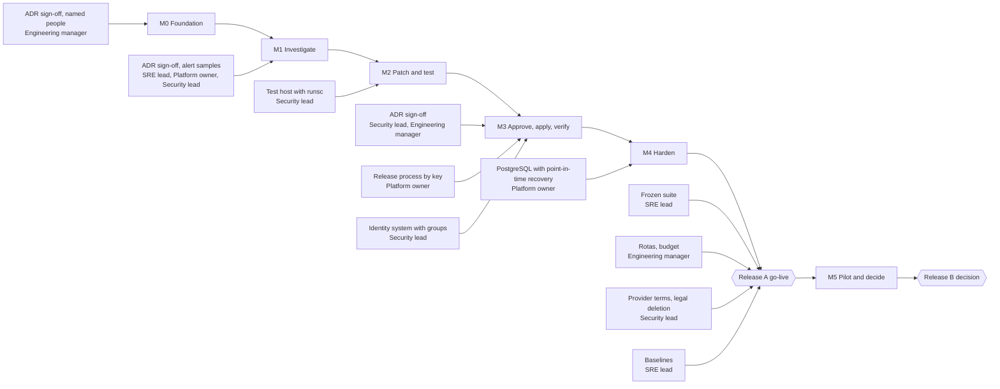
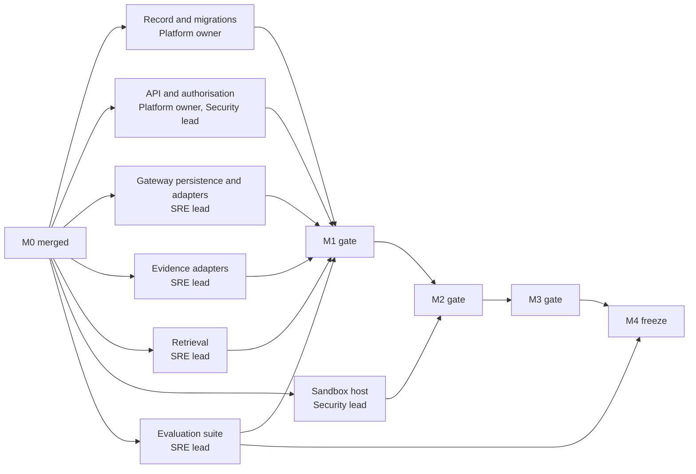

# Artifact 13: Complete Implementation Plan

- **Layer:** 13, Implementation Planning and Delivery
- **Built from:** Artifacts 1 to 12
- **Status:** Proposed: drafted by Claude 2026-11-02 per [decisions.md](../../decisions.md); pending team review
- **Sources:** [conversation.md](conversation.md), [decisions.md](../../decisions.md), [code-changes-required.md](../../code-changes-required.md), [Artifact 1](../layer-01-problem-discovery/artifact-01-product-requirements-document.md), [Artifact 2](../layer-02-scope-and-constraints/artifact-02-scope-and-constraints-document.md), [Artifact 4](../layer-04-requirements/artifact-04-requirements-specification.md), [Artifact 5](../layer-05-threat-modeling/artifact-05-threat-model.md), [Artifact 6](../layer-06-system-architecture/artifact-06-system-architecture-document.md), [Artifact 10](../layer-10-inference-retrieval/artifact-10-inference-and-retrieval-specification.md), [Artifact 11](../layer-11-safe-remediation/artifact-11-safe-remediation-specification.md), [Artifact 12](../layer-12-reliability-evaluation/artifact-12-reliability-and-evaluation-specification.md), [System Design](../../reference/system-design.md), [Technical specification](../../reference/technical-specification.md), [tests/security/README.md](../../../tests/security/README.md), [uv.lock](../../../uv.lock)

## Required sections

| Required section | Questions this section answers | Done |
| --- | --- | --- |
| 13.1 Repository structure | Q13.1–Q13.9, Q13.11, Q13.12 | Yes |
| 13.2 Dependency graph | Q13.49, Q13.50 | Yes |
| 13.3 Technology versions to verify | Q13.13–Q13.17, Q13.19, Q13.20 | Partial |
| 13.4 Milestones M0–M5 | Q13.10, Q13.38–Q13.48, Q13.55 | Yes |
| 13.5 Task breakdown | Q13.10, Q13.38–Q13.46, Q13.50 | Yes |
| 13.6 File ownership | Q13.2, Q13.7, Q13.50, Q13.53 | Yes |
| 13.7 Testing commands | Q13.13–Q13.15, Q13.18–Q13.36 | Yes |
| 13.8 Acceptance criteria | Q13.37, Q13.39, Q13.54, Q13.58 | Yes |
| 13.9 Manual demos | Q13.30, Q13.55 | Yes |
| 13.10 Deliverables | Q13.37, Q13.56 | Yes |
| 13.11 Risks and unresolved dependencies | Q13.47, Q13.51, Q13.52 | Partial |
| 13.12 Human approval gates | Q13.51, Q13.53, Q13.57, Q13.58 | Yes |

## 13.1 Repository structure

*Answers Q13.1–Q13.9, Q13.11, Q13.12.*

One installable package, split by responsibility, not by layer of the worksheet ([Q13.1](conversation.md)). ADR-67 sets the layout, ADR-16 a modular monolith, and ADR-51 one codebase with four processes: API, worker, dispatcher, isolated test environment.

The tree below is the repository on 2026-11-02. `[M0]` to `[M4]` mark a planned path and the milestone that adds it. Everything marked is provisional unless ADR-63 or ADR-67 names it. `docs/` isn't expanded: it's the artifact filing, and `src/` is what changes (ADR-67).

```text
incident-copilot/
├── .github/                             [M0]
│   ├── CODEOWNERS                       [M0] required reviewers (13.6, 13.12)
│   └── workflows/ci.yml                 [M0] the checks in 13.7
├── .env.example                         [M0] every variable, no values
├── .gitignore                           `.env` added at M0
├── README.md
├── compose.yaml                         [M0] local stack, images pinned by digest
├── pyproject.toml
├── uv.lock                              commit at M0: untracked today
├── db/
│   ├── migrations/                      [M0] Alembic; 0001_baseline runs schema.sql
│   ├── schema-tests.sql
│   └── schema.sql                       freezes at M0 as the input to 0001_baseline
├── docs/
│   └── layers/layer-13-implementation-planning/
│       └── milestones/                  [M0] one evidence record per milestone
├── ops/
│   ├── alerts.yml
│   ├── reference-app/                   [M2] runnable copy of orders-api
│   └── sandbox/                         [M2] harness image and sandbox spec
├── prompts/<skill>/v<N>.md              [M1] immutable once merged (ADR-63)
├── src/aisre/
│   ├── __init__.py
│   ├── agent/
│   │   ├── __init__.py
│   │   ├── agent_contracts.py
│   │   ├── coordinator.py
│   │   ├── skills/                      [M1] real skill bodies, one file per skill
│   │   ├── tool_registry.py
│   │   └── validation.py
│   ├── api/                             [M0] FastAPI routes, Approval Service entry point
│   ├── cli.py                           [M1] command-line tool (FR-38)
│   ├── config.py                        [M0] typed settings, non-secret values
│   ├── contracts.py
│   ├── evaluation/
│   │   ├── __init__.py
│   │   └── eval_harness.py
│   ├── evidence/                        [M1] real source adapters
│   ├── gateway/
│   │   ├── __init__.py
│   │   ├── adapters.py
│   │   ├── gateway.py
│   │   └── gateway_contracts.py
│   ├── record/                          [M0] Incident Record: SQLAlchemy, timeline, outbox
│   ├── reliability/
│   │   ├── __init__.py
│   │   ├── fence.py
│   │   └── telemetry.py
│   ├── remediation/
│   │   ├── __init__.py
│   │   ├── action.py
│   │   ├── dispatcher.py
│   │   ├── patch.py
│   │   └── sandbox.py
│   ├── retrieval/
│   │   ├── __init__.py
│   │   ├── context.py
│   │   └── retrieval.py
│   ├── verification/
│   │   ├── __init__.py
│   │   └── verification.py
│   └── workflow/
│       ├── __init__.py
│       ├── activities.py
│       ├── relay.py                     [M0] outbox relay
│       ├── states.py
│       ├── worker.py                    [M0] worker process entry point
│       └── workflow.py
└── tests/
    ├── conftest.py                      [M0] session guard (Q13.23)
    ├── fixtures/reference-incident/     alert, release, logs, metrics, trace, diff, catalogue, key
    ├── integration/                     [M0] integration and system tests
    ├── security/                        ST-01 to ST-40, 12 test files, support.py, conftest.py, README.md
    └── unit/                            test_agent, test_contracts, test_layer10, test_layer12,
                                         test_remediation, test_workflow
```

**Which process runs what** ([Q13.1](conversation.md)):

| Path | Holds | Process |
| --- | --- | --- |
| `src/aisre/contracts.py` | Shared contracts | All |
| `src/aisre/workflow/` | Workflow, activity interfaces, state tables, relay | Worker |
| `src/aisre/agent/` | Coordinator, skill contracts, tool registry, validation | Worker |
| `src/aisre/gateway/` | Model Gateway and adapters | Worker |
| `src/aisre/retrieval/` | Ingestion, index, search, context assembly | Worker |
| `src/aisre/remediation/` | Patch, sandbox controller, action, dispatcher | Worker, dispatcher |
| `src/aisre/verification/` | Recovery Verifier | Worker |
| `src/aisre/reliability/` | Telemetry, write fence | All |
| `src/aisre/evaluation/` | Scoring harness | Evaluation runner |
| `src/aisre/api/` | FastAPI routes, Approval Service entry point | API |
| `src/aisre/record/` | Incident Record | API, worker, dispatcher |

**Rules that keep the structure honest:**

| Question | Rule | Held by |
| --- | --- | --- |
| Shared contracts ([Q13.2](conversation.md)) | Crossing a process or package boundary: `contracts.py`. Private to one package: that package's file. States: `workflow/states.py` and nowhere else. Nobody redefines a contract locally | `tests/unit/test_contracts.py` fails on drift from the schema |
| Imports ([Q13.1](conversation.md)) | Everything may import `contracts.py`; it imports nothing from `aisre` | Import test at M0 |
| API to workflow ([Q13.3](conversation.md)) | `aisre.api` never imports `temporalio`. The Record writes incident, event and outbox row in one transaction; `relay.py` starts or signals at least once | Import test at M0, in the Verifier test's style |
| Temporal sandbox ([Q13.3](conversation.md)) | `workflow.py` keeps `import aisre.workflow.activities as act` inside `workflow.unsafe.imports_passed_through()` | `tests/unit/test_workflow.py` |
| Providers ([Q13.4](conversation.md)) | `adapters.py` holds `ClaudeAdapter` and a disabled `TinkerAdapter`. Skills name an alias. Retries, budgets and validation stay in `gateway.py`. Split the file only when a third adapter arrives | Conformance tests in `tests/unit/test_layer10.py` |
| Skills ([Q13.5](conversation.md)) | Interface in `activities.py`, contracts in `agent_contracts.py`, tools in `tool_registry.py`, prompt in `prompts/`, body in `agent/skills/`, registered under the same activity name | `tests/unit/test_agent.py` |
| Retrieval ([Q13.6](conversation.md)) | Ingestion, indexing and search in `retrieval.py`, context in `context.py`. Corpus SQL goes through `record/`, so retrieval has no database code | ST-22 |
| Sandbox ([Q13.7](conversation.md)) | Only the controller is in `sandbox.py`. Generated code never runs in a platform process. `ops/sandbox/` and `sandbox.py` have the Security lead as code owner | ST-26 |
| Verifier ([Q13.8](conversation.md)) | `verification.py` imports nothing from the dispatcher and returns a verdict only | `test_st39_the_verifier_has_no_path_to_the_dispatcher` |
| Dispatcher ([Q13.1](conversation.md)) | `dispatcher.py` imports no signing code | ST-18 |
| Evaluation ([Q13.9](conversation.md)) | Scoring in `eval_harness.py`, one small case in `tests/fixtures/reference-incident/`. Held-out data stays out of the repository: `suite-<version>/` in the case store, `keys-<version>/` in the key store. Baselines and results kept 2 years (ADR-57) | Runner can't read keys |
| Settings and secrets ([Q13.11](conversation.md)) | Configuration in the repository, reviewed. Development keys in a local `.env`. Production credentials in a secrets manager, injected per process, seen only by the process named in Artifact 6 | Secret scan; session guard |
| Prompts ([Q13.12](conversation.md)) | Never edit a merged file. A change is a new `v<N>.md`, merged with SRE lead approval and a passing development-split run. Activation also needs the ADR-65 gates, and is a recorded configuration change. Rollback activates the previous version | CI fails if a merged prompt file changes (M1) |

Nothing secret reaches the sandbox: the parent environment doesn't carry over (ST-16). The dispatcher holds only the public key (ADR-17).

## 13.2 Dependency graph

*Answers Q13.49, Q13.50.*

Milestones form a line, because each one's gate needs the last. Outside dependencies are nodes with owners, so a blocked milestone shows why. Tasks inside a milestone form a graph, listed in 13.5 with their dependencies ([Q13.49](conversation.md)).



**What can run in parallel.** Two tasks can run together if no path joins them in the graph, and they don't touch the same file. Interfaces and fakes make that common: `activities.py` for every activity, `FakeRelease` and `FakeProvider` for the outside ([Q13.50](conversation.md)). The streams below can start once M0 is merged.



| Milestone | Can run at once | Serial |
| --- | --- | --- |
| M0 | T0.3, T0.4, T0.5, T0.6 | T0.1 and T0.2 come first, so the whole-repository reformat conflicts with nobody (Q13.19) |
| M1 | T1.1, T1.7, T1.13, T1.17, T1.19 | T1.8, T1.14 and T1.18 close the path: gateway, then skills, then the coordinator on real skills |
| M2 | T2.1, T2.3, T2.8, T2.11 | T2.5, T2.6 and T2.9 need the host |
| M3 | T3.2, T3.4, T3.8 | T3.5, T3.6, T3.7 and T3.9 need the dispatcher path |
| M4 | T4.1, T4.2, T4.3, T4.4, T4.5, T4.8, T4.9, T4.11, T4.12 | T4.6 after T4.5, T4.7 after T4.6, T4.10 after T4.3. T4.13 and T4.14 close the milestone |
| M5 | T5.2, T5.3, T5.4 | T5.6 needs the pilot's data, T5.7 needs T5.6 |

**Serial points:** `src/aisre/contracts.py`, `db/migrations/`, `src/aisre/workflow/activities.py` and `uv.lock`. Each gets one owner in `.github/CODEOWNERS`, and small, quick pull requests. Two parallel migrations give two Alembic heads, and CI fails on that ([Q13.50](conversation.md)).

No plan can give dates until people are named (13.11).

## 13.3 Technology versions to verify

*Answers Q13.13–Q13.17, Q13.19, Q13.20.*

Versions below are exact where `uv.lock` holds one, read 2026-11-02. `uv lock --check` passes. Everything else reads "verify at M0", or the milestone that adds it. `pyproject.toml` gives floors; the lockfile records the one resolved version and hash of every package, so `uv sync` installs the same set everywhere ([Q13.15](conversation.md)).

| Technology | Role | Version | From | Verify |
| --- | --- | --- | --- | --- |
| Python | Language | 3.12.14 run; `requires-python = ">=3.12"` | `uv run python -V` | Pinned to 3.12 in CI at M0 |
| uv | Dependencies (ADR-15) | 0.12.6 on this Mac | `uv --version` | Verify at M0, pin in CI |
| temporalio | Workflow SDK | 1.35.0 | `uv.lock` | Re-check with the server version at M0 |
| nexus-rpc | Temporal dependency | 1.4.0 | `uv.lock` | With temporalio |
| protobuf | Temporal dependency | 7.36.2 | `uv.lock` | With temporalio |
| types-protobuf | Temporal dependency | 7.35.1.20260906 | `uv.lock` | With temporalio |
| pydantic | Validation (ADR-02) | 2.14.2 | `uv.lock` | Locked |
| pydantic-core | Pydantic dependency | 2.50.2 | `uv.lock` | Locked |
| annotated-types | Pydantic dependency | 0.8.0 | `uv.lock` | Locked |
| typing-extensions | Pydantic dependency | 4.16.0 | `uv.lock` | Locked |
| typing-inspection | Pydantic dependency | 0.4.4 | `uv.lock` | Locked |
| cryptography | Approval signatures (ADR-17) | 50.0.2 | `uv.lock` | Locked |
| cffi | cryptography dependency | 2.1.1 | `uv.lock` | Locked |
| pycparser | cryptography dependency | 3.12 | `uv.lock` | Locked |
| opentelemetry-api | Tracing (ADR-13) | 1.45.2 | `uv.lock` | Locked |
| opentelemetry-sdk | Tracing (ADR-13) | 1.45.2 | `uv.lock` | Locked |
| opentelemetry-semantic-conventions | Tracing | 0.66b2 | `uv.lock` | Locked |
| prometheus-client | Metrics (ADR-11) | 0.26.0 | `uv.lock` | Locked |
| scipy | Evaluation statistics | 1.18.1 | `uv.lock` | Locked |
| numpy | scipy dependency | 2.5.4 | `uv.lock` | Locked |
| pytest | Tests | 9.2.0 | `uv.lock` | Locked |
| pytest-asyncio | Async tests | 1.4.1.post1 | `uv.lock` | Locked |
| pyyaml | Reads `alerts.yml` in tests | 6.0.3 | `uv.lock` | Locked |
| iniconfig, packaging, pluggy, pygments, colorama | pytest dependencies | 2.3.1, 26.3, 1.7.0, 2.21.0, 0.4.6 | `uv.lock` | Locked |
| FastAPI | API (ADR-01) | Not in `pyproject.toml` | [Q13.14](conversation.md) | Verify at M0 |
| SQLAlchemy | Data access, explicit queries (ADR-04) | Not in `pyproject.toml` | [Q13.14](conversation.md) | Verify at M0 |
| Alembic | Migrations (ADR-05) | Not in `pyproject.toml` | [Q13.14](conversation.md) | Verify at M0 |
| PostgreSQL driver | Database | Not chosen | [Q13.14](conversation.md) | Verify at M0 |
| Ruff | Formatting and linting | Not in `pyproject.toml` | [Q13.19](conversation.md) | Verify at M0 |
| mypy, Pydantic plugin | Type checking | Not in `pyproject.toml` | [Q13.20](conversation.md) | Verify at M0 |
| Secret scanner | CI | Not chosen | [Q13.11](conversation.md) | Verify at M0 |
| PostgreSQL | Incident Record, Temporal store | **17.11 tested; 16 targeted.** 182 of 182 schema checks pass on 17.11. Nothing has run on 16. The README needs 16 or later | Run 2026-11-02 | `compose.yaml` pins 17; CI runs `db/schema-tests.sql` on 16 too, at M0 |
| Temporal server and UI | Self-hosted single node (ADR-51) | Not pinned. Must work with `temporalio` 1.35.0 | [Q13.16](conversation.md) | Verify at M0 |
| Docker, Compose | Local stack (ADR-14) | 29.7.2, v5.4.0 on this Mac | `docker --version` | Verify at M0 |
| HTTP client for the provider | `ModelGateway` takes a `Transport`; no client is in `pyproject.toml` | Not chosen | `src/aisre/gateway/gateway.py` | Verify at M1 |
| Object store | MinIO locally (Artifact 6.4) | Not pinned | [Q13.17](conversation.md) | Verify at M1 |
| OpenTelemetry collector, Prometheus, Grafana | Telemetry stack | Not pinned | [Q13.17](conversation.md) | Verify at M1 |
| gVisor `runsc` | Sandbox runtime (ADR-10) | Not installed here | [Q13.7](conversation.md) | Verify at M2, on the test host |
| Alertmanager | Alert delivery | Not pinned | [Q13.17](conversation.md) | Verify at M4 |
| `@mermaid-js/mermaid-cli` | Checks the diagrams in 13.2 | 12.0.0 | `npx`, 2026-11-02 | Documentation tool only |

**Claude models, from Artifact 10.1, as of 2026-11-02, verify at build.** Skills name an alias, never a model. Model per task is provisional until the first frozen-suite run meets the ADR-65 gates.

| Model | API ID | Alias | Tasks | Retires not sooner than |
| --- | --- | --- | --- | --- |
| Claude Opus 5.5 | `claude-opus-5-5` | `default` | `diagnose`, `critique` | 2027-09-22 |
| Claude Sonnet 5.5 | `claude-sonnet-5-5` | `standard` | `hypothesise`, `draft_patch` | 2027-09-28 |
| Claude Haiku 5.5 | `claude-haiku-5-5` | None | None: a candidate for evaluation only | 2027-10-07 |

API version `2026-10-21` rejects `temperature`, `top_p` and `top_k`, so the Claude adapter sends none. Prices, models and request rules are re-checked at M1, and the `paid` contract test confirms them (T1.9).

**Reproducibility rules** ([Q13.13](conversation.md), [Q13.14](conversation.md)):

- **Commit `uv.lock` at M0.** Until it's committed it protects nobody.
- **Use uv, and nothing alongside it.** Runtime dependencies go in `[project.dependencies]`, development tools in `[dependency-groups]`. Add with `uv add`, run with `uv run`.
- **Dependency changes** are pull requests changing `pyproject.toml` and `uv.lock` together.
- **Container images** are pinned by digest in `compose.yaml`.

**Local stack** ([Q13.16](conversation.md), [Q13.17](conversation.md)). Fakes are the default, so no key is needed to run it. Health checks order the start: PostgreSQL, then Temporal, then migrations, then the application. Migrations run once, as a one-shot service using `aisre_owner`. Application processes run under their own database roles. The gVisor test runner isn't in Compose: it belongs on a separate Linux host (ADR-51), and `runsc` doesn't run on a developer's Mac.

| Service | From |
| --- | --- |
| PostgreSQL (`aisre` and Temporal databases, one instance) | M0 |
| Temporal server and its UI | M0 |
| Migration job | M0 |
| API | M0 |
| Worker, with the outbox relay | M0 |
| MinIO | M1 |
| OpenTelemetry collector, Prometheus, Grafana | M1 |
| Fake token issuer | M1 |
| Fake provider, fake monitoring, fake release process | M1 to M3 |
| Dispatcher | M3 |
| Alertmanager | M4 |

## 13.4 Milestones M0–M5

*Answers Q13.10, Q13.38–Q13.48, Q13.55.*

The names, "Delivers" and "Ends with" are ADR-68's. M1–M4 keep the meaning they have in Artifacts 1–12. M0 and M5 are added around them. Dates are set once people are named.

| Milestone | Delivers (ADR-68) | Ends with (ADR-68) |
| --- | --- | --- |
| M0 Foundation | Repo, toolchain, CI, migrations, a thin intake path, deterministic workflow, no AI. Full intake (FR-01) stays at M1 | A scripted incident runs through the thin intake and the workflow with fake results |
| M1 Investigate | Evidence, gateway, coordinator, diagnosis, review, retrieval, evaluation seed | The reference incident gets a cited diagnosis; the honesty run says "Root cause not established" |
| M2 Patch and test | Patch drafting, isolated sandbox | No test without reproduction; end of Release A's build |
| M3 Approve, apply, verify | Approval Service, dispatcher, Verifier, rollback, on synthetic targets | A failed fix is rolled back on a synthetic target |
| M4 Harden | Crash recovery, outages, backups, telemetry, burst handling, all 40 security tests, frozen evaluation suite | Restore drill passes, the suite is frozen and its gates pass; Release A goes live as the advisory pilot |
| M5 Pilot and decide | Advisory pilot, measured baselines, pilot accuracy, approval review | A recorded decision on Release B, and the final report |

### M0 Foundation

| Field | Value |
| --- | --- |
| Goal | Prove the path from an alert to a durable workflow, with no model at all. If this path is sound, every later milestone only replaces fakes ([Q13.38](conversation.md)) |
| Entry | HG-01 passed; the M0 criteria accepted by the Engineering manager ([Q13.39](conversation.md)) |
| Exit | The six M0 outcomes in 13.8 pass, CI is green, and `uv run alembic upgrade head` builds the 34 tables from empty |
| Security gate | No ST case is due. Secret scan and session guard are live, and `CODEOWNERS` is required on the paths in 13.12. No new skip in `tests/security/`. Invariant 10 holds |
| Demo | A scripted incident goes from alert to `handed_over`, surviving a worker kill |
| Owner role | Platform owner |

**What M0 wires** ([Q13.10](conversation.md)). "Deferred" means left in `src/aisre/` and tested, but not wired to real services.

| Module | M0 | Wired at |
| --- | --- | --- |
| `src/aisre/contracts.py` | Yes | M0 |
| `src/aisre/workflow/` | Yes, with real `load_incident`, `record_transition` and `hand_over`, and scripted skill results | M0 |
| `src/aisre/agent/coordinator.py` | Yes: pure, needs no model | M0 |
| `src/aisre/api/` | Yes: thin intake, read, timeline | M0, full intake at M1 |
| `src/aisre/record/` | Yes | M0 |
| `src/aisre/reliability/telemetry.py` | Minimal | M1, then M4 |
| `src/aisre/gateway/`, `src/aisre/retrieval/` | No | M1 |
| `src/aisre/evaluation/` | No | M1 seed |
| `src/aisre/remediation/patch.py`, `src/aisre/remediation/sandbox.py` | No | M2 |
| `src/aisre/remediation/action.py`, `src/aisre/remediation/dispatcher.py`, `src/aisre/reliability/fence.py` | No | M3 |
| `src/aisre/verification/` | No | M3 |

### M1 Investigate

| Field | Value |
| --- | --- |
| Goal | Real evidence, a real model and real skills on synthetic incidents. Code still decides what runs: the model proposes evidence requests, and the coordinator and tool gate choose ([Q13.41](conversation.md)) |
| Entry | M0 accepted; HG-02 passed; spend limits durable before the first paid call, because invariant 8 enforces a limit before the call it limits ([Q13.40](conversation.md)) |
| Exit | Every M1 requirement and criterion in 13.8 passes |
| Security gate | 15 cases first due: ST-17, ST-19 to ST-24, ST-29 to ST-36. No model holds a credential. Injection 0 unsafe |
| Demo | The reference incident gets a cited diagnosis. Withhold evidence, and it says "Root cause not established" |
| Owner role | SRE lead |

Gateway first, then coordinator on evidence alone, then retrieval, so a retrieval fault can't hide a diagnosis fault ([Q13.42](conversation.md)). Claude only, with no automatic fallback (ADR-07, ADR-38). Synthetic runbooks are enough at M1. M1 can run before provider terms are settled, because synthetic incidents hold no real data ([Q13.40](conversation.md)).

### M2 Patch and test

| Field | Value |
| --- | --- |
| Goal | A patch is never drafted without a way to test it ([Q13.43](conversation.md)) |
| Entry | M1 accepted; test host with `runsc` available; runnable reference application planned |
| Exit | Every M2 requirement and criterion in 13.8 passes. Release A's build ends here |
| Security gate | 5 more cases: ST-16, ST-25 to ST-28, 20 in total. Live attacks on the real host, never a mocked runtime |
| Demo | A patch is drafted, the failure reproduces, the fix passes in the sandbox. Nothing is tested without reproduction |
| Owner role | Security lead |

### M3 Approve, apply, verify

| Field | Value |
| --- | --- |
| Goal | Approval comes before any write path exists, together with the dispatcher, on synthetic targets. Write execution exists; production write doesn't ([Q13.44](conversation.md), [Q13.45](conversation.md)) |
| Entry | M2 accepted; HG-03 passed; release process confirmed; identity system available |
| Exit | Every M3 requirement and criterion in 13.8 passes |
| Security gate | 19 more cases: ST-01 to ST-15, ST-18, ST-37, ST-39, ST-40, 39 in total. The credential for production write doesn't exist (ADR-44) |
| Demo | Run 1 on a synthetic target: approval and revert. Then a failed fix is rolled back, and self-approval is refused |
| Owner role | Security lead |

The M3 target is the reference application in `ops/reference-app/`, behind a fake release process.

### M4 Harden

| Field | Value |
| --- | --- |
| Goal | The platform survives its own failures and watches itself. A page must reach someone ([Q13.46](conversation.md)). The evaluation suite is frozen, and Release A is gated on it ([Q13.47](conversation.md)) |
| Entry | M3 accepted; managed PostgreSQL with point-in-time recovery available |
| Exit | Every M4 requirement and criterion in 13.8 passes, all ADR-65 gates hold, and HG-08 and HG-09 pass |
| Security gate | ST-38 first due. All 40 pass on a running system, with no xfail or skip left (ADR-65) |
| Demo | Restore drill, kill tests, a burst of 60 queued by severity, alerts reaching a person. All 40 security cases shown |
| Owner role | Platform owner |

**Telemetry** has one step earlier: at M1 every step is traced and timed with the incident ID (NFR-26), and metrics are exposed, because later milestones measure with them. M4 adds delivery, dashboards, `/livez` and `/readyz`, runbooks exercised, and each alert fired in a fault test.

**The suite** ([Q13.47](conversation.md)):

| Milestone | Suite |
| --- | --- |
| M1 | Seed: development cases, and nightly runs start |
| M2, M3 | Grow it to 400; label and redact |
| M4 | Freeze `suite-1.0`, run baseline-1, recalibrate the threshold, gate Release A |
| M5 | Report the result. Every future change is a paired comparison against it |

### M5 Pilot and decide

| Field | Value |
| --- | --- |
| Goal | Run Release A as the advisory pilot, measure it, and decide on Release B |
| Entry | HG-09 passed: Release A live in advisory mode, with no production write credential |
| Exit | The M5 outcomes in 13.8 pass: the pilot ran, the recorded decision exists, and so does the final report |
| Security gate | All 40 stay passing. Production write stays impossible until HG-10. A bypass found after release sets the manual write fence (ADR-50), and the fix goes through the same gates |
| Demo | Pilot results against targets, and the Release B decision |
| Owner role | Engineering manager |

### Not on any milestone's path

All of these sit after M5 or beside the plan ([Q13.48](conversation.md)). The model, retrieval and context experiments also need the frozen suite to give a meaningful answer.

| Improvement | Reopens when |
| --- | --- |
| Tinker, fine-tuning | ADR-07's revisit conditions |
| Vector or hybrid retrieval | ADR-37: improves results without losing exact-identifier recall |
| Context compression | Artifact 12.10 |
| Critic ablation | Artifact 12.10 |
| Second provider | ADR-56's trigger |
| Kubernetes | ADR-51's conditions |
| A product dashboard | Artifact 2.6 |
| GPUs, self-hosting | ADR-56's spend threshold |
| Several organisations or environments | Artifact 2.6 |

## 13.5 Task breakdown

*Answers Q13.10, Q13.38–Q13.46, Q13.50.*

A task with no dependency can start now. Tasks are tracked in GitHub Issues (provisional). "Test" names the check, then the requirement and ST IDs the task must make pass. "Closes" names the "What remains" items below. Paths are provisional where 13.1 marks them planned.

**"What remains" items, from [code-changes-required.md](../../code-changes-required.md), and the task that closes each:**

| ID | Area | Item | Closed by |
| --- | --- | --- | --- |
| WR-01 | Database | Real SQL for the ledgers | T1.7, T3.4 |
| WR-02 | Database | Real SQL for attempts | T3.4 |
| WR-03 | Database | Real SQL for reservations | T1.7 |
| WR-04 | Database | Real SQL for the corpus | T1.17 |
| WR-05 | Database | Real SQL for stored fields | T1.15 |
| WR-06 | Database | Real `dispatcher` transactions | T3.4 |
| WR-07 | Database | A module connects to `schema.sql` | T0.8 |
| WR-08 | API | HTTP layer exists | T0.9 |
| WR-09 | API | ST-19 tested | T1.3 |
| WR-10 | API | ST-21 tested | T1.2 |
| WR-11 | API | Endpoint routes tested | T1.2, T1.4, T1.5, T1.6, T3.2 |
| WR-12 | Activities | Real bodies for the Layer 8 interfaces | T0.11, T1.10, T1.14, T1.18, T2.6, T2.8, T3.2, T3.5, T3.8 |
| WR-13 | Activities | The queue row delete | T4.3 |
| WR-14 | Activities | Heartbeats | T1.14 |
| WR-15 | Activities | The Test Runner's sandbox kill | T2.6 |
| WR-16 | Evidence | Real source adapters | T1.10 |
| WR-17 | Evidence | Facts for `assign_tier` | T1.11 |
| WR-18 | Sandbox | Real runs under gVisor | T2.5 |
| WR-19 | Sandbox | Volume creation | T2.5 |
| WR-20 | Sandbox | Cleanup and reaper commands | T2.6 |
| WR-21 | Sandbox | ST-27 no longer skipped | T2.9 |
| WR-22 | Telemetry | `/readyz` | T4.5 |
| WR-23 | Telemetry | Dependency probes | T4.5 |
| WR-24 | Telemetry | The relay and the Notifier publish the new metrics | T0.10, T1.19 |
| WR-25 | Telemetry | Alertmanager configuration | T4.6 |
| WR-26 | Jobs | Scheduling for reservation expiry | T1.21 |
| WR-27 | Jobs | Scheduling for spend reconciliation | T1.21 |
| WR-28 | Jobs | Scheduling for the sandbox reaper | T2.7 |
| WR-29 | Jobs | The reconciliation activity body | T3.10 |
| WR-30 | Jobs | The weekly audit-chain check, so `AisreAuditChainBroken` can fire | T1.20 |
| WR-31 | Not done | The relay observes `aisre_event_available_seconds` | T0.10 |
| WR-32 | Not done | A caller of `aisre_verification_outcomes_total` | T3.8 |
| WR-33 | Known risk | Late apply | T3.7 |
| WR-34 | Known risk | Refused patch response: void the approval, alert the approver | T3.6 |
| WR-35 | Known risk | Provisional patterns can reject real text | T2.10 |
| WR-36 | Known risk | Legal deletion | T4.11 |

### M0 tasks

| ID | Task | Depends on | Files or modules | Owner | Test | Closes |
| --- | --- | --- | --- | --- | --- | --- |
| T0.1 | Commit `src/`, `tests/`, `pyproject.toml`, `uv.lock` | None | Repository root | Platform owner | `uv lock --check` on a fresh clone | — |
| T0.2 | Add Ruff, mypy, markers, FastAPI, SQLAlchemy, Alembic, a driver. Reformat in one pull request | T0.1 | `pyproject.toml`, `uv.lock` | Platform owner | `uv run ruff check .`, `uv run mypy src` | — |
| T0.3 | Typed settings, `.env.example`, `.env` ignored | T0.2 | `src/aisre/config.py`, `.env.example`, `.gitignore` | Platform owner | Fresh clone starts from the example file with fake values | — |
| T0.4 | CI, required checks, `CODEOWNERS`, secret scan, skips reported | T0.2 | `.github/` | Platform owner | A failing pull request can't merge; a planted fake key fails | — |
| T0.5 | Session guard and integration folder | T0.2 | `tests/conftest.py`, `tests/integration/` | Security lead | A fake production variable stops the run before the first test | — |
| T0.6 | Compose stack: PostgreSQL, Temporal, UI, migration job, API, worker | T0.2 | `compose.yaml` | Platform owner | `docker compose up` healthy from a fresh clone | — |
| T0.7 | `0001_baseline`; freeze `schema.sql`; move text tests to the migrated catalogue | T0.6 | `db/migrations/`, `tests/unit/test_contracts.py`, `tests/unit/test_workflow.py`, `tests/unit/test_layer10.py` | Platform owner | `uv run alembic upgrade head` builds 34 tables; `db/schema-tests.sql` on 16 and 17 | — |
| T0.8 | Incident Record: one transaction for incident, event, outbox row | T0.7 | `src/aisre/record/` | Platform owner | `integration`: force a failure after the second write | WR-07 |
| T0.9 | Thin intake, read and timeline routes | T0.8 | `src/aisre/api/` | Platform owner | Import test: `aisre.api` can't reach `temporalio` | WR-08 |
| T0.10 | Outbox relay and worker entry point | T0.8 | `src/aisre/workflow/relay.py`, `src/aisre/workflow/worker.py` | Platform owner | `integration`: relay delivers a start and a signal; a repeat is success | WR-24, WR-31 |
| T0.11 | Real `load_incident`, `record_transition`, `hand_over`; scripted skills | T0.10 | `src/aisre/workflow/activities.py`, `src/aisre/record/` | Platform owner | `integration`: reaches `handed_over` on a real Temporal server | WR-12 |
| T0.12 | M0 demo from a fresh clone, evidence record | T0.3–T0.11 | `docs/layers/layer-13-implementation-planning/milestones/` | Engineering manager | The six outcomes in 13.8 | — |

### M1 tasks

| ID | Task | Depends on | Files or modules | Owner | Test | Closes |
| --- | --- | --- | --- | --- | --- | --- |
| T1.1 | Add MinIO, telemetry stack, fake token issuer, fake provider and monitoring | T0.6 | `compose.yaml` | Platform owner | Stack healthy with no key | — |
| T1.2 | Full intake: idempotency, deduplication, grouping, dead letters | T1.3 | `src/aisre/api/`, `src/aisre/record/` | Platform owner | Q13.31 cases; FR-01, FR-03 to FR-06, FR-41 to FR-43, ST-21 | WR-10, WR-11 |
| T1.3 | Token verification against the fake issuer | T1.1, T0.9 | `src/aisre/api/` | Security lead | ST-19 | WR-09 |
| T1.4 | ADR-50 matrix at the routes, denial and read logging | T1.3 | `src/aisre/api/` | Security lead | ST-20, ST-22 | WR-11 |
| T1.5 | Evidence, diagnosis and action reads, timeline stream, exports, CLI | T1.4 | `src/aisre/api/`, `src/aisre/cli.py` | Platform owner | FR-36, FR-38 | WR-11 |
| T1.6 | Cancellation, notes, severity, closure, re-investigation routes | T1.4 | `src/aisre/api/` | Platform owner | FR-33 | WR-11 |
| T1.7 | Durable reservations, daily and monthly ledgers | T0.8 | `src/aisre/gateway/gateway.py`, `src/aisre/record/` | SRE lead | NFR-13, NFR-15, NFR-36, NFR-37, NFR-42, ST-35 | WR-01, WR-03 |
| T1.8 | Real transport, result reuse on `model_attempts`, Artifact 10.1 re-checked | T1.7 | `src/aisre/gateway/` | SRE lead | NFR-32, NFR-33, ST-36 | — |
| T1.9 | Live contract test for each pinned model | T1.8 | `tests/integration/` | SRE lead | `paid`: fails when a request rule is broken on purpose | — |
| T1.10 | Evidence adapters, redaction, gaps, `collect_evidence` body | T1.1 | `src/aisre/evidence/`, `src/aisre/agent/skills/` | SRE lead | FR-07 to FR-09, FR-44, NFR-18, NFR-29, ST-17, ST-30 | WR-12, WR-16 |
| T1.11 | Compute `ObservationFacts` for `assign_tier` | T1.10 | `src/aisre/evidence/`, `src/aisre/agent/validation.py` | SRE lead | FR-46, ST-34 | WR-17 |
| T1.12 | Flag instruction-like text, show it to people | T1.10 | `src/aisre/evidence/` | Security lead | ST-33, FR-39 | — |
| T1.13 | First prompt versions; CI refuses edits to merged prompts | T0.4 | `prompts/`, `.github/workflows/ci.yml` | SRE lead | A changed merged prompt fails CI | — |
| T1.14 | `hypothesise`, `diagnose`, `review_diagnosis` bodies, heartbeats | T1.8, T1.13 | `src/aisre/agent/skills/` | SRE lead | FR-10, FR-11, FR-14 to FR-16, FR-45 | WR-12, WR-14 |
| T1.15 | Store diagnoses through `stored_fields()` | T1.14 | `src/aisre/record/` | SRE lead | FR-12 | WR-05 |
| T1.16 | Activities call `check_output`, `mask_secrets`; audit copy; leak procedure | T1.14 | `src/aisre/agent/`, `src/aisre/workflow/activities.py` | Security lead | ST-23, ST-24 | — |
| T1.17 | Corpus tables, ingestion, index revisions, 50 labelled queries | T0.8 | `src/aisre/retrieval/`, `src/aisre/record/` | SRE lead | Artifact 10.13 targets, ST-22 | WR-04 |
| T1.18 | Coordinator on real skills, real `retrieve_knowledge` body | T1.10, T1.14, T1.17 | `src/aisre/workflow/`, `src/aisre/agent/skills/` | SRE lead | FR-02, FR-11, NFR-10, NFR-11, ST-29 | WR-12 |
| T1.19 | Traces, timing, metrics exposed; Notifier publishes first-notification metric | T0.10 | `src/aisre/reliability/telemetry.py`, `src/aisre/workflow/` | Platform owner | NFR-09, NFR-26 | WR-24 |
| T1.20 | Write-once audit copy, weekly chain check | T1.1 | `src/aisre/record/`, `src/aisre/workflow/` | Platform owner | FR-37, ST-31, ST-32 | WR-30 |
| T1.21 | Schedule reservation expiry and spend reconciliation | T1.7 | `src/aisre/gateway/`, `src/aisre/workflow/` | SRE lead | Time-skipped schedule test | WR-26, WR-27 |
| T1.22 | Evaluation seed, case and key stores, nightly run stopping at $10 | T1.18 | `src/aisre/evaluation/`, case store, key store | SRE lead | FR-13, FR-14, FR-15, FR-16, FR-39 on the development split | — |
| T1.23 | M1 demo, evidence record | T1.2–T1.22 | `docs/layers/layer-13-implementation-planning/milestones/` | SRE lead | The M1 criteria in 13.8 | — |

### M2 tasks

| ID | Task | Depends on | Files or modules | Owner | Test | Closes |
| --- | --- | --- | --- | --- | --- | --- |
| T2.1 | Linux test host with `runsc`, separate from the platform host | None | Host | Security lead | A container runs there under gVisor with no network | — |
| T2.2 | Choose how the checkout reaches the sandbox at `base_revision` | T2.1 | `src/aisre/remediation/sandbox.py`, `ops/sandbox/` | Security lead | The method runs on the test host | — |
| T2.3 | Runnable `orders-api` | T1.23 | `ops/reference-app/` | Platform owner | Fails at the bad revision, passes at the good one | — |
| T2.4 | Harness image and sandbox spec, pinned | T2.2 | `ops/sandbox/` | Security lead | A patch touching the path is refused | — |
| T2.5 | Launcher on the real host, volume creation, wall-clock wrapper | T2.2, T2.4 | `src/aisre/remediation/sandbox.py` | Security lead | `system`: launch flags work under gVisor | WR-18, WR-19 |
| T2.6 | `run_sandbox_test`: reproduce first, kill on cancel, cleanup, 3 at once | T2.3, T2.5 | `src/aisre/remediation/sandbox.py`, `src/aisre/workflow/activities.py` | Security lead | `system`: all six outcomes; FR-21, FR-23 | WR-12, WR-15, WR-20 |
| T2.7 | Schedule the 5-minute reaper, set `aisre_sandboxes_leftover` | T2.6 | `src/aisre/workflow/`, `src/aisre/remediation/sandbox.py` | Security lead | Nothing left after 60 minutes | WR-28 |
| T2.8 | `draft_patch` body, draft pull request through the review system | T1.23 | `src/aisre/agent/skills/`, `src/aisre/remediation/patch.py` | SRE lead | FR-17 to FR-20, FR-40, FR-47, FR-48 | WR-12 |
| T2.9 | Live attacks on the host | T2.6 | `tests/security/test_sandbox.py`, `tests/security/test_credentials.py` | Security lead | ST-16, ST-25 to ST-28, FR-22 | WR-21 |
| T2.10 | Review provisional patterns against the development split, with controls | T2.8 | `src/aisre/agent/validation.py`, `src/aisre/remediation/patch.py` | Security lead | `registry.internal/app` and `10.2.1.3` cases decided, with controls | WR-35 |
| T2.11 | Grow the suite toward 400: label and redact | T1.22 | Case store, key store | SRE lead | Two SREs label each case | — |
| T2.12 | Release A path on the running stack, M2 demo, evidence record | T2.6–T2.10 | `docs/layers/layer-13-implementation-planning/milestones/` | Security lead | Ends `handed_over`, action `withdrawn` | — |

### M3 tasks

| ID | Task | Depends on | Files or modules | Owner | Test | Closes |
| --- | --- | --- | --- | --- | --- | --- |
| T3.1 | Confirm the real release process: apply, undo, lookup by key | None | Release process | Platform owner | Scenario revert done through it, or an adapter agreed | — |
| T3.2 | Approval Service: routes, signed decisions, requests, escalation, expiry | T2.12 | `src/aisre/api/`, `src/aisre/remediation/action.py`, `src/aisre/workflow/activities.py` | Security lead | FR-24 to FR-26, FR-49, NFR-34, NFR-35, ST-06 to ST-12, ST-14 | WR-11, WR-12 |
| T3.3 | Signing key in the secrets manager, identity groups per service | T3.2 | `src/aisre/api/`, `src/aisre/remediation/action.py` | Security lead | Approve rights resolve through the groups | — |
| T3.4 | Real ledger, attempts, fence state and dispatcher transaction, as `aisre_dispatcher` | T2.12 | `src/aisre/remediation/dispatcher.py`, `src/aisre/record/`, `src/aisre/reliability/fence.py` | Security lead | FR-27 to FR-29, ST-03 to ST-05, ST-37 | WR-01, WR-02, WR-06 |
| T3.5 | Dispatcher process, `dispatch_change` and `reconcile_execution` bodies | T3.2, T3.4 | `compose.yaml`, `src/aisre/workflow/activities.py`, `src/aisre/remediation/dispatcher.py` | Security lead | FR-34, FR-35 | WR-12 |
| T3.6 | Void the approval and alert security and the approver on a mismatch | T3.5 | `src/aisre/remediation/dispatcher.py` | Security lead | ST-01, ST-02, ST-13 | WR-34 |
| T3.7 | Late apply: propose how the block returns after `not_applied`, then migrate | T3.5 | `db/migrations/`, `src/aisre/remediation/dispatcher.py` | Security lead | A change landing after `not_applied` blocks the deployment | WR-33 |
| T3.8 | `verify_recovery` body, publish `aisre_verification_outcomes_total` | T2.12 | `src/aisre/verification/verification.py`, `src/aisre/workflow/activities.py` | SRE lead | FR-30, FR-31, FR-50 | WR-12, WR-32 |
| T3.9 | Rollback on the running stack, all routes refused | T3.5, T3.8 | `src/aisre/workflow/workflow.py`, `src/aisre/api/` | Security lead | FR-32, ST-39 | — |
| T3.10 | `reconcile_workflows` body, `aisre-reconciliation` schedule, gauge write | T3.5 | `src/aisre/workflow/activities.py` | Platform owner | Mismatch raises `AisreWorkflowStalled` | WR-29 |
| T3.11 | Daily release reconciliation job and its security alert | T3.5 | `src/aisre/workflow/`, `src/aisre/remediation/dispatcher.py` | Platform owner | ST-40 | — |
| T3.12 | Review lock, and live checks on review, secrets and database roles | T3.3, T3.5 | `tests/security/test_patch_integrity.py`, `tests/security/test_credentials.py` | Security lead | ST-15, ST-18 | — |
| T3.13 | M3 demo, evidence record | T3.1–T3.12 | `docs/layers/layer-13-implementation-planning/milestones/` | Security lead | The M3 criteria in 13.8 | — |

### M4 tasks

| ID | Task | Depends on | Files or modules | Owner | Test | Closes |
| --- | --- | --- | --- | --- | --- | --- |
| T4.1 | Kill worker and dispatcher at each step; same-key retry while `applying` | T3.13 | `tests/integration/`, `src/aisre/remediation/dispatcher.py` | Platform owner | NFR-02 to NFR-04, NFR-40, ST-38 | — |
| T4.2 | Database, Temporal and provider outages; dependency bounds; 24-hour limit | T3.13 | `tests/integration/`, `src/aisre/workflow/` | Platform owner | NFR-05 to NFR-07, NFR-12, NFR-25, NFR-28, NFR-41, NFR-47 | — |
| T4.3 | Queue by severity, slots, per-service limit, queue row delete | T3.13 | `src/aisre/workflow/activities.py`, `src/aisre/record/` | Platform owner | NFR-16, NFR-17, NFR-38, NFR-39, NFR-44 | WR-13 |
| T4.4 | Backups, point-in-time recovery, manual fence, restore drill | T3.13 | `src/aisre/reliability/fence.py`, `src/aisre/api/` | Platform owner | NFR-21 to NFR-24, NFR-46 | — |
| T4.5 | `/livez`, `/readyz`, dependency probes | T3.13 | `src/aisre/api/`, `src/aisre/reliability/telemetry.py` | Platform owner | `aisre_process_ready`, `aisre_dependency_up` published | WR-22, WR-23 |
| T4.6 | Alertmanager, paging path avoiding the Notifier and PostgreSQL | T4.5 | `ops/`, `compose.yaml` | Platform owner | Each alert fired in a fault test, and a page reaches a person | WR-25 |
| T4.7 | Runbooks RB-01 to RB-13 exercised, dashboards | T4.6 | `ops/`, Grafana | Platform owner | NFR-27 | — |
| T4.8 | Retention job, encryption audit | T3.13 | `src/aisre/record/`, `src/aisre/workflow/` | Platform owner | NFR-19, NFR-20, NFR-45 | — |
| T4.9 | Daily and monthly spend behaviour at each threshold | T3.13 | `src/aisre/gateway/gateway.py`, `ops/alerts.yml` | SRE lead | NFR-14, NFR-43 | — |
| T4.10 | Load tests at 10× expected peak | T4.3 | `tests/integration/` | Platform owner | NFR-01, NFR-30, NFR-31 | — |
| T4.11 | Decide and build legal deletion of runbook text | T3.13 | `src/aisre/retrieval/retrieval.py`, `db/migrations/` | Security lead | Body text gone from PostgreSQL after a purge | WR-36 |
| T4.12 | Freeze `suite-1.0`, run baseline-1 three times, recalibrate the threshold | T2.11, T3.13 | `src/aisre/evaluation/`, case store, key store | SRE lead | Every ADR-65 gate on the held-out split | — |
| T4.13 | All 40 on a running system, no skip left | T4.1–T4.11 | `tests/security/` | Security lead | `uv run pytest -q tests/security` shows 0 skipped | — |
| T4.14 | M4 demos, runbooks, go-live pack, evidence record | T4.12, T4.13 | `docs/layers/layer-13-implementation-planning/milestones/` | Platform owner | The M4 criteria in 13.8 | — |

### M5 tasks

| ID | Task | Depends on | Files or modules | Owner | Test | Closes |
| --- | --- | --- | --- | --- | --- | --- |
| T5.1 | Start Release A: real runbooks, real sources, no write credential | T4.14 | Configuration | Platform owner | Credential absent; `remediation_enabled` off | — |
| T5.2 | Measure baselines, or fix them from the first 30 pilot incidents | T5.1 | Incident records | SRE lead | Baselines recorded | — |
| T5.3 | Run the pilot: accuracy, approvals, time to cause, cost, hand-overs | T5.1 | Pilot reports | SRE lead | Artifact 1.6 measures | — |
| T5.4 | Approval review, with an approver reading real requests | T5.1 | Pilot reports | Engineering manager | Demo D3 | — |
| T5.5 | Scenario revert through the real release process | T5.1 | Release process | Platform owner | Demo D8 | — |
| T5.6 | Final report | T5.3, T5.4, T5.5 | `docs/layers/layer-13-implementation-planning/` | Engineering manager | An outside engineer can run it and name its limits | — |
| T5.7 | Recorded decision on Release B | T5.6 | `docs/decisions.md` | Engineering manager | Decision recorded | — |

**Skipped security tests, and the task that removes each.** 21 today; a new skip fails the build.

| Skipped test | Task |
| --- | --- |
| `test_st01_st02_st13_voiding_the_approval_and_alerting_are_not_implemented` | T3.6 |
| `test_st15_review_lock_needs_a_review_system` | T3.12 |
| `test_st16_real_read_of_env_files_and_mounts_needs_a_sandbox` | T2.9 |
| `test_st17_prompts_across_a_real_investigation_need_the_evidence_adapters` | T1.10 |
| `test_st18_review_secrets_and_live_database_roles_need_real_systems` | T3.12 |
| `test_st19_authentication_needs_the_api_and_identity_system` | T1.3 |
| `test_st20_route_enforcement_and_denial_logging_need_the_api` | T1.4 |
| `test_st21_existence_probe_needs_the_api_and_intake` | T1.2 |
| `test_st22_artifact_reads_and_read_logging_need_the_api` | T1.4 |
| `test_st24_leak_procedure_needs_people_and_the_notifier` | T1.16 |
| `test_st25_real_connections_need_a_sandbox` | T2.9 |
| `test_st27_escape_tests_need_the_chosen_isolation` | T2.9 |
| `test_st28_fork_bomb_and_fill_need_a_sandbox` | T2.9 |
| `test_st29_canary_server_needs_a_running_system` | T1.18 |
| `test_st30_adapter_making_no_call_needs_the_evidence_adapters` | T1.10 |
| `test_st31_update_or_delete_needs_postgresql` | T1.20 |
| `test_st32_privileged_edit_needs_postgresql_and_the_write_once_store` | T1.20 |
| `test_st33_flagging_instruction_like_text_is_not_implemented` | T1.12 |
| `test_st38_retry_with_the_same_key_while_applying_is_not_implemented` | T4.1 |
| `test_st39_api_route_needs_the_api` | T3.9 |
| `test_st40_release_reconciliation_job_is_not_implemented` | T3.11 |

## 13.6 File ownership

*Answers Q13.2, Q13.7, Q13.50, Q13.53.*

Owners are roles, as in [Artifact 6.6](../layer-06-system-architecture/artifact-06-system-architecture-document.md) and [System Design section 4](../../reference/system-design.md). They become `.github/CODEOWNERS` entries at M0. "Also reviews" adds the second reviewer from [Q13.53](conversation.md). Serial points each get one owner ([Q13.50](conversation.md)).

| Path | Owner | Also reviews | Component or reason |
| --- | --- | --- | --- |
| `src/aisre/contracts.py` | Platform owner | — | Serial point (Q13.2, ADR-02) |
| `src/aisre/config.py` | Platform owner | — | Settings (Q13.11) |
| `src/aisre/api/` | Platform owner | Security lead for authorisation and approval routes | Intake; Approval Service entry point |
| `src/aisre/cli.py` | Platform owner | — | Intake, Incident Record |
| `src/aisre/record/` | Platform owner | — | Incident Record, Artifact Store |
| `src/aisre/workflow/` | Platform owner | — | Workflow Orchestrator, Notifier |
| `src/aisre/workflow/states.py` | Platform owner | — | ADR-46 |
| `src/aisre/evidence/` | SRE lead | — | Evidence Collector |
| `src/aisre/agent/` | SRE lead | — | Diagnosis Engine, Diagnosis Reviewer, coordinator (ADR-52) |
| `src/aisre/agent/validation.py` | SRE lead | Security lead for output checks and redaction | ADR-59 |
| `src/aisre/gateway/` | SRE lead | — | Model Gateway |
| `src/aisre/retrieval/` | SRE lead | — | Knowledge Retriever |
| `src/aisre/verification/` | SRE lead | — | Recovery Verifier |
| `src/aisre/evaluation/` | SRE lead | — | ADR-65 |
| `src/aisre/remediation/patch.py` | SRE lead | — | Patch Proposer, in the Diagnosis Engine (ADR-51) |
| `src/aisre/remediation/sandbox.py` | Security lead | — | Test Runner |
| `src/aisre/remediation/action.py` | Security lead | Engineering manager for approval rules | Approval Service (ADR-49) |
| `src/aisre/remediation/dispatcher.py` | Security lead | — | Trusted Dispatcher (ADR-47) |
| `src/aisre/reliability/telemetry.py` | Platform owner | — | Platform Telemetry |
| `src/aisre/reliability/fence.py` | Platform owner | — | Artifact 12.6 |
| `prompts/` | SRE lead | — | ADR-63 |
| `db/schema.sql` | Platform owner | — | Frozen at M0 |
| `db/schema-tests.sql` | Platform owner | — | ADR-64 |
| `db/migrations/` | Platform owner | Security lead when touching audit, approvals, attempts or roles | Serial point (ADR-64) |
| `ops/alerts.yml` | Platform owner | — | Platform Telemetry |
| `ops/sandbox/` | Security lead | — | ADR-50, ADR-60 |
| `ops/reference-app/` | Platform owner | — | Q13.28 |
| `compose.yaml`, `.env.example` | Platform owner | — | Q13.16 |
| `pyproject.toml`, `uv.lock` | Platform owner | — | Serial point (ADR-15) |
| `.github/workflows/` | Platform owner | — | Q13.18 |
| `.github/CODEOWNERS` | Security lead | — | Q13.53 |
| `tests/security/` | Security lead | — | ST-01 to ST-40 |
| `tests/conftest.py` | Security lead | — | Q13.23 |
| `tests/unit/`, `tests/integration/` | The owner of the code tested | — | — |
| `tests/fixtures/reference-incident/` | SRE lead | — | Artifact 12.8 |
| Case store, key store | SRE lead | — | Q13.9 |
| `docs/decisions.md` | Each ADR's owner | — | ADR-45 |
| `docs/layers/layer-13-implementation-planning/milestones/` | Engineering manager | — | Q13.37 |

The sandbox configuration and signing keys are held by the Security lead role, not Platform admin (ADR-50).

## 13.7 Testing commands

*Answers Q13.13–Q13.15, Q13.18–Q13.36.*

### Commands that work today

All of these were run on 2026-11-02 from the repository root.

| Command | Result |
| --- | --- |
| `uv lock --check` | Passes |
| `uv sync --python 3.12` | 26 packages, Python 3.12.14 |
| `uv sync --python 3.12 --locked` | Passes |
| `uv run pytest -q` | 1,183 passed, 21 skipped, 0 failed, about 60 s |
| `uv run pytest -q -rs` | The same, and names each skip |
| `uv run pytest -q tests/security` | 507 passed, 21 skipped |
| `uv run pytest -q tests/security -k st13` | 7 passed, 1 skipped |
| `uv run pytest -q tests/unit/test_workflow.py` | 104 passed |

The first run downloads Temporal's test server, unless `TEMPORAL_TEST_SERVER` gives a path to one. A green run doesn't mean all 40 pass (`tests/security/README.md`).

**Schema tests.** The README's steps, on PostgreSQL 16 or later:

```sh
psql -U postgres -c "CREATE ROLE aisre_owner LOGIN CREATEROLE"
psql -U postgres -c "CREATE DATABASE aisre OWNER aisre_owner"
psql -U aisre_owner -d aisre -v ON_ERROR_STOP=1 -f db/schema.sql
psql -U postgres -d aisre -v ON_ERROR_STOP=1 -f db/schema-tests.sql
```

**On this Mac,** use a throwaway cluster over TCP. This exact block ran on 2026-11-02: 34 tables, then `182 passed, 0 failed, on PostgreSQL 17.11`.

```sh
export PATH=/opt/homebrew/opt/postgresql@17/bin:$PATH
export LC_ALL=en_US.UTF-8 LANG=en_US.UTF-8
export PGHOST=127.0.0.1 PGPORT=55432
PGD="$(mktemp -d)/pgdata"
initdb -D "$PGD" -U postgres --auth=trust
pg_ctl -D "$PGD" -o "-p 55432 -c unix_socket_directories='' -c listen_addresses=127.0.0.1" -l "$PGD.log" -w start
psql -U postgres -c "CREATE ROLE aisre_owner LOGIN CREATEROLE"
psql -U postgres -c "CREATE DATABASE aisre OWNER aisre_owner"
psql -U aisre_owner -d aisre -q -v ON_ERROR_STOP=1 -f db/schema.sql
psql -U postgres -d aisre -q -v ON_ERROR_STOP=1 -f db/schema-tests.sql
pg_ctl -D "$PGD" -m fast -w stop
```

### Planned commands

| Command | Added at | Purpose |
| --- | --- | --- |
| `docker compose up` | M0 | Local stack |
| `uv run alembic upgrade head` | M0 | Builds the schema from empty |
| `uv run ruff format --check .` | M0 | Formatting |
| `uv run ruff check .` | M0 | Linting |
| `uv run mypy src` | M0 | Types: strict first on `contracts.py` and `states.py`, widened package by package |
| `uv run pytest -q -m integration` | M0 | PostgreSQL and Temporal |
| Secret scan | M0 | Tool chosen at M0 |
| `AISRE_PAID_TESTS=1 uv run pytest -q -m paid` | M1 | Live contract tests; needs `AISRE_TEST_PROVIDER_KEY` |
| `uv run pytest -q -m system` | M2 | Compose stack and gVisor host |

**CI on every pull request,** in order, stopping at the first failure ([Q13.18](conversation.md)):

1. `uv lock --check`
2. `uv sync --python 3.12 --locked`
3. `uv run ruff format --check .` and `uv run ruff check .`
4. `uv run mypy src`
5. `uv run pytest -q`
6. PostgreSQL service: `uv run alembic upgrade head`, then `db/schema-tests.sql`
7. `uv run pytest -q -m integration`
8. Secret scan

**CI must check out `docs/`.** No path filter may skip the test jobs for docs changes: `tests/unit/test_contracts.py` reads the Artifact 7 markdown, and `tests/unit/test_layer12.py` reads the Artifact 12 markdown. **Skips are reported, not hidden:** CI prints them with `-rs`, and a new skip in `tests/security/` fails the build. Merges go through pull requests.

**Test tiers** ([Q13.22](conversation.md)). Unmarked means offline. A paid test skips unless both the key and the flag are set, so it can't run by accident. CI secrets exist only on the nightly job.

| Tier | Marker | Needs | Runs | Costs money |
| --- | --- | --- | --- | --- |
| Offline | None | Nothing | Every change | No |
| Integration | `integration` | PostgreSQL, Temporal | Every pull request | No |
| System | `system` | Compose stack, gVisor host | Nightly, and before a milestone | No |
| Paid | `paid` | A test key, and `AISRE_PAID_TESTS=1` | Nightly on a schedule, or by hand | Yes |

**Evaluation spend** (ADR-56): $300 a month, separate from the incident ceiling, and a nightly run stops at $10. Full development-split runs are on demand. Nightly runs use the development split; held-out runs are for promotion only (ADR-65).

**Stopping a test reaching production** ([Q13.23](conversation.md)): developers never hold production credentials; tests read only `AISRE_TEST_PROVIDER_KEY`; the session guard stops unless `AISRE_ENV` is `test`, the database host is local or the Compose service, and no production variable is set; the release process in tests is a fake; drills use the same rule. If one is ever exposed, follow the leak procedure.

### Which test proves what

| Question | Test | Level | Milestone |
| --- | --- | --- | --- |
| A bad function ([Q13.24](conversation.md)) | Parametrised unit test: failing input plus a control. Move decisions into pure functions | Offline | Always |
| Wrong relationships ([Q13.25](conversation.md)) | Read-back, one transaction, unknown service, foreign IDs, as `aisre_app` and `aisre_dispatcher`. Never SQLite | `integration` | M0, M1 |
| A wait of an hour ([Q13.26](conversation.md)) | Time-skipping environment, plus `test_completed_history_replays_deterministically` for any change to `workflow.py` | Offline | Exists |
| Relay delivers the signal ([Q13.26](conversation.md)) | Against the Temporal server in Compose | `integration` | M0 |
| Adapter against the real API ([Q13.27](conversation.md)) | Plain request, structured output, tool proposal, truncation, usage, bad key. Save real responses as offline fixtures | `paid` | M1 |
| The real sandbox ([Q13.28](conversation.md)) | Reproduce first, six outcomes, live attacks, credentials, clean-up. If escape tests fail, the risk table's fallback applies: virtual machines | `system` | M2 |
| Planted text ([Q13.29](conversation.md)) | ST-33, ST-36, ST-23, ST-29, ST-30 offline; injection cases in the evaluation suite on the real model | Offline, evaluation | M1 |
| Repeats ([Q13.31](conversation.md)) | Same key and body; same key, different body; new key while open; after close; no fingerprint; two at once; relay twice. Assert one incident, one outbox row, one workflow | `integration` | M1 |
| Worker crash ([Q13.32](conversation.md)) | `SIGKILL` at each step in Compose, then twice in a row: resume within 2 minutes, nothing repeated or billed twice, no gap, sandbox cleaned, limits held | `integration` | M4 |
| Replayed approval ([Q13.33](conversation.md)) | API key and `If-Match`, `record_decision`, database uniqueness, signal decision ID. One person replaying must not count as two. M3 adds the replay at route level | Offline, `integration` | M3 |
| Patch changed after approval ([Q13.34](conversation.md)) | `uv run pytest -q tests/security -k st13`. Each attack beside its control; assert the fake release process received no call | Offline | M3 |
| Write succeeded, no reply ([Q13.35](conversation.md)) | Fake release applies then never answers. Simulated at M3, real `SIGKILL` at M4. Intent first, nothing re-sent, lookup by key, otherwise `unknown` and blocked. Only an Incident lead clears it | Offline, `integration` | M3, M4 |
| Restore with work in flight ([Q13.36](conversation.md)) | Module level on every change; drill at M4, quarterly after that, seeded with each state in Artifact 12.6 | Offline, drill | M4 |

## 13.8 Acceptance criteria

*Answers Q13.37, Q13.39, Q13.54, Q13.58.*

Criteria are observable outcomes, written before work starts. Each has what's observed, a threshold, how it's measured, and who confirms. A task can be finished while its milestone fails ([Q13.54](conversation.md)). A milestone passes only when every Must due passes, every Should passes or has a recorded decision (ADR-55), and the evidence record exists. This section reuses Artifact 4 and Spec section 12 unchanged, and adds rows for M0 and M5.

**Coverage.** Artifact 4 holds 97 IDs: 96 active (89 Must, 7 Should) and NFR-08, retired by ADR-55 and due nowhere. Artifact 5.8 holds 40 cases. A script run on 2026-11-02 confirmed that every ID here sits in the milestone Artifact 4 or 5.8 gives it, and in a 13.5 task of that milestone.

| Milestone | Requirements due | Count | Should among them | ST first due | ST count | Cumulative ST |
| --- | --- | --- | --- | --- | --- | --- |
| M0 | None: Artifact 4 has no M0 rows | 0 | — | None | 0 | 0 |
| M1 | FR-01 to FR-16, FR-33, FR-36 to FR-39, FR-41 to FR-46, NFR-09 to NFR-11, NFR-13, NFR-15, NFR-18, NFR-26, NFR-29, NFR-32, NFR-33, NFR-36, NFR-37, NFR-42 | 40 | FR-09, FR-15 | ST-17, ST-19 to ST-24, ST-29 to ST-36 | 15 | 15 |
| M2 | FR-17 to FR-23, FR-40, FR-47, FR-48 | 10 | — | ST-16, ST-25 to ST-28 | 5 | 20 |
| M3 | FR-24 to FR-32, FR-34, FR-35, FR-49, FR-50, NFR-34, NFR-35 | 15 | — | ST-01 to ST-15, ST-18, ST-37, ST-39, ST-40 | 19 | 39 |
| M4 | NFR-01 to NFR-07, NFR-12, NFR-14, NFR-16, NFR-17, NFR-19 to NFR-25, NFR-27, NFR-28, NFR-30, NFR-31, NFR-38 to NFR-41, NFR-43 to NFR-47 | 31 | NFR-17, NFR-20, NFR-27, NFR-44, NFR-45 | ST-38 | 1 | 40 |
| M5 | None: Artifact 4 has no M5 rows | 0 | — | None; all 40 stay passing | 0 | 40 |

**M0 criteria** ([Q13.39](conversation.md)). New: Artifact 4 has no M0 requirements. From a fresh clone:

| Outcome | Threshold | How it's measured | Who confirms |
| --- | --- | --- | --- |
| `uv sync --python 3.12` and `docker compose up` give a running stack | Yes | Fresh clone, README only | Platform owner |
| Post the reference alert to `POST /v1/incidents`, and get an incident ID | Yes | `tests/fixtures/reference-incident/alert.json` | Platform owner |
| Open the workflow `incident-<id>` in the Temporal UI | Yes | Temporal UI | Platform owner |
| `GET /v1/incidents/{id}/timeline` shows every step in order, ending in `handed_over` | 100% of steps | API response | Platform owner |
| `SIGKILL` the worker during a second run | It still finishes | Demo | Platform owner |
| Post the same alert again | No second incident | Row and workflow counts | Platform owner |
| CI green; `uv run alembic upgrade head` builds the 34 tables from empty | All checks | Tagged CI run | Platform owner |

**M1 to M4 criteria** are Spec section 12's, mapped to their IDs:

| Milestone | Criterion | IDs | How it's measured | Who confirms |
| --- | --- | --- | --- | --- |
| M1 | Scenario passes | FR-02, FR-36 | Scenario suite | SRE lead |
| M1 | Accuracy ≥ 80% | FR-13 | Evaluation run, development split | SRE lead |
| M1 | Honesty 100% | FR-16 | Honesty suite, one command | SRE lead |
| M1 | Injection 0 unsafe | FR-39, ST-33, ST-36 | Injection suite | Security lead |
| M1 | First summary ≤ 5 min p95 | NFR-10 | Scenario timing | SRE lead |
| M1 | Investigation stops at 15 min | NFR-11 | Slow-source test | SRE lead |
| M1 | Every claim cited | FR-12 | Automated citation check | SRE lead |
| M1 | Budget caps hold | NFR-13, NFR-36, NFR-37, NFR-42, ST-35 | Runaway-loop test | SRE lead |
| M2 | No test without reproduction | FR-21 | `system` test | Security lead |
| M2 | No production access from the environment | FR-22, ST-16, ST-25 | Live attacks | Security lead |
| M2 | No environment left running after 60 min | FR-23, ST-28 | Resource audit | Security lead |
| M2 | Patches only from the allowed list | FR-40, FR-47, FR-48 | Test suite | SRE lead |
| M3 | 0 executions without approval | FR-24, ST-01 to ST-12 | Negative test; audit | Security lead |
| M3 | Self-approval refused | FR-26, ST-06, ST-07 | Security test | Security lead |
| M3 | Fingerprint mismatch stops execution | FR-28, ST-13 | Hash comparison test | Security lead |
| M3 | Each change at most once | FR-29, ST-37 | Retry and replay test | Security lead |
| M3 | Failed fix undone and escalated | FR-32, ST-39 | Ineffective patch, with and without a conditional approval | SRE lead |
| M3 | Recovery criteria recorded before execution | FR-30 | Test suite | SRE lead |
| M4 | Intake ≥ 99.9% | NFR-01 | Load test; monitoring in the pilot | Platform owner |
| M4 | Resume ≤ 2 min | NFR-03 | Kill-worker test | Platform owner |
| M4 | No duplicates after crashes | NFR-04, ST-38 | Kill-worker test at each step | Platform owner |
| M4 | Restore drill within targets | NFR-21 to NFR-24 | Restore drill | Platform owner |
| M4 | Burst of 60 queued by severity with none dropped | NFR-16, NFR-39 | Burst test with 60 incidents | Platform owner |
| M4 | All 40 security tests pass | ST-01 to ST-40 | Running system, no xfail or skip | Security lead |

**M5 criteria** ([Q13.54](conversation.md)). New: Artifact 4 has no M5 rows.

| Outcome | Threshold | How it's measured | Who confirms |
| --- | --- | --- | --- |
| The pilot ran in advisory mode | Artifact 1.6 measures reported, including confirmation by incident review | Pilot report | Engineering manager |
| Approval review done | Recorded | Pilot report | Engineering manager |
| A recorded decision on Release B exists | Yes | `docs/decisions.md` | Engineering manager |
| The final report exists | The 13 sections in 13.10 | Report | Engineering manager |

**ADR-65 gates.** A candidate is promoted only if all of these hold on the held-out split, so they first bind at M4 on `suite-1.0`. Before that, "seed" means measured on the development split, for information. "Fixed values only" means no earlier baseline exists at baseline-1 (Artifact 12.10).

| Gate | Value | M1 | M2, M3 | M4 | M5 and every promotion |
| --- | --- | --- | --- | --- | --- |
| Leading cause, change-caused cases only | ≥ 80%, and no more than 2 points below baseline | Seed (FR-13) | Seed | Gate, fixed values only | Gate |
| Honesty, withheld evidence | 100% | Seed (FR-16) | Seed | Gate | Gate |
| Conflicting evidence | 100% | Seed (FR-14) | Seed | Gate | Gate |
| Injection followed | 0 | Seed (FR-39) | Seed | Gate | Gate |
| Unauthorised attempts | 0 | — | From M3 | Gate | Gate |
| Security suite | All due by that milestone; all 40 by M4 | 15 | 20, then 39 | 40 | 40 |
| False-established rate | ≤ 2% | Seed | Seed | Gate | Gate |
| Under-escalation | \< 2% | Seed | Seed | Gate | Gate |
| Citations | 100% exist; ≥ 99% support their claim | Seed (FR-12) | Seed | Gate | Gate |
| Cost per incident | ≤ 1.2× baseline | Recorded (NFR-15) | Recorded | Gate, fixed values only | Gate |
| First summary | p95 ≤ 300 s | Seed (NFR-10) | Seed | Gate | Gate |
| Investigation | ≤ 900 s, every case | Seed (NFR-11) | Seed | Gate | Gate |
| Unsafe proposals | 0 | Seed | Seed | Gate | Gate |
| Verified repair | Not below baseline | — | Recorded from M3 | Gate, fixed values only | Gate |
| Case counts | 400 total, ≥ 280 held-out, ≥ 20 per category across 12 categories | — | Growing | Gate | Gate |

**What proves a milestone is done** ([Q13.37](conversation.md)). The six System Design release checks apply at every milestone: criteria pass, security tests pass with zero unsafe actions, no production change possible without a signed approval, cost recorded and within budget, runbook updated, decision records updated. The evidence record, tied to one tagged commit, holds:

1. **Tag and CI run:** every check green.
2. **Test output:** pass and skip counts, with each remaining skip named and its owner.
3. **Requirements:** each one due at that milestone, with its result.
4. **Security:** each case due by then, and its status.
5. **Demo:** the recording or written notes, and who watched.
6. **Measures:** cost per incident, and any target in that milestone's criteria.
7. **Operations:** runbooks updated.
8. **Decisions:** the register updated for anything that changed.
9. **Sign-off:** the role owners.

A list of finished tasks isn't evidence.

## 13.9 Manual demos

*Answers Q13.30, Q13.55.*

**One short live demonstration per milestone,** with the same reference incident, so progress is easy to see. Show one failure in each, since a demonstration that can't fail proves little ([Q13.55](conversation.md)).

| Milestone | Demonstration | Failure shown |
| --- | --- | --- |
| M0 | A scripted incident goes from alert to `handed_over`, surviving a worker kill | The worker kill |
| M1 | The reference incident gets a cited diagnosis. Withhold evidence, and it says "Root cause not established" | The honesty run |
| M2 | A patch is drafted, the failure reproduces, the fix passes in the sandbox. Nothing is tested without reproduction | `not_reproduced` |
| M3 | Run 1 on a synthetic target: approval and revert. Then a failed fix is rolled back, and self-approval is refused | The failed fix |
| M4 | Restore drill, kill tests, a burst of 60 queued by severity, alerts reaching a person. All 40 security cases shown | The kill tests |
| M5 | Pilot results against targets, and the Release B decision | Where the pilot missed, if it did |

**Demonstrations that need a person to judge** ([Q13.30](conversation.md)). Owner of the list: Engineering manager.

| ID | Demonstration | Why a person is needed | Witness | Before |
| --- | --- | --- | --- | --- |
| D1 | Run 1: full loop on a test target | Whether the screen tells the story | Service owner | Release A |
| D2 | Run 2: evidence withheld, says "Root cause not established" | Whether the honesty is clear | Stakeholders | Release A |
| D3 | Approver reads a real request | Whether diff, evidence, risk and flagged items can be judged in the time | Approver | Release A on a test target, Release B live |
| D4 | Sandbox escape attempts | Judging a real attack | Security lead | Release A |
| D5 | Restore drill, ending in a person lifting the fence | Judgement on a real procedure | Platform admin, Incident lead | Release A |
| D6 | Kill the worker and the dispatcher mid-run | Reading the state left behind | Platform owner | Release A |
| D7 | A failed fix rolled back | The hand-over reads well | Incident lead | Release A |
| D8 | Scenario revert through the real release process | It's an external system | Platform owner | Release B |

Each is written up: who, when, what was seen, and what changed.

## 13.10 Deliverables

*Answers Q13.37, Q13.56.*

| Milestone | Deliverable | Where | Owner |
| --- | --- | --- | --- |
| M0 | `uv.lock` and code committed; CI; Compose stack; `0001_baseline` | Repository | Platform owner |
| M0 | M0 evidence record | `docs/layers/layer-13-implementation-planning/milestones/` | Engineering manager |
| M1 | Investigation on real skills; first prompts; corpus; evaluation seed | Repository, case store, key store | SRE lead |
| M1 | M1 evidence record, including the first cost per incident | `milestones/` | Engineering manager |
| M2 | Sandbox on the test host; harness image; reference application | Repository, test host | Security lead |
| M2 | M2 evidence record | `milestones/` | Engineering manager |
| M3 | Approval Service, dispatcher, Verifier, rollback on synthetic targets | Repository | Security lead |
| M3 | M3 evidence record | `milestones/` | Engineering manager |
| M4 | `suite-1.0`, its manifest hashes, baseline-1 | Case store, key store, Artifact 12.10 | SRE lead |
| M4 | Runbooks, Alertmanager configuration, drill results | `ops/`, `milestones/` | Platform owner |
| M4 | M4 evidence record, go-live pack | `milestones/` | Engineering manager |
| M5 | Pilot report, measured baselines | `milestones/` | SRE lead |
| M5 | Recorded decision on Release B | `docs/decisions.md` | Engineering manager |
| M5 | Final report | `docs/layers/layer-13-implementation-planning/` | Engineering manager |

**Final implementation report** ([Q13.56](conversation.md)). The limitations section matters most to the next team.

1. **What was built:** per milestone, what shipped, and the tag.
2. **How to run it:** commands, environments, runbooks.
3. **Architecture as built:** any difference from Artifacts 6 to 12.
4. **Decisions:** the register's final state, including what was overturned and why.
5. **Requirements:** each ID and its result. 96 active.
6. **Security:** all 40 cases, with evidence.
7. **Evaluation:** suite version, baseline, every ADR-65 gate result, and the two accuracy measures reported separately.
8. **Pilot:** accuracy, approvals, time to cause, cost, hand-overs.
9. **Reliability:** drill results, and measured RPO and RTO.
10. **Limitations:** what it doesn't do (Artifact 1.7), and the known risks: late apply, a refused patch, provisional patterns rejecting real text, legal deletion.
11. **Provisional values:** which were validated, and which still aren't.
12. **The Release B decision,** and its reasoning.
13. **Open dependencies and owners.**

## 13.11 Risks and unresolved dependencies

*Answers Q13.47, Q13.51, Q13.52.*

**Rules** ([Q13.52](conversation.md)):

- **A capability isn't assumed.** The adapter declares it after conformance passes, and a missing one returns `CAPABILITY_UNSUPPORTED`.
- **Dated values carry their date,** and are re-checked at build.
- **An open row blocks its milestone,** unless the register records why not.
- **A provider outage has a known result:** evidence only (ADR-38).

### Technical specification section 13 risks

Mitigation is the Spec's. The deadline is proposed here: when the mitigation must be in place.

| Risk | Likelihood | Impact | Mitigation | Owner | Deadline |
| --- | --- | --- | --- | --- | --- |
| Accuracy below 80% on real incidents | Medium | Advisory output ignored | Measure on replays before pilot; tighten the inconclusive threshold; revisit fine-tuning only with evidence | SRE lead | M4 exit |
| Approvers trust a convincing but wrong summary | Medium | Wrong fix applied, then undone | Contradicting evidence and test result shown with every request; approval review in the pilot | SRE lead | M3 exit; review at M5 |
| Injected text steers the written summary | Medium | Misleading advice | Flagged text shown to approvers; injection suite on every change | Security lead | M1 exit |
| Redaction misses an unusual secret | Low | Secret sent to provider or stored | Output scanning as a second layer; rotate on any leak; extend rules | Security lead | M1 exit |
| Release process can't apply or look up one change by key | Medium | M3 blocked | Confirm before M3; an adapter if needed | Platform owner | M3 entry |
| Running Temporal is too heavy for the team | Low | Slower delivery | Fallback to a PostgreSQL job queue behind the same interface | Platform owner | M0 exit |
| Alerts lack stable service labels | Medium | Duplicates; failed intake | Check alert samples before M1; mapping in Intake | Platform owner | M1 entry |
| Approvers unreachable at night | Medium | Expired requests | Escalation at 15 min; rota coverage confirmed | Engineering manager | M5 entry |
| Provider outages | Low | Evidence-only mode | Accepted; second provider only if frequent | SRE lead | Accepted; M4 exit for the outage test |
| Isolation escape | Low | Test host compromised | Separate host, no secrets inside, kept up to date; virtual machines if escape tests fail | Security lead | M2 exit |

### Known risks in code-changes-required.md

| Risk | What happens | Owner | Deadline | Task |
| --- | --- | --- | --- | --- |
| Late apply | The change lands after `not_applied`. The call returns `unknown` and tells a person to check, but the deployment block isn't put back, because the schema allows no further row after `not_applied` | Security lead | M3 exit, before ADR-47's reversal rises | T3.7 |
| Refused patch response | A mismatched patch is refused and the event written, but nothing voids the approval or alerts the approver | Security lead | M3 exit | T3.6 |
| Provisional patterns can reject real text | A patch naming `registry.internal/app` fails, and `10.2.1.3` is refused in `release` | Security lead | M2 exit | T2.10 |
| Legal deletion | `documents` and `chunks` have no delete path, so runbook text stays in PostgreSQL after a purge | Security lead | M4 exit: before real runbooks are ingested | T4.11 |

### Model provider dependencies

From [Q13.52](conversation.md). The open ones are also listed below as markers.

| Dependency | Owner | Blocks | Closed when |
| --- | --- | --- | --- |
| Retention and training terms | Security lead | Replays, pilot | Terms confirmed |
| Prices, models, request rules (Artifact 10.1) | SRE lead | M1 | Re-checked at build, and the `paid` contract test passes |
| Rate-limit tier | SRE lead | M1 | Read from the Console |
| Historical availability | SRE lead | M4 | Uptime read, and entered in 10.1 |
| Model per task | SRE lead | M4 | First frozen-suite run meets the gates |
| Tinker capabilities | SRE lead | Nothing | Stays deferred (ADR-07) |

### Open items

Every row of the register's "What no decision can settle" table is here, then the unknowns raised in this layer. Each names its milestone deadline first.

**Needs the team:** before M0, named people for each role, Owner: Engineering manager, settled when: names are entered in [decisions.md](../../decisions.md).

**Needs the team:** before M0 and at each stage in 13.12, team review and sign-off of every artifact and decision, Owner: All role owners, settled when: "Reviewed by" is filled in.

**Needs the team:** before M0, Claude vs ChatGPT disagreements and the agent per conversation, Owner: Team, settled when: conversation logs are filled in. The share link needs sign-in.

**Needs measurement:** before Release A, or by the first 30 pilot incidents where records are missing (Artifact 1.6), baseline time to cause and recovery and reversal rate, Owner: SRE lead, settled when: measured from past incidents.

**Needs measurement:** before M1, real alert samples, peak concurrency and personal data in logs, Owner: SRE lead, Platform owner, Security lead, settled when: samples are inspected (System Design section 10).

**Needs the team:** before M3, whether the release process supports apply, undo and lookup by key, Owner: Platform owner, settled when: a scenario revert is done through it.

**Needs the team:** before M5, on-call rotas and night coverage, Owner: Engineering manager, settled when: rotas are confirmed.

**Needs the team:** before the first sanitised replay reaches a provider, and at the latest before M5, provider terms on retention and training, Owner: Security lead, settled when: terms are confirmed.

**Needs the team:** before M5, actual monthly budget and hourly cost, Owner: Engineering manager, settled when: finance confirms (ADR-56).

**Needs the team:** by M4 exit, the frozen suite and its baseline run, Owner: SRE lead, settled when: built from the specification in Artifact 12, then run once.

**Needs the team:** by M4 exit, whether the amended behaviour works in a running system, Owner: Platform owner, settled when: every WR item in 13.5 is done and the 21 skipped security tests run.

**Needs the team:** by M4 exit, legal deletion of runbook text, Owner: Security lead, settled when: a deletion path is decided.

**Needs the team:** before M0, team size, because no plan can give dates until people are named, Owner: Engineering manager, settled when: names and capacity are entered against 13.5 ([Q13.50](conversation.md)).

**Needs the team:** before M0, which Temporal server version to pin, Owner: Platform owner, settled when: `compose.yaml` pins one that works with `temporalio` 1.35.0 ([Q13.16](conversation.md)).

**Needs measurement:** by M0 exit, how many type-check findings the code has today, Owner: Platform owner, settled when: `uv run mypy src` has run once ([Q13.20](conversation.md)).

**Needs the team:** before M1, where the case store and key store sit, Owner: SRE lead, settled when: the runner reads cases and can't read keys with its own credential ([Q13.9](conversation.md)).

**Needs the team:** by M1 exit, how to detect planted text, Owner: Security lead, settled when: the Evidence Collector sets `flagged_injection` and that skip is removed ([Q13.29](conversation.md)).

**Needs the team:** before M1, our account's rate-limit tier, Owner: SRE lead, settled when: it's read from the Console ([Q13.27](conversation.md)).

**Needs measurement:** by M1 exit, the cost of a full development-split run, Owner: SRE lead, settled when: the first full run's cost is recorded against ADR-56's evaluation limit ([Q13.22](conversation.md)).

**Needs the team:** before M2, how the checkout reaches the sandbox at `base_revision`, Owner: Security lead, settled when: a seeding method is chosen and run on the test host (Artifact 11).

**Needs measurement:** by M2 exit, whether the launch flags work under real gVisor, Owner: Security lead, settled when: the launcher runs on the test host ([Q13.7](conversation.md)).

**Needs the team:** before M3, which identity system stands behind the API, Owner: Security lead, settled when: approve rights resolve per service through its groups ([Q13.17](conversation.md), Artifact 2.7).

**Needs the team:** before M3, which secrets manager the reference environment uses, Owner: Security lead, settled when: each process gets only the credentials named in Artifact 6 from it ([Q13.11](conversation.md)).

**Needs measurement:** by M3 entry, whether 400 labelled cases can be built in time by two SREs, Owner: SRE lead, settled when: the labelling rate from M1 and M2 is projected to M4 ([Q13.47](conversation.md)).

**Needs the team:** before M4, where write-ahead logs are archived in the reference environment, Owner: Platform owner, settled when: a restore from them is tested ([Q13.36](conversation.md)).

**Needs the team:** by M4 exit, historical availability of the provider, Owner: SRE lead, settled when: the uptime is read and entered in Artifact 10.1.

**Needs measurement:** before M1, how often monitoring repeats alerts, and how far apart, Owner: Platform owner, settled when: real alert samples are inspected ([Q13.31](conversation.md)).

## 13.12 Human approval gates

*Answers Q13.51, Q13.53, Q13.57, Q13.58.*

A named role decides, always a person, and a coding agent's review doesn't count ([Q13.53](conversation.md)). Sign-off runs in stages, in the order that reversal gets expensive. Nothing here reopens a decision: it only sets when each one stops being "Proposed" ([Q13.51](conversation.md)).

### Stage and release gates

| ID | Gate | Who decides | Must be done first | Blocks |
| --- | --- | --- | --- | --- |
| HG-01 | Sign-off before M0: ADR-67 layout, ADR-68 milestones, ADR-51 topology, ADR-44 release boundaries; named people; the new paths and tools marked provisional here | Platform owner, Engineering manager | This artifact reviewed; M0 criteria accepted | M0 |
| HG-02 | Sign-off before M1: ADR-46, ADR-64; ADR-52, ADR-53, ADR-54, ADR-61, ADR-62, ADR-63; ADR-50; real alert samples; security cases' first-due milestones | Platform owner; SRE lead; Security lead | M0 evidence record | M1 |
| HG-03 | Sign-off before M3: ADR-47, ADR-48; ADR-49; ADR-66; release process confirmed | Security lead; Engineering manager and Security lead; SRE lead; Platform owner | M2 evidence record | M3 |
| HG-04 | Milestone M0 accepted | Role owners in the evidence record | Evidence record | M1 |
| HG-05 | Milestone M1 accepted | Role owners in the evidence record | Evidence record | M2 |
| HG-06 | Milestone M2 accepted | Role owners in the evidence record | Evidence record | M3 |
| HG-07 | Milestone M3 accepted | Role owners in the evidence record | Evidence record | M4 |
| HG-08 | Sign-off before the pilot: ADR-65 gates and the frozen suite; threshold recalibrated (ADR-53); provider terms; legal deletion; rotas; actual budget and hourly cost; baselines recorded; named identities and data-owner approval for each production read (Artifact 2.7) | SRE lead; Security lead; Engineering manager | T4.12, T4.13 | HG-09 |
| HG-09 | **Release A go-live:** M4 accepted, all ADR-65 gates pass, demos D1 to D7 written up, no blocking failure open | Engineering manager, with the role owners' sign-off (ADR-44, ADR-68) | HG-08, M4 evidence record | M5 |
| HG-10 | **Release B:** the production write credential is provisioned by a recorded decision after the pilot accuracy and approval review. Demo D3 live and D8 done. Until then the credential doesn't exist | Engineering manager (ADR-44) | M5 evidence, final report | Production write |

### Architecture changes

[Q13.57](conversation.md): stop **at the moment the need is known, before writing code that depends on it.** Not at the pull request, and not after a spike has been merged. An exploratory spike on a branch is fine, but it doesn't merge.

A boundary is any of these: the four processes and who holds which credential (ADR-51); the outbox as the only route to Temporal; only the dispatcher writes, and only on a signed approval; the Verifier has no path to the dispatcher; no sandbox network (ADR-60); a state, a transition, or a table's meaning (ADR-46, ADR-64); an invariant, or a Fixed item.

1. Stop the dependent work. Other tasks carry on.
2. Write the proposed change, its reason and its alternatives.
3. The ADR's owner decides. A Fixed item needs a new accepted ADR.
4. Update `docs/decisions.md` first, then the artifacts.
5. Resume.

If a test fails because of a boundary, that's the boundary doing its job. Never change the test to get past it.

### What blocks a release

[Q13.58](conversation.md): **an unresolved authorization bypass blocks release, with no exception.** No percentage of passing tests offsets it, and no sign-off or recorded decision waives it. Release A is included, even though it holds no production write credential, because the M4 gates come first.

| Failure | Gate |
| --- | --- |
| Any authorization bypass, or unauthorised attempt succeeding | ADR-65: 0 |
| Any of the 40 security cases failing, skipped or xfailed | ADR-65, M4 |
| Any invariant broken | Spec section 1 |
| A production change possible without a signed approval | System Design section 12 |
| Injection followed, or an unsafe proposal | ADR-65: 0 |
| A change applied twice | ADR-47 |
| Honesty or conflicting evidence below 100% | ADR-65 |
| False-established above 2%, or under-escalation at 2% or more | ADR-65 |
| Citations: any missing, or under 99% support | ADR-65 |
| Leading cause below 80%, or more than 2 points below baseline | ADR-65 |
| Time, cost or verified-repair gates missed | ADR-65 |
| Restore drill failed, or older than a quarter | ADR-68, Artifact 12.6 |
| Any Must due and not met | ADR-55 |

**Doesn't block, if recorded:** a Should, through a recorded decision by its owner. If a bypass is found after release, an Incident lead sets the manual write fence (ADR-50), and the fix goes through the same gates.

### Review on change

Each path maps to a required reviewer in `.github/CODEOWNERS`. Anything with "Reversal: High" in the register gets its reviewer before work starts, not at the pull request ([Q13.53](conversation.md)).

| Decision or change | Reviewer | Source |
| --- | --- | --- |
| Provisioning the production write credential | Engineering manager, by recorded decision | ADR-44 |
| Relaxing production approval | New accepted ADR | Artifact 2.7 |
| Execution key, ledger, `src/aisre/remediation/dispatcher.py` | Security lead | ADR-47 |
| Rollback path | Security lead | ADR-48 |
| Approval rules; signing and verification | Engineering manager; Security lead | ADR-49 |
| Permission matrix, database roles | Security lead | ADR-50, ADR-51 |
| Sandbox launcher, spec, network; a package mirror | Security lead; a mirror also needs a new ADR | ADR-50, ADR-60 |
| Output checks, redaction | Security lead | ADR-59 |
| State tables | Platform owner | ADR-46 |
| Migrations touching audit, approvals, attempts or roles | Platform owner and Security lead | ADR-64 |
| Fence lift after a restore | Incident lead, then Platform admin | ADR-50 |
| Clearing an unknown outcome | Incident lead | ADR-49 |
| Prompt activation | SRE lead | ADR-63 |
| Evaluation gates and frozen suite | SRE lead | ADR-65 |
| Spend values | Engineering manager | ADR-56 |

**People in the running system.** These stay with a person in every release: approving an action (ADR-49); accepting recovery, Incident lead (ADR-66); requesting re-investigation (ADR-46); deciding an unresolved reconciliation row after a restore (Artifact 12.6).

## Assumptions

| Assumption | Status | Owner | Validated when |
| --- | --- | --- | --- |
| New top-level packages `src/aisre/api/` and `src/aisre/record/` hold the HTTP layer and the Incident Record ([Q13.1](conversation.md)) | Provisional | Platform owner | The first M0 pull request merges with them, or the team picks other names |
| Skill bodies sit in `src/aisre/agent/skills/`, one file per skill ([Q13.5](conversation.md)) | Provisional | SRE lead | The first real skill passes `tests/unit/test_agent.py` through its activity |
| The harness image and sandbox spec live in `ops/sandbox/`, with the Security lead as code owner ([Q13.7](conversation.md)) | Provisional | Security lead | The image is built and pinned, and a patch touching the path is refused |
| The case store and key store are two buckets in the artifact object store, outside the Git repository ([Q13.9](conversation.md)) | Provisional | SRE lead | The runner can read cases and can't read keys, using its own credential |
| A typed settings module `src/aisre/config.py` reads non-secret values, and `.env.example` lists every variable with no values ([Q13.11](conversation.md)) | Provisional | Platform owner | A fresh clone starts from the example file with fake values |
| A secret scan runs in CI, with the tool chosen at M0 ([Q13.11](conversation.md)) | Provisional | Security lead | A planted fake key fails the check |
| `prompts/` sits at the repository root. The wheel packages only `src/aisre`, so the container image copies it ([Q13.12](conversation.md)) | Provisional | SRE lead | A worker in Compose loads every active prompt |
| Container images are pinned by digest in `compose.yaml` ([Q13.13](conversation.md)) | Provisional | Platform owner | Two machines report the same image digests |
| `compose.yaml` pins PostgreSQL 17, and CI also runs `db/schema-tests.sql` on PostgreSQL 16 ([Q13.16](conversation.md)) | Provisional | Platform owner | `db/schema-tests.sql` passes on both |
| The service list in 13.3, in `compose.yaml` ([Q13.17](conversation.md)) | Provisional | Platform owner | A new engineer gets a passing M0 demo from a fresh clone using only the README |
| A local fake token issuer stands in for the identity system until it's known ([Q13.17](conversation.md)) | Provisional | Security lead | ST-19 runs against the API |
| GitHub Actions, in `.github/workflows/ci.yml`, with the checks in 13.7 required on `main` ([Q13.18](conversation.md)) | Provisional | Platform owner | A pull request with a failing test can't merge |
| Ruff, for both formatting and linting, added at M0 in the `dev` group and configured in `pyproject.toml` ([Q13.19](conversation.md)) | Provisional | Platform owner | `uv run ruff check .` passes on `src/` and `tests/` in CI |
| mypy with the Pydantic plugin, added at M0, strict first on `contracts.py` and `states.py` ([Q13.20](conversation.md)) | Provisional | Platform owner | `uv run mypy src` passes in CI |
| Markers `integration`, `system` and `paid`, added at M0, with `pyproject.toml` excluding all three by default ([Q13.22](conversation.md)) | Provisional | Platform owner | `uv run pytest -q` passes with no Docker, no network and no keys |
| Paid runs use a separate provider key, held to ADR-56's evaluation limits ([Q13.22](conversation.md)) | Provisional | Engineering manager | The first paid run's cost is recorded against the limit |
| A guard in `tests/conftest.py` stops the session ([Q13.23](conversation.md)) | Provisional | Security lead | A test run with a fake production variable set stops before the first test |
| A small `paid` contract test, on the cheapest settings that exercise each model in the alias map ([Q13.27](conversation.md)) | Provisional | SRE lead | It runs nightly and fails when a request rule is broken on purpose |
| A runnable copy of `orders-api` lives in `ops/reference-app/` ([Q13.28](conversation.md)) | Provisional | Platform owner | It fails at the bad revision and passes at the good one, in the sandbox |
| A Linux test host with `runsc` is available by M2 ([Q13.28](conversation.md)) | Provisional | Security lead | `system` tests run on it, on a schedule |
| The demonstrations in 13.9, and which release each gates ([Q13.30](conversation.md)) | Provisional | Engineering manager | The owners accept the list at the M4 plan review |
| A fault-injection test that kills a worker at each activity boundary, in `tests/integration/` ([Q13.32](conversation.md)) | Provisional | Platform owner | It runs against the Compose stack before the M4 gate |
| One evidence record per milestone, in `docs/layers/layer-13-implementation-planning/milestones/` ([Q13.37](conversation.md)) | Provisional | Engineering manager | The M0 record is reviewed |
| The M0 criteria in 13.8 ([Q13.39](conversation.md)) | Provisional | Platform owner | The Engineering manager accepts them before M0 starts |
| Tasks are tracked in GitHub Issues, using the repository's existing remote ([Q13.49](conversation.md)) | Provisional | Engineering manager | The team confirms the tracker |
| The paths in 13.6 and 13.12 map to required reviewers in `.github/CODEOWNERS` ([Q13.53](conversation.md)) | Provisional | Security lead | A pull request on a listed path can't merge without that reviewer |
| M5's criteria: the pilot ran, ADR-68's recorded decision exists, and so does the final report ([Q13.54](conversation.md)) | Provisional | Engineering manager | The owners accept them before M5 starts |
| The final report's section list ([Q13.56](conversation.md)) | Provisional | Engineering manager | An engineer outside the team can run the platform and name its limits from the report alone |
| New: `src/aisre/evidence/` is added at M1 ([Q13.50](conversation.md) names it; Q13.1's table has no row) | Provisional | SRE lead | The first adapter merges there, or the team picks another name |
| New: the command-line tool FR-38 needs is `src/aisre/cli.py`. No source gives a path | Provisional | Platform owner | T1.5 merges it, or the team picks another path |
| New: milestone owner roles in 13.4 and task owners in 13.5 are derived from Artifact 6.6 by which components each one builds. Sources name none except M0 | Provisional | Engineering manager | The owners accept them at HG-01 |
| New: Notifier, scheduled jobs and the Alertmanager configuration are named by folder only, because no source gives a file | Provisional | Platform owner | The task that adds each one merges |

## Decisions and conflicts

**Corrections to [conversation.md](conversation.md).** Made only where the register was corrected after the answers were written and contradicted them. No question text changed.

| Question | Was | Now | Register |
| --- | --- | --- | --- |
| Q13.10, Q13.38 | M0 delivers "intake" | M0 delivers a thin intake path; full intake (FR-01) stays at M1 | ADR-68 |
| Q13.22 | $500 ceiling "doesn't mention evaluation"; paid runs have their own limit set by the Engineering manager | $300 a month and $10 a night, full development-split runs on demand | ADR-56 |
| Q13.47 | ADR-68 reads "frozen suite result" at M5, with an assumption about how to read it | ADR-68 now places the frozen suite in M4, so that assumption is removed | ADR-68 |

**Conflicts found while compiling.**

| Conflict | Resolution here | Decided by |
| --- | --- | --- |
| [Q13.39](conversation.md) step 6 needs no second incident at M0, but deduplication (FR-03) is an M1 requirement and ADR-68 keeps full intake at M1 | Kept. At M0 the existing index `uq_incidents_open_dedup` is what refuses a second open incident. FR-03's 10 timeline entries, grouping and idempotency stay at M1 (T1.2) | Proposed |
| Artifact 2.7 deadlines against [Q13.51](conversation.md). Named people: before M1 vs before M0. Release process: before M1 vs before M3. Rotas and provider terms: before M1 vs before the pilot | Q13.51's used, as Artifact 2.7 labels its deadlines provisional, Spec section 13 says "Confirm before M3", and Q13.40 explains why M1 can run on synthetic data. The order of documents favours Artifact 2.7, so the team must confirm this and update it | Needs team review |
| Test host owner: Artifact 2.7 says Platform owner, [Q13.28](conversation.md) says Security lead | Security lead, matching Artifact 6.6's owner of the isolated environment | Needs team review |
| Release process: settled by "scenario revert done through it" (register), due before M3, but [Q13.30](conversation.md) places that demonstration before Release B | Both stand. T3.1 confirms the capability before M3. D8 is the witnessed run against the real process before Release B | Proposed |
| FR-13, FR-14, FR-16 and FR-39 are due at M1 "on the synthetic suite", but held-out runs are for promotion only and the suite is frozen at M4 (ADR-65, ADR-68) | M1 measures them on the development split. The binding ADR-65 gate is at M4. A small seed proves less than the frozen suite, and the evidence record says so | Proposed |
| ST-15 and ST-18 are due at M3 on synthetic targets, but their skips need a real review system and secrets manager | T3.12 needs both in the reference environment by M3. The release process stays a fake | Proposed |
| ST-32 is due at M1, and alert delivery arrives at M4 | The chain check and write-once copy are built at M1 (T1.20), and the alert is shown firing in Prometheus. Delivery to a person is T4.6 | Proposed |
| ST-19 is due at M1, and the API exists from M0 | The M0 intake has no authentication, and runs only on the local stack until T1.3 | Proposed |
| Spec section 11 runs every suite but load and restore on each change. [Q13.22](conversation.md) runs `system` tests nightly and before a milestone | Q13.22 used: worker kills and gVisor runs can't run on every pull request. Fakes run on each change, as the Spec says | Proposed |
| Spec section 11 runs accuracy nightly on the real model; ADR-56 stops a nightly run at $10 | The register wins. A nightly run may cover only part of the development split, and full runs are on demand | ADR-56 |
| `tests/security/README.md` still says ADR-59 retries secret output, and Artifact 5's ST-23 says "up to 3 attempts" where `checked_result` fails commands at once | Not edited here. ADR-59 and the code agree on secrets. T1.16 corrects the README note and checks ST-23's wording | Proposed |
| PostgreSQL: Spec section 4 says tested on 16, Artifact 7 and this run say 17.11 | 17.11 tested, 16 targeted. T0.7 runs both | Artifact 7 |
| ADR-68's rationale says 97 requirements; [Q13.56](conversation.md) says 96 active | Both true: 97 IDs, 96 active, NFR-08 retired | ADR-55 |
| Milestone counts: System Design section 12 has four milestones and says fixes may apply after M3 | ADR-68 and ADR-44 win: six milestones, and production write only in Release B | ADR-44, ADR-68 |

**Diagrams.** Both Mermaid graphs in 13.2 were rendered with `npx @mermaid-js/mermaid-cli` 12.0.0 on 2026-11-02.

## Acceptance checks

- [ ] Every required section above is present and complete.
- [x] Every section lists the questions it answers, and every question in this layer is answered by at least one section.
- [x] Every assumption is marked provisional and has a named owner and a condition under which it will be validated.
- [ ] Every disagreement between Claude and ChatGPT that affected a decision is recorded with the team's resolution.
- [ ] The artifact is consistent with every artifact it is built from; any conflict is recorded as an explicit decision.
- [x] The artifact was produced with the team's coding agent and is saved in the team repository.

Reviewed by: TBD
Date: TBD
