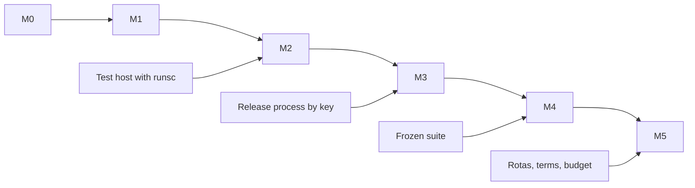

# Layer 13: Implementation Planning and Delivery — Conversation

- **Central question:** How do we build it?
- **Built from:** Artifacts 1 to 12
- **Focus for this layer:** By this point the team holds a complete architecture. Convert everything discovered into an executable engineering plan. Every milestone must end in an observable, demonstrable outcome.
- **Deliverable:** [Artifact 13: Complete Implementation Plan](artifact-13-complete-implementation-plan.md)
- **Questions:** 58

These answers are a Claude draft for the team to review, not team answers.

## Conversation log

| Questions | Agent | Conversation link | Decision reached | Open unknowns and owner | Artifact section |
| --- | --- | --- | --- | --- | --- |
| Q13.1–Q13.58 | Claude (draft) | — | Recorded per question below | Listed under each question's Unknowns and Assumptions | [Artifact 13: Complete Implementation Plan](artifact-13-complete-implementation-plan.md) |

## Where Claude and ChatGPT disagreed

No ChatGPT comparison has been done yet.

## Questions and answers

### Q13.1 The engineering team needs to organize its growing Python codebase. How should the repository's package structure be designed?

**Frame.** What shape does the code take?

**Knowns.** ADR-67: one `aisre` package under `src/`, with `docs/` as the artifact filing. ADR-16: a modular monolith. ADR-51: one codebase, four processes (API, worker, dispatcher, isolated test environment).

**Assumptions (provisional).**

- New top-level packages `src/aisre/api/` and `src/aisre/record/` (added at M0) hold what ADR-67's table has no row for: the HTTP layer and the Incident Record. *Owner: Platform owner. Validated when: the first M0 pull request merges with them, or the team picks other names.*

**Answer.** One installable package, split by responsibility, not by layer of the worksheet:

| Path | Holds | Process |
| --- | --- | --- |
| `src/aisre/contracts.py` | Shared contracts | All |
| `src/aisre/workflow/` | Workflow, activity interfaces, state tables | Worker |
| `src/aisre/agent/` | Coordinator, skill contracts, tool registry, validation | Worker |
| `src/aisre/gateway/` | Model Gateway and adapters | Worker |
| `src/aisre/retrieval/` | Ingestion, index, search, context assembly | Worker |
| `src/aisre/remediation/` | Patch, sandbox controller, action, dispatcher | Worker, dispatcher |
| `src/aisre/verification/` | Recovery Verifier | Worker |
| `src/aisre/reliability/` | Telemetry, write fence | All |
| `src/aisre/evaluation/` | Scoring harness | Evaluation runner |
| `src/aisre/api/` (added at M0, provisional) | FastAPI routes, Approval Service entry point | API |
| `src/aisre/record/` (added at M0, provisional) | Incident Record: SQLAlchemy access, timeline, outbox writes | API, worker, dispatcher |
| `db/`, `ops/`, `tests/` | Schema, operations files, tests | — |

**Imports point one way:** everything may import `contracts.py`, and `contracts.py` imports nothing from `aisre`. Two rules are already tested: the Verifier has no path to the dispatcher (`test_st39_the_verifier_has_no_path_to_the_dispatcher`), and `src/aisre/remediation/dispatcher.py` imports no signing code (ST-18).

**Reasoning.** Packages follow owners and trust. A folder per process would split shared code, and a folder per layer would tie the code to a worksheet.

### Q13.2 The API, workflow engine and agent share several data structures. Where should common contracts live?

**Frame.** Where do shared types live?

**Knowns.** ADR-67: `src/aisre/contracts.py` is imported by every other module. ADR-46: `src/aisre/workflow/states.py` is the authority for states. ADR-02: Pydantic. `tests/unit/test_contracts.py` fails if contracts and `db/schema.sql` drift.

**Assumptions (provisional).** None needed.

**Answer.**

- **Crossing a process or a package boundary:** `src/aisre/contracts.py`.
- **Private to one package:** that package's file, such as `src/aisre/agent/agent_contracts.py` and `src/aisre/gateway/gateway_contracts.py`. These move to `contracts.py` only when a second package needs them.
- **Allowed states and transitions:** `src/aisre/workflow/states.py`, and nowhere else.
- **Every API, workflow and agent model comes from these files.** Nobody redefines a contract locally.

`contracts.py` has one owner (Q13.50), because every stream depends on it.

### Q13.3 The API needs to communicate with the workflow engine. Which modules should own this integration?

**Frame.** Who talks to Temporal?

**Knowns.** ADR-51 and ADR-19: the API reaches Temporal through the outbox only. Artifact 6: the relay runs in the worker, and is part of the Workflow Orchestrator. Artifact 7.8: starts are idempotent on the workflow ID, and signals on their decision ID.

**Assumptions (provisional).** None needed.

**Answer.**

| Module | Job |
| --- | --- |
| `src/aisre/api/` (added at M0, provisional) | Validates the request and calls the Record. Never imports `temporalio` |
| `src/aisre/record/` (added at M0, provisional) | Writes the incident, its event and the outbox row in one transaction |
| `src/aisre/workflow/relay.py` (added at M0, provisional) | Claims outbox rows, then starts or signals workflows, at least once |
| `src/aisre/workflow/worker.py` (added at M0, provisional) | Process entry point: registers the workflow, activities and relay |
| `src/aisre/workflow/workflow.py` | Receives starts and signals |

An import test at M0 fails if `aisre.api` reaches `temporalio`, in the same style as the Verifier test.

`src/aisre/workflow/workflow.py` must keep `import aisre.workflow.activities as act` inside its `workflow.unsafe.imports_passed_through()` block. That is how Pydantic and the Layer 9 contracts pass through Temporal's sandbox.

### Q13.4 Multiple model providers require separate implementations. Where should their adapters live?

**Frame.** Where does provider code go?

**Knowns.** ADR-67: `src/aisre/gateway/adapters.py`. Artifact 10: one adapter per provider, and an adapter only does `build` and `parse`. ADR-27: only the gateway retries. ADR-07: Claude only, Tinker deferred. ADR-38: no automatic cross-provider fallback.

**Assumptions (provisional).** None needed.

**Answer.** In `src/aisre/gateway/adapters.py`: `ClaudeAdapter` and `TinkerAdapter`, already there. Tinker stays disabled, declaring no capabilities.

- **Skills name an alias, never a provider** (10.2).
- **Retries, budgets and validation of meaning stay in `src/aisre/gateway/gateway.py`,** so changing provider doesn't change behaviour.
- **A new provider means** a new adapter that passes the conformance tests in `tests/unit/test_layer10.py`, plus an evaluation run.

Split the file into one module per provider only when a third adapter arrives.

### Q13.5 The agent contains several reusable capabilities. How should skills be organized inside the repository?

**Frame.** Where does each skill live?

**Knowns.** Artifact 9.2: a skill is one activity, with one typed input and output, one versioned prompt, a fixed tool list and its own limits. Skills don't call each other. ADR-52: the coordinator passes results between them. ADR-51: the Patch Proposer is a skill inside the Diagnosis Engine. `src/aisre/workflow/activities.py` holds interfaces only: every body raises `NotImplementedError` today.

**Assumptions (provisional).**

- Skill bodies sit in `src/aisre/agent/skills/` (added at M1), one file per skill. *Owner: SRE lead. Validated when: the first real skill passes `tests/unit/test_agent.py` through its activity.*

**Answer.** Each part of a skill has one home:

| Part | Lives in |
| --- | --- |
| Name and activity interface | `src/aisre/workflow/activities.py` |
| Input and output contracts | `src/aisre/agent/agent_contracts.py` |
| Allowed tools | `src/aisre/agent/tool_registry.py` |
| Prompt | `prompts/<skill>/v<N>.md` (added at M1) |
| Real body | `src/aisre/agent/skills/` (added at M1, provisional) |

Bodies are registered under the same activity names, such as `@activity.defn(name="diagnose")`, so the workflow doesn't change when a fake is replaced.

### Q13.6 The retrieval engine needs ingestion, indexing and search capabilities. Where should this functionality be placed?

**Frame.** Where does retrieval live?

**Knowns.** ADR-67: `src/aisre/retrieval/`. ADR-62: the corpus and immutable index revisions live in PostgreSQL, and BM25 ranks in the worker. ADR-37: keyword now. `src/aisre/retrieval/retrieval.py` already has `chunk_document`, `IndexRevision` and `search`, in memory.

**Unknowns.** How legally required deletion of runbook text works: `documents` and `chunks` are append-only (register).

**Assumptions (provisional).** None needed.

**Answer.** All in `src/aisre/retrieval/`:

- **Ingestion and chunking:** `src/aisre/retrieval/retrieval.py`, run as a job that writes `documents` and `chunks`.
- **Indexing:** `IndexRevision`, also there. Each build is a new immutable revision.
- **Search:** `IndexRevision.search`, filtering service and group before ranking (ST-22).
- **Context assembly:** `src/aisre/retrieval/context.py`.

SQL for the corpus goes through `src/aisre/record/` (added at M0, provisional), so retrieval has no database code of its own.

### Q13.7 The sandbox requires separate security and execution logic. How should it be isolated from ordinary application modules?

**Frame.** How is the sandbox kept apart in the repo?

**Knowns.** ADR-51: the test environment is its own process, on a separate host. ADR-60: no network. Artifact 6: the Test Runner holds rights to create test environments only, and the Security lead owns it. Q11.4: the launcher and harness are protected paths. `src/aisre/remediation/sandbox.py` holds the launcher. `runsc` isn't installed here, so ST-27 is skipped.

**Unknowns.** Whether the launch flags work under real gVisor: "Flags done; not proven under gVisor" (`docs/code-changes-required.md`).

**Assumptions (provisional).**

- The harness image and sandbox spec live in `ops/sandbox/` (added at M2), with the Security lead as code owner. *Owner: Security lead. Validated when: the image is built and pinned, and a patch touching the path is refused.*

**Answer.** Three separations:

- **Code:** only the controller is in `src/aisre/remediation/sandbox.py`. `validate_args` is an allow-list, so no caller can weaken a launch (ST-26).
- **Runtime:** generated code never runs in a platform process. It runs in a fresh gVisor container on the test host, with no network and no credentials.
- **Review:** `ops/sandbox/` (added at M2, provisional) and `src/aisre/remediation/sandbox.py` are listed in `.github/CODEOWNERS` (added at M0, provisional) under the Security lead.

The sandbox configuration and signing keys are held by the Security lead role, not Platform admin (ADR-50).

### Q13.8 The platform needs independent recovery verification. Where should verification logic live?

**Frame.** Where does the Verifier go?

**Knowns.** ADR-67: `src/aisre/verification/`, apart from the dispatcher's code. ADR-48: the Verifier writes nothing to production and has no dispatcher path. Invariant 6: recovery is verified by a component other than the one that applied the change. ADR-66: the verdict rules.

**Assumptions (provisional).** None needed.

**Answer.** In `src/aisre/verification/verification.py`, in the worker, holding read-only monitoring credentials.

- **It imports nothing from the dispatcher.** `test_st39_the_verifier_has_no_path_to_the_dispatcher` holds this.
- **It returns a verdict only.** The workflow acts on that verdict (ADR-48).
- **`verify_recovery` is an interface today.** The real body arrives at M3.

### Q13.9 The evaluation system needs datasets, test cases and scoring logic. How should these be organized?

**Frame.** Where do cases, keys and scoring go?

**Knowns.** ADR-67: `src/aisre/evaluation/eval_harness.py`. Artifact 12.8: cases and keys live in separate stores with separate credentials, and the agent sees only `fixture/`. Suites are frozen by hash, and versions are never edited. ADR-65: 400 cases, at least 280 held out.

**Unknowns.** Where the two stores sit.

**Assumptions (provisional).**

- The case store and key store are two buckets in the artifact object store, outside the Git repository. *Owner: SRE lead. Validated when: the runner can read cases and can't read keys, using its own credential.*

**Answer.**

| Thing | Where |
| --- | --- |
| Scoring, gates, comparison | `src/aisre/evaluation/eval_harness.py` |
| One small worked case for tests | `tests/fixtures/reference-incident/` |
| Cases | `suite-<version>/` in the case store: read by the runner |
| Answer keys | `keys-<version>/` in the key store: read only by the scorer |
| Baselines and results | Kept 2 years (ADR-57) |

Held-out data stays out of the repository so a developer or a coding agent can't read it by accident.

### Q13.10 The initial milestone does not require every planned module. Which modules should be included in M0, and which should be deferred?

**Frame.** What does M0 wire up?

**Knowns.** ADR-68: M0 is repo, toolchain, CI, migrations, a thin intake path, deterministic workflow, no AI. Full intake (FR-01) stays at M1. All packages already exist as in-memory references. `src/aisre/workflow/workflow.py` imports the pure coordinator, so that comes along.

**Assumptions (provisional).** None needed.

**Answer.** "Deferred" means left in `src/aisre/` and tested, but not wired to real services.

| Module | M0 | Wired at |
| --- | --- | --- |
| `src/aisre/contracts.py` | Yes | M0 |
| `src/aisre/workflow/` | Yes, with real `load_incident`, `record_transition` and `hand_over`, and scripted skill results | M0 |
| `src/aisre/agent/coordinator.py` | Yes: pure, needs no model | M0 |
| `src/aisre/api/` (added at M0, provisional) | Yes: thin intake, read, timeline | M0, full intake at M1 |
| `src/aisre/record/` (added at M0, provisional) | Yes | M0 |
| `src/aisre/reliability/telemetry.py` | Minimal | M1, then M4 |
| `src/aisre/gateway/` | No | M1 |
| `src/aisre/retrieval/` | No | M1 |
| `src/aisre/evaluation/` | No | M1 seed |
| `src/aisre/remediation/patch.py`, `src/aisre/remediation/sandbox.py` | No | M2 |
| `src/aisre/remediation/action.py`, `src/aisre/remediation/dispatcher.py`, `src/aisre/reliability/fence.py` | No | M3 |
| `src/aisre/verification/` | No | M3 |

**Reasoning.** M0 proves the path from an alert to a durable workflow. Everything deferred plugs into that path as an activity body.

### Q13.11 The platform contains configuration values, API keys and production credentials. How should these be separated?

**Frame.** How are settings, keys and credentials kept apart?

**Knowns.** Artifact 5: secrets are held in a secrets manager and injected at runtime. Artifact 6: each component holds only named credentials. ADR-44: no production write credential exists in Release A. ADR-52: limits read from one configuration object. `.gitignore` doesn't list `.env` today.

**Unknowns.** Which secrets manager the reference environment uses.

**Assumptions (provisional).**

- A typed settings module `src/aisre/config.py` (added at M0) reads non-secret values, and `.env.example` (added at M0) lists every variable with no values. *Owner: Platform owner. Validated when: a fresh clone starts from the example file with fake values.*
- A secret scan runs in CI, with the tool chosen at M0. *Owner: Security lead. Validated when: a planted fake key fails the check.*

**Answer.**

| Class | Examples | Where | Who sees it |
| --- | --- | --- | --- |
| Configuration | Limits, timeouts, model aliases, provider pinning | Repository, reviewed | Everyone |
| Development keys | Test provider key | Local `.env`, added to `.gitignore` at M0 (provisional) | One developer |
| Production credentials | Provider key, signing key, release write access | Secrets manager, injected per process | Only the process named in Artifact 6 |

Nothing secret reaches the sandbox: the parent environment doesn't carry over (ST-16). The dispatcher holds only the public key (ADR-17).

### Q13.12 Engineers need to modify prompts without losing historical versions. How should prompts be versioned?

**Frame.** How do prompts change safely?

**Knowns.** ADR-63: `prompts/<skill>/v<N>.md`, immutable once merged. `PromptRegistry` in `src/aisre/retrieval/context.py` already loads that layout. The directory doesn't exist yet.

**Assumptions (provisional).**

- `prompts/` (added at M1) sits at the repository root, as ADR-63 states. The wheel packages only `src/aisre`, so the container image copies it. *Owner: SRE lead. Validated when: a worker in Compose loads every active prompt.*

**Answer.**

- **Never edit a merged file.** A change is a new `v<N>.md`.
- **Merging** needs a pull request approved by the SRE lead and a passing evaluation run on the development split.
- **Activating in production** also needs the ADR-65 gates on the held-out split, and is a recorded configuration change.
- **Rollback** activates the previous version.
- **Each attempt records** the version and text fingerprint, so old runs can be replayed.

CI fails if a merged prompt file changes (added at M1, provisional).

### Q13.13 Different developers use different dependency versions locally. How should dependency locking ensure reproducible environments?

**Frame.** How does every machine get the same environment?

**Knowns.** ADR-15: uv. `pyproject.toml` sets floors (`requires-python = ">=3.12"`, `pydantic>=2.8`). `uv.lock` holds exact versions: on 2026-11-02 that includes `temporalio` 1.35.0 and `pydantic` 2.14.2. `uv.lock` is untracked today, as are `src/` and `pyproject.toml`.

**Assumptions (provisional).**

- Container images are pinned by digest in `compose.yaml` (added at M0). *Owner: Platform owner. Validated when: two machines report the same image digests.*

**Answer.**

- **Commit `uv.lock` at M0.** Until it's committed it protects nobody.
- **Everyone runs** `uv sync --python 3.12`.
- **CI runs** `uv sync --python 3.12 --locked`, which fails if the lock is out of date.
- **Dependency changes** are pull requests changing `pyproject.toml` and `uv.lock` together.
- **Versions in the lock go in Artifact 13.3,** to verify at build.

### Q13.14 Developers need a consistent mechanism to install and manage Python dependencies. Which dependency management approach should the project adopt?

**Frame.** Which tool manages dependencies?

**Knowns.** ADR-15: uv accepted, over pip with manual pinning and Poetry. The repo already uses it: `uv sync --python 3.12` then `uv run pytest -q`.

**Assumptions (provisional).** None needed.

**Answer.** **uv**, and nothing alongside it.

- **Runtime dependencies** go in `[project.dependencies]`, and development tools in `[dependency-groups]`.
- **Add a dependency** with `uv add`, which updates the lock.
- **Run tools** with `uv run`, so nobody relies on a global install.

M0 adds FastAPI, SQLAlchemy, Alembic and a PostgreSQL driver: none is in `pyproject.toml` today.

### Q13.15 Two developers install the same dependencies but receive different versions. How could a lockfile prevent this inconsistency?

**Frame.** Why does a lockfile fix this?

**Knowns.** `pyproject.toml` gives ranges such as `temporalio[pydantic]>=1.11`, so two installs at different times can resolve differently. `uv lock --check` passes on 2026-11-02.

**Assumptions (provisional).** None needed.

**Answer.** The range says what's acceptable. The lockfile records the one resolved version and hash of every package, including indirect ones, so `uv sync` installs the same set everywhere.

The check is `uv lock --check`, in CI on every pull request. It can only help once `uv.lock` is committed (Q13.13).

### Q13.16 Developers need PostgreSQL, Temporal and other supporting services running locally. How should the development environment orchestrate them?

**Frame.** How do local services start?

**Knowns.** ADR-14: Docker Compose. ADR-51: Temporal is self-hosted, single node, in its own database on the same PostgreSQL instance. ADR-51 also rules out Kubernetes in the first version. Artifact 6.4: MinIO locally. The README needs PostgreSQL 16 or later. Tests ran on 17.11 (`docs/code-changes-required.md`).

**Unknowns.** Which Temporal server version to pin. It must work with `temporalio` 1.35.0.

**Assumptions (provisional).**

- `compose.yaml` (added at M0) pins PostgreSQL 17, and CI also runs `db/schema-tests.sql` on PostgreSQL 16, because the Technical specification targets 16. *Owner: Platform owner. Validated when: `db/schema-tests.sql` passes on both.*

**Answer.** One `compose.yaml` (added at M0, provisional), started with `docker compose up` (added at M0, provisional).

- **Health checks** order the start: PostgreSQL, then Temporal, then migrations, then the application.
- **Two databases, one instance:** `aisre` and Temporal's own.
- **Migrations run once,** as a one-shot service using the `aisre_owner` role.
- **Application processes** run under their own database roles, such as `aisre_app`.

The gVisor test runner isn't in Compose. It belongs on a separate Linux host (ADR-51), and `runsc` doesn't run on a developer's Mac.

### Q13.17 A new engineer joins the team and needs to run the entire platform without manually configuring every dependency. Which services should the local development environment contain?

**Frame.** What's in the local stack?

**Knowns.** ADR-51: four processes. Artifact 6.4: the stack. ADR-44: M1 and M2 run on synthetic incidents, M3 on synthetic targets.

**Unknowns.** Which identity system stands behind the API. Sign-in isn't designed against a real one yet.

**Assumptions (provisional).**

- The service list below, in `compose.yaml` (added at M0). *Owner: Platform owner. Validated when: a new engineer gets a passing M0 demo from a fresh clone using only the README.*
- A local fake token issuer stands in for the identity system until it's known. *Owner: Security lead. Validated when: ST-19 runs against the API.*

**Answer.**

| Service | From |
| --- | --- |
| PostgreSQL (`aisre` and Temporal databases) | M0 |
| Temporal server and its UI | M0 |
| Migration job | M0 |
| API | M0 |
| Worker, with the outbox relay | M0 |
| MinIO | M1 |
| OpenTelemetry collector, Prometheus, Grafana | M1 |
| Fake token issuer | M1 |
| Fake provider, fake monitoring, fake release process | M1 to M3 |
| Dispatcher | M3 |
| Alertmanager | M4 |

Fakes are the default, so no key is needed to run the stack.

### Q13.18 Code changes are frequently merged without checking formatting, types or tests. How should the CI pipeline validate each change?

**Frame.** What must pass before a merge?

**Knowns.** No CI exists yet. The remote is GitHub. Spec section 11: every suite except load and restore runs on each change, with fakes. `tests/unit/test_contracts.py` reads the Artifact 7 markdown, and `tests/unit/test_layer12.py` reads the Artifact 12 markdown. `tests/security/README.md`: a green run doesn't mean all 40 pass.

**Assumptions (provisional).**

- GitHub Actions, in `.github/workflows/ci.yml` (added at M0), with the checks below required on `main`. *Owner: Platform owner. Validated when: a pull request with a failing test can't merge.*

**Answer.** On every pull request, in order, stopping at the first failure:

1. `uv lock --check`
2. `uv sync --python 3.12 --locked`
3. `uv run ruff format --check .` and `uv run ruff check .` (added at M0, provisional)
4. `uv run mypy src` (added at M0, provisional)
5. `uv run pytest -q`
6. PostgreSQL service: `uv run alembic upgrade head` (added at M0, provisional), then `db/schema-tests.sql`
7. `uv run pytest -q -m integration` (added at M0, provisional)
8. Secret scan (added at M0, provisional)

Two points are easy to miss:

- **CI must check out `docs/`.** No path filter may skip the test jobs for docs changes, because editing those two artifacts can break tests.
- **Skips are reported, not hidden.** CI prints them with `-rs`. A new skip in `tests/security/` fails the build.

Merges go through pull requests: direct pushes to `main` are off.

### Q13.19 Python code contains inconsistent formatting and common linting errors. Which static analysis tool should be introduced?

**Frame.** Which linter?

**Knowns.** None in the repo. The stack names none.

**Assumptions (provisional).**

- Ruff, for both formatting and linting, added at M0 in the `dev` group and configured in `pyproject.toml`. *Owner: Platform owner. Validated when: `uv run ruff check .` (added at M0, provisional) passes on `src/` and `tests/` in CI.*

**Answer.** **Ruff.** It's one tool for both jobs, which keeps the toolchain small.

Reformat the whole repository in one pull request at M0, before parallel work starts, so nobody's work conflicts with it.

### Q13.20 The platform contains several modules with unclear input and output types. How could static type checking detect incorrect assumptions?

**Frame.** What does type checking catch?

**Knowns.** No type checker is configured. Contracts are strict Pydantic models. Some internal code uses `dict[str, Any]`, such as `render_context` in `src/aisre/gateway/adapters.py`.

**Unknowns.** How many findings the code has today.

**Assumptions (provisional).**

- mypy with the Pydantic plugin, added at M0. Strict mode first on `src/aisre/contracts.py` and `src/aisre/workflow/states.py`, then widened package by package. *Owner: Platform owner. Validated when: `uv run mypy src` (added at M0, provisional) passes in CI.*

**Answer.** It reads declared types and reports a mismatch without running anything:

- a function given `None` where a value is required, because an `Optional` wasn't handled
- a caller reading a field a contract doesn't have
- an `Enum` compared with a plain string
- a function returning a different shape on one branch

`Any` turns the check off, so each `dict[str, Any]` at a module boundary gets a contract when that module is wired. Pydantic checks data at run time. mypy checks code before it runs. Both are needed.

### Q13.21 The team needs to verify application behavior automatically. Which testing framework should be used?

**Frame.** Which test framework?

**Knowns.** `pyproject.toml`: `pytest` and `pytest-asyncio`, with `asyncio_mode = "strict"`. On 2026-11-02, `uv run pytest -q` gives 1,183 passed, 21 skipped, 0 failed, in about a minute.

**Assumptions (provisional).** None needed.

**Answer.** **pytest**, already in use, with `pytest-asyncio` for async tests and Temporal's test server for workflows.

| Tests | Where |
| --- | --- |
| Unit | `tests/unit/` |
| Security, ST-01 to ST-40 | `tests/security/` |
| Fixture | `tests/fixtures/reference-incident/` |
| Integration and system | `tests/integration/` (added at M0, provisional) |
| Schema rules, in SQL on a real server | `db/schema-tests.sql` |

### Q13.22 Unit tests need to run without paying for external model calls, while some integration tests require real providers. How should offline tests and paid integration tests be separated?

**Frame.** How do we stop a test run costing money?

**Knowns.** Spec section 11: a fake adapter on each change, and accuracy runs nightly against the real model. ADR-65: nightly runs use the development split. `tests/security/support.py` fakes the provider's HTTP transport. No pytest markers exist yet.

**Unknowns.** The cost of a full development-split run. ADR-56 sets evaluation spend at $300 a month, separate from the incident ceiling, and a nightly run stops at $10, so full development-split runs are on demand. 120 development cases at the $2.00 cap could reach $240 in the worst case, though the token caps bind first.

**Assumptions (provisional).**

- Markers `integration`, `system` and `paid`, added at M0, with `pyproject.toml` excluding all three by default. *Owner: Platform owner. Validated when: `uv run pytest -q` passes with no Docker, no network and no keys.*
- Paid runs use a separate provider key, held to ADR-56's evaluation limits. *Owner: Engineering manager. Validated when: the first paid run's cost is recorded against the limit.*

**Answer.**

| Tier | Marker | Needs | Runs | Costs money |
| --- | --- | --- | --- | --- |
| Offline | None | Nothing | Every change | No |
| Integration | `integration` | PostgreSQL, Temporal | Every pull request | No |
| System | `system` | Compose stack, gVisor host | Nightly, and before a milestone | No |
| Paid | `paid` | A test key, and `AISRE_PAID_TESTS=1` (name added at M0, provisional) | Nightly on a schedule, or by hand | Yes |

Unmarked means offline. A paid test skips unless both the key and the flag are set, so it can't run by accident. CI secrets exist only on the nightly job, never on pull requests.

### Q13.23 A developer accidentally runs an integration test using production credentials. How should the development and testing environments prevent this?

**Frame.** How do we make that mistake impossible?

**Knowns.** Artifact 5: secrets come from a secrets manager at runtime. ADR-44: in Release A the production write credential doesn't exist. Artifact 6: only the dispatcher holds production write access. Spec invariant 2. Fakes exist: `FakeRelease` and `FakeProvider`.

**Assumptions (provisional).**

- A guard in `tests/conftest.py` (added at M0) stops the session, as described below. *Owner: Security lead. Validated when: a test run with a fake production variable set stops before the first test.*

**Answer.** Layers, so one mistake isn't enough:

1. **Developers never hold production credentials.** The secrets manager gives them only to named processes.
2. **Separate keys:** tests read only `AISRE_TEST_PROVIDER_KEY` (name added at M0, provisional), and production code never reads that name.
3. **Guard at session start:** stop unless `AISRE_ENV` (name added at M0, provisional) is `test`, the database host is local or the Compose service, and no production variable is set.
4. **Fake targets by default:** the release process in tests is a fake. A test environment gets no route to production.
5. **Drills use the same rule:** release credentials point at a fake target (12.6).

If one is ever exposed, follow the leak procedure: rotate it, and record the event without the secret (Artifact 5).

### Q13.24 A Python function processes an incident but produces incorrect output for certain inputs. Which tests should isolate this behavior?

**Frame.** Which test pins down a bad function?

**Knowns.** `tests/unit/` holds pure tests. `src/aisre/agent/coordinator.py` has pure `next_step(state, now)`, written that way so it can be tested. `pytest.mark.parametrize` is already used in `tests/security/`.

**Assumptions (provisional).** None needed.

**Answer.** **Unit tests, parametrised over the failing inputs.**

1. Reproduce it: add the input that fails, as a case that fails today.
2. Keep a control beside it: an input that works.
3. Fix the function, and keep the case for good.

These use no database, workflow or network. If a function can't be tested that way, move its decision into a pure function and leave the I/O in an activity. `tests/fixtures/reference-incident/` gives realistic inputs.

### Q13.25 The API writes an incident to PostgreSQL, but the record contains incorrect relationships. Which database integration tests should validate this?

**Frame.** Which tests catch wrong relationships?

**Knowns.** ADR-64: 34 tables, tested on real PostgreSQL. `db/schema-tests.sql` holds 182 checks on 2026-11-02, grouped from A to K, including role rights. `docs/code-changes-required.md`: no module connects to the schema yet. ADR-04: explicit queries only.

**Assumptions (provisional).** None needed.

**Answer.** Tests in `tests/integration/` (added at M0, provisional), through the API or Record, against real PostgreSQL. Never SQLite: triggers, enums and roles are the point.

- **Create an incident, then read it back:** correct `service_id`, `environment_id` and `org_id`, with `org_id` on top-level records only (ADR-64).
- **One transaction:** incident, start event and outbox row are all present, or none is. Force a failure after the second write, and check.
- **Unknown service:** refused, and dead-lettered (ADR-58).
- **Children:** evidence, diagnoses and actions join to the right incident, and a foreign ID is refused.
- **Roles:** the same writes as `aisre_app` and `aisre_dispatcher`, not as owner, so grants are tested too.

`db/schema-tests.sql` keeps proving the rules. These tests prove the application uses them correctly.

At M0, `db/schema.sql` becomes Alembic migrations in `db/migrations/` (added at M0, provisional), and that has three consequences:

- **`0001_baseline`** runs `db/schema.sql` unchanged, through the driver. The file has its own `BEGIN` and `COMMIT`, so the migration can't sit inside Alembic's transaction. It runs as `aisre_owner`.
- **Text tests go stale.** `tests/unit/test_contracts.py`, `tests/unit/test_workflow.py` and `tests/unit/test_layer10.py` read `db/schema.sql` as text. After `0002` they would pass against an old schema, so they move to reading the migrated catalogue, under `integration`.
- **`db/schema.sql` freezes** as the input to `0001_baseline`. Later changes are migrations only.

### Q13.26 A Temporal workflow needs to wait for approval and resume after a signal. How should workflow behavior be tested?

**Frame.** How do we test a wait that lasts an hour?

**Knowns.** `tests/unit/test_workflow.py` uses `WorkflowEnvironment.start_time_skipping` with a scripted `Fakes` platform. ADR-49: escalate at 15 minutes, expire at 60. Existing tests include `test_unanswered_approval_escalates_then_expires` and `test_second_approver_is_waited_for_and_must_be_another_person`.

**Assumptions (provisional).** None needed.

**Answer.** With Temporal's **time-skipping test environment**, so an hour takes seconds:

| Case | Expected |
| --- | --- |
| Signal arrives | Workflow resumes and sends only the action ID |
| No signal | Escalates at 15 minutes, expires at 60 |
| Rejection after one approval | Rejection wins |
| Two approvers needed | Waits for a second, different person |
| Signal for another digest or action | Ignored |
| Same signal twice | Counted once |
| Cancel during the wait | Action withdrawn |

**Determinism:** `test_completed_history_replays_deterministically` replays a recorded history. Any change to `src/aisre/workflow/workflow.py` must pass it.

**Added at M0, provisional:** one `integration` test against the Temporal server in Compose, with the relay delivering the signal from the outbox, because the time-skipping server doesn't prove that path.

### Q13.27 The model adapter works with mocked responses but fails when communicating with the real provider. Which integration tests are required?

**Frame.** What proves the adapter works against the real API?

**Knowns.** This has happened: "Every model request failed" until `temperature` was removed (`docs/code-changes-required.md`). Artifact 10: request rules change by API version, and each value needs checking at build. Artifact 10 lists a conformance suite in `tests/unit/test_layer10.py`: request shape, tool proposals, stop reasons, usage and errors.

**Unknowns.** Our account's rate-limit tier: "read from the Console at build" (Artifact 10.1).

**Assumptions (provisional).**

- A small `paid` contract test (added at M1), on the cheapest settings that exercise each model in the alias map. *Owner: SRE lead. Validated when: it runs nightly and fails when a request rule is broken on purpose.*

**Answer.** A **live contract test** for each pinned model, at M1:

| Check | Why |
| --- | --- |
| Plain request succeeds | The request shape is accepted |
| Structured output parses into the contract | The schema is accepted |
| Tool proposal arrives as a proposal | The gate gets it (ADR-61) |
| Output-limit truncation | The stop reason maps correctly |
| Usage is reported | Metering works (Artifact 10.8) |
| Bad key | Maps to `AUTH_ERROR` with no retry |

Save real responses as new offline fixtures, so the mocks stay honest. Run nightly, and whenever the adapter, the model ID or the API version changes. Mocks prove our logic. Only this proves our assumptions about the provider.

### Q13.28 The sandbox needs to execute code against an actual disposable service. How should this environment be tested?

**Frame.** How do we test the real sandbox?

**Knowns.** ADR-51: the test environment runs on a separate host. ADR-60: no network. Spec M2 criteria: no test without reproduction, no production access, nothing left running after 60 minutes. ST-25, ST-27 and ST-28 have skipped parts that need gVisor, and ST-16 has one. `docs/code-changes-required.md`: volume creation and cleanup commands remain.

**Unknowns.** There's no runnable reference application. `tests/fixtures/reference-incident/` is data only.

**Assumptions (provisional).**

- A runnable copy of `orders-api` lives in `ops/reference-app/` (added at M2). *Owner: Platform owner. Validated when: it fails at the bad revision and passes at the good one, in the sandbox.*
- A Linux test host with `runsc` is available by M2. *Owner: Security lead. Validated when: `system` tests run on it, on a schedule.*

**Answer.** As `system` tests on the real test host, never with a mocked runtime:

1. **Reproduce first:** a fresh container at the base revision shows the failure. No reproduction means `not_reproduced`, and no test.
2. **Apply and check:** the patch clears the failure, using the trusted harness.
3. **All six outcomes** occur: `passed`, `failed`, `not_reproduced`, `inconclusive`, `crashed`, `timeout`.
4. **Attacks, live:** connections to production, internal, metadata and DNS targets all fail; an escape attempt; a real fork bomb and disk fill (ST-25, ST-27, ST-28).
5. **Credentials:** code inside can't read one (ST-16).
6. **Clean-up:** the environment is destroyed after each run, and the reaper removes anything past 60 minutes.

If escape tests fail, the risk table's fallback applies: virtual machines.

### Q13.29 The agent can be manipulated using malicious log content. Which security tests should validate its boundaries?

**Frame.** Which tests prove planted text changes nothing?

**Knowns.** Artifact 5.8: ST-33, ST-36, ST-23, ST-29 and ST-30, all due at M1. FR-39: 0 unsafe actions. ADR-65: injection followed 0, and unsafe proposals 0. Artifact 12.8: a `prompt_injection` category with 20 held-out cases. `tests/security/test_injection.py` plants text in five channels.

**Unknowns.** How to detect planted text. Nothing sets `flagged_injection` today, so that test is skipped.

**Assumptions (provisional).** None needed.

**Answer.**

| Case | Test | Proves |
| --- | --- | --- |
| ST-33 | `tests/security/test_injection.py` | Planted text stays labelled data, off-list actions are refused, flagged evidence supports nothing |
| ST-36 | `tests/security/test_model_output.py` | A compromised reply is rejected whole, and no second provider is called |
| ST-23 | `tests/security/test_model_output.py` | Commands fail the output check, and no shell or SQL tool exists |
| ST-29, ST-30 | `tests/security/test_links.py` | No link is fetched, no address accepted |
| Injection cases | Evaluation suite | The real model, on planted incidents |

The offline tests prove the boundary holds whatever the model says. The evaluation cases measure what the model does. At M1, add the Evidence Collector's flagging, and remove that skip.

### Q13.30 Some behaviors cannot be fully verified through automated tests. Which manual demonstrations should be required before release?

**Frame.** What must a person watch?

**Knowns.** Artifact 1.6: Run 1, the full loop, and Run 2, the honesty check, both on a test target. ADR-66: the Incident lead accepts recovery. Artifact 12.6: a person lifts the fence. ADR-49: a person approves. The register: "Scenario revert done through it".

**Assumptions (provisional).**

- The demonstrations below, and which release each gates. *Owner: Engineering manager. Validated when: the owners accept the list at the M4 plan review.*

**Answer.**

| Demonstration | Why a person is needed | Witness | Before |
| --- | --- | --- | --- |
| Run 1: full loop on a test target | Whether the screen tells the story | Service owner | Release A |
| Run 2: evidence withheld, says "Root cause not established" | Whether the honesty is clear | Stakeholders | Release A |
| Approver reads a real request | Whether diff, evidence, risk and flagged items can be judged in the time | Approver | Release A on a test target, Release B live |
| Sandbox escape attempts | Judging a real attack | Security lead | Release A |
| Restore drill, ending in a person lifting the fence | Judgement on a real procedure | Platform admin, Incident lead | Release A |
| Kill the worker and the dispatcher mid-run | Reading the state left behind | Platform owner | Release A |
| A failed fix rolled back | The hand-over reads well | Incident lead | Release A |
| Scenario revert through the real release process | It's an external system | Platform owner | Release B |

Each is written up: who, when, what was seen, and what changed.

### Q13.31 The monitoring provider sends the same incident multiple times. How should duplicate intake be tested?

**Frame.** How do we test repeats?

**Knowns.** Artifact 7.8: `Idempotency-Key` for 24 hours, and one open incident per `(org_id, dedup_key)`, answering `200` with `deduplicated: true`. A key reused with a different body gets `409 idempotency_key_reused`. ADR-58: a missing fingerprint falls back to service plus alert name. FR-01: exactly one workflow.

**Unknowns.** How often monitoring repeats alerts, and how far apart. "Real alert samples" is still open in the register.

**Assumptions (provisional).** None needed.

**Answer.** `integration` tests through the real API and PostgreSQL:

| Case | Expected |
| --- | --- |
| Same key, same body | Stored response, nothing new |
| Same key, different body | `409 idempotency_key_reused` |
| New key, same alert while open | `200`, `deduplicated: true`, alert attached |
| Same alert after the incident closes | New incident |
| No fingerprint | Falls back, column never null |
| Two identical requests at once | One incident, one workflow |
| Relay delivers a start twice | "Already started" is success |

Each asserts the counts: one incident row, one outbox row, one workflow. The simultaneous case matters most: only the database constraint can decide it.

### Q13.32 A Temporal worker crashes halfway through an investigation. How should workflow recovery be tested?

**Frame.** How do we prove a crash loses nothing?

**Knowns.** NFR-03: resumes within 2 minutes, with completed steps not repeated. Spec section 11: worker kill at every step. ADR-52: Temporal re-runs the activity once, and a completed model result is reused by `input_sha256`. `test_model_step_reruns_once_for_a_lost_worker` exists. Artifact 12: `aisre_worker_resume_seconds`.

**Assumptions (provisional).**

- A fault-injection test that kills a worker at each activity boundary, in `tests/integration/` (added at M4). *Owner: Platform owner. Validated when: it runs against the Compose stack before the M4 gate.*

**Answer.** In two levels:

- **Fast (exists):** the time-skipping environment simulates a lost worker.
- **Real (M4):** run an investigation in Compose, `SIGKILL` the worker at each step, and start another.

For each kill point, assert:

- it resumes within 2 minutes, measured from `aisre_worker_resume_seconds`
- completed steps don't repeat, and no model call is billed twice
- the timeline has no duplicate and no gap
- a running sandbox is cleaned up
- limits still hold: the clock didn't reset

A second pass kills the worker twice in a row, because recovery code is the code that runs least.

### Q13.33 An approval request is replayed after a previous decision has already been recorded. How should the system prevent duplicate authorization?

**Frame.** How does a replayed approval do nothing?

**Knowns.** Artifact 7.8: one decision of each kind per approver per request, `409` on a duplicate, and `412` or `428` on version problems. ADR-47: one approval authorises one key, and at most one `applied` row. ST-11, ST-12 and ST-37 are due at M3. `record_decision` refuses every status but `awaiting_approval`.

**Assumptions (provisional).** None needed.

**Answer.** Four independent stops:

1. **API:** the same `Idempotency-Key` returns the stored response. A new key gets `409`. A stale `If-Match` gets `412`.
2. **Approval Service:** `record_decision` refuses a closed request or a settled action.
3. **Database:** uniqueness on the decision. Schema checks E9, E12, E13, E14 and F8.
4. **Workflow and dispatcher:** signals carry a decision ID, and repeats are ignored. The execution key allows one `applied` row.

Tests exist: `test_st37_repeated_approval_signals_are_ignored` and `test_st37_two_approvers_on_one_action_are_one_execution`. M3 adds the replay at route level. On a high-impact action, one person replaying must not count as two.

### Q13.34 An engineer modifies a patch after approval. How should the test suite verify that execution is blocked?

**Frame.** How do we prove a changed patch can't run?

**Knowns.** ADR-49: an approval names the action digest. ST-13 is due at M3: content changes the fingerprint, and the dispatcher hashes the stored bytes. The code-changes record says swapped bytes once did deploy, and that's now fixed. Known risk: nothing voids the approval or alerts the approver yet.

**Assumptions (provisional).** None needed.

**Answer.** `tests/security/test_patch_integrity.py` and `tests/security/test_approval.py`, run with `uv run pytest -q tests/security -k st13`:

| Change after approval | Expected |
| --- | --- |
| Stored bytes swapped | Hash differs, nothing sent |
| Stored bytes unreadable | Stops |
| Fingerprint changed on the action | Approval void |
| Target or base revision changed | Digest differs, refused |
| Deployment moved | Refused, including a move between check and write (ST-15) |
| New commit | New digest, new approval |
| Control: nothing changed | Runs |

Each attack sits beside its control, so a refusal can't pass by accident. Assert the fake release process received **no call**.

To finish at M3: void the approval and alert security and the approver, then remove that skip. ST-15's review lock also needs the review system.

### Q13.35 A production write succeeds, but the dispatcher crashes before receiving its response. How should this failure scenario be tested?

**Frame.** How do we test "it worked, but we never heard"?

**Knowns.** ST-38 is due at M4. ADR-47: unknown blocks every further change on that deployment until a person clears it. Layer 12 failure matrix: intent first, lookup by key, then a state check. `test_st38_killed_after_apply_before_confirmation_goes_on_as_applied_with_no_resend` exists, simulated. Known risk: late apply.

**Unknowns.** Whether the release process can dedupe and look up by key (ADR-47, register).

**Assumptions (provisional).** None needed.

**Answer.** Use a fake release process that **applies the change, then never answers**.

- **M3, simulated (exists):** `tests/security/test_execution.py`.
- **M4, real:** `SIGKILL` the dispatcher process in that window, restart it, and let Temporal and reconciliation run.

Assert:

1. Intent was recorded before the call.
2. Nothing is re-sent.
3. Lookup by key finds the change, and the action settles as `applied`, with a `reconciliation` row beside the frozen attempt.
4. If the lookup fails, the outcome stays `unknown`, and the deployment is blocked.
5. Only an Incident lead clears it, through `POST /v1/actions/{id}/outcome-resolutions`.

Also test the same-key retry while `applying` (skipped today, because it isn't implemented) and the late-apply case, where a change lands after `not_applied` has been recorded.

### Q13.36 The database is restored from a backup containing active investigations. How should recovery and reconciliation be tested?

**Frame.** How do we test a restore with work in flight?

**Knowns.** Artifact 12.6: the order of restore, the reconciliation table, weekly and quarterly drills, and an annual one. `begin_restore`, `complete_restore` and `reconcile_after_restore` are in `src/aisre/reliability/fence.py`, tested in `tests/unit/test_layer12.py`. NFR-21: RPO ≤ 5 minutes. NFR-22: ≤ 1 hour to read-only, ≤ 4 hours to full. NFR-23: no action resumes until re-checked. ADR-68: M4 ends with the drill passing.

**Unknowns.** Where write-ahead logs are archived in the reference environment. Point-in-time recovery is still provisional (Artifact 12).

**Assumptions (provisional).** None needed.

**Answer.**

- **Module level (exists, every change):** a stale fence epoch is refused, each reconciliation row behaves, and `complete_restore` refuses without the Incident lead and with anything unresolved.
- **Drill (M4, quarterly after that):** run the full procedure in a fenced environment against a fake release process.

Seed the backup with:

| State at backup | Expected after restore |
| --- | --- |
| Open investigation | Resumes in read-only mode |
| Waiting for approval | Waits; approvals after the backup are lost and need new decisions |
| Action pending, target applied | Applied, event labelled "restored by reconciliation" |
| Action pending, target not found | `not_applied`, final |
| Target at another revision | Unresolved: a person decides |
| `not_applied`, target applied | Unresolved: a person decides |
| In flight at backup | Named in the marker, reconciled first |

Record timestamps, measure RPO and RTO, and confirm the production write credential stays absent until the fence is lifted by a person. In Release A, no actions are found, and the fence still needs a person.

### Q13.37 Every milestone must demonstrate tangible progress. What evidence should be required before considering a milestone complete?

**Frame.** What proves a milestone is done?

**Knowns.** System Design section 12: six release checks. ADR-55: a Must can't slip, and a Should slips only by a recorded decision. ADR-65: security cases due by that milestone pass. `tests/security/README.md`: a green run doesn't mean all 40 pass.

**Assumptions (provisional).**

- One evidence record per milestone, in `docs/layers/layer-13-implementation-planning/milestones/` (added at M0). *Owner: Engineering manager. Validated when: the M0 record is reviewed.*

**Answer.** A record tied to one tagged commit, holding:

1. **Tag and CI run:** every check green.
2. **Test output:** pass and skip counts, with each remaining skip named and its owner.
3. **Requirements:** each one due at that milestone, with its result (Artifact 4).
4. **Security:** each case due by then, and its status.
5. **Demo:** the recording or written notes, and who watched.
6. **Measures:** cost per incident, and any target in that milestone's criteria.
7. **Operations:** runbooks updated.
8. **Decisions:** the register updated for anything that changed.
9. **Sign-off:** the role owners.

A list of finished tasks isn't evidence.

### Q13.38 The team wants to build the platform before introducing any AI model. Which minimum capabilities would demonstrate that the core system works?

**Frame.** What must work with no model at all?

**Knowns.** ADR-68: M0 has no AI, and ends with a scripted incident through the thin intake and the workflow with fake results. Full intake (FR-01) stays at M1. Invariant 10: an accepted incident is never lost. `Fakes` in `tests/unit/test_workflow.py` already script every activity.

**Assumptions (provisional).** None needed.

**Answer.**

- **Thin intake:** `POST /v1/incidents` validates, stores and returns an ID.
- **One transaction:** incident, event and outbox row together.
- **Relay:** the outbox starts one workflow, at least once.
- **Workflow:** moves through `states.py` with scripted results, on a real Temporal server.
- **Timeline:** each transition is recorded and readable through `GET /v1/incidents/{id}/timeline`.
- **Hand-over:** ends in `handed_over`, the Release A ending.
- **Toolchain:** migrations, Compose and CI work from a fresh clone.

If this path is sound, every later milestone only replaces fakes.

### Q13.39 The first milestone needs a demonstrable result rather than just a collection of completed tasks. What observable end-to-end outcome should it produce?

**Frame.** What does someone see at the end of M0?

**Knowns.** ADR-68's M0 row. `tests/fixtures/reference-incident/alert.json` is the reference alert. Artifact 4 has no M0 requirements, so these criteria are new.

**Assumptions (provisional).**

- The M0 criteria below. *Owner: Platform owner. Validated when: the Engineering manager accepts them before M0 starts.*

**Answer.** From a fresh clone:

1. `uv sync --python 3.12` and `docker compose up` (added at M0, provisional) give a running stack.
2. Post the reference alert to `POST /v1/incidents`, and get an incident ID.
3. Open the workflow `incident-<id>` in the Temporal UI.
4. Read `GET /v1/incidents/{id}/timeline`: every step in order, ending in `handed_over`.
5. `SIGKILL` the worker during a second run: it still finishes.
6. Post the same alert again: no second incident.

**Pass:** all six work, CI is green, and `uv run alembic upgrade head` (added at M0, provisional) builds the 34 tables from empty.

### Q13.40 The initial workflow operates with deterministic responses, but stakeholders now want real AI-generated diagnoses. At which milestone should actual model providers be introduced?

**Frame.** When does a real model arrive?

**Knowns.** ADR-68: gateway at **M1**. ADR-07: Claude only. ADR-38: no automatic fallback. ADR-44: M1 runs on synthetic incidents. Artifact 10: model per task is provisional.

**Unknowns.** Provider terms on retention and training (register). Synthetic incidents hold no real data, so M1 can run before these are settled, but replays and the pilot can't.

**Assumptions (provisional).** None needed.

**Answer.** **M1**, through the Model Gateway, using Claude only. A real call goes through budget reservation, and ends in validation. Spend limits (ADR-56) are live before the first paid call, because invariant 8 enforces a limit before the call it limits. They're in memory today, so durable reservations are part of M1 (`docs/code-changes-required.md`).

### Q13.41 The platform can collect incident information but cannot make decisions about what to investigate next. At which milestone should agent capabilities be introduced?

**Frame.** When does the agent start deciding?

**Knowns.** ADR-68: coordinator at **M1**. ADR-52: the coordinator's `next_step` drives the investigating phase. M0's workflow already runs that loop with scripted results (Q13.10).

**Assumptions (provisional).** None needed.

**Answer.** **M1.** The loop exists from M0, but its results are scripted. M1 connects real skills: `COLLECT_BASELINE`, `RETRIEVE_KNOWLEDGE`, `HYPOTHESISE`, `COLLECT_TARGETED`, `DIAGNOSE`, `CRITIQUE`.

Code still decides what runs: the model proposes evidence requests, and the coordinator and tool gate choose. M1 also delivers FR-16's threshold. It ends in a cited diagnosis, and in an honest "Root cause not established" (ADR-68).

### Q13.42 The agent can investigate incidents but does not have access to internal runbooks. At which milestone should retrieval capabilities be introduced?

**Frame.** When does retrieval arrive?

**Knowns.** ADR-68: retrieval at **M1**. ADR-52 added the `RETRIEVE_KNOWLEDGE` step. ADR-37 and ADR-62: BM25 over PostgreSQL. Artifact 10.13: a query set of 50.

**Unknowns.** How runbook text can be legally deleted (register, Security lead). It must be settled before real runbooks are ingested for the pilot.

**Assumptions (provisional).** None needed.

**Answer.** **M1**, after the coordinator and gateway work on evidence alone, so a retrieval fault can't hide a diagnosis fault. Synthetic runbooks are enough at M1. Build the corpus tables, an index revision and the labelled query set, and check the service and group filters (ST-22).

### Q13.43 The platform generates proposed patches, but currently has no isolated execution environment. At which milestone should the sandbox be introduced?

**Frame.** When does the sandbox arrive?

**Knowns.** ADR-68: patch drafting and isolated sandbox at **M2**. Spec M2: no test without reproduction. ST-16 and ST-25 to ST-28 are due at M2.

**Assumptions (provisional).** None needed.

**Answer.** **M2**, in the same milestone as patch drafting, so a patch is never drafted without a way to test it. M2 needs a Linux host with `runsc` and a runnable reference application (Q13.28). Order the host early, because it's an outside dependency.

M2 ends Release A's build (ADR-68).

### Q13.44 The sandbox can successfully test patches, but production actions still lack authorization controls. At which milestone should human approval be introduced?

**Frame.** When does approval arrive?

**Knowns.** ADR-68: Approval Service at **M3**. ADR-44: built and tested at M3 on synthetic targets, and it runs against production only in Release B. ADR-49: the rules. Release A has no production write credential.

**Assumptions (provisional).** None needed.

**Answer.** **M3**, before any write path exists, and together with the dispatcher. Nothing can write until then, so nothing is exposed. M3 delivers signed approvals, the ADR-50 matrix at the routes, and the 19 security cases first due then (Artifact 5.8).

### Q13.45 Approved actions can be represented and validated, but the platform cannot modify the target application. At which milestone should actual write execution be introduced?

**Frame.** When does the platform first write?

**Knowns.** ADR-68: dispatcher at **M3**, on synthetic targets. ADR-44: production write only in Release B, provisioned by a recorded decision after the pilot review. Register: the release process's support for apply, undo and lookup by key isn't confirmed.

**Assumptions (provisional).** None needed.

**Answer.** Two different moments:

- **Write execution exists at M3,** against a synthetic target only.
- **Production write happens only in Release B,** after M5's recorded decision. Until then the credential doesn't exist.

The M3 target is the reference application in `ops/reference-app/` (added at M2, provisional), behind a fake release process. Confirm the real release process before M3, per the System Design risk table.

### Q13.46 The platform works in a development environment, but its own failures are not monitored. At which milestone should production operational monitoring be introduced?

**Frame.** When does the platform watch itself?

**Knowns.** ADR-68: telemetry at **M4**. Artifact 4.7: NFR-26 (timing and tracing) stays at M1, and the Technical Specification's telemetry at M4 means hardening only. Artifact 12: alerts in `ops/alerts.yml`, and runbooks RB-01 to RB-13. `docs/code-changes-required.md`: `/readyz`, probes and an Alertmanager configuration remain.

**Assumptions (provisional).** None needed.

**Answer.** **M4**, with one step earlier:

- **M1:** every step is traced and timed with the incident ID (NFR-26). Metrics are exposed, because later milestones measure with them.
- **M4:** alerts delivered through Alertmanager to a person, dashboards, `/livez` and `/readyz`, runbooks exercised, and each alert fired in a fault test.

The pilot can't start without M4, because a page must reach someone (register: on-call rotas).

### Q13.47 The organization wants to establish whether future model improvements are genuinely useful. At which milestone should the baseline evaluation suite be frozen?

**Frame.** When is the suite frozen?

**Knowns.** ADR-68: evaluation seed at M1, and the frozen evaluation suite at M4, whose gates must pass before Release A goes live. ADR-53 and FR-16: the threshold is recalibrated on the frozen suite before Release A. ADR-44: Release A goes live after the M4 gates. ADR-65: gates run on the held-out split. Artifact 12.10: baseline-1 is 3 runs.

**Unknowns.** Whether 400 labelled cases can be built in time, labelled by two SREs (Artifact 12.8). Provider terms must be confirmed before sanitised replays go to a provider.

**Assumptions (provisional).** None needed.

**Answer.** **Frozen at M4, before Release A.** The result is reported at M5.

| Milestone | Suite |
| --- | --- |
| M1 | Seed: development cases, and nightly runs start |
| M2, M3 | Grow it to 400; label and redact |
| M4 | Freeze `suite-1.0`, run baseline-1, recalibrate the threshold, gate Release A |
| M5 | Report the result. Every future change is a paired comparison against it |

**Reasoning.** Freezing later would let Release A go live ungated, and would miss ADR-53's condition. Freezing earlier would fix the suite before remediation categories can be run.

### Q13.48 The team has several experimental improvements that are not essential for the initial product. Which improvements should be moved into optional experimentation rather than blocking the core implementation?

**Frame.** What doesn't block delivery?

**Knowns.** Artifact 12.10's planned experiments. ADR-07: Tinker deferred. ADR-37: vector or hybrid only on measured benefit. ADR-51: no Kubernetes. Artifact 2.6: non-goals. Each has a revisit condition.

**Assumptions (provisional).** None needed.

**Answer.** All of these sit after M5, or beside the plan, and none is on a milestone's path:

| Improvement | Reopens when |
| --- | --- |
| Tinker, fine-tuning | ADR-07's revisit conditions |
| Vector or hybrid retrieval | ADR-37: improves results without losing exact-identifier recall |
| Context compression | Artifact 12.10 |
| Critic ablation | Artifact 12.10 |
| Second provider | ADR-56's trigger |
| Kubernetes | ADR-51's conditions |
| A product dashboard | Artifact 2.6 |
| GPUs, self-hosting | ADR-56's spend threshold |
| Several organisations or environments | Artifact 2.6 |

The model, retrieval and context experiments also need the frozen suite to give a meaningful answer, and that alone puts them after M4.

### Q13.49 The implementation contains several dependent milestones. How should dependencies between milestones be represented?

**Frame.** How do we show what depends on what?

**Knowns.** The worksheet requires a dependency graph in Artifact 13. ADR-51: diagrams are Mermaid text (Q6.34). ADR-68: M0 to M5 in order. System Design section 12: outside dependencies.

**Assumptions (provisional).**

- Tasks are tracked in GitHub Issues, using the repository's existing remote. *Owner: Engineering manager. Validated when: the team confirms the tracker.*

**Answer.** As a **Mermaid graph in Artifact 13.2**, at two levels:

- **Milestones** form a line, because each one's gate needs the last.
- **Tasks** inside a milestone form a graph, listed in 13.5 with `depends on` IDs.
- **Outside dependencies** appear as nodes with owners, so a blocked milestone shows why.

A task with no `depends on` entry can start now. That's also how Q13.50 finds parallel work.

### Q13.50 Some engineers can work on database schemas while others develop model adapters. How should parallel development opportunities be identified?

**Frame.** What can happen at once?

**Knowns.** Artifact 6.6: component owners by role. Interfaces exist: `src/aisre/workflow/activities.py` for every activity, and `FakeRelease` and `FakeProvider` for the outside. Staffing isn't known (System Design section 12).

**Unknowns.** Team size: no plan can give dates until people are named.

**Assumptions (provisional).** None needed.

**Answer.** Two tasks can run together if **no path joins them in the graph, and they don't touch the same file**. Interfaces and fakes make that common.

After M0, these streams can run at once:

| Stream | Owner | Files |
| --- | --- | --- |
| Record and migrations | Platform owner | `src/aisre/record/` (added at M0, provisional) |
| API and authorisation | Platform owner, Security lead | `src/aisre/api/` (added at M0, provisional) |
| Gateway persistence and adapters | SRE lead | `src/aisre/gateway/` |
| Evidence adapters | SRE lead | `src/aisre/evidence/` (added at M1, provisional) |
| Retrieval | SRE lead | `src/aisre/retrieval/` |
| Sandbox host | Security lead | `src/aisre/remediation/sandbox.py` |
| Evaluation suite | SRE lead | Case store |

**Serial points:** `src/aisre/contracts.py`, `db/migrations/` (added at M0, provisional), `src/aisre/workflow/activities.py`, `uv.lock`. Each gets one owner in `.github/CODEOWNERS` (added at M0, provisional), and small, quick pull requests.

Migrations need ordering: two parallel migrations give two Alembic heads, and CI fails on that.

### Q13.51 The team wants to begin coding, but critical architecture decisions remain unresolved. Which decisions must be finalized before implementation starts?

**Frame.** What must be settled first?

**Knowns.** The register: every decision is Proposed, pending team sign-off. Its "What no decision can settle" table. Reversal costs: ADR-46 and ADR-64 are Medium before M1, and ADR-46 High after. ADR-47 is High after M3. Artifact 5: first-due milestones to be reviewed before M1 build.

**Unknowns.** All of the open items below.

**Assumptions (provisional).** None needed.

**Answer.** Sign off the register in stages, in the order that reversal gets expensive.

**Before M0:**

| Item | Owner |
| --- | --- |
| ADR-67 layout, ADR-68 milestones, ADR-51 topology, ADR-44 release boundaries | Platform owner, Engineering manager |
| Named people for each role | Engineering manager |
| The new paths and tools marked provisional in this layer | Platform owner |

**Before M1:**

| Item | Owner |
| --- | --- |
| ADR-46 state machines, ADR-64 schema (reversal rises after this) | Platform owner |
| ADR-52 coordinator, ADR-53 evidence strength, ADR-54 required evidence, ADR-61 gateway, ADR-62 retrieval, ADR-63 prompts | SRE lead |
| ADR-50 permission matrix | Security lead |
| Real alert samples | SRE lead, Platform owner, Security lead |
| Security cases' first-due milestones | Security lead |

**Before M3:**

| Item | Owner |
| --- | --- |
| ADR-47 execution identity, ADR-48 rollback | Security lead |
| ADR-49 approval rules | Engineering manager, Security lead |
| ADR-66 verification | SRE lead |
| Release process supports apply, undo and lookup by key | Platform owner |

**Before the pilot:**

| Item | Owner |
| --- | --- |
| ADR-65 gates, and the frozen suite | SRE lead |
| Provider terms on retention and training | Security lead |
| Legal deletion of runbook text | Security lead |
| On-call rotas and night coverage | Engineering manager |
| Actual budget and hourly cost (ADR-56) | Engineering manager |
| Baseline time to cause and recovery | SRE lead |

Nothing here reopens a decision. It only sets when each one stops being "Proposed".

### Q13.52 The platform depends on external model providers, but their availability and capabilities have not been confirmed. How should these unresolved dependencies be tracked?

**Frame.** How do we keep track of what we haven't confirmed?

**Knowns.** The worksheet: Artifact 13.11 covers risks and unresolved dependencies. The register's open table. Artifact 10: "verify at build" values, and two "Needs the team" items. The conformance suite decides what an adapter may declare. ADR-56: the second-provider trigger.

**Assumptions (provisional).** None needed.

**Answer.** One table in Artifact 13.11, each row with an owner, the milestone it blocks, and a condition that closes it:

| Dependency | Owner | Blocks | Closed when |
| --- | --- | --- | --- |
| Retention and training terms | Security lead | Replays, pilot | Terms confirmed |
| Prices, models, request rules (Artifact 10.1) | SRE lead | M1 | Re-checked at build, and the `paid` contract test passes |
| Rate-limit tier | SRE lead | M1 | Read from the Console |
| Historical availability | SRE lead | M4 | Uptime read, and entered in 10.1 |
| Model per task | SRE lead | M4 | First frozen-suite run meets the gates |
| Tinker capabilities | SRE lead | Nothing | Stays deferred (ADR-07) |

Rules:

- **A capability isn't assumed.** The adapter declares it after conformance passes, and a missing one returns `CAPABILITY_UNSUPPORTED`.
- **Dated values carry their date,** and are re-checked at build.
- **An open row blocks its milestone,** unless the register records why not.
- **A provider outage has a known result:** evidence only (ADR-38).

### Q13.53 Some implementation decisions affect production security and data integrity. Which decisions should require explicit human review?

**Frame.** What can't be merged on one engineer's say-so?

**Knowns.** Artifact 2.7: a Fixed item changes only through a new accepted ADR. ADR-63: the SRE lead approves prompts. ADR-50: Security lead holds sandbox configuration and signing keys. ADR-60: a package mirror needs a new ADR and Security lead sign-off. ADR-44: production write takes a recorded decision. Layer 11: no component both proposes and authorises.

**Assumptions (provisional).**

- These paths map to required reviewers in `.github/CODEOWNERS` (added at M0). *Owner: Security lead. Validated when: a pull request on a listed path can't merge without that reviewer.*

**Answer.** A named role reviews, always a person, and a coding agent's review doesn't count.

| Decision or change | Reviewer | Source |
| --- | --- | --- |
| Provisioning the production write credential | Engineering manager, by recorded decision | ADR-44 |
| Relaxing production approval | New accepted ADR | Artifact 2.7 |
| Execution key, ledger, `src/aisre/remediation/dispatcher.py` | Security lead | ADR-47 |
| Rollback path | Security lead | ADR-48 |
| Approval rules; signing and verification | Engineering manager; Security lead | ADR-49 |
| Permission matrix, database roles | Security lead | ADR-50, ADR-51 |
| Sandbox launcher, spec, network | Security lead | ADR-50, ADR-60 |
| Output checks, redaction | Security lead | ADR-59 |
| State tables | Platform owner | ADR-46 |
| Migrations touching audit, approvals, attempts or roles | Platform owner and Security lead | ADR-64 |
| Fence lift after a restore | Incident lead, then Platform admin | ADR-50 |
| Clearing an unknown outcome | Incident lead | ADR-49 |
| Prompt activation | SRE lead | ADR-63 |
| Evaluation gates and frozen suite | SRE lead | ADR-65 |
| Spend values | Engineering manager | ADR-56 |

Anything with "Reversal: High" in the register gets its reviewer before work starts, not at the pull request.

### Q13.54 Engineers mark tasks as completed, but stakeholders cannot establish whether the milestone actually works. How should milestone completion criteria be defined?

**Frame.** What does "done" mean?

**Knowns.** Artifact 4: each requirement has an acceptance criterion, a validation method and a milestone: M1 40, M2 10, M3 15, M4 31. Spec section 12: criteria per milestone. ADR-55: Must and Should. M0 and M5 have no rows.

**Assumptions (provisional).**

- M5's criteria: the pilot ran, ADR-68's recorded decision exists, and so does the final report. *Owner: Engineering manager. Validated when: the owners accept them before M5 starts.*

**Answer.** As **observable outcomes, written before work starts**. Each criterion has:

| Field | Example |
| --- | --- |
| What's observed | The honesty run says "Root cause not established" |
| Threshold | 100% |
| How it's measured | The honesty suite, one command |
| Who confirms | SRE lead |

A task can be finished while its milestone fails. The milestone passes only when every Must due passes, every Should passes or has a recorded decision, and the evidence record exists (Q13.37). Artifact 13.8 reuses Artifact 4 and Spec section 12 unchanged, and adds rows for M0 and M5.

### Q13.55 Management wants to see tangible progress after each milestone. Which demonstrations should be prepared for stakeholders?

**Frame.** What do we show at each milestone?

**Knowns.** ADR-68's "Ends with" column. Artifact 1.6's two runs.

**Assumptions (provisional).** None needed.

**Answer.** One short live demonstration per milestone, with the same reference incident, so progress is easy to see:

| Milestone | Demonstration |
| --- | --- |
| M0 | A scripted incident goes from alert to `handed_over`, surviving a worker kill |
| M1 | The reference incident gets a cited diagnosis. Withhold evidence, and it says "Root cause not established" |
| M2 | A patch is drafted, the failure reproduces, the fix passes in the sandbox. Nothing is tested without reproduction |
| M3 | Run 1 on a synthetic target: approval and revert. Then a failed fix is rolled back, and self-approval is refused |
| M4 | Restore drill, kill tests, a burst of 60 queued by severity, alerts reaching a person. All 40 security cases shown |
| M5 | Pilot results against targets, and the Release B decision |

Show one failure in each, since a demonstration that can't fail proves little.

### Q13.56 The team completes the entire implementation, but another engineering team needs to understand the decisions and limitations. What should the final implementation report contain?

**Frame.** What does the next team need?

**Knowns.** ADR-68: M5 ends with the final report. The worksheet's Artifact 13.10 deliverables. `docs/code-changes-required.md`: known risks. Register: ADR fields and open items.

**Assumptions (provisional).**

- The section list below. *Owner: Engineering manager. Validated when: an engineer outside the team can run the platform and name its limits from the report alone.*

**Answer.**

1. **What was built:** per milestone, what shipped, and the tag.
2. **How to run it:** commands, environments, runbooks.
3. **Architecture as built:** any difference from Artifacts 6 to 12.
4. **Decisions:** the register's final state, including what was overturned and why.
5. **Requirements:** each ID and its result. 96 active.
6. **Security:** all 40 cases, with evidence.
7. **Evaluation:** suite version, baseline, every ADR-65 gate result, and the two accuracy measures reported separately.
8. **Pilot:** accuracy, approvals, time to cause, cost, hand-overs.
9. **Reliability:** drill results, and measured RPO and RTO.
10. **Limitations:** what it doesn't do (Artifact 1.7), and the known risks: late apply, a refused patch, provisional patterns rejecting real text, legal deletion.
11. **Provisional values:** which were validated, and which still aren't.
12. **The Release B decision,** and its reasoning.
13. **Open dependencies and owners.**

The limitations section matters most to the next team.

### Q13.57 Engineers discover that a proposed implementation requires changing a previously approved architectural boundary. At which point should they stop and request architectural approval?

**Frame.** When do we stop?

**Knowns.** Register: "change it here first, then in the artifacts it lists". ADR-46: revisit when a state has no test path. Artifact 2.7: Fixed items. The ten invariants. ADR-45: this file is the log.

**Assumptions (provisional).** None needed.

**Answer.** **At the moment the need is known, before writing code that depends on it.** Not at the pull request, and not after a spike has been merged. An exploratory spike on a branch is fine, but it doesn't merge.

A boundary is any of these:

- the four processes, and who holds which credential (ADR-51)
- the outbox as the only route to Temporal
- only the dispatcher writes, and only on a signed approval
- the Verifier has no path to the dispatcher
- no sandbox network (ADR-60)
- a state, a transition, or a table's meaning (ADR-46, ADR-64)
- an invariant, or a Fixed item

**Then:**

1. Stop the dependent work. Other tasks carry on.
2. Write the proposed change, its reason and its alternatives.
3. The ADR's owner decides. A Fixed item needs a new accepted ADR.
4. Update `docs/decisions.md` first, then the artifacts.
5. Resume.

If a test fails because of a boundary, that's the boundary doing its job. Never change the test to get past it.

### Q13.58 The platform passes most tests but still has an unresolved authorization bypass. Which failures should prevent the system from being released?

**Frame.** What stops a release?

**Knowns.** ADR-65: unauthorised attempts 0, injection followed 0, unsafe proposals 0, honesty 100%, all 40 security cases by M4. `tests/security/README.md`: every case must pass on a running system, with no xfail or skip left. ADR-55: a Must can't pass without being met, and a Should can slip by a recorded decision. Spec: ten invariants that every milestone must hold.

**Assumptions (provisional).** None needed.

**Answer.** **An unresolved authorization bypass blocks release, with no exception.** No percentage of passing tests offsets it, and no sign-off or recorded decision waives it. Release A is included, even though it holds no production write credential, because the M4 gates come first.

**These all block, with no exception:**

| Failure | Gate |
| --- | --- |
| Any authorization bypass, or unauthorised attempt succeeding | ADR-65: 0 |
| Any of the 40 security cases failing, skipped or xfailed | ADR-65, M4 |
| Any invariant broken | Spec section 1 |
| A production change possible without a signed approval | System Design section 12 |
| Injection followed, or an unsafe proposal | ADR-65: 0 |
| A change applied twice | ADR-47 |
| Honesty or conflicting evidence below 100% | ADR-65 |
| False-established above 2%, or under-escalation at 2% or more | ADR-65 |
| Citations: any missing, or under 99% support | ADR-65 |
| Leading cause below 80%, or more than 2 points below baseline | ADR-65 |
| Time, cost or verified-repair gates missed | ADR-65 |
| Restore drill failed, or older than a quarter | ADR-68, Artifact 12.6 |
| Any Must due and not met | ADR-55 |

**Doesn't block, if recorded:** a Should, through a recorded decision by its owner.

If a bypass is found after release, an Incident lead sets the manual write fence (ADR-50), and the fix goes through the same gates.
