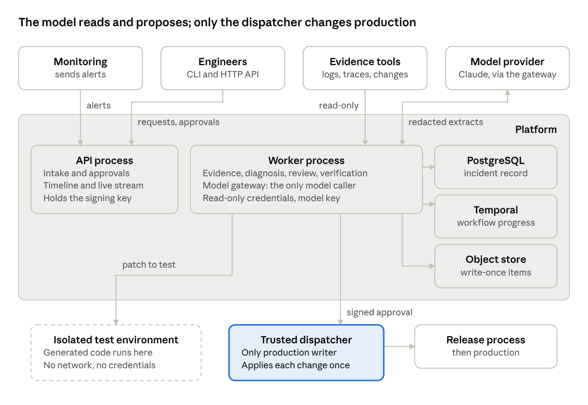
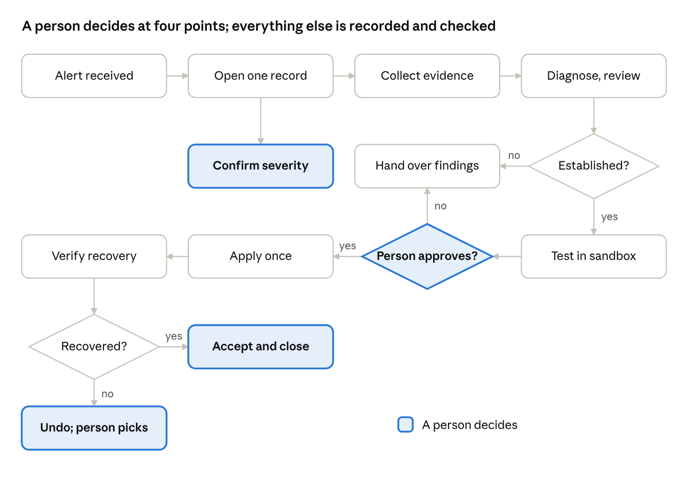
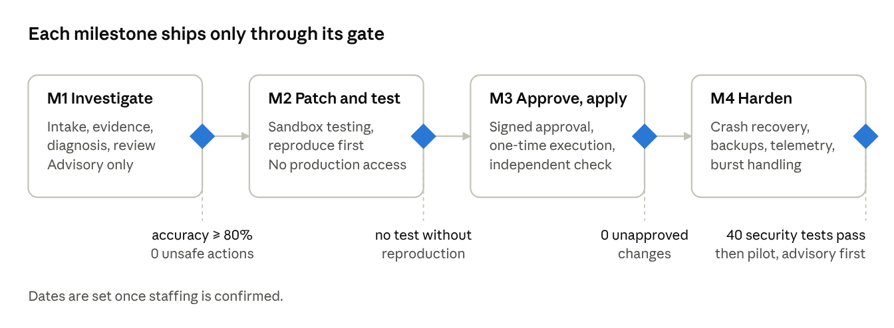

# AI SRE Platform — System Design

Nov 1, 2026

> **Amended 2026-11-02 (proposed).** The text below is the original document, unchanged. Where it differs from the [decision register](../decisions.md), the register wins.
>
> | Section | Amended by |
> | --- | --- |
> | 1, 12 Advisory start, milestones | ADR-44: two releases; production write stays off until Release B |
> | 2 Processes | ADR-51: the API reaches Temporal through the outbox only |
> | 6 Evidence strength | ADR-53: the eight-tier order from Q3.34; confidence threshold set |
> | 7, 8 Failures, approvals | ADR-46, ADR-48, ADR-49: state paths, rollback as its own action, approval rules |
> | 9 Limits | ADR-56, ADR-61: money values, enforcement; "trim or summarise" means trim |
> | 11 Sandbox network | ADR-60: no network |
> | 12 Open decisions | Hold period (ADR-66), approval rules (ADR-49), workflow hosting (ADR-51), advisory to applying (ADR-44) |
> | 13 Execution key | ADR-47: the key is the action ID, not one per approval |

## 1. Summary

The AI SRE platform investigates production incidents caused by recent changes. Within 5 minutes it gives the on-call engineer an evidence-backed first summary, and within 15 minutes a ranked diagnosis. It proposes the smallest reversible fix, tests it in a disposable environment, and applies it only after a named person approves. Recovery is then verified independently.

**First slice:** change-caused failures in Python web applications, in one organisation and one environment. The reference case: a deployment changes a configuration value, the application starts returning HTTP 500 errors, and monitoring detects it.

**Who it serves:** on-call engineers and service owners, who decide; incident leads, who confirm severity and close incidents.

**How it starts:** in advisory mode. The platform investigates and recommends, and people carry out every change. Applying approved fixes comes only after the advisory results hold up.

| Promise | Target (provisional) |
| --- | --- |
| First summary to the on-call engineer | ≤ 5 min p95 |
| Investigation stops and hands over | ≤ 15 min |
| Correct leading cause on change-caused test incidents | ≥ 80% |
| Production changes without a named approver | 0 |
| Recovery checked independently, held for a set period | 100% of fixes |

## 2. Architecture: the system around the model

The model is one component among fifteen, and it holds no power. It reads redacted evidence and returns a structured diagnosis. Everything it returns is checked, and nothing it says can change production.

The platform is one Python codebase, split into modules and run as four processes. Each split exists for a trust or runtime reason:

| Process | Does | Holds | Why separate |
| --- | --- | --- | --- |
| API | Takes in incidents, records approvals and cancellations, serves the timeline | Database access; approval signing key | Must answer in milliseconds and stay up |
| Worker | Runs each investigation step by step, saving progress after every step | Read-only tool credentials; model key | Long-running, retried, scaled on its own |
| Trusted dispatcher | Applies an approved change through the release process | The only production write access | Production power held in one small place |
| Isolated test environment | Runs generated patches against the failing version | Nothing | Untrusted code, no route to production |

Around them sit PostgreSQL (the incident record), Temporal (durable workflow progress), a write-once object store (large items), and the organisation's existing observability tools.

architecture · 4 processes, 3 stores, 1 privileged path

The dashed box runs untrusted code and reaches nothing; the shaded box is the only path to production, and it acts only on a signed approval.

## 3. Readiness: is AI the right tool here?

Yes, for one narrow job: reading a large, mixed body of evidence and ranking possible causes. Every other job is done by ordinary code or by a person.

### Readiness checks

| Check | Answer | Consequence |
| --- | --- | --- |
| Is the task judgement over messy text? | Yes: logs, errors, traces and change notes in many formats | A model adds value at the ranking step |
| Can a wrong answer be caught before harm? | Yes: reproduction, testing, approval and independent verification sit between the model and production | Errors cost time, not outages |
| Is there evidence to check answers against? | Yes: synthetic test incidents with known causes, then sanitised replays | Accuracy is measured before advisory use |
| Can it fail safely? | Yes: below the confidence threshold, it hands over with "Root cause not established" | It never presents a guess as a cause |
| Is the cost bounded? | Yes: per-incident call, token and spend limits, enforced before each call | No runaway bills |
| Does it work without the model? | Partly: if the provider is down, the platform still delivers evidence and a timeline | Engineers are never left with nothing |

### Where AI is deliberately not used

- **Facts:** the timeline, version split and changed values are computed in code, then given to the model.
- **Validation:** output structure, citations and the allowed list of fixes are checked in code.
- **Confidence:** scored from the strength of cited evidence, not from the model's tone.
- **Approval:** always a named person. The platform never approves its own actions.
- **Execution:** the trusted dispatcher applies only the exact approved change.
- **Verification:** measured from monitoring by a separate component, against criteria set before the change.
- **Limits and security:** budgets, permissions and redaction are plain code.

## 4. The pieces

Fifteen components, each named by what it is responsible for. Only three hold anything powerful: the approval key, model access, and production write access.

| Component | Responsible for | Process | Holds | Owner (role) |
| --- | --- | --- | --- | --- |
| Intake | Authenticate, validate, deduplicate, store the incident | API | — | Platform owner |
| Incident Record | The incident, its timeline and audit chain | API and worker | Database access | Platform owner |
| Workflow Orchestrator | Step order, checkpoints, timers, cancellation | Worker | — | Platform owner |
| Evidence Collector | Read-only queries to each tool, redaction, gaps | Worker | Read-only tool credentials | SRE lead |
| Knowledge Retriever | Relevant runbook and past-incident passages | Worker | — | SRE lead |
| Model Gateway | Every model call: limits, timeouts, validation, cost | Worker | Model provider key | SRE lead |
| Diagnosis Engine | Hypotheses, diagnosis and the draft patch | Worker | — | SRE lead |
| Diagnosis Reviewer | Citations, allowed list, confidence, alternatives | Worker | — | SRE lead |
| Test Runner | Reproduce the failure, apply the patch, run checks | Worker + isolated environment | Rights to create test environments only | Security lead |
| Approval Service | Requests, rights checks, signed decisions, expiry | API | Approval signing key | Security lead |
| Trusted Dispatcher | Apply the approved change once, or undo it | Dispatcher | Production write access | Security lead |
| Recovery Verifier | Check recovery against criteria set before the change | Worker | Read-only monitoring credentials | SRE lead |
| Artifact Store | Large logs, diffs, test output, model input and output | Storage | — | Platform owner |
| Notifier | Messages to on-call, owners, approvers | Worker | Messaging credentials | Platform owner |
| Platform Telemetry | The platform's own health, cost and latency | Observability tools | — | Platform owner |

## 5. Evidence sources and model choice

Evidence comes only from the organisation's existing tools, read-only, scoped to the incident's service and time window. The model is Claude, behind an internal gateway, with no fine-tuning in the first version.

### Evidence, in collection order

| Order | Source | What it answers |
| --- | --- | --- |
| 1 | The alert | What is wrong, since when, how badly |
| 2 | Impact metrics | Error rate and latency on the failing paths |
| 3 | Service catalogue | Owner, dependencies, runbooks |
| 4 | Change history | Deployments and configuration changes in the window, collected first for this slice |
| 5 | Logs, traces, error tracker | Which code path fails, with which error |
| 6 | Dependency health | Whether something the service relies on failed |
| 7 | Past incidents | Whether this has happened before |

A tool that fails or times out is recorded as a gap, never as "healthy", and lowers confidence.

### Model choice

| Decision | Reason | Revisit when |
| --- | --- | --- |
| Claude only, through the Model Gateway | A hosted frontier model is expected to reach the accuracy target without training | Accuracy stalls below 80% on the test suite |
| Tinker deferred | It is for fine-tuning our own model, excluded from the first version; its serving API is in beta | Enough labelled incidents, cost too high, or data must stay on a self-managed model |
| No second provider | A provider outage degrades to evidence and a timeline, which is acceptable | Outages are frequent enough to hurt |
| Keyword search for runbooks | Alerts and runbooks share exact terms; no extra system | Measured retrieval misses relevant runbooks |

## 6. How a diagnosis is produced

Code gathers the facts, the model ranks explanations, and code checks the result. A diagnosis is either established, with a leading cause and its evidence, or marked "Root cause not established".

1. **Compute facts in code:** the timeline, which version each failing instance runs, and every changed configuration value.
2. **Label evidence as data:** each item is wrapped with its source and a statement that it is never an instruction. Text that looks like an instruction is flagged.
3. **Ask for hypotheses:** the model returns two to five hypotheses, always including "not the deployment". Every claim must cite an evidence ID.
4. **Validate the output:** a strict structure, real citations, and fixes only from the allowed list. Invalid output gets two retries, then the step hands over.
5. **Score confidence from evidence strength**, strongest first:
    - the failure reproduces with the change and disappears without it
    - only the new version fails
    - the changed value sits on the failing code path
    - the stack trace points at the changed code
    - a new error type appears
    - timing alone, which is weakest
6. **Review independently:** the Diagnosis Reviewer re-checks citations and alternatives, and can downgrade or reject the diagnosis.
7. **Draft the smallest fix** for the leading cause: revert the configuration value, then the commit, then the release.

In the reference case, the decisive evidence is the configuration match: the changed value is read on the failing path, and only instances with the new value return HTTP 500 errors.

## 7. Incident flow

An incident moves from alert to verified recovery in one recorded workflow. Each step saves its progress, and a person decides at four points: severity, the fix, the next step if the fix fails, and closure.

incident flow · alert to close, 3 decisions

Both "no" paths before the change lead to a hand-over with findings, never to a guess; a fix that doesn't hold is undone before a person picks the next step.

### What happens when it goes wrong

| Failure | What the platform does |
| --- | --- |
| Evidence is too thin, or causes can't be separated | Marks "Root cause not established", lists the missing evidence, hands over; proposes no fix |
| The failure doesn't reproduce in the test environment | Proposes no fix; hands over with the evidence |
| The model returns invalid output three times | Fails the step; hands over as inconclusive |
| The model provider is down | Delivers evidence and a timeline only; no fix proposals |
| An evidence tool is slow or down | Records a gap, lowers confidence, continues with other sources |
| Time, call or spend limit is reached | Stops and hands over with findings so far |
| No approver answers | Escalates after 15 minutes; the request expires after 60; never acts by default |
| The service changes after approval | Voids the approval; asks again |
| The fix doesn't restore service | Undoes the change; a person decides the next step |
| A worker crashes | Another worker resumes from the last saved step; nothing runs twice |
| The database is down | Pauses; takes no action that can't be recorded; tells on-call to work manually |
| The whole platform is down | Alerts still reach engineers directly; work continues as today |

## 8. Governance

People decide; the platform investigates, proposes and records. No production change happens without a named, accountable approver, and every action can be traced from evidence to verified result.

| Decision | Who decides | What they see | Rule |
| --- | --- | --- | --- |
| Confirm severity | Incident lead | Impact, proposed severity | Sets who is notified and how urgent the work is |
| Approve or reject a fix | Service owner or on-call engineer; a second approver for high-impact changes | Diagnosis, evidence for and against, patch, test result, risk, undo plan | Covers one exact patch, on one target, for 15 minutes |
| Next step after a failed fix | On-call engineer | Why verification failed, the undone change | The platform doesn't choose its own next move |
| Accept recovery and close | Incident lead | Verification result held over the set period | Closes the incident and accepts the cause |

**Approval rules:**

- the approver signs in within the last 15 minutes, with two-factor authentication
- nobody approves their own request, and the platform can't approve at all
- approvals are signed, and name the patch's fingerprint; any change to the patch voids them
- no response means no action

**Prohibited for the platform, always:** deleting or migrating data, changing permissions or secrets, failover or traffic shifts, rollback across a schema change, external communication, and acting on a suspected security incident. Each needs a person.

**Audit:** every event is appended to the incident's timeline, hash-chained, and copied to a separate store. Approvals, executions and verifications can never be edited.

**Relaxing rules later:** the team may let specific low-risk, reversible actions run without approval, one at a time, once proven safe. Each is a logged decision with an owner and a review trigger.

## 9. Cost and limits

Model spend per incident is held to about 10% of the engineer time it saves, and every limit is enforced before a call is made, not after. When a limit is reached, the platform stops and hands over.

| Limit | Value (provisional) | On breach |
| --- | --- | --- |
| Model calls per incident | 30 | Stop and hand over |
| Tokens per incident | 200,000 input, 20,000 output | Stop and hand over |
| Tokens per call | 16,000 input | Trim or summarise evidence to fit |
| Attempts per step | 3 (original + 2 retries) | Step fails; inconclusive |
| Time per model call | 60 s | Counts as one attempt |
| Investigation time | 15 min | Stop and hand over |
| Whole workflow | 24 h | Stop and hand over |
| Concurrent investigations | 5; queue up to 50 by severity | Queued, never dropped |
| Daily spend, all incidents | Monthly budget ÷ 30 | Alert at 80%; evidence-only at 100% |
| Monthly spend | Budget ceiling | Alerts at 50%, 80%, 100% |

**How the budget can't be overrun:** before each call, the Model Gateway reserves the call's maximum cost against the incident's budget. If it doesn't fit, the call isn't made. After the call, the actual cost replaces the reservation. The database itself rejects any total above the limit.

The real cost per incident is recorded for every incident, and the limits are reviewed after the pilot.

## 10. Scope, success metrics and unknowns

The first version covers one kind of failure end to end. Success is measured on test incidents before any advisory use, and in the pilot after it.

### System boundary

| In scope | Out of scope (first version) |
| --- | --- |
| Change-caused failures in Python web applications | Other failure types: capacity, hardware, security incidents |
| One organisation, one environment | Several organisations or environments |
| Read-only evidence from existing tools | Replacing any monitoring or logging tool |
| Fixes from the allowed list: configuration revert, commit revert, release rollback | New code written by the model; data, permission or infrastructure changes |
| CLI and HTTP API | A product dashboard |
| Hosted model, no training | Fine-tuning, self-hosted models, GPUs |

### Success metrics

| Metric | Target (provisional) | Measured on |
| --- | --- | --- |
| Leading cause correct, change-caused incidents | ≥ 80% | Synthetic test suite |
| Withheld-evidence cases marked inconclusive | 100% | Honesty tests |
| Time to first summary | ≤ 5 min p95 | Test suite, then pilot |
| Unsafe actions from injected log text | 0 | Injection test set |
| Production changes without approval | 0 | Audit |
| Fixes verified independently | 100% | Audit |
| Engineer-rated usefulness of the summary | To be set with on-call teams | Pilot survey |

### Unknowns to settle before build

| Unknown | Owner (role) | Settled when |
| --- | --- | --- |
| Do in-scope alerts carry a stable service label and identifier? | Platform owner | Alert samples inspected |
| Can the release process apply, undo and look up one change by key? | Platform owner | Scenario revert done through it |
| Do on-call rotas cover every in-scope service, including nights? | Engineering manager | Rotas confirmed |
| What are the organisation's approval rules by service and severity? | Engineering manager | Rules written down |
| How often do real logs contain personal data or secrets? | Security lead | Seeded and sampled corpus reviewed |
| What is historical peak concurrency? | SRE lead | Past incident records checked |
| What does the provider agreement say about data retention? | Security lead | Terms confirmed |

## 11. Threats and how each is controlled

Every input the model reads is treated as hostile. Even if injected text changes what the model writes, it can't change what the platform does.

| Threat | Control | Remaining risk |
| --- | --- | --- |
| Text in logs tells the model to run a command or hide an error | Evidence labelled as data and flagged; strict output checks; allowed list; testing and approval before any change | The written summary can still be steered; flagged text is shown to the approver |
| The model proposes a destructive command | No shell in production; fixes only from the allowed list; generated code runs only in the isolated environment | None for production |
| A confident, wrong diagnosis is approved | Confidence from evidence; alternatives always shown; failure must reproduce; independent verification undoes a failed fix | Approvers may still trust a convincing summary |
| A patch is changed after approval | Approval names the patch fingerprint and is signed; the dispatcher re-checks both | None known |
| The wrong person approves | Single sign-on with two-factor; roles per service; recent sign-in; no self-approval; dispatcher re-checks | None known |
| Secrets leak through evidence or output | Redaction before storage and before the model; output scanned; model holds no credentials | Unusual secret formats may slip past redaction |
| A link in logs reaches internal systems | The platform never fetches links from evidence | None |
| Generated code escapes testing | Fresh container under gVisor, separate host, no network, no real credentials, resource limits | Unknown escape flaws; nothing valuable inside limits the impact |
| A retry applies a change twice | One execution key per approval; only one attempt can end "applied" | None known |
| Injected text burns the budget | Limits enforced before each call | None |

Forty security tests cover these cases (Technical specification, section 11).

## 12. Delivery plan

Four milestones, each gated on measured results. The platform stays advisory until the third milestone's checks pass, and dates are set once staffing is confirmed.

roadmap · 4 milestones, 4 gates

M1 and M2 run on synthetic incidents with no production access; production changes become possible only after the M3 gate.

### Open decisions

| Decision | Options | Owner (role) | Decide by |
| --- | --- | --- | --- |
| Hold period for recovery | 10 minutes, or longer per service | SRE lead | Before M3 |
| Approval rules by severity | One approver; two for high-impact | Engineering manager | Before M3 |
| Run the workflow engine ourselves or hosted | Self-hosted single node; hosted service | Platform owner | Before M1 build |
| When to move from advisory to applying fixes | After pilot accuracy and approval review | Engineering manager | After M3 |

### Dependencies

- Read-only access to monitoring, logs, traces, the error tracker and the change history.
- A release process that can apply, undo and look up one change by key.
- The organisation's identity system, with groups per service.
- A test host that can run containers under gVisor.
- A managed PostgreSQL with point-in-time recovery.
- Model provider terms confirming requests aren't kept or used for training.

### Release checks for every milestone

- ☐ All acceptance criteria for the milestone pass (Technical specification, section 12)
- ☐ Security tests for the milestone pass, with zero unsafe actions
- ☐ No production change possible without a signed approval
- ☐ Cost per incident recorded and within budget
- ☐ Runbook for the platform's own failures updated
- ☐ Decision records updated for anything that changed

## 13. Glossary

| Term | Meaning |
| --- | --- |
| Advisory mode | The platform investigates and recommends; people carry out every change |
| Allowed list | The only fix types the platform may propose: configuration revert, commit revert, release rollback |
| Approval | A signed record that a named person approved one exact patch, on one target, for 15 minutes |
| Change-caused failure | An incident started by a deployment or configuration change |
| Diagnosis | The platform's belief about the cause: established, or "Root cause not established" |
| Disposable test environment | A fresh, isolated container that runs a patch against the failing version, then is destroyed |
| Evidence | A redacted, source-linked record of something collected from a tool |
| Execution key | One key per approval, so a change can be applied at most once |
| Fingerprint | A hash of the exact patch; any change to the patch changes it |
| Gap | A source that failed or timed out, recorded as evidence |
| Hand over | Stop and give a person the findings so far |
| Hypothesis | One possible cause, with the evidence for and against it |
| Outbox | A table written with each change, so messages to the workflow engine are never lost |
| Recovery criteria | What "recovered" means, recorded before the change: for example, the HTTP 500 rate back to its pre-incident level |
| Timeline | The incident's append-only, hash-chained history of every event |
| Trusted dispatcher | The only component that can change production |
